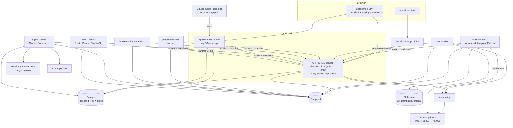

# Architecture

ScadBuddy is a self-hosted OpenSCAD customizer that renders multi-colour 3MFs, slices
them and prints them on Bambu printers, through Bambuddy or directly over the LAN. Around
that core it has a print library, orders and a public storefront, user-written flows and
an AI assistant. This folder describes the code on `main` at `67d7ff6` (2026-11-21), which the `path:line` citations resolve against; the design
history is in [`docs/superpowers/specs/`](../superpowers/specs/), and where the code
disagrees with a spec, the code is what these pages describe (see
[Drift from specs](#drift-from-specs)).

The repo-wide rules (database access, migrations, generated files, CI and caching, PR
conventions) are in the root [`CLAUDE.md`](../../CLAUDE.md); each area's commands and
layout are in its own `CLAUDE.md` ([`backend/`](../../backend/CLAUDE.md),
[`frontend/`](../../frontend/CLAUDE.md), [`agent/`](../../agent/CLAUDE.md),
[`agent-durable/`](../../agent-durable/CLAUDE.md), [`tools/go/`](../../tools/go/CLAUDE.md),
[`workers/rust/`](../../workers/rust/CLAUDE.md), [`e2e-stack/`](../../e2e-stack/CLAUDE.md),
[`models/`](../../models/CLAUDE.md), [`deploy/`](../../deploy/CLAUDE.md),
[`plugins/`](../../plugins/CLAUDE.md)). Who may reach the database and where untrusted
code runs: [`docs/security/trust-boundaries.md`](../security/trust-boundaries.md).
Deployment: [`README.md` "Deploying"](../../README.md#deploying).

## Components

The API is the CRUD service: the only process meant to hold SQL access. Today's code
still gives the agent sidecar, the agent worker and agent-durable a database secret
([trust-boundaries.md](../security/trust-boundaries.md#who-talks-to-the-database-today),
#5299). Every other process is an HTTP client of the API with a short-lived service
credential.

## Pages

| Page | What it covers |
|---|---|
| [processes.md](processes.md) | every deployable process: entrypoint, image, credentials, zone |
| [data.md](data.md) | tables by owner, the two migration ledgers, the CRUD service, the blob store, generated API files |
| [workflows.md](workflows.md) | Temporal task queues, workflows and activities; sequence diagrams for render, slice, print and orders |
| [frontend.md](frontend.md) | the two SPAs, routes, API types, realtime, the iframe, template-owned UIs |
| [agent.md](agent.md) | the agent's roles, tools, gate, browser bridge, how it reaches the API |
| [ci-and-deploy.md](ci-and-deploy.md) | CI lanes, published images, how an image reaches prod |
| [../features/README.md](../features/README.md) | one page per user-visible feature |

## Drift from specs

Where a spec or doc disagrees with the code on `main`, the code wins. Each line names the
document's claim and the code. These specs and docs were not changed in this PR.

**Design spec** (`docs/superpowers/specs/2026-09-22-scadbuddy-design.md`)

- `:262` "No database"; one container / the code needs Postgres and Temporal at start
  (`backend/scadbuddy/main.py:2161-2163`) and runs separate workers
  (`backend/scadbuddy/worker.py:1737-1747`).
- `:302` job state in `jobs/<job-id>.json` / jobs are the `render_jobs` table
  (`backend/scadbuddy/migrations/20260927T2243Z_render_jobs.sql`).
- `:888` one `<object>` per colour part / one assembly object per declared object with a
  component per colour (`backend/scadbuddy/render/bambu3mf.py:326-391`).
- `:1299` one replica, `Recreate` / RollingUpdate with `maxSurge` ≥ 1 (`Dockerfile:1127-1129`).

**Template-pipelines spec** (`…/2026-09-27-template-pipelines-design.md`)

- `:94` two task queues / eight queue settings (`backend/scadbuddy/core/settings.py:621-646`).
- `:178` an `Arrange` workflow / Arrange is `TemplatePipeline` with `kind == "arrange"`
  (`backend/scadbuddy/workflows/pipelines.py:858-860`).
- `:147-153`, `:132` insert the row, then start `render-<job_id>` / update-with-start of
  `render-<render_key>`, the row inserted by the workflow
  (`backend/scadbuddy/render/submit.py:539-552`, `backend/scadbuddy/workflows/pipelines.py:790`).
- `:379` UI files at `?version=<revision>` / the version is a path segment
  (`frontend/src/api/client.ts:1822-1826`, `backend/scadbuddy/api/template_ui.py:117-118`).
- `:494` custom elements as `react-dom/client` roots / `createPortal`
  (`frontend/src/template-ui/TemplateUi.tsx:164-175`).
- `:794` render workers hold Postgres / no database; `SCADBUDDY_DATABASE_URL` ignored
  (`backend/scadbuddy/worker.py:1097-1100`).
- `:676-681` the store chosen by `SCADBUDDY_STORE_BACKEND`, `local` with one render
  worker / a stored setting (`backend/scadbuddy/core/settings.py:228`), and a separate
  render worker refuses `local` (`backend/scadbuddy/worker.py:222-257`).
- `:673-674` `SCADBUDDY_WORKER_CACHE_DIR` / no such setting; only `worker_cache_max_bytes`
  (`backend/scadbuddy/core/settings.py:349`).
- `:700` pieces as `piece-….3mf` / `piece-{key}.zip` (`backend/scadbuddy/store/cache.py:202`).

**Print flow and spool-first specs** (`…/2026-09-24-print-flow-design.md`,
`…/2026-09-27-spool-first-print-design.md`)

- print-flow `:215` and spool-first `:23` "ScadBuddy sends no `ams_mapping`" / the native
  LAN path computes and sends `ams_mapping` and `nozzle_mapping`
  (`backend/scadbuddy/printers/print_activities.py:537-563`,
  `backend/scadbuddy/printers/ams_mapping.py:92`).
- print-flow `:655` progress from `route="pipeline"` `GET /pipeline-runs/{id}` / no
  pipeline route; following is the `FollowPrint` workflow
  (`backend/scadbuddy/workflows/follow.py:70`).
- print-flow `:7-12` ScadBuddy keeps no spool or printer state of its own / its own spools,
  virtual and LAN printers (`backend/scadbuddy/filament/inventory.py:901`,
  `backend/scadbuddy/printers/store.py`).

**Print library file spec** (`…/2026-09-28-print-library-file-design.md`)

- `:64` choices in `library_print_choices` / the table is dropped
  (`backend/scadbuddy/migrations/20261011T0001Z_drop_library_print_choices.sql`).
- `:20-23` a sliced `.gcode.3mf` is not printable / it is queued as it is
  (`backend/scadbuddy/workflows/printing.py:855-857`).
- `:40`, `:84-85` library prints not recorded, no progress panel / recorded and followed
  (`backend/scadbuddy/workflows/print_activities.py:596`,
  `backend/scadbuddy/api/library_print.py:1481`).

**Durable printing, agents and flows spec** (`…/2026-10-01-durable-printing-agents-flows-design.md`)

- `:361` the `agent` queue served by agent-durable / agent-durable runs no worker
  (`agent-durable/src/scadbuddy_durable/worker.py:21-24`).
- `:755` the library worker holds no Bambuddy key / `slice_run` and `makerworld_import`
  open Bambuddy clients (`backend/scadbuddy/workflows/slicing_activities.py:424-428`,
  `backend/scadbuddy/makerworld/operations.py:96`).
- `:1340-1342` flow `render`, `print`, `arrange` are child workflows / HTTP calls to the
  API through `flow_route_send`, and the function is `queue_print`
  (`backend/scadbuddy/workflows/flow_tools.py:379`, `:471-474`, `:583`, `:1373-1391`).

**Rack nozzle selection spec** (`…/2026-10-01-rack-nozzle-selection-design.md`)

- `:3-5` status "not yet approved" / implemented (`backend/scadbuddy/rack/rank.py`).
- `:337-348` the seam is `slice_and_queue` / the pick is in `queue_plate`
  (`backend/scadbuddy/bambuddy/print_run.py:3569`); `slice_and_queue` has only test callers.

**Flow grants and git spec** (`…/2026-10-11-flow-grants-and-git-design.md`)

- `:546` no metadata file in `data/flows` / `<name>/flow.json`
  (`backend/scadbuddy/flows/repository.py:65`).
- `:877` event fire id `flow-trigger-<id>-<sha256>` / `flow-trigger-<id>-ev-<sha256[:32]>`
  (`backend/scadbuddy/flow_triggers/events.py:166-167`).
- `:885-890` four event kinds / also `order.changed` and `order_item.changed`
  (`backend/scadbuddy/flow_triggers/events.py:83-88`).

**Mesh models spec** (`…/2026-10-11-mesh-models-design.md`)

- `:245-246` kinds exported from `library/operations.py` / from
  `backend/scadbuddy/meshmodel/operations.py:405-421`.

**Async command accept spec** (`…/2026-10-13-async-command-accept-design.md`)

- `:116-117` the route always makes an update id / a print run answers 202 only with a
  followable `request_id`, otherwise 503 (`backend/scadbuddy/api/printing.py:1140-1151`).

**bambuddy-fs spec** (`…/2026-10-13-bambuddy-fs-design.md`)

- `:22` no authentication / an optional bearer token, https only
  (`tools/go/bambuddy-fs/internal/api/api.go:65-75`).
- `:262` amd64 and arm64 images / amd64 only (`.github/workflows/build-go-image.yml:161`).
- `:318-319` an unbounded cache / per-host, bounded by `--cache-max`
  (`tools/go/bambuddy-fs/main.go:127-134`).
- `:324` a failed upload fails `close()` / a queued upload counts as success
  (`tools/go/bambuddy-fs/internal/fsys/writer.go:301-307`).

**Unified agent runtime spec** (`…/2026-10-13-unified-agent-runtime-design.md`)

- `:1199` the session directory on the NAS share / `SCADBUDDY_SESSION_DIR`, a volume of
  the worker's own (`agent/src/config.ts:61-66`).

**Own store, slicer and Rust workers spec** (`…/2026-10-16-own-store-slicer-rust-workers-design.md`)

- `:313-316` the CLI's argument order / `--debug` second, `--arrange` before `--slice`,
  optional `--export-slicedata` (`workers/rust/crates/sb-slicer/src/runner.rs:103-135`,
  whose comment says it follows the spec).
- `:256-274` the activity's schema / adds `filament_colours` and `elapsed_seconds`
  (`workers/rust/crates/sb-slicer/src/models.rs:44-47`, `:96`).
- `:607-612` `sb-transfer` packs archives; `sb-render` and `scadbuddy-render-tools` crates /
  GET and PUT only, and no render crates (`workers/rust/Cargo.toml:3`).
- `:608` `sb-temporal` does versioning / the slicer is unversioned
  (`workers/rust/bins/scadbuddy-slicer/src/lib.rs:1-2`).
- `:439-443` sliced files go to Bambuddy's library even on `native` / into the native
  library (`backend/scadbuddy/workflows/slicing_activities.py:484-490`).

**Orders, storefront and forks specs**

- orders `:257-258` quote `source` is `slice` or `manual` / also `archive` and
  `storefront` (`backend/scadbuddy/orders/models.py:75`).
- orders `:673-674` the native path has no spool inventory / an item's spools are filled
  from ScadBuddy's own spools (`backend/scadbuddy/orders/spools.py:215-221`).
- storefront `:274` listing `colours` / listings also carry `materials`
  (`backend/scadbuddy/migrations/20261114T2313Z_storefront_materials.sql`).
- storefront `:306-310` request uploads go through `order_attachment_add` / added directly
  in the cart's transaction (`backend/scadbuddy/orders/storefront/drafts.py:625-647`).
- storefront `:296` `estimate_grams` at `pricing.py:160` / at
  `backend/scadbuddy/orders/pricing.py:175-183`.
- customer-models `:712-787` the staged-model import flow / not built; the watcher "waits
  for the import (a later PR)" (`backend/scadbuddy/workflows/staged_file.py:17`).
- template-forks `:149-151` Detach as a UI action / also a route
  (`backend/scadbuddy/api/upstream.py:228`).

**Auth and service-credential specs** (`…/2026-11-01-backend-auth-design.md`,
`…/2026-11-05-service-credentials-without-db-design.md`)

- auth `:354` callers `agent`, `print`, `projects`, all sealed tokens / seven callers
  (`backend/scadbuddy/auth/service_auth.py:25-27`), only `agent` sealed
  (`backend/scadbuddy/auth/service_credentials.py:84`, `:99-106`).
- auth `:481-485` route classes / also `exchange`, `crud.*`, `flow.host`
  (`backend/scadbuddy/auth/routes.py:22-40`).
- service-credentials `:326-336` no `intake` caller / `crud.intake`
  (`backend/scadbuddy/api/crud_intake.py:34`).
- service-credentials `:470-471` a worker without a proof is still served / the workers
  refuse to start (`backend/scadbuddy/auth/service_auth.py:242-251`).

**AI and settings specs, and `docs/ai/`**

- ai-integration `:46`, `:524` a headless Chromium in the agent (`harness/headlessBrowser.ts`) /
  removed; the image has tini, git and ca-certificates (`Dockerfile:244-246`), and leftover
  folders are deleted at start (`agent/src/main.ts:212-215`).
- ai-integration `:348-356` one sidecar container / roles `api`, `worker`, `all` and a
  `sandbox` image (`agent/src/runtime/role.ts:27-35`, `Dockerfile:311`).
- settings-and-tool-access `:70` cites `routes/subagentMcp.ts` / no such file in
  `agent/src/routes/`.
- settings-and-tool-access `:264-274` access sources / also `builtin:claude-code`
  (`agent/src/access/model.ts:27`).
- `docs/ai/README.md:60` `agent/src/db/migrations.ts` / no such file; the API applies the
  agent's migrations and the agent waits for no ledger (#5299 step 12).
- `docs/ai/README.md:50-51` tools run in-process / a `ToolCall` workflow per call when
  Temporal is set (`agent/src/tools/projections.ts:136-147`).
- `docs/ai/operating.md:385-389` Claude Code's env is `CLAUDE_CONFIG_DIR`, `HOME`, `PATH` /
  also `TZ`, the gateway URL and token, and traffic switches
  (`agent/src/harness/options.ts:61`, `agent/src/harness/run.ts:515-521`).
- `docs/ai/security.md:558`, `:985` the credential reaches Claude Code through `env` /
  Claude Code gets only a leased gateway token (`agent/src/gateway/server.ts:21-29`).
- `agent/CLAUDE.md:9` "run no SQL on a backend table" / the agent still reads two backend
  views over SQL as fallbacks: `auth_sessions_agent` until the API lists area
  `auth-sessions`, and `service_credentials_agent` with no proof file
  (`agent/src/auth/browserSession.ts:58`, `agent/src/api/serviceCredential.ts:71`). The
  same file describes both fallbacks further down.

**`docs/security/trust-boundaries.md`**

- `:97` cites `agent/src/approvals/service.ts:719` for the browser principal approving any
  outward call / that check is now at `agent/src/approvals/service.ts:805`.
- `:95` cites `core/settings.py:248` for the `off` default / now
  `backend/scadbuddy/core/settings.py:386`.
- `:320` the storefront "not built yet" / it exists (`backend/scadbuddy/storefront/__main__.py`,
  `backend/scadbuddy/api/crud_storefront.py:208`); its tables do not list the storefront
  edge or the intake worker.

**`docs/user-guide.md`**

- `:334` Quality in Simple mode / an Advanced-only step
  (`frontend/src/components/print/QualityStep.tsx:19-20`).
- `:326-327` sizes marked "(installed)" / no such mark
  (`frontend/src/components/print/NozzleStep.tsx:55-59`).
- `:331-333` a High Flow message / not in the code.
- `:425-427` history rows have Edit, Send again and Delete / also Print and a More menu
  (`frontend/src/pages/HistoryPage.tsx:933-1015`).
- `:228-230` the catalogue's buttons / also Import from URL
  (`frontend/src/pages/CataloguePage.tsx:194-195`).
- `:538-539` chats are not archived / Archive and Unarchive
  (`frontend/src/components/assistant/SessionSwitcher.tsx:310-317`).

**README, `CLAUDE.md` and the Dockerfile**

- `Dockerfile:3`, `:15-16` "ONE image", the agent the one exception; root `CLAUDE.md`
  "all three images" / `build-image.yml` publishes six
  (`.github/workflows/build-image.yml:54`, `:217`, `:329`, `:433`, `:544`, `:657`).
- `README.md:2693-2698` four manifests pinned / up to eleven files and six images
  (`.github/workflows/deploy.reusable.yml:116-158`); the README never names the
  `scadbuddy-sandbox` image.
- `.github/workflows/build-image.yml:215-216` "drop `continue-on-error` once pinned" / the
  agent pin is required (`.github/workflows/deploy.reusable.yml:925`) but the job keeps it
  (`.github/workflows/build-image.yml:221`).
- `README.md:2781-2784` one dashboard / seven (`deploy/grafana/kustomization.yaml:33-89`).
- `README.md:2718` the API, render worker and agent export traces / the slicer does too
  (`workers/rust/crates/sb-temporal/src/telemetry.rs`).
- `.github/workflows/build-image.yml:317-320` agent-durable as a third container in the
  pod / its own Deployment (`Dockerfile:373`).
