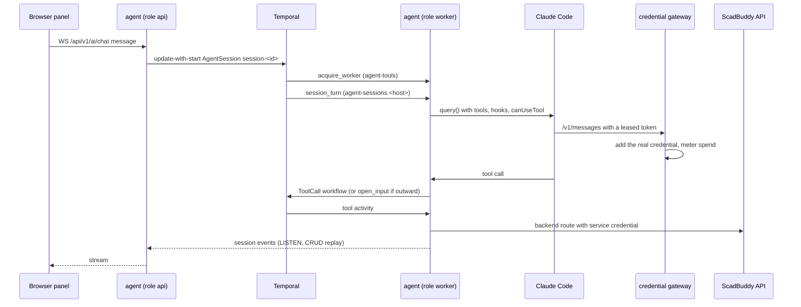

# The agent

The assistant's service: a TypeScript package (`agent/`) that runs Claude Code through
the Claude Agent SDK, gives it ScadBuddy's tools, gates outward actions behind a person's
approval, and serves `/api/v1/ai/*` and `/mcp`. Commands, tests and folder layout are in
[`agent/CLAUDE.md`](../../agent/CLAUDE.md). The operator and security docs are in
[`docs/ai/`](../ai/README.md):
[operating](../ai/operating.md), [security](../ai/security.md),
[sessions](../ai/agent-sessions.md), [browser bridge](../ai/browser-bridge.md),
[MCP resources](../ai/mcp-resources.md), [Claude plugin](../ai/claude-plugin.md),
[evals](../ai/evals.md). This page maps the code and links to them.

Paths below are under `agent/src/` unless they say otherwise. Line numbers are for `main`
at the commit that adds this page.

## Processes and roles

One image (`Dockerfile:233`, stage `agent`) runs `node dist/main.js` on port 8081
(`Dockerfile:284-289`). `SCADBUDDY_AGENT_ROLE` (`config.ts:106-107`) picks what it runs
(`runtime/role.ts:27-35`):

| Role | Where | Serves |
|---|---|---|
| `api` | the sidecar in the API pod | HTTP and WebSocket on 8081 (`/api/v1/ai/*`, `/mcp`); its own host queue `agent-tools.<identity>` for browser-tab calls and pinned turn tools (`main.ts:347`, `:1117-1149`) |
| `worker` | the `scadbuddy-agent-worker` Deployment | only `/healthz` and `/readyz` over HTTP (`runtime/health.ts:41`, `:55`); the shared Temporal queues `agent-tools` and `agent-sessions` and its host queues (`main.ts:1037-1149`); it runs the turns |
| `all` (default) | development | both |

A second image, `sandbox` (`Dockerfile:307`), runs one pod per session for sandboxed
`Bash` and `PowerShell` (role `exec`) and the pods' CONNECT proxy (role `egress`)
(`sandbox/main.ts:13-19`). The worker creates those pods through the Kubernetes API
(`sandbox/pods.ts:192`) when all five `SCADBUDDY_SANDBOX_*` settings are present
(`config.ts:258-289`).

Inside the process: a loopback credential gateway (`gateway/server.ts:272-295`), a
loopback plugin forwarder (`plugins/forwarder.ts:404-432`), and one Claude Code child
process per query, spawned by the SDK (`harness/run.ts:636`).

The variables each role reads are the list `ENV_VARS` (`config.ts:113-138`); see
[operating.md §1](../ai/operating.md) for what they mean.

## Trust zone

Today's code: every role connects to Postgres with the owner role's URL
(`SCADBUDDY_DATABASE_URL`, `main.ts:206-242`, `db.ts:35-38`), and LISTENs on
`scadbuddy_events` (`events/bus.ts:21`). This is the case [#5299](https://github.com/eh-homelab/ScadBuddy/issues/5299) removes; the
state, step by step, is in
[trust-boundaries.md](../security/trust-boundaries.md#who-talks-to-the-database-today). It
holds the KEK (`SCADBUDDY_SECRET_KEY_FILE`) and runs untrusted code (Claude Code's tools,
plugin code). The agent does not migrate its tables: the API applies them, and the
agent's `ready()` waits for them (`db/schema.ts`; [data.md](data.md#the-two-migration-ledgers)).

## How it reaches the CRUD API

- A backend client generated from `openapi.json` (`api/backend.ts:63-68`), with a
  `Bearer` service credential on every call (`api/serviceCredential.ts:289-290`). The
  credential comes from exchanging the pod's projected token or a bootstrap file at
  `POST /api/v1/auth/service-token` (`api/serviceCredential.ts:103`, `:136`), or, with
  no proof, from the sealed row in the view `service_credentials_agent` over SQL
  (`api/serviceCredential.ts:71`).
- Its own data moves to `/api/v1/internal/crud/agent/*` (`api/crudRead.ts:14`) area by
  area. `CrudAreas` reads the API's `…/areas` list (`api/crudAreas.ts:34`, `:88`); an
  area the API does not list yet falls back to SQL (`api/crudAreas.ts:15`, `:21`;
  `api/crudStores.ts:12`, `:19`). Events and flows have no SQL fallback
  (`main.ts:330-334`).
- Every backend operation needs a tool or an entry in `tools/coverage.ts`, which a test
  checks (`test/coverage.test.ts`).

Remaining direct SQL on backend objects: the gate's read of `flow_grants` and
`flow_grant_uses` under `FOR SHARE` (`gate/store.ts:451-460`), the views
`auth_sessions_agent` (`auth/browserSession.ts:93`) and `service_credentials_agent`, and
the LISTEN above. The `ai_*` tables it still writes over SQL are listed in
[data.md](data.md#ownership-by-domain).

## Public surface

### HTTP and WebSocket (role `api`)

Routes are auto-registered from every `routes/*.ts` that exports `route`
(`routes/index.ts:17-31`, `app.ts:243`). Every response carries
`X-ScadBuddy-Service: agent` (`app.ts:163`).

| Path | What | Code |
|---|---|---|
| `GET /healthz` | health; the worker also has `/readyz` | `app.ts:194`, `runtime/health.ts:41` |
| `/mcp` | Streamable HTTP MCP server with `ALL_TOOLS` | `mcp/http.ts:446` |
| `GET /api/v1/ai/chat` (WebSocket) | the assistant panel | `routes/chat.ts:76` |
| `GET /api/v1/ai/bridge` (WebSocket) | the browser bridge | `routes/bridge.ts:34` |
| `/api/v1/ai/sessions…` | list, start, send, interrupt, fork, hand off, events, files | `routes/sessions.ts:228`, `routes/sessionFiles.ts:139` |
| `/api/v1/ai/pending-input…`, `/approvals…` | the gate's open questions and approvals | `routes/pendingInput.ts:561`, `routes/approvals.ts:85-109` |
| `/api/v1/ai/credentials…` | Claude credentials | `routes/credentials.ts:207-412` |
| `/api/v1/ai/settings/*`, `/capabilities/*` | model, limits, workspace, tool access | `routes/model.ts:37`, `routes/capabilities.ts:141-180` |
| `/api/v1/ai/plugins…`, `/plugin-packages…`, `/mcp-tokens…` | plugins, packages, tokens for external MCP clients | `routes/plugins.ts:159`, `routes/pluginPackages.ts:120`, `routes/mcpTokens.ts:116` |
| `/api/v1/ai/notify/*`, `/push/*`, `/audit` | notifications and the audit log | `routes/notifyChannels.ts:24`, `routes/push.ts:29`, `routes/audit.ts:68` |
| `/api/v1/ai/orders/*` | customer messages through a bound plugin | `routes/orderMessages.ts:85`, `routes/messagingBinding.ts:63` |

The ingress sends these paths to port 8081 ahead of the backend
([README "The agent sidecar"](../../README.md#the-agent-sidecar-ai-261)).

### Tools

`ALL_TOOLS` (`tools/index.ts:46-84`) is about 360 tools in 37 groups: catalogue, customizer,
outputs, arrange, history, files, workspace, libraries, print, prints, farm, filament,
printers, spools, orders (65), flows, sessions, browser and more. They are served on
`/mcp` (`tools/projections.ts:195-210`) and given to each turn as the in-process MCP server
`scadbuddy` (`tools/projections.ts:90-114`). Each tool calls the backend API; the agent
never calls Bambuddy or a printer itself (`tools/makerworld.ts:6-8`). Turns also get:

- `scadbuddy_http` (`http_request`, `harness/httpRequest.ts:79-81`) and
  `scadbuddy_questions` (`ask_user`, `harness/questions.ts:34-37`);
- the `builtin` server: WebFetch, WebSearch, Cron, Monitor, Workflow and, with the
  sandbox, `Bash` and `PowerShell` (`builtins/server.ts:36`, `builtins/sandboxShell.ts:88`);
- `scadbuddy://` resources (`resources/catalog.ts:88-203`; [mcp-resources.md](../ai/mcp-resources.md)).

Which of these a session may use is the access model (`access/model.ts:22-27`), set in
Settings ([user guide "Tool access"](../user-guide.md#tool-access)).

### Temporal

| Workflow | Queue | Code |
|---|---|---|
| `AgentSession`, id `session-<id>` | `agent-sessions` (deployment `scadbuddy-agent`) | `temporal/session/workflow.ts:214`, `temporal/session/names.ts:5-8` |
| `ToolCall` | `agent-tools` | `temporal/toolCall.ts:13` |
| `BridgeCall`, id `bridge-<uuid>` | the caller's `agent-tools.<identity>` | `temporal/bridgeCall.ts:12`, `bridge/relay.ts:109` |
| `AgentOperation` | `agent-tools` | `temporal/workflows.ts:77` |
| `BackgroundTask`, `BackgroundFire` | `agent-tools` | `temporal/backgroundTask.ts:55`, `:112` |

The activities on `agent-tools` are every tool under its own name, plus the gate, turn,
flow-session and operation activities (`main.ts:1044-1073`). `session_turn` runs on the
host queue `agent-sessions.<host>` of the replica that holds the session's warm Claude
Code process. The backend's flow workflows call the agent's flow activities
(`temporal/flowRuns.ts:5-8`; [workflows.md](workflows.md#flows)).

## A chat turn

1. A message reaches `SessionManager`, which does update-with-start of `AgentSession`
   (`sessions/durable.ts:403-412`).
2. The workflow acquires a worker and runs `session_turn` on its home queue
   (`temporal/session/workflow.ts:352-383`).
3. `runHarness` builds the query options: no settings sources, an explicit environment,
   and the gateway URL and token (`harness/options.ts:54-74`, `harness/run.ts:510-528`).
   Claude Code never holds the credential: the gateway leases a token per run and adds
   the real header itself (`gateway/server.ts:21-50`).
4. A tool call with a `tool_use_id` becomes a `ToolCall` workflow
   (`tools/projections.ts:136-147`, `main.ts:993-998`).

## The gate

`decide()` (`harness/permissions.ts:145-161`) gives every tool a tier: `read` and `write`
run, `outward` (and any unknown tool) needs a person's approval. It is installed as both
`canUseTool` and a PreToolUse hook (`harness/permissions.ts:310`, `:366`). In a session an
outward call opens a pending input on the session's workflow; the person's answer is an
`ai_input_responses` row and a signal (`gate/store.ts`). A flow's grant can approve
instead (`gate/store.ts:451-460`). On `/mcp`, outward calls become `ai_approvals` rows that
`confirm_action` runs (`approvals/service.ts:79-96`). What needs approval, from the
person's side: [user guide "What needs your approval"](../user-guide.md#what-needs-your-approval).

## Browser bridge

A ScadBuddy tab paired over `/api/v1/ai/bridge` lets the assistant drive the UI (the
`browser_*` tools). `TabHub` holds the sockets (`bridge/hub.ts:19-22`, `main.ts:397-407`).
A call to a tab connected to another replica is a `BridgeCall` workflow whose `bridge.tab`
activity runs on the owner's host queue (`bridge/relay.ts:30`, `:67-109`). Protocol and
security: [browser-bridge.md](../ai/browser-bridge.md).

## Workspace, plugins, credentials

- **Workspace.** `SessionFiles` (`workspace/store.ts:408`) keeps a session's files as
  sealed blobs in the backend's blob store (`workspace/blobs.ts:83`); the working
  directory is under `SCADBUDDY_SESSION_DIR` (`config.ts:61-66`).
- **Plugins.** Remote MCP plugins (`ai_plugins`) through the loopback forwarder; packages
  pinned to a git commit (`ai_plugin_packages`), fetched with a stripped git environment
  (`plugins/packages/git.ts:1-29`). [User guide "Plugins"](../user-guide.md#plugins).
- **Claude credentials.** Kinds `anthropic_api_key`, `claude_oauth_token` and `gateway`
  (`credentials.ts:36`), sealed with a per-row key under the KEK (`secrets.ts:194-200`),
  read through the API's CRUD area `credentials` once it is listed
  (`credentials.ts:935`, `:1050`).

## Tests and evals

`agent/test/` (vitest; `*.pg.test.ts` need Postgres, `*temporal*` a Temporal dev server)
and `agent/evals/` (`pnpm evals`). See [`agent/CLAUDE.md`](../../agent/CLAUDE.md) and
[evals.md](../ai/evals.md).

## agent-durable

`agent-durable/` is a Python image that today serves only `/healthz`
(`agent-durable/src/scadbuddy_durable/__main__.py:25-37`) and runs no Temporal worker
(`agent-durable/src/scadbuddy_durable/worker.py:21-24`). It keeps tested Python ports of
the agent's codec, gate store and credential store. See
[`agent-durable/CLAUDE.md`](../../agent-durable/CLAUDE.md) and [processes.md](processes.md#agent-durable).
