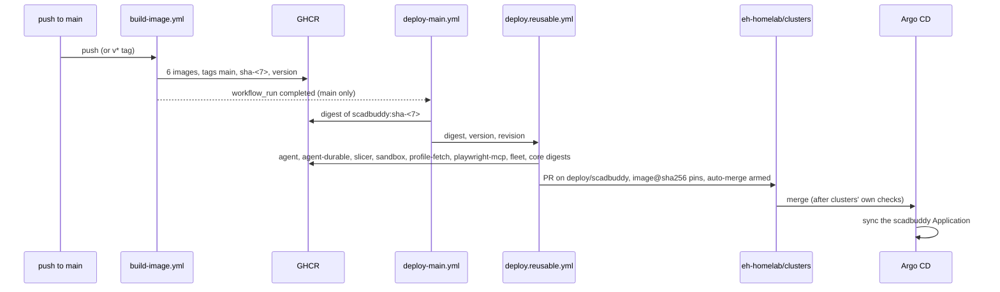

# CI and deploy

A map of the GitHub Actions workflows and of the path an image takes to prod. The rules
(runners, caches, the buildx mirror, pins, required checks) are in the root
[`CLAUDE.md`, "CI and caching rules"](../../CLAUDE.md#ci-and-caching-rules) and
["PR conventions"](../../CLAUDE.md#pr-conventions); the operator's view of a deploy is
in [`README.md`, "Deploying"](../../README.md#deploying). This page does not repeat them.

All line numbers are for `main` at `67d7ff6` (2026-11-21).

## Images

One `Dockerfile` builds every image. `build-image.yml` publishes these stages to GHCR,
amd64 only:

| Dockerfile stage | Image | Entry | Job |
|---|---|---|---|
| `runtime` (`Dockerfile:1087`) | `ghcr.io/eh-homelab/scadbuddy` | `tini` then `uvicorn --factory scadbuddy.main:create_app` (`Dockerfile:1105`, `:1131`); the same image runs the Python workers, the storefront and the intake worker with another command ([processes.md](processes.md)) | `build` (`.github/workflows/build-image.yml:54`) |
| `agent` (`Dockerfile:237`) | `ghcr.io/eh-homelab/scadbuddy-agent` | `node --import ./dist/telemetry.js dist/main.js` (`Dockerfile:293`) | `agent` (`build-image.yml:217`) |
| `sandbox` (`Dockerfile:311`) | `ghcr.io/eh-homelab/scadbuddy-sandbox` | `node dist/sandbox/main.js` (`Dockerfile:370`), role `exec` or `egress` from `SCADBUDDY_SANDBOX_ROLE` (`Dockerfile:304-310`) | `sandbox` (`build-image.yml:433`) |
| `agent-durable` (`Dockerfile:377`) | `ghcr.io/eh-homelab/scadbuddy-agent-durable` | `python -m scadbuddy_durable` (`Dockerfile:439`) | `agent-durable` (`build-image.yml:329`) |
| `slicer` (`Dockerfile:555`) | `ghcr.io/eh-homelab/scadbuddy-slicer` | `scadbuddy-slicer` (`Dockerfile:609`) | `slicer` (`build-image.yml:544`) |
| `profile-fetch` (`Dockerfile:654`) | `ghcr.io/eh-homelab/scadbuddy-profile-fetch` | `tini` then the browser service by default (`Dockerfile:728-729`); the worker's Deployment runs `python -m scadbuddy.profile_fetch` ([processes.md](processes.md#profile-fetch-worker-and-browser)) | `profile-fetch` (`build-image.yml:657`) |
| `playwright-mcp` (#7027; after `67d7ff6`) | `ghcr.io/eh-homelab/scadbuddy-playwright-mcp` | `tini -s -- node /opt/scadbuddy-playwright-mcp/server.mjs`: `@playwright/mcp` with each MCP session's context built from the `X-ScadBuddy-Browser` header (`workers/playwright-mcp/`) | `playwright-mcp` (`build-image.yml:542` after `67d7ff6`) |
| `camera-relay`, `camera-recorder`, `camera-edge` (after `67d7ff6`, #7328, #7330) | `ghcr.io/eh-homelab/scadbuddy-camera-relay`, `ghcr.io/eh-homelab/scadbuddy-camera-recorder`, `ghcr.io/eh-homelab/scadbuddy-camera-edge` | `tini` then the controller; each pod runs the image a second time as `mediamtx` ([processes.md](processes.md#camera-relay-and-recorders)) | `camera` (one leg per image) |
| `tools/go/core/Dockerfile` (#7667; after `67d7ff6`) | `ghcr.io/eh-homelab/scadbuddy-core` | `scadbuddy-core`, the API in Go, run as the `core` container in the API's pod | `core` |

`openscad-lsp` (`Dockerfile:767`) and `libraries` (`Dockerfile:829`) are internal stages
copied into `app`; `test` (`Dockerfile:1007`) is the CI image. Only `build` gates the
workflow: every other job is `continue-on-error` (for example `build-image.yml:221`).

The Go CLIs are published by `build-go-image.yml`, one image per `tools/go/*` module with
a `main.go`, except core (`build-go-image.yml:46`, `:133`), as
`ghcr.io/eh-homelab/scadbuddy-<module>`. Nothing in this repo deploys them
([`tools/go/CLAUDE.md`](../../tools/go/CLAUDE.md)). `build-go-image.yml` skips
`tools/go/core`: `build-image.yml`'s `core` job publishes `scadbuddy-core` with every
build, and the deploy pins it (#7667).

## How an image reaches prod

1. `build-image.yml` runs on a push to `main`, a `v*` tag or a dispatch, never on a PR
   (`build-image.yml:37-41`). Every job tags `main`, `sha-<7>`, `{{version}}` and
   `{{major}}.{{minor}}` (`build-image.yml:102-106`).
2. `deploy-main.yml` runs on the `workflow_run` of a successful `main` build
   (`.github/workflows/deploy-main.yml:25-29`, `:45-48`), resolves the API image's digest
   (`:67-77`) and calls the reusable deploy (`:82-89`). Disabling this workflow switches
   continuous deploy off ([README](../../README.md#switching-continuous-deploy-off)).
3. `deploy-release.yml` runs when a release is published (`deploy-release.yml:19-21`),
   waits for the tag's image (`:73-108`), calls the same reusable deploy (`:113-120`) and
   records the deploy in the release notes (`:143-184`).
4. `deploy.reusable.yml` is the one deploy mechanism. It checks out
   `eh-homelab/clusters` (`deploy.reusable.yml:117`) with the runner App's token and
   rewrites each image line to `image@sha256:digest`, plus the version, revision and
   source annotations (`:666-672`), in the API manifest (required) and, where they exist,
   the render, print, projects, storefront, intake, agent-worker, agent-durable, slicer,
   sandbox, profile-fetch and playwright-mcp manifests (`:116-158`, `:924-1030`; the
   playwright-mcp pin in `applications/scadbuddy/playwright-mcp.yaml` since #7546). It also
   pins the `core` image line in the API manifest once that manifest names it (#7667); a
   build with no core image keeps the pin and warns. The fleet chat server's pin in
   `applications/scadbuddy/scadbuddy-fleet.yaml` (#7903) moves the same way, but its image
   comes from `build-go-image.yml`, only for a push that touches Go, so it is looked up
   once with no wait, and a build with no fleet image keeps the pin. Where clusters keeps a
   copy of `deploy/grafana`, it replaces that copy with the files at the deployed revision
   and writes the revision into its `.revision` file (`:818-831`, `:997`). It fails on any `ghcr.io/eh-homelab/scadbuddy*` reference
   it did not pin (`:1044-1071`), then opens or replaces the PR on the fixed branch
   `deploy/scadbuddy` and arms auto-merge (`:1085-1206`). Runs share one concurrency
   group that is never cancelled (`:174-189`).
5. Once the PR merges, Argo CD syncs the `scadbuddy` Application. A workflow in
   eh-homelab/clusters then checks `/healthz` for the pinned revision. Nothing in this
   repository talks to the cluster (`deploy.reusable.yml:69-74`).

How to cut a release, read a deploy or deploy by hand:
[README "Cutting a release"](../../README.md#cutting-a-release),
["Reading a deploy"](../../README.md#reading-a-deploy),
["Manual fallback"](../../README.md#manual-fallback).

## CI lanes (`ci.yml`)

`ci.yml` runs on PRs, the merge queue, pushes to `main`, a weekly schedule and dispatch
(`.github/workflows/ci.yml:48-67`). The required check is its `summary` job, **CI
Summary**, which needs every job except `lfs-fixtures` and `dispatch-review`
(`ci.yml:2670-2674`). Lane selection (`layout`,
`select-lanes.sh`, `go-select`) is described in
[`CLAUDE.md`](../../CLAUDE.md#ci-and-caching-rules).

| Lane | Jobs (`ci.yml`) | What it covers | Area notes |
|---|---|---|---|
| layout | `layout` (`:99`) | reads the changed paths and picks the lanes | root `CLAUDE.md` |
| lint | `lint` (`:199`) | actionlint, hadolint, shellcheck, the `lint-*.sh` scripts and every `.github/scripts/*.test.sh`, including the deploy workflow's shell tests (`:317`, `:322`) | root `CLAUDE.md` "Workflow/Dockerfile lint" |
| markdown | `markdown` (`:457`) | markdownlint-cli2 over `docs/**/*.md` and each `CLAUDE.md` and `AGENTS.md` outside `vendor/` (`.markdownlint-cli2.jsonc`); on a docs-only change (`docs_only`, `select-lanes.sh`) the only job that checks it | root `CLAUDE.md` "CI and caching rules" |
| frontend | `frontend` (`:447`), `frontend-unit` (`:515`), `frontend-e2e` (`:575`), `frontend-e2e-split` (`:696`) | typecheck, vitest, Playwright shards | [`frontend/CLAUDE.md`](../../frontend/CLAUDE.md) |
| agent | `agent` (`:747`) | the agent's tests; builds the `agent` (`:850`), `sandbox` (`:899`) and `playwright-mcp` (#7027) targets | [`agent/CLAUDE.md`](../../agent/CLAUDE.md) |
| agent_durable | `agent-durable` (`:936`) | builds the `agent-durable` target (`:1012`) | [`agent-durable/CLAUDE.md`](../../agent-durable/CLAUDE.md) |
| image | `image` (`:1045`) | builds `test` and `runtime`, backend checks, a container smoke test, the real-backend e2e | [`backend/CLAUDE.md`](../../backend/CLAUDE.md) |
| backend | `lfs-fixtures` (`:1411`), `backend-pytest` (`:1443`), `backend-pytest-split` (`:1693`) | pytest in groups against Postgres and Temporal | [`backend/CLAUDE.md`](../../backend/CLAUDE.md) |
| models | `models` (`:1797`) | `verify-models.sh` over the changed templates on the `base` stage | [`models/CLAUDE.md`](../../models/CLAUDE.md) |
| go | `go-select` (`:1941`), `go` (`:1964`, calls `go-module-ci.yml`) | gofmt, vet, build, `test -race`, vendor drift, CLI images | [`tools/go/CLAUDE.md`](../../tools/go/CLAUDE.md) |
| rust | `rust` (`:1976`), `slicer-image` (`:2053`) | the Rust workspace and the `slicer` target | [`workers/rust/CLAUDE.md`](../../workers/rust/CLAUDE.md) |
| profile-fetch | `profile-fetch-image` (`:2112`) | the profile-fetch site tests in the `test` stage | [`backend/CLAUDE.md`](../../backend/CLAUDE.md) |
| image | `camera-image` (after `67d7ff6`, #7328) | builds the `camera-relay`, `camera-recorder` and `camera-edge` targets, checks MediaMTX, `curl`, `TZ`, the refusals and the relay's and the edge's read users | [`docs/features/printer-cameras.md`](../features/printer-cameras.md) |
| freshness | `freshness` (`:2255`), `go-client` (`:2642`) | the generated API files ([data.md](data.md#generated-api-files)) and the Go client | root `CLAUDE.md` "Generated API files" |
| review | `dispatch-review` (`:2837`) | dispatches `claude-code-review.yml`, which posts the `claude-review` status | root `CLAUDE.md` "PR conventions" |

Outside `ci.yml`:

- `hot-path-e2e.yml` builds `runtime`, `test` and `slicer` and runs the real stack
  (`e2e-stack/run.sh --mode both`, then `--auth`) on PRs touching `e2e-stack/**` or
  `backend/**` (a `CLAUDE.md` or `AGENTS.md` aside), weekly and on dispatch
  (`.github/workflows/hot-path-e2e.yml:29-40`,
  `:196-202`). It is not part of CI Summary. See
  [`e2e-stack/CLAUDE.md`](../../e2e-stack/CLAUDE.md).
- `merge-queue-review.yml` carries the `claude-review` verdict onto a merge-queue commit.
- `ai-evals.yml` runs the agent's live evals on dispatch only ([`docs/ai/evals.md`](../ai/evals.md)).

## Scheduled and bot workflows

| Workflow | Trigger | Does |
|---|---|---|
| `openscad-bump.yml` | weekly | opens a PR moving the OpenSCAD nightly (never auto-merged) |
| `postgres-pin.yml`, `rust-toolchain-pin.yml`, `harness-pin.yml` | weekly | check pinned digests and SHAs against upstream |
| `link-check.yml` | weekly, dispatch | lychee over `docs/`, `README.md`, every `CLAUDE.md` and `SKILL.md` |
| `ghcr-cleanup.yml` | monthly | prunes untagged versions of the `scadbuddy` package only (`ghcr-cleanup.yml:63`) |
| `release-drafter.yml` | push to main, PRs | drafts the release notes and labels PRs by title |
| `claude.yml`, `issue-intake.yml`, `pr-follow-up-issues.yml` | comments, issues, a label | the `@claude` bot, issue triage, follow-up issues |
| `vendor-autofix.yml` | Dependabot gomod PRs | regenerates `vendor/` |
| `cancel-pr-workflows.yml` | PR closed | cancels its runs |

## Observability

- Seven Grafana dashboards live in [`deploy/grafana/`](../../deploy/grafana/) as ConfigMaps
  (`deploy/grafana/kustomization.yaml:33-89`); see
  [`deploy/CLAUDE.md`](../../deploy/CLAUDE.md). `lint-dashboard.sh` checks them in the
  `lint` job.
- Traces: the API, the Python workers, the agent and the slicer export OTLP when the
  standard `OTEL_*` variables are set; browser spans are relayed through the API.
  See [README "Tracing"](../../README.md#tracing-988).
