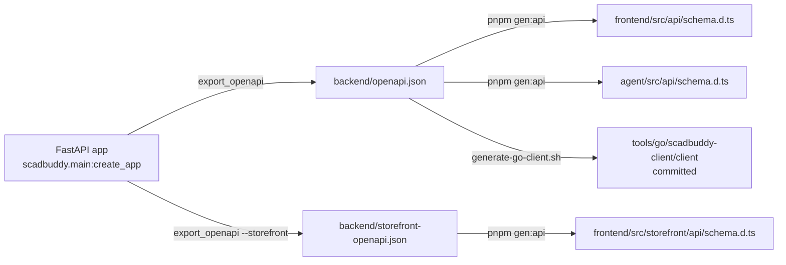

# Data

Where ScadBuddy keeps its state: one Postgres database with two migration ledgers, a
content-addressed blob store, git repositories on the data volume, and Temporal's own
history. Who may reach the database, and why, is in
[`docs/security/trust-boundaries.md`](../security/trust-boundaries.md) and the root
[`CLAUDE.md` "Database access"](../../CLAUDE.md#database-access-5295); this page does not
repeat it.

Line numbers are for `main` at the commit that adds this page. Paths under
`backend/scadbuddy/` are shortened to `scadbuddy/`.

## Postgres

One database, one schema: the one `SCADBUDDY_DATABASE_URL` names
(`scadbuddy/core/settings.py:522`). The backend's tables and the agent's `ai_*` tables sit
side by side. In prod one role owns all of them (measured 2026-11-05 and re-measured
2026-11-14 in [trust-boundaries.md](../security/trust-boundaries.md#who-talks-to-the-database-today)).

Today's code: four processes hold this database's secret: the API, the agent sidecar, the
agent worker and agent-durable. The render, print and projects workers, the storefront
edge, the intake worker and the slicer hold none and reach data through the CRUD service
([processes.md](processes.md)).

### Ownership by domain

"Owner" below means the code that writes the table. In every case it is a table in the
same schema, created by a file in `backend/scadbuddy/migrations/` (218 files today) or
`backend/scadbuddy/migrations_agent/` (99 files today).

| Domain | Tables (creating migration) | Written by |
|---|---|---|
| Render and blobs | `render_jobs` (`20260927T2243Z_render_jobs`), `blob_refs` (`20260928T0900Z_render_jobs_projection`), `store_blobs`, `store_folders` (`20260928T1800Z_blob_store`), `assets` (`20260928T1631Z_assets`), `piece_geometry` (`20261013T0719Z_piece_geometry`), `model_previews`, `template_media`, `saved_presets`, `analyzer_decisions`, `library_leases`, `library_pin_holds`, `library_install_slots`, `transfer_puts` | the API; the render worker through `crud.render` routes (`scadbuddy/api/crud_render.py:83`) |
| Core | `events` (`20260928T0630Z_events`), `settings`, `model_print_choices`, `printer_bed_types` (`20260928T0840Z_settings`), `operations`, `activity` (`20261010T0533Z_activity`), `crud_requests`, `models_repo_head`, `flows_repo_head`, `git_remote_pushes`, `output_index` | the API |
| Auth | `auth_sessions`, `auth_login_config`, `auth_break_glass_codes`, `service_credentials`, `personal_access_tokens`, `auth_delegation_codes`, `service_caller_suspensions` (2026-11-02 to 2026-11-06 files) | the API |
| Printing | `print_runs`, `print_sends`, `print_links`, `output_bambuddy_uploads`, `output_bambuddy_slices`, `output_last_prints`, `print_preview_slices`, `print_slice_starts`, `print_batches`, `print_batch_items`, `print_attachments`, `print_outcomes`, `printers`, `printer_reports` (`20261018T1659Z_printers`), `rack_nozzle_*`, `library_folders`, `library_files` (`20261017T2250Z_print_library`), `native_slices`, `library_copies`, `print_imports`, `print_lan_imports`, `lan_print_archives` and more | the API; the print worker through `crud.print` routes (`scadbuddy/api/crud_print.py:260`) |
| Spools and filament | `physical_spools`, `spool_*`, `native_spools`, `native_spool_uses`, `held_local_presets`, `filaments`, `filament_*` (`20261114T1300Z`, `20261114T1301Z`) | the API; the print worker through CRUD |
| Flows | `workflow_definitions`, `workflow_runs`, `workflow_run_decisions`, `workflow_flow_states`, `workflow_run_proposals`, `workflow_run_links`, `flow_grants`, `flow_grant_uses`, `flow_triggers`, `flow_trigger_grants`, `flow_trigger_fires` | the API; the projects worker through `crud.projects` (`scadbuddy/api/crud_projects.py:71-73`); the agent's gate reads `flow_grants` and `flow_grant_uses` over SQL ([trust-boundaries.md](../security/trust-boundaries.md#who-talks-to-the-database-today)) |
| Orders, payments, storefront | `customers*`, `orders`, `order_*` (`20261020T0446Z_orders` and later), `attachments` (`20261024T2050Z_order_attachments`), `parts*`, `payment_*`, `bank_*`, `printer_cost_profiles`, `storefront_*` (2026-11-07 to 2026-11-13 files) | the API; the storefront edge through `crud.storefront` (`scadbuddy/api/crud_storefront.py:208`); the intake worker through `crud.intake` (`scadbuddy/api/crud_intake.py:34`) |
| Agent (`ai_*`) | `ai_credentials`, `ai_settings` (`20260927T2349Z_credentials_settings`), `ai_sessions`, `ai_session_entries`, `ai_session_events` (`20260928T0107Z_sessions`), `ai_approvals`, `ai_mcp_tokens`, `ai_plugins`, `ai_audit`, `ai_payload_keys`, `ai_forgotten_subjects`, `ai_session_files`, `ai_flow_blobs`, `ai_push_*`, `ai_notify_channels` and about 30 more (47 `ai_*` tables today) | the agent sidecar and agent worker over SQL; the API over SQL for the 20 tables it serves the agent through `crud.agent` routes (`scadbuddy/api/crud_agent*.py`, #5299) |

### The two migration ledgers

The rules for adding a migration are in the root
[`CLAUDE.md` "Migrations"](../../CLAUDE.md#migrations-491). In code:

- **Backend.** `migrate` (`scadbuddy/render/pg_store.py:84`) applies every file in
  `MIGRATIONS_DIR` (`:31`) not yet in `scadbuddy_migrations`, in id order, in one
  transaction under `pg_advisory_xact_lock(MIGRATION_LOCK)` ("SCADBDDY", `:27`). A file
  whose name does not match `MIGRATION_ID` (`:34`) fails at import. The API runs it first
  at start, through the settings store (`scadbuddy/main.py:2034`).
- **Agent.** `migrate_agent` (`scadbuddy/render/agent_migrations.py:105`) does the same
  for `migrations_agent/` under the lock "SCADAGNT" (`:49`), with lock and statement
  timeouts, and records each file's SHA-256 in `ai_migrations`. A changed file stops the
  start with `AgentMigrationChecksumError` (`:139-149`). The API runs it right after the
  backend's (`scadbuddy/main.py:2037`). The agent itself only waits until the ledger
  holds every file in `agent/src/db/expected-migrations.json` (see
  [`agent/CLAUDE.md`](../../agent/CLAUDE.md)).

### The CRUD service

Every process without a database secret reaches its rows through
`/api/v1/internal/crud/<caller>/…`, served by the API on its own port
(`SCADBUDDY_CRUD_PORT`, default 8082, `scadbuddy/core/settings.py:365`;
`scadbuddy/crud/listener.py:30-46`). Each router is `crud_router(caller)`, guarded by
`require_crud(caller)` in every auth mode (`scadbuddy/crud/guard.py:144-152`, `:44-73`).
The callers are agent, print, projects, render, storefront and intake
(`scadbuddy/auth/service_auth.py:25`); their scopes are in
`scadbuddy/auth/service_credentials.py:99-106`. `GET …/<caller>/areas` lists what each
caller may use (`scadbuddy/api/crud_areas.py:73-139`); a worker waits for its areas
before it polls (for example `scadbuddy/worker.py:1102`). Retries are deduplicated by the
`crud_requests` ledger (`scadbuddy/crud/idempotency.py`).

## Blob store

Large bytes (render pieces, source snapshots, fonts, slices, library files, uploads,
order attachments) live in the blob store, not in Postgres. The design is in the
[template-pipelines spec §6](../superpowers/specs/2026-09-27-template-pipelines-design.md)
and the [own-store spec §4](../superpowers/specs/2026-10-16-own-store-slicer-rust-workers-design.md);
where they disagree with the code, see [Drift from specs](README.md#drift-from-specs).

### Backends

The stored setting `store_backend` (seeded from the environment, default `local`,
`scadbuddy/core/settings.py:177`) picks one at the API's start
(`scadbuddy/main.py:2063-2077`):

| Backend | Where bytes go | Code |
|---|---|---|
| `local` | files on the API's data volume; works only with the render worker in-process (a separate render worker refuses it, `scadbuddy/worker.py:218-253`) | `scadbuddy/store/local.py:22-35` |
| `bambuddy` | Bambuddy's library, one folder per template with a `Work/` folder, recorded in `store_folders` | `scadbuddy/store/bambuddy.py:3-15` |
| `s3` | an S3-compatible bucket, object key `<prefix>/<kind>/<sha256>` | `scadbuddy/store/s3.py:4-5`, `:47-48` |

### Keys and content addressing

`ContentStore` (`scadbuddy/store/content.py`) maps a logical key to a `BlobRef` (sha256,
kind, backend, backend id, size; `scadbuddy/store/content_models.py:52-57`), indexed in
`store_blobs`. The kinds are `piece`, `snapshot`, `asset`, `font`, `slice`, `library`,
`workspace` and `media` (`content_models.py:12`). A blob stays alive while a `blob_refs`
row holds it (`scadbuddy/store/refs.py:22-30`); unreferenced blobs of the swept kinds are
deleted after a grace period.

| Logical key | What | Code |
|---|---|---|
| 64-hex, `act-<40hex>`, `output-<32hex>-<n>` | a render job's pieces | `scadbuddy/api/crud_render.py:110` |
| `src-<slug>-<revision>` | a template's source snapshot | `scadbuddy/store/snapshots.py:65-66` |
| `asset-<id>` | an uploaded template asset | `scadbuddy/store/assets.py:30` |
| `font-<dir>` | a mirrored font | `scadbuddy/store/fonts.py:27` |
| `slice-<library_file_id>-<digest>` | a sliced 3MF | `scadbuddy/slicing/store.py:63` |
| `library-file-<id>`, `library-copy-<hash>`, `library-<id>` | print-library files and copies | `scadbuddy/print_library/native.py:52`, `scadbuddy/print_library/copy_models.py:51`, `scadbuddy/bambuddy/subject.py:100` |
| `quote-<sha256>`, `attachment-<sha256>` | order quotes and attachments | `scadbuddy/orders/quote.py:712`, `scadbuddy/orders/attachments.py:121` |
| `customer-preview-<sha256>`, `customer-file-<sha256>`, `listing-media-<sha256>` | storefront uploads and listing media | `scadbuddy/orders/storefront/intake.py:74`, `scadbuddy/orders/storefront/order_page.py:163`, `scadbuddy/orders/storefront/listings.py:963` |
| `workspace-<sha256>` | an agent workspace file | `scadbuddy/api/internal_workspace.py:41` |

Processes without store credentials (the slicer) get short-lived transfer URLs instead:
a presigned S3 GET, or the API's `/api/v1/internal/blobs/{key}` with an HMAC transfer
token (`scadbuddy/slicing/transfer.py:52-57`, `scadbuddy/slicing/transfer_token.py`).

## Files on the data volume

Templates are git repositories on the API's data volume (`SCADBUDDY_DATA_DIR`,
`Dockerfile:837`). The bundled models are mirrored into `_builtin/` as one commit at
start (`scadbuddy/library/catalogue.py:2940-2956`, called from `scadbuddy/main.py:1477-1481`).
Every model edit is a commit, which is what versions and history read
([features/versions-and-history.md](../features/versions-and-history.md)).

## Generated API files

The rules are in the root
[`CLAUDE.md` "Generated API files"](../../CLAUDE.md#generated-api-files). In short:

The Dockerfile's `api-spec` stage runs both exports (`Dockerfile:129-130`) for the
`frontend` and `agent-build` stages. Only the Go client is committed; it covers just the
print library and operations routes (`scripts/generate-go-client.sh:40-44`).

## Temporal

Workflow inputs, outputs and histories live in Temporal, in the namespace
`SCADBUDDY_TEMPORAL_NAMESPACE`. Agent session and flow payloads are encrypted by a
per-subject codec whose keys are in `ai_payload_keys`
([agent.md](agent.md)). The queues and workflows are in [workflows.md](workflows.md).
