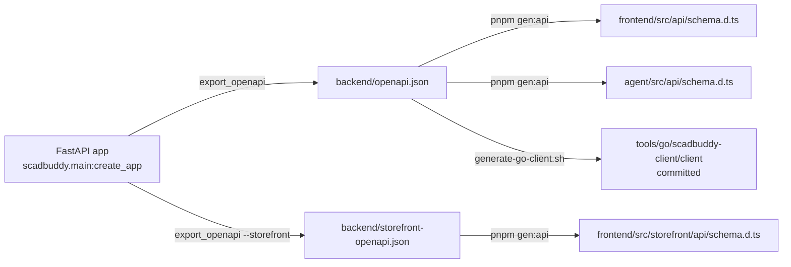

# Data

Where ScadBuddy keeps its state: one Postgres database with two migration ledgers, a
content-addressed blob store, git repositories on the data volume, and Temporal's own
history. Who may reach the database, and why, is in
[`docs/security/trust-boundaries.md`](../security/trust-boundaries.md) and the root
[`CLAUDE.md` "Database access"](../../CLAUDE.md#database-access-5295); this page does not
repeat it.

Line numbers are for `main` at `67d7ff6` (2026-11-21). Paths under
`backend/scadbuddy/` are shortened to `scadbuddy/`.

## Postgres

One database, one schema: the one `SCADBUDDY_DATABASE_URL` names
(`scadbuddy/core/settings.py:573`). The backend's tables and the agent's `ai_*` tables sit
side by side. In prod one role owns all of them (measured 2026-11-05 and re-measured
2026-11-14 in [trust-boundaries.md](../security/trust-boundaries.md#who-talks-to-the-database-today)).

Today's code: four processes hold this database's secret: the API, the agent sidecar, the
agent worker and agent-durable. The render, print and projects workers, the storefront
edge, the intake worker and the slicer hold none and reach data through the CRUD service
([processes.md](processes.md)).

### Ownership by domain

"Owner" below means the code that writes the table. In every case it is a table in the
same schema, created by a file in `backend/scadbuddy/migrations/` or
`backend/scadbuddy/migrations_agent/`.

| Domain | Tables (creating migration) | Written by |
|---|---|---|
| Render and blobs | `render_jobs` (`20260927T2243Z_render_jobs`), `blob_refs` (`20260928T0900Z_render_jobs_projection`), `store_blobs`, `store_folders` (`20260928T1800Z_blob_store`), `assets` (`20260928T1631Z_assets`), `piece_geometry` (`20261013T0719Z_piece_geometry`), `model_previews`, `template_media`, `saved_presets`, `analyzer_decisions`, `library_leases`, `library_pin_holds`, `library_install_slots`, `transfer_puts` | the API; the render worker through `crud.render` routes (`scadbuddy/api/crud_render.py:89`) |
| Core | `events` (`20260928T0630Z_events`), `settings`, `model_print_choices`, `printer_bed_types` (`20260928T0840Z_settings`), `operations`, `activity` (`20261010T0533Z_activity`), `crud_requests`, `models_repo_head`, `flows_repo_head`, `git_remote_pushes`, `output_index`, `outputs`, `output_copy_runs` (`20261124T0053Z_outputs_records`, #7255), `output_files`, `output_derived`, `output_byte_runs` (`20261124T0245Z_output_bytes`, #7256; see [Saved outputs](#saved-outputs)) | the API |
| Auth | `auth_sessions`, `auth_login_config`, `auth_break_glass_codes`, `service_credentials`, `personal_access_tokens`, `auth_delegation_codes`, `service_caller_suspensions` (2026-11-02 to 2026-11-06 files) | the API |
| Printing | `print_runs`, `print_sends`, `print_links`, `output_bambuddy_uploads`, `output_bambuddy_slices`, `output_last_prints`, `print_preview_slices`, `print_slice_starts`, `print_batches`, `print_batch_items`, `print_attachments`, `print_outcomes`, `printers`, `printer_reports` (`20261018T1659Z_printers`), `rack_nozzle_*`, `library_folders`, `library_files` (`20261017T2250Z_print_library`), `native_slices`, `library_copies`, `print_imports`, `print_lan_imports`, `lan_print_archives` and more | the API; the print worker through `crud.print` routes (`scadbuddy/api/crud_print.py:316`) |
| Spools and filament | `filament_*` (`20261114T1300Z`, `20261114T1301Z` and later), `filament_presets`, `filaments` (the overlay and native spool tables were dropped by `20261118T1235Z_drop_native_spool_tables`, and `held_local_presets` by `20261124T1308Z_drop_held_local_presets`, #7275) | the API; the print worker through CRUD |
| Flows | `workflow_definitions`, `workflow_runs`, `workflow_run_decisions`, `workflow_flow_states`, `workflow_run_proposals`, `workflow_run_links`, `flow_grants`, `flow_grant_uses`, `flow_triggers`, `flow_trigger_grants`, `flow_trigger_fires` | the API; the projects worker through `crud.projects` (`scadbuddy/api/crud_projects.py:71-73`); the agent's run-grant check reads `flow_grants` and `flow_grant_uses` through `crud.agent` area `gate` (`agent/src/gate/crudStore.ts:13`) |
| Orders, payments, storefront | `customers*`, `orders`, `order_*` (`20261020T0446Z_orders` and later), `entity_attachments` (an order's files; `20261024T2050Z_order_attachments`, renamed by `20261122T0426Z_entities`), `parts*`, `payment_*`, `bank_*`, `printer_cost_profiles`, `storefront_*` (2026-11-07 to 2026-11-13 files) | the API; the storefront edge through `crud.storefront` (`scadbuddy/api/crud_storefront.py:208`); the intake worker through `crud.intake` (`scadbuddy/api/crud_intake.py:34`) |
| Entities (files, links and properties on any row, #6950, #7026) | `entities`, `entity_links` (`20261122T0426Z_entities`), `entity_properties` (one row per entity and key) and `entity_property_schemas` (one row per kind, seeded for `spool_type` and `spool`; `20261123T0017Z_entity_properties`), `entity_attachments` (the old `order_attachments`, renamed there; an order's files are its rows with an `order_id`) | the API |
| Agent (`ai_*`) | `ai_credentials`, `ai_settings` (`20260927T2349Z_credentials_settings`), `ai_sessions`, `ai_session_entries`, `ai_session_events` (`20260928T0107Z_sessions`), `ai_approvals`, `ai_mcp_tokens`, `ai_plugins`, `ai_audit`, `ai_payload_keys`, `ai_forgotten_subjects`, `ai_session_files`, `ai_flow_blobs`, `ai_push_*`, `ai_notify_channels`, the hosted plugins and feeds (`ai_hosted_plugins`, `ai_hosted_plugin_files`, `ai_hosted_plugin_versions`, `ai_plugin_feeds`, `ai_plugin_feed_packages`) and more | the API, which serves the agent every area through `crud.agent` routes (`scadbuddy/api/crud_agent*.py`, areas listed at `scadbuddy/api/crud_areas.py:202-248`, #5299); the agent's own SQL to these tables remains only as the fallback while an area is unlisted |

### The two migration ledgers

The rules for adding a migration are in the root
[`CLAUDE.md` "Migrations"](../../CLAUDE.md#migrations-491). In code:

- **Backend.** `migrate` (`scadbuddy/render/pg_store.py:84`) applies every file in
  `MIGRATIONS_DIR` (`:31`) not yet in `scadbuddy_migrations`, in id order, in one
  transaction under `pg_advisory_xact_lock(MIGRATION_LOCK)` ("SCADBDDY", `:27`). A file
  whose name does not match `MIGRATION_ID` (`:34`) fails at import. The API runs it first
  at start, through the settings store (`scadbuddy/main.py:2163`).
- **Agent.** `migrate_agent` (`scadbuddy/render/agent_migrations.py:105`) does the same
  for `migrations_agent/` under the lock "SCADAGNT" (`:49`), with lock and statement
  timeouts, and records each file's SHA-256 in `ai_migrations`. A changed file stops the
  start with `AgentMigrationChecksumError` (`:139-149`). The API runs it right after the
  backend's (`scadbuddy/main.py:2166`). The agent waits for no ledger (#5299 step 12); the
  agent tests' file list is `agent/test/support/expected-migrations.json`, which
  `agent/test/schema.test.ts` checks against this runner (see
  [`agent/CLAUDE.md`](../../agent/CLAUDE.md)).

### The CRUD service

Every process without a database secret reaches its rows through
`/api/v1/internal/crud/<caller>/…`, served by the API on its own port
(`SCADBUDDY_CRUD_PORT`, default 8082, `scadbuddy/core/settings.py:416`;
`scadbuddy/crud/listener.py:30-46`). Each router is `crud_router(caller)`, guarded by
`require_crud(caller)` in every auth mode (`scadbuddy/crud/guard.py:144-152`, `:44-73`).
The callers are agent, print, projects, render, storefront, intake and profile-fetch
(`scadbuddy/auth/service_auth.py:25-27`); their scopes are in
`scadbuddy/auth/service_credentials.py:100-107`. `GET …/<caller>/areas` lists what each
caller may use (`scadbuddy/api/crud_areas.py:170-236`); a worker waits for its areas
before it polls (for example `scadbuddy/worker.py:1106`). Retries are deduplicated by the
`crud_requests` ledger (`scadbuddy/crud/idempotency.py`).

## Blob store

Large bytes (render pieces, source snapshots, fonts, slices, library files, uploads,
order attachments) live in the blob store, not in Postgres. The design is in the
[template-pipelines spec §6](../superpowers/specs/2026-09-27-template-pipelines-design.md)
and the [own-store spec §4](../superpowers/specs/2026-10-16-own-store-slicer-rust-workers-design.md);
where they disagree with the code, see [Drift from specs](README.md#drift-from-specs).

### Backends

The stored setting `store_backend` (seeded from the environment, default `local`,
`scadbuddy/core/settings.py:228`) picks one at the API's start
(`scadbuddy/main.py:2192-2206`):

| Backend | Where bytes go | Code |
|---|---|---|
| `local` | files on the API's data volume; works only with the render worker in-process (a separate render worker refuses it, `scadbuddy/worker.py:222-257`) | `scadbuddy/store/local.py:22-35` |
| `bambuddy` | Bambuddy's library, one folder per template with a `Work/` folder, recorded in `store_folders` | `scadbuddy/store/bambuddy.py:3-15` |
| `s3` | an S3-compatible bucket, object key `<prefix>/<kind>/<sha256>` | `scadbuddy/store/s3.py:4-5`, `:47-48` |

### Keys and content addressing

`ContentStore` (`scadbuddy/store/content.py`) maps a logical key to a `BlobRef` (sha256,
kind, backend, backend id, size; `scadbuddy/store/content_models.py:58-63`), indexed in
`store_blobs`. The kinds are `piece`, `snapshot`, `asset`, `font`, `slice`, `library`,
`workspace`, `media` and `output` (`content_models.py:12-14`). A blob stays alive while a `blob_refs`
row holds it (`scadbuddy/store/refs.py:22-30`); unreferenced blobs of the swept kinds are
deleted after a grace period.

| Logical key | What | Code |
|---|---|---|
| 64-hex, `act-<40hex>`, `output-<32hex>-<n>` | a render job's pieces | `scadbuddy/api/crud_render.py:116` |
| `output-<id>-model`, `-preview`, `-thumbnail`, `-file-<hash>` | a saved output's bytes: `model.3mf`, `preview.glb`, `thumbnail.png`, and a `files/` entry, keyed by the first 32 hex digits of its name's sha256 (a save puts each under `<key>-save-<attempt>` first, `staged_save_key`) | `scadbuddy/library/output_rows.py` `output_blob_key`, `output_file_key` |
| `output-<id>-thumbnail-<sha256>`, `output-<id>-plate_cover-<sha256>` | a thumbnail upload before its key names it (held by nothing); the plate cover read once out of the output's 3MF | `scadbuddy/library/output_rows.py` `staged_thumbnail_key`, `plate_cover_key` |
| `src-<slug>-<revision>` | a template's source snapshot | `scadbuddy/store/snapshots.py:65-66` |
| `asset-<id>` | an uploaded template asset | `scadbuddy/store/assets.py:30` |
| `font-<dir>` | a mirrored font | `scadbuddy/store/fonts.py:27` |
| `slice-<library_file_id>-<digest>` | a sliced 3MF | `scadbuddy/slicing/store.py:63` |
| `library-file-<id>`, `library-copy-<hash>`, `library-<id>` | print-library files and copies | `scadbuddy/print_library/native.py:52`, `scadbuddy/print_library/copy_models.py:51`, `scadbuddy/bambuddy/subject.py:102` |
| `quote-<sha256>`, `attachment-<sha256>` | order quotes and attachments | `scadbuddy/orders/quote.py:727`, `scadbuddy/orders/attachments.py:121` |
| `customer-preview-<sha256>`, `customer-file-<sha256>`, `listing-media-<sha256>` | storefront uploads and listing media | `scadbuddy/orders/storefront/intake.py:74`, `scadbuddy/orders/storefront/order_page.py:163`, `scadbuddy/orders/storefront/listings.py:963` |
| `workspace-<sha256>` | an agent workspace file | `scadbuddy/api/internal_workspace.py:43` |

Processes without store credentials (the slicer) get short-lived transfer URLs instead:
a presigned S3 GET, or the API's `/api/v1/internal/blobs/{key}` with an HMAC transfer
token (`scadbuddy/slicing/transfer.py:52-57`, `scadbuddy/slicing/transfer_token.py`).

## Files on the data volume

Templates are git repositories on the API's data volume (`SCADBUDDY_DATA_DIR`,
`Dockerfile:981`). The bundled models are mirrored into `_builtin/` as one commit at
start (`scadbuddy/library/catalogue.py:2940-2956`, called from `scadbuddy/main.py:1561-1565`).
Every model edit is a commit, which is what versions and history read
([features/versions-and-history.md](../features/versions-and-history.md)).

### Saved outputs

A saved output's record is a row of `outputs` (#7255, phase 1 of the
[outputs-in-Postgres spec](../superpowers/specs/2026-11-23-outputs-in-postgres-design.md)):
what its `meta.json`, `params.json`, `inputs.json`, `record.json`, `manifest.json`,
`bom.json`, `arranged_from.json` and `backfill.json` hold (`scadbuddy/library/output_rows.py`
`OutputRows`). Its last print stays in `output_last_prints`.

Its bytes (`model.3mf`, `preview.glb`, `thumbnail.png`, each file in `files/`) are blobs
of kind `output` (#7256, phase 2), held in `blob_refs` by `(output, <output_id>)`. The row
names the keys (`model_blob`, `preview_blob`, `thumbnail_blob`, and one `output_files` row
per `files/` name); `bytes_at` is set once the blobs hold the bytes, and NULL while only
the files do. The folder `data/outputs/<slug>/<id>/` stays as the fallback until #7257: a
save still writes it, and every reader reads the file when the row names no blob, or when
the blob is lost (logged, never a 500). A save writes the folder, puts the bytes under
keys of its own (`OutputBytes.put_folder`, `<key>-save-<attempt>`), then inserts the row,
points the output's keys at those objects, and writes its `output_files` rows and its
holds, in one transaction; then it deletes its staged keys. When the row fails (an id
that another output holds, `orders/quote.py` `operation_output_id`, among the causes), the
save fails, its folder is removed (`OutputStore._insert_row`) and its staged keys and
their objects are deleted: no key of the other output moved, so that output keeps its
bytes. A put into a full store is a 507. On the `local` backend (no
content store) and on `bambuddy` (spec §6.4) no output blob is written: the bytes stay
files. A store migration to `bambuddy` is refused while the index holds an `output` blob
(`scadbuddy/store/migrate.py` `refuse_outputs_to_bambuddy`). A delete deletes the row
and releases its byte holds in one transaction, then removes the folder; the content sweep
removes the blobs after its grace (`OutputRows.delete`).

A save's cost in commits: each put writes its index row in a transaction of its own
(`ContentStore.put`), one each for `model.3mf`, `preview.glb`, `thumbnail.png` when there,
and each `files/` entry, before the row's transaction, and the delete of each staged key
commits once more after it. On prod a commit is known to take 1-2 s, so a save takes some
seconds more than in phase 1. The save then files its 3MF in
the native library from the folder it wrote, the same bytes as the model blob, so it
does not download the blob again (`scadbuddy/library/output_operations.py`). The filing's
own put commits once more. Fewer commits would need a batch put in `ContentStore`:
upload every file first, then write every index row in one transaction (or in the row's
own transaction), with its own answer to a reused object that the sweep freed meanwhile
(`ReuseLostError`) and to a deadlock.

What readers derive of the model (the geometry analysis and its attributed form, the
asset ids, the plate names, the plate cover) is kept in `output_derived`, once per output.
The plate cover is a small blob (`output-<id>-plate_cover-<sha256>`); the row names its
key, or none when the 3MF has no cover. A derive writes only while the model the reader
read is still the row's (the row's model key names the same sha256, or the files hold the
bytes). One window stays: an attributed analysis made from a geometry row read between the
byte copy's model swap and its `drop_derived` can stay stale. It needs a hand-edited
`model.3mf`, and it is accepted (spec §4.5). A copied row whose model blob is lost keeps no
derived rows: readers fall back to the file and derive again until the blob is back.

Each API start copies the folders to rows once (`scadbuddy/library/output_copy.py`
`copy_outputs`, one replica at a time under an advisory lock, held on a connection of its
own; a run that does not get the lock does nothing). The housekeeping sweep `housekeeping_copy_outputs` copies them again
on each run of the sweeps' Schedule (`workflows/housekeeping.py` `OUTPUT_COPY_SWEEP`, every
`asset_sweep_interval`; with the sweeps off, `asset_sweep_interval` 0, only the start
copies). Each run is a row of `output_copy_runs`.
`GET /api/v1/outputs/copy-status` answers the last run. Until a run finishes, a lookup
that finds no row falls back to the files; after one, a missing row is a missing output.
A run whose walk may have missed folders does not finish: it records its counts with
`incomplete` true and no `finished_at`. Each run stats about ten record files in each
output folder (`files_stamp`) and reads a folder only when its stamp changed. The copy
reconciles:

- A folder with no row gets one. A row is read again when the folder's `files_stamp`
  differs from the row's: a sha256 of the sorted name, size and `mtime_ns` of the record
  files, so no NFS clock is compared with the database's. A save writes no stamp, so the
  next run reads its folder once.
- Live writers (a save, a rename, a backfill change) set `copied_at` to the database's
  clock. The copy takes a mark from that clock before it reads a batch. A refresh is
  `UPDATE … WHERE copied_at < mark`, and a new row is `INSERT … ON CONFLICT DO NOTHING`
  (`OutputRows.write_copy`), so a live write wins.
- After each batch, `undo_copy` deletes each row the batch wrote whose `meta.json` is
  gone, only while its `copied_at` is still the mark. The run's end checks the rows it
  inserted once more.
- A row whose folder the walk did not see is dropped, only when its `copied_at` is before
  the run's start. When a listing or a stat fails (ESTALE, EIO), or the outputs folder
  lists nothing while rows exist, the run drops no row and is `incomplete`.
- A folder with no readable `meta.json` gets no row and goes on the run's `not_copied`
  list; a side file that cannot be read is left out of its row and named on `damaged`.
- Pods on an older build save and delete outputs in the files only, during a roll-out
  and after a rollback. The next housekeeping sweep gives their saves rows and drops the
  rows of their deletes. Until then, such a save is a 404 on the newer pods once a copy
  run has finished (`OutputRows.copied` stays true in each process); README, "Saved
  outputs during a roll-out".

After a roll-out, confirm that every pod runs the new image (`kubectl -n bambuddy get
pods -o jsonpath` on the images), then read `GET /api/v1/outputs/copy-status`. Check that
its run has a `finished_at`, is not `incomplete`, and started after the last pod on the
older build went. Until then, writes of the older pods may have no row yet.

`output_index` stays as it is in this phase; #7257 drops it.

#### The byte copy

The byte copy puts the existing outputs' bytes into the blob store
(`scadbuddy/library/output_byte_copy.py` `copy_output_bytes`). Each API start runs it once,
after the row copy, and the housekeeping sweep `housekeeping_copy_output_bytes`
(`workflows/housekeeping.py` `OUTPUT_BYTES_SWEEP`, after `OUTPUT_COPY_SWEEP`, on the
sweeps' Schedule) runs it again, with a timeout of 30 minutes (`OUTPUT_BYTES_TIMEOUT`). One
replica copies at a time, under a session advisory lock. That lock holds one autocommit
connection of its own (`scadbuddy-output-byte-copy`, no transaction), not a pool's, for the
whole run: in the sweep up to that timeout, and at a start with no bound (the first start
after the roll-out copies every output). Each of the run's statements takes a connection of
the main pool. Each run is
a row of `output_byte_runs`. It reconciles:

- A row whose `bytes_at` is set and whose `bytes_stamp` (the name, size and `mtime_ns` of
  the byte files) is the folder's is skipped.
- For every other row, each byte file is compared with the blob its key names: the
  index's sha256 first, then the file's hash. An equal file is not put. A different one is
  put with a compare-and-swap on that sha256, so a live writer that moved the key keeps its
  blob. A thumbnail goes up under a staged key, and the thumbnail key takes it in the
  batch's transaction, under the output's thumbnail lock, only while the row, the key and
  the file are still what the copy read.
- Each blob the copy put, and every blob of a row not copied before, is read back from the
  backend and checked (`verified`).
- When the model key of a row copied before takes other bytes, the rows derived from the
  old model are deleted at once (`OutputRows.drop_derived`).
- The rows name their keys in batches of 50 outputs, one transaction each.
- A missing `model.3mf` or `preview.glb` is `damaged`, on the run and on the row. A
  `files/` entry that is not a regular file, or has a name an output may not hold, makes
  the output `damaged` with the names, and it is not copied. A read, put or check that
  fails is `failed`, and the row keeps `bytes_at` NULL. A stat that fails with anything but
  a missing file makes the run `incomplete`.
- A missing file never drops a key. When the row names a blob for that role, or a
  `files/` name that went, the key and its hold stay, and the file is `damaged`.
- A volume that is not there is not every output gone (phase 1's rule). An outputs folder
  that is missing, or lists no slug folder while rows exist, makes the run `incomplete`,
  and it writes nothing. An output whose folder is missing gets no write, and the run is
  `incomplete`. At a start, the byte copy runs only after a row copy run that finished
  (`finished_at` set, not `incomplete`); else the sweep runs it.
- `copied` counts only the outputs where the run put a blob or named a key the row did
  not name before.

Refusals: before any put, the copy adds up the bytes and the count of the rows with
`bytes_at` NULL (an output with a bad `files/` name adds nothing, as it is not copied) and checks them against `store_max_total_bytes` and `store_max_count`.
Past a cap, the run is `refused`, names the shortfall and puts nothing. The needed bytes
and count can be more than the copy will add, never less: blobs that a failed run already
put are counted again until the sweep removes them. On the `local` and the `bambuddy` backends
every run is refused.

A run has a `finished_at` only when nothing was refused, failed or incomplete and it was
not stopped. `GET /api/v1/outputs/copy-status` answers the last byte run as `bytes`
(`null` before any), with `pending`, the count of rows whose bytes the files still hold
now, and the rows' damage from every run: `damaged_rows`, the count of rows whose
`damaged` is not empty, and `damaged_sample`, the first 50 of them by output id as
`{output_id, damaged}`. The run's own `damaged` names only what that run found: a later
run skips an output whose files did not change.

After a roll-out of phase 2, confirm that every pod runs the new image (`kubectl -n
bambuddy get pods -o jsonpath` on the images), then read `GET /api/v1/outputs/copy-status`.
Check that `bytes` has a `finished_at`, is not `incomplete`, has no `refused`, started
after the last pod on the older build went, and that `pending` counts no output but those
that `damaged_sample` names with `names` (a refused `files/` name keeps `bytes_at` NULL). The first
runs after the roll-out put and read back every output's bytes. A sweep's run stops at its
30-minute timeout with no `finished_at`, and the batches it committed stay, so `pending`
can take several sweeps to reach 0. Before you call a run with no `finished_at` a fault,
check that `pending` went down since the run before it, and read again after the next
sweep. Pods on an older build write the files only; the next sweep copies what they wrote. Read `damaged_rows`
and `damaged_sample`, not the run's `damaged`: a person checks each output they name.
When `damaged_rows` is more than the sample, list the rest with
`SELECT output_id, damaged FROM outputs WHERE damaged <> '[]' ORDER BY output_id`. An output with a refused `files/` name keeps its
folder as the only copy of its bytes until the name is fixed.

## Generated API files

The rules are in the root
[`CLAUDE.md` "Generated API files"](../../CLAUDE.md#generated-api-files). In short:

The Dockerfile's `api-spec` stage runs both exports (`Dockerfile:129-130`) for the
`frontend` and `agent-build` stages. Only the Go client is committed; it covers just the
print library and operations routes (`scripts/generate-go-client.sh:40-44`).

## Temporal

Workflow inputs, outputs and histories live in Temporal, in the namespace
`SCADBUDDY_TEMPORAL_NAMESPACE`. Agent session and flow payloads are encrypted by a
per-subject codec whose keys are in `ai_payload_keys`
([agent.md](agent.md)). The queues and workflows are in [workflows.md](workflows.md).
