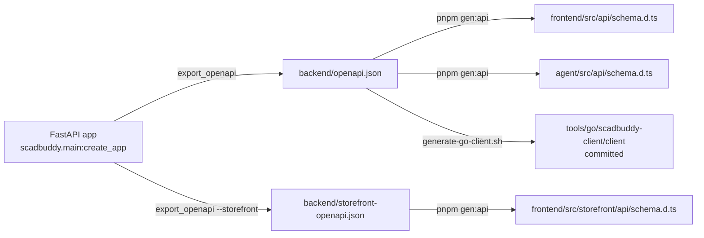

# Data

Where ScadBuddy keeps its state: one Postgres database with two migration ledgers, a
content-addressed blob store, git repositories on the data volume, and Temporal's own
history. Who may reach the database, and why, is in
[`docs/security/trust-boundaries.md`](../security/trust-boundaries.md) and the root
[`CLAUDE.md` "Database access"](../../CLAUDE.md#database-access-5295); this page does not
repeat it.

Line numbers are for `main` at `67d7ff6` (2026-11-21). Paths under
`backend/scadbuddy/` are shortened to `scadbuddy/`.

## Postgres

One database, one schema: the one `SCADBUDDY_DATABASE_URL` names
(`scadbuddy/core/settings.py:573`). The backend's tables and the agent's `ai_*` tables sit
side by side. In prod one role owns all of them (measured 2026-11-05 and re-measured
2026-11-14 in [trust-boundaries.md](../security/trust-boundaries.md#who-talks-to-the-database-today)).

Today's code: four processes hold this database's secret: the API, the agent sidecar, the
agent worker and agent-durable. The render, print and projects workers, the storefront
edge, the intake worker and the slicer hold none and reach data through the CRUD service
([processes.md](processes.md)).

### Ownership by domain

"Owner" below means the code that writes the table. In every case it is a table in the
same schema, created by a file in `backend/scadbuddy/migrations/` or
`backend/scadbuddy/migrations_agent/`.

| Domain | Tables (creating migration) | Written by |
|---|---|---|
| Render and blobs | `render_jobs` (`20260927T2243Z_render_jobs`), `blob_refs` (`20260928T0900Z_render_jobs_projection`), `store_blobs`, `store_folders` (`20260928T1800Z_blob_store`), `assets` (`20260928T1631Z_assets`), `piece_geometry` (`20261013T0719Z_piece_geometry`), `model_previews`, `template_media`, `saved_presets`, `analyzer_decisions`, `library_leases`, `library_pin_holds`, `library_install_slots`, `transfer_puts` | the API; the render worker through `crud.render` routes (`scadbuddy/api/crud_render.py:89`) |
| Core | `events` (`20260928T0630Z_events`), `settings`, `model_print_choices`, `printer_bed_types` (`20260928T0840Z_settings`), `operations`, `activity` (`20261010T0533Z_activity`), `crud_requests`, `models_repo_head`, `templates`, `template_copy_runs` (`20261124T1824Z_templates`, #7317), `flows_repo_head`, `git_remote_pushes`, `output_index`, `outputs`, `output_copy_runs` (`20261124T0053Z_outputs_records`, #7255), `output_files`, `output_derived`, `output_byte_runs` (`20261124T0245Z_output_bytes`, #7256), `output_cutover`, `output_claims` (`20261125T0758Z_outputs_cut_over`, #7257; see [Saved outputs](#saved-outputs)) | the API |
| Auth | `auth_sessions`, `auth_login_config`, `auth_break_glass_codes`, `service_credentials`, `personal_access_tokens`, `auth_delegation_codes`, `service_caller_suspensions` (2026-11-02 to 2026-11-06 files) | the API |
| Printing | `print_runs`, `print_sends`, `print_links`, `output_bambuddy_uploads`, `output_bambuddy_slices`, `output_last_prints`, `print_preview_slices`, `print_slice_starts`, `print_batches`, `print_batch_items`, `print_attachments`, `print_outcomes`, `printers`, `printer_reports` (`20261018T1659Z_printers`), `rack_nozzle_*`, `library_folders`, `library_files` (`20261017T2250Z_print_library`), `native_slices`, `library_copies`, `print_imports`, `print_lan_imports`, `lan_print_archives` and more | the API; the print worker through `crud.print` routes (`scadbuddy/api/crud_print.py:316`) |
| Spools and filament | `filament_*` (`20261114T1300Z`, `20261114T1301Z` and later), `filament_presets`, `filaments` (the overlay and native spool tables were dropped by `20261118T1235Z_drop_native_spool_tables`, and `held_local_presets` by `20261124T1308Z_drop_held_local_presets`, #7275) | the API; the print worker through CRUD |
| Label sheets (#7216) | `label_sheets` (`20261125T1454Z_label_sheets`) | the API |
| Flows | `workflow_definitions`, `workflow_runs`, `workflow_run_decisions`, `workflow_flow_states`, `workflow_run_proposals`, `workflow_run_links`, `flow_grants`, `flow_grant_uses`, `flow_triggers`, `flow_trigger_grants`, `flow_trigger_fires`, `tasks` (`20261124T0449Z_tasks`, #7364) | the API; the projects worker through `crud.projects` (`scadbuddy/api/crud_projects.py:71-73`; the tasks: `scadbuddy/api/crud_tasks.py`); the agent's run-grant check reads `flow_grants` and `flow_grant_uses` through `crud.agent` area `gate` (`agent/src/gate/crudStore.ts:13`) |
| Orders, payments, storefront | `customers*`, `orders`, `order_*` (`20261020T0446Z_orders` and later; `order_item_parts` and `model_part_rules` name `items` since `20261124T0918Z_parts_to_items`), `entity_attachments` (an order's files; `20261024T2050Z_order_attachments`, renamed by `20261122T0426Z_entities`), `parts_retired` and `part_stock_moves_retired` (the old `parts` and `part_stock_moves`, renamed by `20261124T0918Z_parts_to_items`; a follow-up drops them after a prod check, Ruling 6 of #7067), `payment_*`, `bank_*`, `printer_cost_profiles`, `storefront_*` (2026-11-07 to 2026-11-13 files) | the API; the storefront edge through `crud.storefront` (`scadbuddy/api/crud_storefront.py:208`); the intake worker through `crud.intake` (`scadbuddy/api/crud_intake.py:34`) |
| Entities (files, links and properties on any row, #6950, #7026) | `entities`, `entity_links` (`20261122T0426Z_entities`), `entity_properties` (one row per entity and key) and `entity_property_schemas` (one row per kind, seeded for `spool_type` and `spool`; `20261123T0017Z_entity_properties`), `entity_attachments` (the old `order_attachments`, renamed there; an order's files are its rows with an `order_id`) | the API |
| Inventory (#7067, spec 2026-11-21 §6.4-6.6) | `item_kinds`, `items`, `supplier_offers`, `offer_price_points`, `stock_lots`, `stock_units`, `stock_moves` (`20261124T0323Z_inventory_core`: also seeds the built-in kinds), and `part_item_map` (`20261124T0918Z_parts_to_items`: each old part id and its item id). `20261124T0918Z_parts_to_items` locks the four part tables `IN EXCLUSIVE MODE`, makes each `parts` row an item of kind `hardware` with an opening lot, converts `part_stock_moves` to `stock_moves`, makes an offer and a price point of each part's supplier and pack price, deletes the `part:` rows of `order_cost_entries` that the moves replace, and renames the old tables `*_retired`. The tables add foreign keys to `filament_suppliers`, `filament_locations`, `filament_invoice_lines` and `printers`, and change no filament table | the API |
| Agent (`ai_*`) | `ai_credentials`, `ai_settings` (`20260927T2349Z_credentials_settings`), `ai_sessions`, `ai_session_entries`, `ai_session_events` (`20260928T0107Z_sessions`), `ai_approvals`, `ai_mcp_tokens`, `ai_plugins`, `ai_audit`, `ai_payload_keys`, `ai_forgotten_subjects`, `ai_session_files`, `ai_flow_blobs`, `ai_push_*`, `ai_notify_channels`, the hosted plugins and feeds (`ai_hosted_plugins`, `ai_hosted_plugin_files`, `ai_hosted_plugin_versions`, `ai_plugin_feeds`, `ai_plugin_feed_packages`) and more | the API, which serves the agent every area through `crud.agent` routes (`scadbuddy/api/crud_agent*.py`, areas listed at `scadbuddy/api/crud_areas.py:202-248`, #5299); the agent's own SQL to these tables remains only as the fallback while an area is unlisted |

### The two migration ledgers

The rules for adding a migration are in the root
[`CLAUDE.md` "Migrations"](../../CLAUDE.md#migrations-491). In code:

- **Backend.** `migrate` (`scadbuddy/render/pg_store.py:84`) applies every file in
  `MIGRATIONS_DIR` (`:31`) not yet in `scadbuddy_migrations`, in id order, in one
  transaction under `pg_advisory_xact_lock(MIGRATION_LOCK)` ("SCADBDDY", `:27`). A file
  whose name does not match `MIGRATION_ID` (`:34`) fails at import. The API runs it first
  at start, through the settings store (`scadbuddy/main.py:2163`).
- **Agent.** `migrate_agent` (`scadbuddy/render/agent_migrations.py:105`) does the same
  for `migrations_agent/` under the lock "SCADAGNT" (`:49`), with lock and statement
  timeouts, and records each file's SHA-256 in `ai_migrations`. A changed file stops the
  start with `AgentMigrationChecksumError` (`:139-149`). The API runs it right after the
  backend's (`scadbuddy/main.py:2166`). The agent waits for no ledger (#5299 step 12); the
  agent tests' file list is `agent/test/support/expected-migrations.json`, which
  `agent/test/schema.test.ts` checks against this runner (see
  [`agent/CLAUDE.md`](../../agent/CLAUDE.md)).

### The CRUD service

Every process without a database secret reaches its rows through
`/api/v1/internal/crud/<caller>/…`, served by the API on its own port
(`SCADBUDDY_CRUD_PORT`, default 8082, `scadbuddy/core/settings.py:416`;
`scadbuddy/crud/listener.py:30-46`). Each router is `crud_router(caller)`, guarded by
`require_crud(caller)` in every auth mode (`scadbuddy/crud/guard.py:144-152`, `:44-73`).
The callers are agent, print, projects, render, storefront, intake and profile-fetch
(`scadbuddy/auth/service_auth.py:25-27`); their scopes are in
`scadbuddy/auth/service_credentials.py:100-107`. `GET …/<caller>/areas` lists what each
caller may use (`scadbuddy/api/crud_areas.py:170-236`); a worker waits for its areas
before it polls (for example `scadbuddy/worker.py:1106`). Retries are deduplicated by the
`crud_requests` ledger (`scadbuddy/crud/idempotency.py`).

## Blob store

Large bytes (render pieces, source snapshots, fonts, slices, library files, uploads,
order attachments) live in the blob store, not in Postgres. The design is in the
[template-pipelines spec §6](../superpowers/specs/2026-09-27-template-pipelines-design.md)
and the [own-store spec §4](../superpowers/specs/2026-10-16-own-store-slicer-rust-workers-design.md);
where they disagree with the code, see [Drift from specs](README.md#drift-from-specs).

### Backends

The stored setting `store_backend` (seeded from the environment, default `local`,
`scadbuddy/core/settings.py:228`) picks one at the API's start
(`scadbuddy/main.py:2192-2206`):

| Backend | Where bytes go | Code |
|---|---|---|
| `local` | files on the API's data volume; works only with the render worker in-process (a separate render worker refuses it, `scadbuddy/worker.py:222-257`) | `scadbuddy/store/local.py:22-35` |
| `bambuddy` | Bambuddy's library, one folder per template with a `Work/` folder, recorded in `store_folders` | `scadbuddy/store/bambuddy.py:3-15` |
| `s3` | an S3-compatible bucket, object key `<prefix>/<kind>/<sha256>` | `scadbuddy/store/s3.py:4-5`, `:47-48` |

### Keys and content addressing

`ContentStore` (`scadbuddy/store/content.py`) maps a logical key to a `BlobRef` (sha256,
kind, backend, backend id, size; `scadbuddy/store/content_models.py` `BlobRef`), indexed in
`store_blobs`. The kinds are `piece`, `snapshot`, `asset`, `font`, `slice`, `library`,
`workspace`, `media`, `output` and `tag_dump` (`content_models.py` `BlobKind`). A blob stays alive while a `blob_refs`
row holds it (`scadbuddy/store/refs.py:22-30`); unreferenced blobs of the swept kinds are
deleted after a grace period.

| Logical key | What | Code |
|---|---|---|
| 64-hex, `act-<40hex>`, `output-<32hex>-<n>` | a render job's pieces | `scadbuddy/api/crud_render.py:116` |
| `output-<id>-model`, `-preview`, `-thumbnail`, `-file-<hash>` | a saved output's bytes: `model.3mf`, `preview.glb`, `thumbnail.png`, and a `files/` entry, keyed by the first 32 hex digits of its name's sha256 (a save uploads each with no index row first, and the key is indexed in the row's transaction, `OutputBytes.put_folder`) | `scadbuddy/library/output_rows.py` `output_blob_key`, `output_file_key` |
| `output-<id>-thumbnail-<sha256>`, `output-<id>-plate_cover-<sha256>` | a thumbnail upload before its key names it (held by nothing); the plate cover read once out of the output's 3MF | `scadbuddy/library/output_rows.py` `staged_thumbnail_key`, `plate_cover_key` |
| `src-<slug>-<revision>` | a template's source snapshot | `scadbuddy/store/snapshots.py:65-66` |
| `asset-<id>` | an uploaded template asset | `scadbuddy/store/assets.py:30` |
| `font-<dir>` | a mirrored font | `scadbuddy/store/fonts.py:27` |
| `slice-<library_file_id>-<digest>` | a sliced 3MF | `scadbuddy/slicing/store.py:63` |
| `library-file-<id>`, `library-copy-<hash>`, `library-<id>` | print-library files and copies | `scadbuddy/print_library/native.py:52`, `scadbuddy/print_library/copy_models.py:51`, `scadbuddy/bambuddy/subject.py:102` |
| `library-upload-<sha256>` | a library upload's bytes, put while the request is received and read by its run on any replica; released once the answer is final, else swept with the claims after a day (#7373) | `scadbuddy/operations/blob_claims.py:39` |
| `quote-<sha256>`, `attachment-<sha256>` | order quotes and attachments | `scadbuddy/orders/quote.py:727`, `scadbuddy/orders/attachments.py:121` |
| `customer-preview-<sha256>`, `customer-file-<sha256>`, `listing-media-<sha256>` | storefront uploads and listing media | `scadbuddy/orders/storefront/intake.py:74`, `scadbuddy/orders/storefront/order_page.py:163`, `scadbuddy/orders/storefront/listings.py:963` |
| `workspace-<sha256>` | an agent workspace file | `scadbuddy/api/internal_workspace.py:43` |
| `tag_dump-<sha256>` | a Bambu tag's raw dump (#7905), uploaded by a service through core's shared CRUD area `blobs` (#7958); swept unless its caller holds it | `tools/go/core/internal/blobstore` `IndexKey` |

Processes without store credentials (the slicer) get short-lived transfer URLs instead:
a presigned S3 GET, or the API's `/api/v1/internal/blobs/{key}` with an HMAC transfer
token (`scadbuddy/slicing/transfer.py:52-57`, `scadbuddy/slicing/transfer_token.py`).
A service that stores bytes asks core's shared CRUD area `blobs` (#7958,
`tools/go/core/internal/blobstore`; client `internal/blobclient`) for an upload: on `s3` a
presigned PUT of a random staging object (`<prefix>/staging/<32 hex>`, the storefront's
staging form), its length, type and SHA-256 checksum signed in; the content key is never
presigned. At the commit core reads the staging object, checks its size and SHA-256, PUTs those
verified bytes to the content key unless that object is there already (never overwritten, as
`store/s3.py` `upload`), writes the `store_blobs` row as `BlobIndex.put` does with
`verified_at` set (`backend/tests/fixtures/blob-upload-vectors.json` pins both), and deletes
the staging object; one left behind goes with `sweep_staged` after a day. Any other backend
answers 503 `not_configured`.

On `bambuddy` and `s3`, each process that renders or reads pieces (the API and each render
worker) keeps a bounded cache of them in front of the store (`scadbuddy/store/cache.py`
`CachedBlobStore`, capped by `SCADBUDDY_WORKER_CACHE_MAX_BYTES`). It is the data volume's
`blobs/` unless `SCADBUDDY_BLOB_CACHE_DIR` puts it on a node-local volume (#7318,
`scadbuddy/store/factory.py` `build_store`); on `local` that `blobs/` is the store itself.
The cache is never shared: each replica fetches what it lacks. A job's files are named
`blobs/<key>/<file>` wherever the cache is (`scadbuddy/core/paths.py` `result_path`). A
fetch and a whole-file read are spans `blob_cache.fetch` and `blob_cache.read_file` with
`scadbuddy.cache.hit`.

## Files on the data volume

Templates are git repositories on the API's data volume (`SCADBUDDY_DATA_DIR`,
`Dockerfile:981`). The bundled models are mirrored into `_builtin/` as one commit at
start (`scadbuddy/library/catalogue.py:2940-2956`, called from `scadbuddy/main.py:1561-1565`).
Every model edit is a commit, which is what versions and history read
([features/versions-and-history.md](../features/versions-and-history.md)).

### Template records

Each template folder that has a `model.scad` also has a row of `templates` (#7317, phase 1
of the [model records spec](../superpowers/specs/2026-11-25-model-records-in-postgres-design.md),
migration `20261124T1824Z_templates.sql`): its parsed `model.json` (`meta`, or `meta_error`
and the raw `meta_text` when it cannot be read or stored), `name`, `version` (the last
commit that touched it), `inputs_version`, its `// color` parameters, its media files'
sizes, its cover and a `files_stamp` (`scadbuddy/library/template_rows.py` `TemplateRow`).
The row is derived: git stays the record, and any row can be rebuilt from the tree.
`Catalogue.slugs`, `list_models` and `record` read the rows, and so do the pin index, the
library associations (`raw_metas`), the print settings, the name check, `duplicates_of`,
and the callers that only name or filter models (`list_summaries`: the activity facets,
the print-import suggestions and the outputs' `?tag=`). Since phase 3 they read the rows
always, with no walk of the folders or of the history before a copy run has finished
(`scadbuddy/library/catalogue.py` `Catalogue._rows`). A reader with no rows open raises
`RuntimeError`; the API opens them after its migrations, before it serves. The walk lives
only in the copy. `library_users` and `library_pins` always read the files (spec §7.4).

- A database where no copy run has finished (a fresh install, a test's database) gets its
  first copy at the API's start, before the app serves (`scadbuddy/main.py`
  `_first_template_copy`). When a run has finished (every start after the first), it does
  nothing. When another replica holds the copy lock, it waits for that run up to
  `FIRST_COPY_WAIT`, inside the startupProbe's budget, and takes the lock itself when that
  run ends unfinished. A SIGTERM or SIGINT stops the copy and the wait. A copy that fails
  or ends `incomplete`, or a wait that ends, is logged at error level and the app serves
  anyway; the lists lack what the copy missed until the next copy run.
- A template with files but no row (a failed refresh, a folder made by hand on the
  volume, an older pod's create) is not in the list until the next copy run. `record`,
  its print settings and its thumbnail read it from its files at once. A write's own
  answer is read from the files too (`_fresh_record`), so it shows the write even when
  its refresh failed.
- These reads of the files stay by design: one template's files when it has no row, when
  Postgres cannot store its `model.json`, or while its row lags its media; git for one
  record's `version_pair` and `ui_version` and for every history route; the source,
  media bytes, editing, rendering, duplicate and merge; `library_users` and
  `library_pins`; and the output cover's fallback to the output folders, which belongs to
  the outputs cut-over (#7257).

- A row whose folder is gone (a hand removal, a delete whose row drop failed) is a 404 for
  `record` and for its thumbnail's 200, has no print settings, holds no name in the name
  check, is no duplicate in `duplicates_of` and is made from no library file (the
  associations' implied `mesh_source`): each of these readers makes one
  `Catalogue.exists` check for it (a hit is one stat; a miss also revalidates the
  directories). A thumbnail 304 makes no check, so a client that holds the tag gets 304
  until the next copy run drops the row. The list keeps such a row until then too
  (spec §10).
- A row whose `model.json` Postgres cannot store (`meta` null, `meta_error` `not storable
  (…)`: NaN, a lone surrogate) is read from its file by every reader, the list and
  `list_summaries` included. It costs reads of its own files only, never a walk. When
  its folder is gone, the list and `list_summaries` both leave it out (#7661).
- A media file that the row's `files` lacks is stat'ed only while the template's media
  changed after the row's `refreshed_at` (`TemplateRow.media_newer`, read with the row from
  `templates.media_changed_at`): every media write (an add, a removal, a reorder, a
  built-in's cover choice) sets that column in its own transaction, before the template's
  row is refreshed, so a new item is on the disk first. Once the row is newer, such a file
  is `missing` with no stat. An older pod's media write during a roll sets no
  `media_changed_at`.
- The catalogue thumbnail reads `Catalogue.thumbnail_ref`: the row's `cover`, else the
  output's plate cover (`OutputStore.plate_cover_output`), else the preview
  (`PreviewStore.preview_id`). Its `ETag` names the source: the cover's `sha256` (the hash
  of the bytes, the same value as before phase 2), `"output-<id>"` or `"preview-<id>"`. A matching
  `If-None-Match` is a 304 with no file read or stat, except for a row that lags its media,
  which is read from the files. A 200 reads the source
  (`OutputStore.plate_image`, `PreviewStore.current_image`, which reads the preview's id and
  image from one row) and carries the tag of what it read (plan decision 12). No row is
  one `Catalogue.exists` check: a template with files but no row (a failed refresh) is
  read from the files, as its record is, and one with no folder either is a 404. A row
  that lags its media is read from the files too; both are tagged by the bytes
  (`scadbuddy/api/models.py` `get_thumbnail`). A cover that someone replaces by hand on the
  volume keeps its row's old tag, so it is served stale until the next refresh or copy run
  repairs the row (spec §10).

- A write that commits writes its templates' rows in the transaction that records the
  models HEAD and sends its NOTIFY (`scadbuddy/library/history.py` `_also_record`,
  `scadbuddy/library/repo_lock.py` `_PgHold._also`, in a savepoint), so a save adds no
  Postgres commit. The rows are read and built before that transaction opens, and a
  failed read or row write costs the rows only, never the HEAD or its NOTIFY. Content
  Postgres refuses (a NUL, a `\u0000` escape) is cleaned when the row is built
  (`scadbuddy/library/catalogue.py` `_unstorable`, `_storable_text`). When git cannot
  list what a commit touched, the rows written are those of the templates the write
  named. A write that commits nothing (`ModelHistory.commit` with no change, a
  built-in's added media, a create whose commit failed) refreshes its rows under the
  models write lock in a transaction of its own (`scadbuddy/library/template_refresh.py`
  `TemplateRefresh.refresh_locked`); without git, `Catalogue.notify_change` refreshes them.
- A failed refresh never fails the write. It is logged with the template ids and counted in
  `scadbuddy_template_refresh_failures_total` (label `path`: `commit`, `no_commit` or
  `no_git`; `scadbuddy/core/metrics.py`). The next copy run repairs the row. Two other
  misses are counted under `no_commit` too: a commit that wrote its
  files but did not get the write lock, so nothing refreshed its rows
  (`scadbuddy/library/catalogue.py` `Catalogue._commit`), and a no-commit refresh for which
  git did not name a version, so the row keeps its stored one.
- Each API start copies the files to rows once (`scadbuddy/library/template_copy.py`
  `copy_templates`, one replica at a time under the advisory lock `COPY_LOCK`; a run that
  does not get it does nothing). It starts in the background during the lifespan, before
  the app serves, and goes on while the app serves, except on a start whose first copy
  (above) finished: that start does not copy again. The housekeeping sweep `housekeeping_copy_templates`
  (`workflows/housekeeping.py` `TEMPLATE_COPY_SWEEP`, directly after the activity sweep, behind
  `TEMPLATE_COPY_PATCH`) copies again on each run of the sweeps' Schedule. Each run is a
  row of `template_copy_runs`. The copy reconciles: outside the write lock it walks the
  folders, reads every version with one `git log` walk and stats each template's files; a
  template with no row, or whose stamp or version differs, is read again `BATCH` at a time,
  each batch under the write lock. Under the lock it corrects the versions of a commit made
  since its walk, and when git cannot name a version the row keeps its stored one. Then,
  under the lock, it drops each row whose folder the walk did not see and that is not there
  now.
- A run whose walk may have missed templates (a listing, stat or batch read failed, git
  failed in a batch, `models/` is missing, or the walk saw no template while rows exist)
  or whose walk of the history failed (each row then keeps its stored version, so only a
  template whose stamp changed is read again) drops no row and ends `incomplete`, with no `finished_at`. A stopped run has no
  `finished_at` either.
- A new run deletes the runs that started more than `RUN_KEPT` (30 days) before it
  (`scadbuddy/library/template_rows.py` `TemplateRows.start_run`). If every run ends
  incomplete for that period, the finished runs are deleted: `TemplateRows.copied()`
  answers false at the next start, and each start then copies before it serves (as on a
  new database).
- `GET /api/v1/model-records/copy-status` answers the last run: `started_at`,
  `finished_at`, `incomplete`, `added`, `refreshed`, `dropped`, and `unreadable`, each
  walked template whose row has a `meta_error`: its `model.json` is not JSON, cannot be
  stored, or does not validate (`scadbuddy/api/models.py`
  `template_copy_status`; 404 before any run).
- Pods on an older build write the files and commit with no rows, during a roll-out and
  after a rollback. The next housekeeping sweep repairs their rows. After a roll-out,
  confirm that every pod runs the new image (`kubectl -n bambuddy get pods -o jsonpath` on
  the images), then read the copy status: a run with a `finished_at`, not `incomplete`, that
  started after the last pod on the older build went.

### Saved outputs

A saved output's record is a row of `outputs` (#7255, phase 1 of the
[outputs-in-Postgres spec](../superpowers/specs/2026-11-23-outputs-in-postgres-design.md)):
what its `meta.json`, `params.json`, `inputs.json`, `record.json`, `manifest.json`,
`bom.json`, `arranged_from.json` and `backfill.json` hold (`scadbuddy/library/output_rows.py`
`OutputRows`). Its last print stays in `output_last_prints`.

Its bytes (`model.3mf`, `preview.glb`, `thumbnail.png`, each file in `files/`) are blobs
of kind `output` (#7256, phase 2), held in `blob_refs` by `(output, <output_id>)`. The row
names the keys (`model_blob`, `preview_blob`, `thumbnail_blob`, and one `output_files` row
per `files/` name); `bytes_at` is set once the blobs hold the bytes, and NULL while only
the files do. The folder `data/outputs/<slug>/<id>/` stays as the fallback until #7257: a
save still writes it, and every reader reads the file when the row names no blob, or when
the blob is lost (logged, never a 500). A save writes the folder, uploads the bytes with no
index row (`OutputBytes.put_folder`, `ContentStore.stage`), then inserts the row, writes the
index rows of the output's keys naming those objects, its `output_files` rows and its holds,
in one transaction. When the row fails (an id
that another output holds, `orders/quote.py` `operation_output_id`, among the causes), the
save fails, its folder is removed (`OutputStore._insert_row`) and the objects it uploaded
are removed (`OutputBytes.drop_staged`; an object it reused is another row's and stays): no
key of the other output moved, so that output keeps its bytes. A put into a full store is a
507. On `bambuddy` (spec §6.4) no output blob is
written: the bytes stay files. The `local` backend has no content store, so the outputs
get one of their own under `data/output-blobs/`, with the shared index and spool (#7257,
plan D7); the byte copy runs there too. A store switch from `local` to `s3` (no store
migration from `local`, `workflows/store_migration_models.py`) leaves `outputs` rows whose
keys have index rows that name `local`: release A falls back to the files, and release B
is to answer 500 for them. This affects dev stores only. A store migration to `bambuddy` is refused while the index holds an `output` blob
(`scadbuddy/store/migrate.py` `refuse_outputs_to_bambuddy`). A delete deletes the row
and releases its byte holds in one transaction, then removes the folder; the content sweep
removes the blobs after its grace (`OutputRows.delete`).

A save's cost in commits is one, however many files it has (#7477): the row's transaction
writes every index row. Two cases each put once handled alone have a rule of their own.
An object the save reused (the index named the same bytes already) is held only from that
transaction on; when the sweep freed it first (`ReuseLostError`), the transaction rolls
back whole, the save uploads its own copy of every object it reused
(`OutputBytes.own_copies`), and writes the transaction once more, which then reuses
nothing. A deadlock or a serialization failure runs the transaction again whole, up to
three attempts (`OutputRows.insert`); the last one's error fails the save, which removes its
folder and the objects it uploaded. Until the commit no row names an uploaded object. So
from before each upload until its commit or its failure the save holds a session advisory
lock on the object, shared (`store/index.py` `StageHold`, `object_lock_name`: one per
backend and sha256, on one pooled connection, no transaction). Any release of an object
(a failed save's, a replaced key's, the content sweep's) and the unrecorded sweep remove it
only while they hold that lock exclusively, taken without waiting, and no row names it,
checked under the lock (`ContentStore.claim_object`, `BlobIndex.claim_unnamed`): an object
another save of the same bytes has uploaded and not indexed yet stays. These are the API's
releases; the render worker's content store (over the CRUD routes) takes no lock, and its
index never admits kind `output` (`api/crud_render.py` `READ_KINDS`), so it never removes
an output's object. A connection whose unlock fails is closed, never given back to its
pool with the lock. The holds take their connections from a small pool of their own
(`scadbuddy-stage-locks`, `STAGE_LOCK_POOL_SIZE`, 4; `store/index.py` `StageLocks`), never
the API's shared pool: a save waits for one of its `STAGE_LOCK_SLOTS` (3) before its first
upload, so at most that many saves per pod are between their first upload and their
commit, and none waits mid-save for a second lock connection. A removal's exclusive lock
takes the pool's last connection (`CLAIM_LOCK_SLOTS`, 1; `StageLocks.claim_connection`),
and checks the index on it too, since it holds the lock through the backend's remove (a
round trip on S3 or Bambuddy): removals on one pod run one at a time, and none holds a
connection of the shared pool (#7756 review). A save waits for a removal's lock at most
`STAGE_LOCK_TRIES` (6) tries of `STAGE_LOCK_TIMEOUT_MS` (5 s), a `SET LOCAL lock_timeout`
in each try's transaction; then it fails with `StageLockBusyError`, closing its hold and
freeing its slot, so a hung remove never pins a save slot. On `local` the unrecorded sweep
reads an object's mtime again under its claim and keeps one written since its cutoff (a
plain put of the same bytes). A cancel cannot stop the row's transaction, which
runs in a thread: the save keeps its locks until that thread ends, then the cancel stands.
When a reuse is lost, the save removes the `meta.json` its first commit wrote before it
puts its own copies, so a cancel meanwhile leaves a folder the hold reaper removes, as a
cancel during the puts does. A save that dies before its commit drops its connection and
so its locks; the blob sweep's unrecorded step (`main._sweep_unrecorded`, run with
`claim`) then removes its objects once they are older than `sweep_grace`: on `s3`
(`S3ContentBackend.sweep_unrecorded`, which lists the bucket, so it finds an object no row
ever named) and on `local` in the outputs' own store (`LocalContentBackend.sweep_unrecorded`,
which walks `data/output-blobs/`). The save then files its 3MF in
the native library from the folder it wrote, the same bytes as the model blob, so it
does not download the blob again (`scadbuddy/library/output_operations.py`). The filing's
own put commits once more.

What readers derive of the model (the geometry analysis and its attributed form, the
asset ids, the plate names, the plate cover) is kept in `output_derived`, once per output.
The plate cover is a small blob (`output-<id>-plate_cover-<sha256>`); the row names its
key, or none when the 3MF has no cover. A derive writes only while the model the reader
read is still the row's (the row's model key names the same sha256, or the files hold the
bytes). One window stays: an attributed analysis made from a geometry row read between the
byte copy's model swap and its `drop_derived` can stay stale. It needs a hand-edited
`model.3mf`, and it is accepted (spec §4.5). A copied row whose model blob is lost keeps no
derived rows: readers fall back to the file and derive again until the blob is back.

Each API start copies the folders to rows once (`scadbuddy/library/output_copy.py`
`copy_outputs`, one replica at a time under an advisory lock, held on a connection of its
own; a run that does not get the lock does nothing). The housekeeping sweep `housekeeping_copy_outputs` copies them again
on each run of the sweeps' Schedule (`workflows/housekeeping.py` `OUTPUT_COPY_SWEEP`, every
`asset_sweep_interval`; with the sweeps off, `asset_sweep_interval` 0, only the start
copies). Each run is a row of `output_copy_runs`.
`GET /api/v1/outputs/copy-status` answers the last run. Until a run finishes, a lookup
that finds no row falls back to the files; after one, a missing row is a missing output.
A run whose walk may have missed folders does not finish: it records its counts with
`incomplete` true and no `finished_at`. Each run stats about ten record files in each
output folder (`files_stamp`) and reads a folder only when its stamp changed. The copy
reconciles:

- A folder with no row gets one. A row is read again when the folder's `files_stamp`
  differs from the row's: a sha256 of the sorted name, size and `mtime_ns` of the record
  files, so no NFS clock is compared with the database's. A save writes no stamp, so the
  next run reads its folder once.
- Live writers (a save, a rename, a backfill change) set `copied_at` to the database's
  clock. The copy takes a mark from that clock before it reads a batch. A refresh is
  `UPDATE … WHERE copied_at < mark`, and a new row is `INSERT … ON CONFLICT DO NOTHING`
  (`OutputRows.write_copy`), so a live write wins.
- After each batch, `undo_copy` deletes each row the batch wrote whose `meta.json` is
  gone, only while its `copied_at` is still the mark. The run's end checks the rows it
  inserted once more.
- A row whose folder the walk did not see is dropped, only when its `copied_at` is before
  the run's start. When a listing or a stat fails (ESTALE, EIO), or the outputs folder
  lists nothing while rows exist, the run drops no row and is `incomplete`.
- A folder with no readable `meta.json` gets no row and goes on the run's `not_copied`
  list; a side file that cannot be read is left out of its row and named on `damaged`.
- Pods on an older build save and delete outputs in the files only, during a roll-out
  and after a rollback. The next housekeeping sweep gives their saves rows and drops the
  rows of their deletes. Until then, such a save is a 404 on the newer pods once a copy
  run has finished (`OutputRows.copied` stays true in each process); README, "Saved
  outputs during a roll-out".

After a roll-out, confirm that every pod runs the new image (`kubectl -n bambuddy get
pods -o jsonpath` on the images), then read `GET /api/v1/outputs/copy-status`. Check that
its run has a `finished_at`, is not `incomplete`, and started after the last pod on the
older build went. Until then, writes of the older pods may have no row yet.

Once a row copy run has finished, `GET /api/v1/outputs` lists from the `outputs` rows
(#7257, release A): `name` and `source` are columns generated from `meta`, and
`params_text` is a plain column that a save writes. A row that a pod on the phase 2 build
saves has no `params_text`, so a text search does not find it by its params until release
B fills them. The print links read an output's slug from `outputs` too. `output_index` and
`output_hold_slugs` are still written, and each write to them is skipped with a warning
when the table is gone; release B is to drop both.

The copies stop at the cut-over mark (#7257, [The cut-over](#the-cut-over)).

#### The byte copy

The byte copy puts the existing outputs' bytes into the blob store
(`scadbuddy/library/output_byte_copy.py` `copy_output_bytes`). Each API start runs it once,
after the row copy, and the housekeeping sweep `housekeeping_copy_output_bytes`
(`workflows/housekeeping.py` `OUTPUT_BYTES_SWEEP`, after `OUTPUT_COPY_SWEEP`, on the
sweeps' Schedule) runs it again, with a timeout of 30 minutes (`OUTPUT_BYTES_TIMEOUT`). One
replica copies at a time, under a session advisory lock. That lock holds one autocommit
connection of its own (`scadbuddy-output-byte-copy`, no transaction), not a pool's, for the
whole run: in the sweep up to that timeout, and at a start with no bound (the first start
after the roll-out copies every output). Each of the run's statements takes a connection of
the main pool. Each run is
a row of `output_byte_runs`. It reconciles:

- A row whose `bytes_at` is set and whose `bytes_stamp` (the name, size and `mtime_ns` of
  the byte files) is the folder's is skipped.
- For every other row, each byte file is compared with the blob its key names: the
  index's sha256 first, then the file's hash. An equal file is not put. A different one is
  put with a compare-and-swap on that sha256, so a live writer that moved the key keeps its
  blob. A thumbnail goes up under a staged key, and the thumbnail key takes it in the
  batch's transaction, under the output's thumbnail lock, only while the row, the key and
  the file are still what the copy read.
- Each blob the copy put, and every blob of a row not copied before, is read back from the
  backend and checked (`verified`).
- When the model key of a row copied before takes other bytes, the rows derived from the
  old model are deleted at once (`OutputRows.drop_derived`).
- The rows name their keys in batches of 50 outputs, one transaction each.
- A missing `model.3mf` or `preview.glb` is `damaged`, on the run and on the row. A
  `files/` entry that is not a regular file, or has a name an output may not hold, makes
  the output `damaged` with the names, and it is not copied. A read, put or check that
  fails is `failed`, and the row keeps `bytes_at` NULL. A stat that fails with anything but
  a missing file makes the run `incomplete`.
- A missing file never drops a key. When the row names a blob for that role, or a
  `files/` name that went, the key and its hold stay, and the file is `damaged`.
- A volume that is not there is not every output gone (phase 1's rule). An outputs folder
  that is missing, or lists no slug folder while rows exist, makes the run `incomplete`,
  and it writes nothing. An output whose folder is missing gets no write, and the run is
  `incomplete`. At a start, the byte copy runs only after a row copy run that finished
  (`finished_at` set, not `incomplete`); else the sweep runs it.
- `copied` counts only the outputs where the run put a blob or named a key the row did
  not name before.

Refusals: before any put, the copy adds up the bytes and the count of the rows with
`bytes_at` NULL (an output with a bad `files/` name adds nothing, as it is not copied) and checks them against `store_max_total_bytes` and `store_max_count`.
Past a cap, the run is `refused`, names the shortfall and puts nothing. The needed bytes
and count can be more than the copy will add, never less: blobs that a failed run already
put are counted again until the sweep removes them. On `local` the outputs' own content
store has no caps, as the `local` store has none, so the check never refuses there. On the
`bambuddy` backend every run is refused.

A run has a `finished_at` only when nothing was refused, failed or incomplete and it was
not stopped. `GET /api/v1/outputs/copy-status` answers the last byte run as `bytes`
(`null` before any), with `pending`, the count of rows whose bytes the files still hold
now, and the rows' damage from every run: `damaged_rows`, the count of rows whose
`damaged` is not empty, and `damaged_sample`, the first 50 of them by output id as
`{output_id, damaged}`. The run's own `damaged` names only what that run found: a later
run skips an output whose files did not change.

After a roll-out of phase 2, confirm that every pod runs the new image (`kubectl -n
bambuddy get pods -o jsonpath` on the images), then read `GET /api/v1/outputs/copy-status`.
Check that `bytes` has a `finished_at`, is not `incomplete`, has no `refused`, started
after the last pod on the older build went, and that `pending` counts no output but those
that `damaged_sample` names with `names` (a refused `files/` name keeps `bytes_at` NULL). The first
runs after the roll-out put and read back every output's bytes. A sweep's run stops at its
30-minute timeout with no `finished_at`, and the batches it committed stay, so `pending`
can take several sweeps to reach 0. Before you call a run with no `finished_at` a fault,
check that `pending` went down since the run before it, and read again after the next
sweep. Pods on an older build write the files only; the next sweep copies what they wrote. Read `damaged_rows`
and `damaged_sample`, not the run's `damaged`: a person checks each output they name.
When `damaged_rows` is more than the sample, list the rest with
`SELECT output_id, damaged FROM outputs WHERE damaged <> '[]' ORDER BY output_id`. An output with a refused `files/` name keeps its
folder as the only copy of its bytes until the name is fixed.

#### The cut-over

Phase 3 (#7257) stops reading and writing `data/outputs/`. It ships as two releases,
because during a roll the pods of the old build run beside the new ones (plan
`docs/superpowers/plans/2026-11-25-outputs-cutover-phase-3.md`, D1). A phase 2 pod writes
into an output's folder on a rename, a thumbnail upload and an attributed analysis, and
fails when the folder is missing. So release A (3a) still writes every folder. Release B
(3b, not built yet) is to stop the folder writes and to remove the file fallback, the
copies, the directory scans and `output_index`.

The mark is the one row of `output_cutover` (its key column is `one`). The API writes it
(`OutputRows.try_cut_over`) in one transaction when all of these hold:

- it gets both copies' advisory locks at once (`pg_try_advisory_xact_lock`), so no copy
  runs;
- the last row copy run has a `finished_at`;
- the last byte run has a `finished_at`, no `refused` and an empty `failed`;
- no `outputs` row has `bytes_at` NULL.

It tries at each start, before the copies, and after each byte run that ended. Once the
mark exists, both copies do nothing, at the start and in the sweeps: each checks the
mark before its lock and again under it. `GET /api/v1/outputs/copy-status` names the
mark's time as `cut_over_at` (`null` before it). Each process keeps the mark once it has
read it. On `bambuddy` the byte copy is refused, so the mark is never written there.

After the mark, release A:

- writes into an output's folder as before, but a missing folder skips the file step
  (logged at debug) and the row and blob steps run as before. This holds for a rename,
  the storefront mark, the backfill writes, a thumbnail (uploaded or drawn), the kept
  geometry and an attributed analysis (`OutputStore._folder_write`). Before the mark, a
  missing folder raises, as in phase 2.
- reaps orphan holds from the rows only: it releases the `output` holds of each holder
  whose oldest hold is past the grace and which has no `outputs` row and no claim younger
  than the grace. It scans no folder and reads no `output_hold_slugs`.

A save that names its id (a quote's attempt, #5390) claims it in `output_claims` first,
then makes the folder (`OutputStore.claim`). Other saves take a new id and no claim. As
with a phase 2 pod's save, their holds are kept only while they are younger than the
grace. A pod of release B is to claim in the table only,
so both share one claim during release B's roll. A claim ends in one of three ways: the
save's row deletes it in the row's transaction, a failed save releases it
(`output_operations.py`), or the hold reaper prunes it once it is older than
`ORPHAN_HOLD_GRACE` (1 hour). A release that fails is logged and left to the prune. So
`ORPHAN_HOLD_GRACE` is also the claim's lease: a save that runs longer than it can lose its
claim, and a release B pod can then claim the same id (a release A pod's row claim
succeeds, but its `mkdir` fails on the live save's folder, and it releases the claim). Release B is to keep a live save's
claim. A phase 2 pod that saves after the mark takes no table claim, and its holds are
kept only while they are younger than the grace.

Release B's migration is to refuse to run while the mark is missing (unless `outputs`
and `output_index` are both empty), and while any row has `bytes_at` NULL. The migration
runs at the API's start, so a refused release B pod does not start, and the release A
pods go on serving. On `bambuddy` the mark is never written, so release B refuses every
start on such an install that holds an output. This is the decision (plan D2, D7):
outputs never go into Bambuddy's library (spec §6.4). The refusal's text names the cause
and the remedy: move the store to `s3` or `local`, let release A run the copies until
`cut_over_at` is set, then upgrade.

Before release A's roll, read `GET /api/v1/outputs/copy-status`: the row copy's
`not_copied` must be empty (fix or remove each folder first). Such a folder has no
readable `meta.json` and so no row. Once the mark exists, the rows-only reaper releases
its Parts holds past the grace, and the content sweep then removes its pieces.

After release A's roll ends:

1. Confirm that every API pod runs release A's image (`kubectl -n bambuddy get pods -o
   jsonpath` on the images, as above).
2. Read `GET /api/v1/outputs/copy-status`. `cut_over_at` must be set, and `bytes.pending`
   must be 0.
3. When `cut_over_at` is `null`, read `bytes` (`refused`, `failed`, `pending`) and fix
   that first. The next start or byte sweep tries the mark again.
4. When `cut_over_at` is set and `pending` is not 0, a phase 2 pod's row copy wrote a row
   after the mark (an orphan folder's row, with `bytes_at` NULL). The copies of release A
   no longer fill it, and release B's migration is to refuse it. To recover, delete the mark
   (`DELETE FROM output_cutover`), then restart the API pods (`kubectl -n bambuddy
   rollout restart deploy scadbuddy`), because each process keeps the mark once it has
   read it. The starts then copy the rows and the bytes, and write the mark again when the
   conditions hold. Read copy-status again.

## Generated API files

The rules are in the root
[`CLAUDE.md` "Generated API files"](../../CLAUDE.md#generated-api-files). In short:

The Dockerfile's `api-spec` stage runs both exports (`Dockerfile:129-130`) for the
`frontend` and `agent-build` stages. Only the Go client is committed; it covers just the
print library and operations routes (`scripts/generate-go-client.sh:40-44`).

## Temporal

Workflow inputs, outputs and histories live in Temporal, in the namespace
`SCADBUDDY_TEMPORAL_NAMESPACE`. Agent session and flow payloads are encrypted by a
per-subject codec whose keys are in `ai_payload_keys`
([agent.md](agent.md)). The queues and workflows are in [workflows.md](workflows.md).
