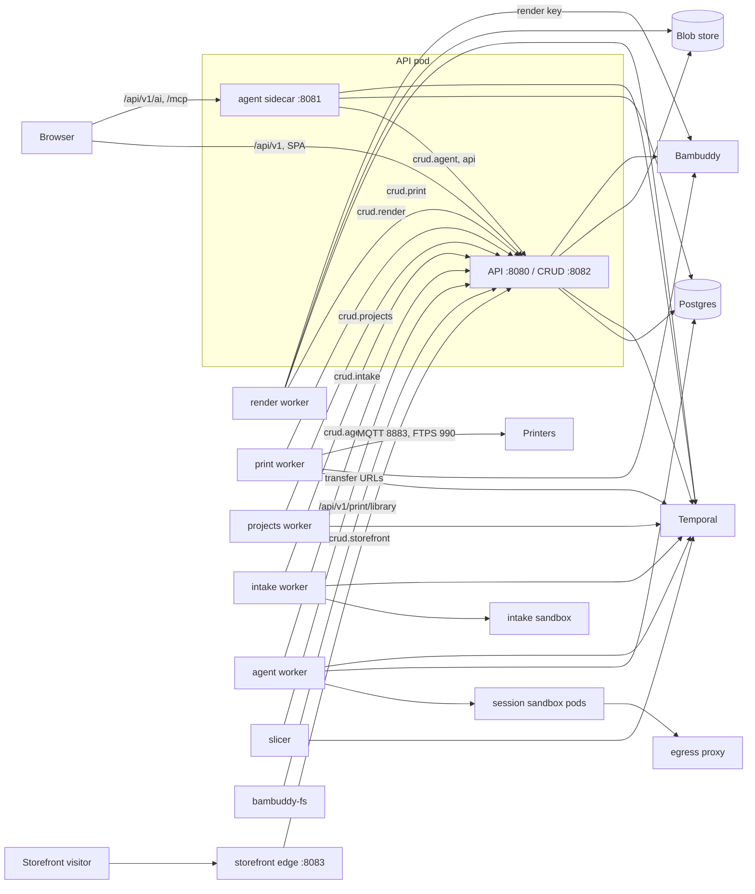

# Processes

One section per deployable process: its entrypoint, its image, what it runs, the
credentials it reads (by variable name; no values), and its trust zone. The zones, the
measured state of each pod and the known gaps are in
[`docs/security/trust-boundaries.md`](../security/trust-boundaries.md): see
["What each pod holds"](../security/trust-boundaries.md#what-each-pod-holds),
["Where untrusted code runs"](../security/trust-boundaries.md#where-untrusted-code-runs) and
["Zones"](../security/trust-boundaries.md#zones). This page does not restate them. The
Kubernetes objects live in eh-homelab/clusters; how a build reaches them is in
[ci-and-deploy.md](ci-and-deploy.md).

The role of a Python process is chosen by its command, not by an environment variable;
the agent's role is chosen by `SCADBUDDY_AGENT_ROLE`. Every `SCADBUDDY_*` setting of the
backend is listed by `python -m scadbuddy.tools.settings_reference`. Paths under
`backend/scadbuddy/` are shortened to `scadbuddy/`.

| Process | Image (Dockerfile stage) | Command | Ports | Holds a database secret |
|---|---|---|---|---|
| [API (CRUD service)](#api) | `scadbuddy` (`runtime`) | `uvicorn --factory scadbuddy.main:create_app` | 8080, CRUD 8082 | yes |
| [Render worker](#render-worker) | `scadbuddy` (`runtime`) | `python -m scadbuddy.worker` | 9090 (health) | no |
| [Print worker](#print-worker) | `scadbuddy` (`runtime`) | `python -m scadbuddy.worker --queue bambuddy` | 9090 | no |
| [Projects worker](#projects-worker) | `scadbuddy` (`runtime`) | `python -m scadbuddy.worker --queue projects` | 9090 | no |
| [Storefront edge](#storefront-edge) | `scadbuddy` (`runtime`) | `python -m scadbuddy.storefront` | 8083 | no |
| [Intake worker and sandbox](#intake-worker-and-sandbox) | `scadbuddy` (`runtime`) | `python -m scadbuddy.intake_worker`, `python -m scadbuddy.intake_worker.sandbox` | 9090, 8090 | no |
| [Agent sidecar](#agent-sidecar-and-agent-worker) | `scadbuddy-agent` (`agent`) | `node dist/main.js`, role `api` | 8081 | yes (today's code) |
| [Agent worker](#agent-sidecar-and-agent-worker) | `scadbuddy-agent` (`agent`) | `node dist/main.js`, role `worker` | 8081 (health) | yes (today's code) |
| [Session sandbox and egress proxy](#session-sandbox-and-egress-proxy) | `scadbuddy-sandbox` (`sandbox`) | `node dist/sandbox/main.js` | 8090, 3128 | no |
| [agent-durable](#agent-durable) | `scadbuddy-agent-durable` (`agent-durable`) | `python -m scadbuddy_durable` | 8082 (health) | yes, mounted (today's manifests) |
| [Slicer worker](#slicer-worker) | `scadbuddy-slicer` (`slicer`) | `scadbuddy-slicer` | 9090 | no |
| [bambuddy-fs](#bambuddy-fs) | `scadbuddy-bambuddy-fs` (`tools/go/bambuddy-fs/Dockerfile`) | `bambuddy-fs mount` | none | no |
| [Frontend](#frontend) | built into `scadbuddy` (`frontend` stage) | served by the API and the edge | | |

## API

- **Runs.** `create_app` (`scadbuddy/main.py:2255`); `lifespan` (`scadbuddy/main.py:2030`)
  applies both migration ledgers, grants and revokes retired roles, opens the blob store,
  starts the in-process `library` worker (always), the print upkeep, and on its own port
  the CRUD listener (`scadbuddy/main.py:2034-2210`). Routers under `api/` are mounted
  automatically under `/api/v1` (`scadbuddy/main.py:259-277`); the built frontend is
  mounted last at `/` (`scadbuddy/main.py:2387`).
- **Also runs untrusted code today:** openscad renders for the editor's checks and
  `openscad-lsp`, the latter under a no-network seccomp filter (`scadbuddy/editor/nonet.py:3-6`);
  #5296 moves them out.
- **Reads.** `SCADBUDDY_DATABASE_URL`, `SCADBUDDY_SECRET_KEY_FILE` (and `_PREVIOUS_FILE`),
  `SCADBUDDY_TEMPORAL_ADDRESS`, the Bambuddy URL and keys and the S3 store settings (also
  stored settings), `SCADBUDDY_AUTH_MODE` and the OIDC settings, `SCADBUDDY_AGENT_INTERNAL_URL`
  (`scadbuddy/core/settings.py:145-624`).
- **Talks to.** Postgres, Temporal, the blob store, Bambuddy, the Kubernetes API for
  token reviews (`scadbuddy/auth/exchange.py:127-128`), the OIDC issuer, Google Fonts and
  the optional git remote.
- **Zone.** The CRUD service: the only process meant to hold SQL access
  ([`CLAUDE.md` "Database access"](../../CLAUDE.md#database-access-5295)).

## Render worker

- **Runs.** `run_worker` (`scadbuddy/worker.py:1077`) on queue `render`: renders and
  template pipelines ([workflows.md](workflows.md#render-split-by-colour-3mf)).
- **Reads.** `SCADBUDDY_API_INTERNAL_URL` and a service proof,
  `SCADBUDDY_SERVICE_TOKEN_FILE` or `SCADBUDDY_SERVICE_BOOTSTRAP_FILE`; without one it
  refuses to start (`scadbuddy/auth/service_auth.py:233-254`). It ignores
  `SCADBUDDY_DATABASE_URL` (`scadbuddy/worker.py:1093-1096`) and refuses the `local` store
  (`scadbuddy/worker.py:218-253`). The S3 keys and the Bambuddy render key come from its
  CRUD settings route (`scadbuddy/api/crud_render.py:192-206`).
- **Zone.** Runs template Python and openscad; holds a 15-minute `crud.render` credential
  and the store keys. See trust-boundaries, "Where untrusted code runs".

## Print worker

- **Runs.** `run_print_worker` (`scadbuddy/worker.py:1503`) on `bambuddy` and
  `bambuddy-follow`: print runs, LAN upload and start, follow, printer watches
  ([workflows.md](workflows.md#print-to-the-h2c)).
- **Reads.** The API URL and a service proof as above. Its Bambuddy key comes from the
  CRUD settings route; a printer's access code is opened by the API and handed over a
  CRUD route (`scadbuddy/api/crud_print.py:1924`).
- **Talks to.** The API, Temporal, Bambuddy, printers over MQTT and FTPS
  (`scadbuddy/printers/lan.py:65-67`).

## Projects worker

- **Runs.** `run_projects_worker` (`scadbuddy/worker.py:1589`) on `projects`: flow runs
  ([workflows.md](workflows.md#flows)).
- **Reads.** The API URL, a service proof, and the KEK (`SCADBUDDY_SECRET_KEY_FILE`,
  `scadbuddy/worker.py:1609-1614`) for flow payload keys.

## Storefront edge

- **Runs.** `python -m scadbuddy.storefront` (`scadbuddy/storefront/__main__.py:24-48`):
  the public shop's API under `/api/store/v1` and the storefront bundle
  ([features/storefront-and-payments.md](../features/storefront-and-payments.md)).
- **Reads.** `SCADBUDDY_API_INTERNAL_URL`, a service proof,
  `SCADBUDDY_STOREFRONT_COOKIE_KEY_FILE`, `SCADBUDDY_STOREFRONT_PUBLIC_URL`. It refuses to
  start with a database URL, a Postgres password, the KEK or a Temporal address
  (`scadbuddy/storefront/settings.py:18-26`).
- **Zone.** Internet-facing; every call is a `crud.storefront` route
  (`scadbuddy/crud/storefront.py:124`). Not yet in trust-boundaries' tables (see
  [Drift from specs](README.md#drift-from-specs)).

## Intake worker and sandbox

- **Runs.** `python -m scadbuddy.intake_worker` on `customer-files`
  (`scadbuddy/intake_worker/worker.py:94-101`): checks customer-uploaded models in a
  separate sandbox process (`scadbuddy/intake_worker/sandbox.py`).
- **Reads.** The API URL and a service proof; it refuses a database URL, a Postgres
  password and the KEK (`scadbuddy/intake_worker/settings.py:19-24`).

## Agent sidecar and agent worker

One image, two roles ([agent.md](agent.md#processes-and-roles)). The sidecar serves
`/api/v1/ai/*` and `/mcp` in the API pod; the worker runs the turns.

- **Reads.** `ENV_VARS` (`agent/src/config.ts:113-138`): today's code includes
  `SCADBUDDY_DATABASE_URL` and the KEK, plus Temporal, a service proof and the sandbox
  settings.
- **Zone.** Today's code still breaks the database rule: both roles connect to Postgres
  (#5299). Claude Code and plugin code run in the worker.

## Session sandbox and egress proxy

`SCADBUDDY_SANDBOX_ROLE=exec` is one pod per assistant session that runs sandboxed `Bash`
and `PowerShell`; `egress` is those pods' CONNECT proxy (`agent/src/sandbox/main.ts:13-19`).
The agent worker creates the pods through the Kubernetes API (`agent/src/sandbox/pods.ts:192`).

## agent-durable

Serves only `/healthz` and runs no Temporal worker
(`agent-durable/src/scadbuddy_durable/__main__.py:25-37`,
`agent-durable/src/scadbuddy_durable/worker.py:21-24`). Its Deployment is at zero replicas
and still mounts the database secret and the KEK; see
[`agent-durable/CLAUDE.md`](../../agent-durable/CLAUDE.md).

## Slicer worker

The Rust `scadbuddy-slicer` serves the `slice_plate` activity on `slicer` and runs the
Bambu Studio CLI (`workers/rust/crates/sb-slicer/src/activity.rs:22-23`,
`workers/rust/crates/sb-slicer/src/runner.rs:103-135`). It reads only the Temporal and
concurrency settings and `OTEL_*` (`workers/rust/crates/sb-temporal/src/lib.rs:22-60`) and
holds no credential: its inputs carry transfer URLs. See
[`workers/rust/CLAUDE.md`](../../workers/rust/CLAUDE.md).

## bambuddy-fs

A FUSE mount of the print library on a person's own machine, through ScadBuddy's
`/api/v1/print/library` routes with an optional personal access token
(`tools/go/bambuddy-fs/internal/api/api.go:65-75`). Not deployed to the cluster. See
[`tools/go/CLAUDE.md`](../../tools/go/CLAUDE.md) and
[README "Mounting the library"](../../README.md#mounting-the-library-bambuddy-fs).

## Frontend

Built by the Dockerfile's `frontend` stage and served as static files: the back office by
the API, the storefront bundle by the edge. See [frontend.md](frontend.md).
