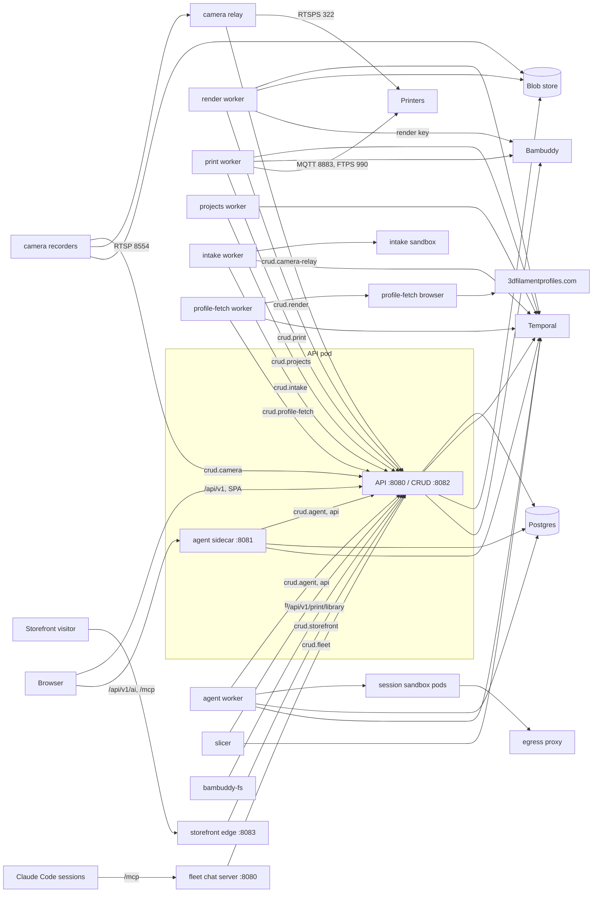

# Processes

One section per deployable process: its entrypoint, its image, what it runs, the
credentials it reads (by variable name; no values), and its trust zone. The zones, the
measured state of each pod and the known gaps are in
[`docs/security/trust-boundaries.md`](../security/trust-boundaries.md): see
["What each pod holds"](../security/trust-boundaries.md#what-each-pod-holds),
["Where untrusted code runs"](../security/trust-boundaries.md#where-untrusted-code-runs) and
["Zones"](../security/trust-boundaries.md#zones). This page does not restate them. The
Kubernetes objects live in eh-homelab/clusters; how a build reaches them is in
[ci-and-deploy.md](ci-and-deploy.md).

The role of a Python process is chosen by its command, not by an environment variable;
the agent's role is chosen by `SCADBUDDY_AGENT_ROLE`. Every `SCADBUDDY_*` setting of the
backend is listed by `python -m scadbuddy.tools.settings_reference`. Paths under
`backend/scadbuddy/` are shortened to `scadbuddy/`.

| Process | Image (Dockerfile stage) | Command | Ports | Holds a database secret |
|---|---|---|---|---|
| [API (CRUD service)](#api) | `scadbuddy` (`runtime`) | `uvicorn --factory scadbuddy.main:create_app` | 8080, CRUD 8082 | yes |
| [Render worker](#render-worker) | `scadbuddy` (`runtime`) | `python -m scadbuddy.worker` | 9090 (health) | no |
| [Print worker](#print-worker) | `scadbuddy` (`runtime`) | `python -m scadbuddy.worker --queue bambuddy` | 9090 | no |
| [Projects worker](#projects-worker) | `scadbuddy` (`runtime`) | `python -m scadbuddy.worker --queue projects` | 9090 | no |
| [Storefront edge](#storefront-edge) | `scadbuddy` (`runtime`) | `python -m scadbuddy.storefront` | 8083 | no |
| [Intake worker and sandbox](#intake-worker-and-sandbox) | `scadbuddy` (`runtime`) | `python -m scadbuddy.intake_worker`, `python -m scadbuddy.intake_worker.sandbox` | 9090, 8090 | no |
| [Profile-fetch worker and browser](#profile-fetch-worker-and-browser) | `scadbuddy-profile-fetch` (`profile-fetch`) | `python -m scadbuddy.profile_fetch`, `python -m scadbuddy.profile_fetch.browser` | 9090, 8091 | no |
| [Camera relay and recorders](#camera-relay-and-recorders) | `scadbuddy-camera-relay` (`camera-relay`), `scadbuddy-camera-recorder` (`camera-recorder`), `scadbuddy-camera-edge` (`camera-edge`, #7330) | `python -m scadbuddy.camera.relay`, `.recorder`, `.edge`, each beside `mediamtx` | 9090 (health); relay RTSP 8554; edge HLS 8888, WHEP 8889, UDP 8189 | no |
| [Agent sidecar](#agent-sidecar-and-agent-worker) | `scadbuddy-agent` (`agent`) | `node dist/main.js`, role `api` | 8081 | yes (today's code) |
| [Agent worker](#agent-sidecar-and-agent-worker) | `scadbuddy-agent` (`agent`) | `node dist/main.js`, role `worker` | 8081 (health) | yes (today's code) |
| [Session sandbox and egress proxy](#session-sandbox-and-egress-proxy) | `scadbuddy-sandbox` (`sandbox`) | `node dist/sandbox/main.js` | 8090, 3128 | no |
| [agent-durable](#agent-durable) | `scadbuddy-agent-durable` (`agent-durable`) | `python -m scadbuddy_durable` | 8082 (health) | yes, mounted (today's manifests) |
| [Slicer worker](#slicer-worker) | `scadbuddy-slicer` (`slicer`) | `scadbuddy-slicer` | 9090 | no |
| [Fleet chat server](#fleet-chat-server) | `ghcr.io/eh-homelab/scadbuddy-fleet` (`tools/go/fleet/Dockerfile`) | `scadbuddy-fleet` | 8080 | no |
| [bambuddy-fs](#bambuddy-fs) | `scadbuddy-bambuddy-fs` (`tools/go/bambuddy-fs/Dockerfile`) | `bambuddy-fs mount` | none | no |
| [Frontend](#frontend) | built into `scadbuddy` (`frontend` stage) | served by the API and the edge | | |

## API

- **Runs.** `create_app` (`scadbuddy/main.py:2386`); `lifespan` (`scadbuddy/main.py:2159`)
  applies both migration ledgers, grants and revokes retired roles, opens the blob store,
  starts the in-process `library` worker (always), the print upkeep, and on its own port
  the CRUD listener (`scadbuddy/main.py:2163-2339`). Routers under `api/` are mounted
  automatically under `/api/v1` (`scadbuddy/main.py:279-297`); the built frontend is
  mounted last at `/` (`scadbuddy/main.py:2532`).
- **Also runs untrusted code today:** openscad renders for the editor's checks and
  `openscad-lsp`, the latter under a no-network seccomp filter (`scadbuddy/editor/nonet.py:3-6`);
  #5296 moves them out.
- **Reads.** `SCADBUDDY_DATABASE_URL`, `SCADBUDDY_SECRET_KEY_FILE` (and `_PREVIOUS_FILE`),
  `SCADBUDDY_TEMPORAL_ADDRESS`, the Bambuddy URL and keys and the S3 store settings (also
  stored settings), `SCADBUDDY_AUTH_MODE` and the OIDC settings, `SCADBUDDY_AGENT_INTERNAL_URL`
  (`scadbuddy/core/settings.py:196-675`).
- **Talks to.** Postgres, Temporal, the blob store, Bambuddy, the Kubernetes API for
  token reviews (`scadbuddy/auth/exchange.py:128-129`), the OIDC issuer, Google Fonts and
  the optional git remote.
- **Zone.** The CRUD service: the only process meant to hold SQL access
  ([`CLAUDE.md` "Database access"](../../CLAUDE.md#database-access-5295)).

## Render worker

- **Runs.** `run_worker` (`scadbuddy/worker.py:1081`) on queue `render`: renders and
  template pipelines ([workflows.md](workflows.md#render-split-by-colour-3mf)).
- **Reads.** `SCADBUDDY_API_INTERNAL_URL` and a service proof,
  `SCADBUDDY_SERVICE_TOKEN_FILE` or `SCADBUDDY_SERVICE_BOOTSTRAP_FILE`; without one it
  refuses to start (`scadbuddy/auth/service_auth.py:235-256`). It ignores
  `SCADBUDDY_DATABASE_URL` (`scadbuddy/worker.py:1097-1100`) and refuses the `local` store
  (`scadbuddy/worker.py:222-257`). The S3 keys and the Bambuddy render key come from its
  CRUD settings route (`scadbuddy/api/crud_render.py:215-229`).
- **Zone.** Runs template Python and openscad; holds a 15-minute `crud.render` credential
  and the store keys. See trust-boundaries, "Where untrusted code runs".

## Print worker

- **Runs.** `run_print_worker` (`scadbuddy/worker.py:1521`) on `bambuddy` and
  `bambuddy-follow`: print runs, LAN upload and start, follow, printer watches
  ([workflows.md](workflows.md#print-to-the-h2c)), and the filament sync with Bambuddy,
  the Bambuddy pull and the location-sensor alerts (`FilamentBbSync`, `FilamentBbPull`,
  `SensorNotifyPass`, `scadbuddy/workflows/client.py:211-223`), and a printer's K-profile and
  AMS slot commands over its LAN link (`LanCommand`, #7276, started and awaited by the API).
- **Reads.** The API URL and a service proof as above. Its Bambuddy key comes from the
  CRUD settings route; a printer's access code is opened by the API and handed over a
  CRUD route (`scadbuddy/api/crud_print.py:2242`).
- **Talks to.** The API, Temporal, Bambuddy, printers over MQTT and FTPS
  (`scadbuddy/printers/lan.py:65-67`).

## Projects worker

- **Runs.** `run_projects_worker` (`scadbuddy/worker.py:1607`) on `projects`: flow runs
  ([workflows.md](workflows.md#flows)).
- **Reads.** The API URL, a service proof, and the KEK (`SCADBUDDY_SECRET_KEY_FILE`,
  `scadbuddy/worker.py:1627-1632`) for flow payload keys.

## Storefront edge

- **Runs.** `python -m scadbuddy.storefront` (`scadbuddy/storefront/__main__.py:24-48`):
  the public shop's API under `/api/store/v1` and the storefront bundle
  ([features/storefront-and-payments.md](../features/storefront-and-payments.md)).
- **Reads.** `SCADBUDDY_API_INTERNAL_URL`, a service proof,
  `SCADBUDDY_STOREFRONT_COOKIE_KEY_FILE`, `SCADBUDDY_STOREFRONT_PUBLIC_URL`. It refuses to
  start with a database URL, a Postgres password, the KEK or a Temporal address
  (`scadbuddy/storefront/settings.py:18-26`).
- **Zone.** Internet-facing; every call is a `crud.storefront` route
  (`scadbuddy/crud/storefront.py:124`). Not yet in trust-boundaries' tables (see
  [Drift from specs](README.md#drift-from-specs)).

## Intake worker and sandbox

- **Runs.** `python -m scadbuddy.intake_worker` on `customer-files`
  (`scadbuddy/intake_worker/worker.py:94-101`): checks customer-uploaded models in a
  separate sandbox process (`scadbuddy/intake_worker/sandbox.py`).
- **Reads.** The API URL and a service proof; it refuses a database URL, a Postgres
  password and the KEK (`scadbuddy/intake_worker/settings.py:19-24`).

## Profile-fetch worker and browser

Fetches a new spool type's slicer presets per printer model and nozzle from
3dfilamentprofiles.com (#6625, #6780). See README
["Profile-fetch worker"](../../README.md#profile-fetch-worker-6625).

- **Worker.** `python -m scadbuddy.profile_fetch` (`scadbuddy/profile_fetch/__main__.py:32`)
  polls `profile-fetch` with the `ProfileFetch`, `TdfpSearch` and `TdfpCreate` workflows, one activity at a time, and `profile-fetch-search` for a search's activity alone, in a slot of its own (#7062, `scadbuddy/profile_fetch/worker.py:74-109`).
  It reads the API URL, a service proof and Temporal's address, reaches the API only as
  CRUD caller `profile-fetch` (area `runs`, `scadbuddy/api/crud_areas.py:250`), and calls the
  browser service over HTTP. It refuses a database secret, the KEK and the site login
  (`scadbuddy/profile_fetch/settings.py:80-93`).
- **Browser service.** `python -m scadbuddy.profile_fetch.browser`
  (`scadbuddy/profile_fetch/browser.py:364`) runs Chromium on the site and holds only the
  site login (`SCADBUDDY_TDFP_EMAIL`, `SCADBUDDY_TDFP_PASSWORD`). It refuses a service proof
  and a Temporal or API address (`scadbuddy/profile_fetch/settings.py:38`, `:96-102`).
- **Image.** `scadbuddy-profile-fetch`, Dockerfile stage `profile-fetch` (`Dockerfile:654`).

## Camera relay and recorders

Record each qualifying printer's camera all the time (#7328, phase 1 of #7334). See
[features/printer-cameras.md](../features/printer-cameras.md) and README
["Printer cameras"](../../README.md#printer-cameras-7328). Each pod runs two containers of
its image: MediaMTX and the controller. They share the pod's network (the control API on
`127.0.0.1:9997`, the hooks to `127.0.0.1:9091`).

- **Relay.** `python -m scadbuddy.camera.relay` (`scadbuddy/camera/relay.py`), one pod. It
  reads the qualifying printers, access codes included, as CRUD caller `camera-relay`
  (`scadbuddy/api/crud_camera_relay.py`), and gives MediaMTX one RTSPS pull per printer
  through the control API. MediaMTX serves the streams to the recorders and the edge on 8554
  with one read user.
- **Edge.** `python -m scadbuddy.camera.edge` (`scadbuddy/camera/edge.py`), one pod, CRUD
  caller `camera` (ServiceAccount `scadbuddy-camera-edge`). Its MediaMTX pulls each recorded
  printer from the relay on demand and serves WebRTC (8889) and LL-HLS (8888) to the API's
  proxy (`scadbuddy/api/camera.py`) behind its own read user. The controller sets
  `scadbuddy_camera_viewers`. It holds no bucket key and no access code.
- **Recorders.** `python -m scadbuddy.camera.recorder` (`scadbuddy/camera/recorder.py`), two
  pods. Each MediaMTX reads every stream from the relay and writes fMP4 segments to a shared
  `/segments` volume. Per printer, the recorder that holds the lease puts the segments in the
  bucket and indexes them as CRUD caller `camera` (`scadbuddy/api/crud_camera.py`). Only these
  pods hold the bucket's camera keys.
- **Reads.** The API URL and a service proof; the recorders and the edge also the relay read
  user, and the recorders the bucket keys. The edge's MediaMTX also reads the edge read user
  (`MTX_AUTHINTERNALUSERS_0_*`). All three refuse a database secret and the KEK (`scadbuddy/camera/settings.py`).
  None reaches Temporal.
- **Images.** `scadbuddy-camera-relay`, `scadbuddy-camera-recorder` and `scadbuddy-camera-edge`,
  Dockerfile stages `camera-relay`, `camera-recorder` and `camera-edge`, all off `camera`, with MediaMTX from the `mediamtx`
  stage.

## Agent sidecar and agent worker

One image, two roles ([agent.md](agent.md#processes-and-roles)). The sidecar serves
`/api/v1/ai/*` and `/mcp` in the API pod; the worker runs the turns.

- **Reads.** `ENV_VARS` (`agent/src/config.ts`): the backend URL, Temporal, a required
  service proof and the sandbox settings. It ignores `SCADBUDDY_DATABASE_URL`,
  `SCADBUDDY_SECRET_KEY_FILE` and `SCADBUDDY_SECRET_KEY_PREVIOUS_FILE` with one warning
  (`IGNORED_VARS`).
- **Zone.** Neither role holds a database client or a KEK (#5299 step 12): the agent's data
  is the API's CRUD routes, and it is not ready until the API lists every area it wants and
  has released the input-hash key ([agent.md](agent.md#trust-zone)). Claude Code and plugin
  code run in the worker, with its service credential and its Temporal client.

## Session sandbox and egress proxy

`SCADBUDDY_SANDBOX_ROLE=exec` is one pod per assistant session that runs sandboxed `Bash`
and `PowerShell`, and their background commands and a `Monitor`'s command in background
slots (`agent/src/sandbox/slots.ts`, #5916, #7310); `egress` is those pods' CONNECT proxy
(`agent/src/sandbox/main.ts:13-19`).
The agent worker creates the pods through the Kubernetes API (`agent/src/sandbox/pods.ts:192`).

## agent-durable

Serves only `/healthz` and runs no Temporal worker
(`agent-durable/src/scadbuddy_durable/__main__.py:25-37`,
`agent-durable/src/scadbuddy_durable/worker.py:21-24`). Its Deployment is at zero replicas
and mounts no database secret and no KEK; see
[`agent-durable/CLAUDE.md`](../../agent-durable/CLAUDE.md).

## Slicer worker

The Rust `scadbuddy-slicer` serves the `slice_plate` activity on `slicer` and runs the
Bambu Studio CLI (`workers/rust/crates/sb-slicer/src/activity.rs:22-23`,
`workers/rust/crates/sb-slicer/src/runner.rs:103-135`). It reads only the Temporal and
concurrency settings and `OTEL_*` (`workers/rust/crates/sb-temporal/src/lib.rs:22-60`; traces, metrics and logs over OTLP, `workers/rust/crates/sb-temporal/src/telemetry.rs`) and
holds no credential: its inputs carry transfer URLs. See
[`workers/rust/CLAUDE.md`](../../workers/rust/CLAUDE.md).

## Fleet chat server

The agent fleet chat (spec
[`2026-11-25-agent-fleet-messaging-design.md`](../superpowers/specs/2026-11-25-agent-fleet-messaging-design.md),
feature page [agent-fleet-chat.md](../features/agent-fleet-chat.md)): an MCP server that
lets Claude Code sessions send direct messages and channel posts to each other. The Go
binary `scadbuddy-fleet` (`tools/go/fleet/main.go`, uid 10003) serves `/mcp` and
`GET /healthz` on 8080. It holds no database secret and no KEK. It reaches the fleet's
tables only through core's CRUD routes under `/api/v1/internal/crud/fleet/`
(`tools/go/core/internal/fleet`; core serves them when `SCADBUDDY_CORE_AREAS` names
`fleet`) with the `crud.fleet` credential of caller `fleet`. It exchanges its proof for that
credential at `POST /api/v1/auth/service-token` (a projected token of the ServiceAccount
`scadbuddy-fleet`, `FLEETCHAT_SERVICE_TOKEN_FILE`, or a bootstrap secret,
`FLEETCHAT_SERVICE_BOOTSTRAP_FILE`) and renews it in process at half-life and after a 401
(`tools/go/fleet/sbfleet/credential.go`). It follows the change stream
`GET /api/v1/internal/crud/fleet/changes` (the Python API's `api/crud_fleet.py`, which core
forwards: the `fleet.*` events of the event log, with `Last-Event-ID` replay) to tell
subscribed inboxes of new messages. Its other settings are `FLEETCHAT_LISTEN`,
`FLEETCHAT_CORE_URL`, `FLEETCHAT_MAX_TEXT`, `FLEETCHAT_PAGE_SIZE`,
`FLEETCHAT_MAX_PAGE_SIZE` and `FLEETCHAT_SESSION_TIMEOUT`
([`tools/go/fleet/README.md`](../../tools/go/fleet/README.md)). The server has no auth of
its own: anything on the LAN may call it, directly or through ScadBuddy's `/mcp`
(the owner's decision of 2026-11-26), and a NetworkPolicy is to admit only ScadBuddy's pods and the LAN's
Gateway. Neither the server nor that policy is deployed yet.

## bambuddy-fs

A FUSE mount of the print library on a person's own machine, through ScadBuddy's
`/api/v1/print/library` routes with an optional personal access token
(`tools/go/bambuddy-fs/internal/api/api.go:65-75`). Not deployed to the cluster. See
[`tools/go/CLAUDE.md`](../../tools/go/CLAUDE.md) and
[README "Mounting the library"](../../README.md#mounting-the-library-bambuddy-fs).

## Frontend

Built by the Dockerfile's `frontend` stage and served as static files: the back office by
the API, the storefront bundle by the edge. See [frontend.md](frontend.md).
