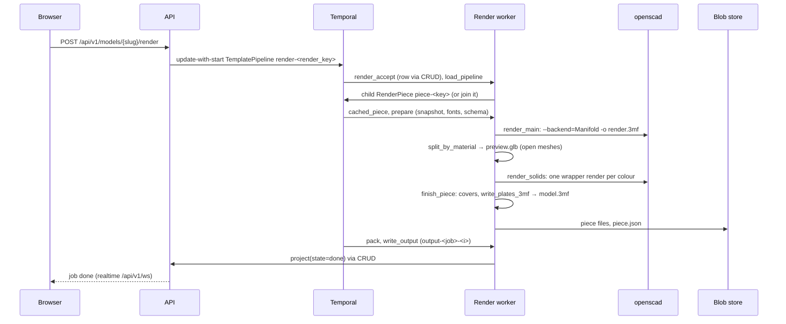
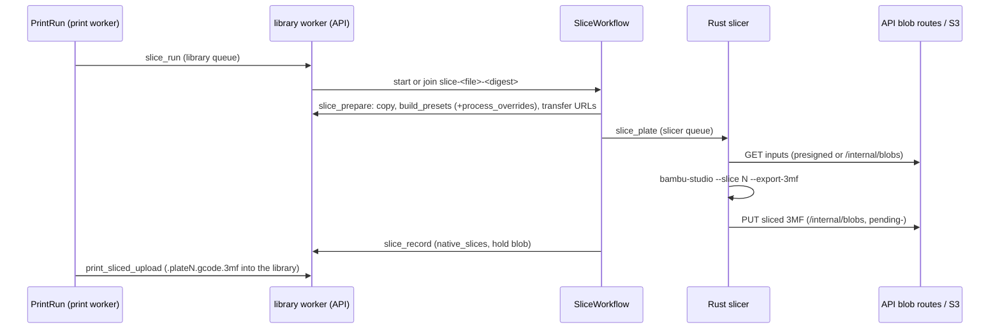
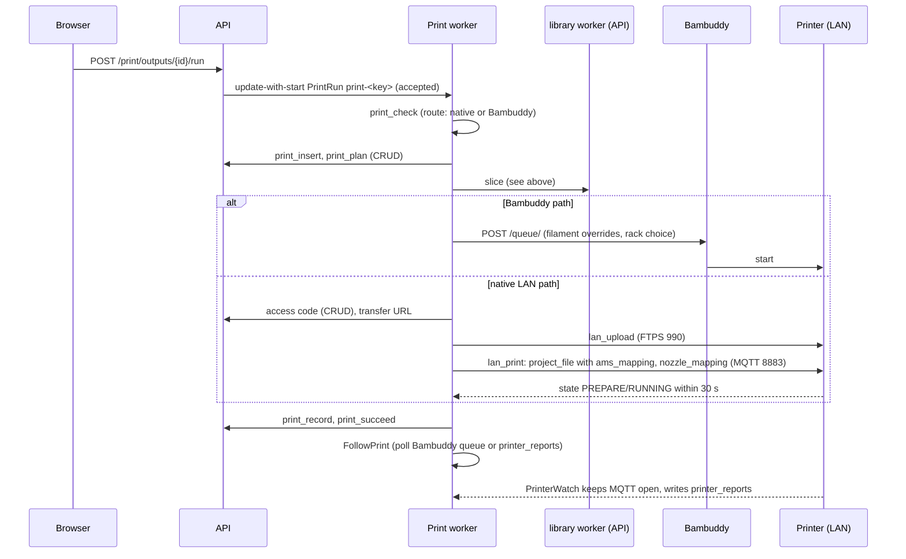
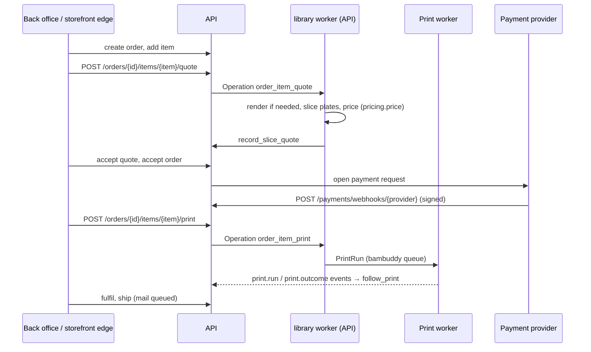

# Temporal workflows

Every long or retried piece of work runs on Temporal: renders, slices, prints, library
writes, flows, assistant sessions. This page lists the task queues, who serves each, the
workflows and activities on it, and the hot paths as sequence diagrams. The design
history is in the
[template-pipelines spec](../superpowers/specs/2026-09-27-template-pipelines-design.md)
and the [durable printing, agents and flows spec](../superpowers/specs/2026-10-01-durable-printing-agents-flows-design.md);
the operator's notes per worker are in [`README.md` "Deploying"](../../README.md#deploying).

Paths under `backend/scadbuddy/` are shortened to `scadbuddy/`. Line numbers are for
`main` at the commit that adds this page.

## Task queues

Queue names are settings (`scadbuddy/core/config.py:40`, `scadbuddy/core/settings.py:574-590`).

| Queue | Served by | Workflows |
|---|---|---|
| `render` | render worker, `python -m scadbuddy.worker` (`scadbuddy/worker.py:1077`) | `RenderPiece`, `RenderPreview`, `TemplatePipeline`, `MigrateInputs` (`scadbuddy/workflows/client.py:140`) |
| `bambuddy` | print worker, `--queue bambuddy` (`scadbuddy/worker.py:1503`) | `PrintRun`, `PrintLanSequence`, `Operation` (bambuddy kinds), `FollowPrint`, `PrinterWatch`, `LanAutoImport` (`scadbuddy/workflows/client.py:194-206`) |
| `bambuddy-follow` | print worker | activities only: `follow_print`, `printer_watch` (`scadbuddy/workflows/client.py:215-236`) |
| `library` | the API process (`scadbuddy/main.py:1798-1888`) | `Housekeeping`, `PreviewBackfill`, `Operation` (library kinds), `FlowTriggerFire`, `StoreMigration`, `LibraryCopy`, `SliceWorkflow`, `SpoolRefresh`, `StagedFile`, `PrepareListing` (`scadbuddy/main.py:1731-1741`) |
| `projects` | projects worker, `--queue projects` (`scadbuddy/worker.py:1589`) | `ProjectWorkflow` (flow runs), `Operation` (flow kinds) (`scadbuddy/workflows/projects_worker.py:81-110`) |
| `slicer` | the Rust slicer (`workers/rust/bins/scadbuddy-slicer/src/main.rs:103-107`) | activity `slice_plate` only (`workers/rust/crates/sb-slicer/src/activity.rs:22-23`) |
| `customer-files` | intake worker, `python -m scadbuddy.intake_worker` (`scadbuddy/intake_worker/worker.py:96`) | `CustomerFileCheck` (`scadbuddy/intake_worker/workflow.py:40`) |
| `agent-sessions`, `agent-tools` and per-replica `.<identity>` queues | the agent ([agent.md](agent.md#temporal)) | `AgentSession`, `ToolCall`, `BridgeCall`, `AgentOperation`, `BackgroundTask` |

In development (`SCADBUDDY_TEMPORAL_WORKER_INPROCESS`), the API also serves `render`,
`bambuddy` and `projects` itself (`scadbuddy/main.py:1557-1559`, `:1710-1712`;
`scadbuddy/flows/component.py:120`). The real-stack e2e runs that way
(`e2e-stack/compose.yaml:83-95`).

Versioned deployments: `scadbuddy-library`, `scadbuddy-render`, `scadbuddy-projects`
(`scadbuddy/workflows/client.py:60-65`), `scadbuddy-print` for the print worker given a
build id (`scadbuddy/workflows/client.py:242-251`, `scadbuddy/worker.py:1539-1563`) and the
agent's `scadbuddy-agent`. Unversioned: the API's in-process print worker in development
(`scadbuddy/main.py:1619-1707`) and the slicer
(`workers/rust/bins/scadbuddy-slicer/src/lib.rs:1-2`).

## Operations: one shape for writes

Most writes that take more than a request (send, library copy, MakerWorld import, mesh
edits, order quotes and prints, flow answers) are operation kinds run by
`OperationWorkflow` (`scadbuddy/workflows/operation.py:136`, `:300`): `op_insert`, then
`op.<kind>.check`, then `op.<kind>.run`, then `op_finish`
(`scadbuddy/workflows/operation_activities.py:65-183`). The API starts them with
update-with-start and answers 202 with an operation id the browser follows at
`GET /api/v1/operations/{id}` (`scadbuddy/api/operations.py:322`;
`scadbuddy/workflows/commands.py:338-375`). The kinds live beside their features, for
example `scadbuddy/makerworld/operations.py:33`, `scadbuddy/meshmodel/operations.py:405-407`,
`scadbuddy/orders/operations.py:1049-1123`.

## Render, split by colour, 3MF

The OpenSCAD facts this rests on (Manifold, per-triangle materials, the `color` wrapper,
the `project_settings.config` keys) are in the root
[`CLAUDE.md` "Verified OpenSCAD facts"](../../CLAUDE.md#verified-openscad-facts-do-not-re-derive-re-measure-if-the-base-image-moves);
they are not repeated here.

1. `POST /api/v1/models/{slug}/render` (`scadbuddy/api/jobs.py:401`) resolves the
   revision and inputs and calls `RenderService._submit` (`scadbuddy/render/submit.py:307`).
2. `_submit` computes the render key (`scadbuddy/render/job_models.py:261`), reuses a
   finished job when one matches (`scadbuddy/render/submit.py:362-372`), and otherwise
   does update-with-start of `TemplatePipeline` with id `render-<render_key>`
   (`scadbuddy/render/submit.py:539-552`).
3. `TemplatePipeline` (`scadbuddy/workflows/pipelines.py:524`) inserts the job row with the
   local activity `render_accept` (`:790-796`) and loads the template's pipeline or the
   built-in default (`scadbuddy/library/pipelines.py:16-20`). The pipeline calls
   `ctx.render`, which starts or joins a child `RenderPiece` with id `piece-<key>`
   (`scadbuddy/workflows/pipelines.py:1090-1162`).
4. `RenderPiece` (`scadbuddy/workflows/pipelines.py:386`) runs `cached_piece`, `prepare`,
   optionally `reuse_geometry`, then:
   - `render_main`: openscad with `--backend=Manifold` (`scadbuddy/render/runner.py:653`);
   - `render_solids`: `split_by_material` (`scadbuddy/render/split.py:172`) gives the
     open per-colour meshes for the preview GLB; `solid_parts` renders one closed solid per
     colour through the `color` wrapper (`scadbuddy/render/solids.py:40-55`, `:92`), and
     falls back to the split mesh for a colour that fails (`:146-151`);
   - `finish_piece`: plate covers in numpy, then `write_plates_3mf`
     (`scadbuddy/render/bambu3mf.py:815`), which writes one assembly object per declared
     object with a component per colour, `model_settings.config` and
     `project_settings.config` (`scadbuddy/render/bambu3mf.py:577-633`).
5. Back in the pipeline, `pack` lays parts out on plates (`scadbuddy/workflows/arrange.py:212`)
   and `write_output` writes the output under `output-<job>-<i>`
   (`scadbuddy/workflows/outputs.py:44-45`).

A template's own `pipeline/pipeline.py` runs inside the workflow sandbox; its
`activities.py` runs in a child process with an allowlisted environment
(`scadbuddy/workflows/template_process.py:106-130`). **Arrange** is the same
`TemplatePipeline` with `kind == "arrange"` (`scadbuddy/workflows/pipelines.py:858-860`,
`:1010`). The default model preview is `RenderPreview`, id `preview-<slug>`
(`scadbuddy/render/submit.py:745-791`).

## Slice

The slicer is chosen by the stored setting `slicer_backend`: `native` (ScadBuddy's own
Rust worker running the Bambu Studio CLI) or Bambuddy's slicer. `process_overrides` from
the print dialog are merged into the plan with the profile values, the template's
`print_settings` and the shorthands (supports, prime tower)
(`scadbuddy/bambuddy/print_run.py:481-483`, `:3403-3415`); the rule against per-key fields
is in the root [`CLAUDE.md` "PR conventions"](../../CLAUDE.md#pr-conventions).

- `slice_run` (`scadbuddy/workflows/slicing_activities.py:385`) starts or joins
  `SliceWorkflow` (`scadbuddy/workflows/slicing.py:182`) with id `slice-<file>-<digest>`
  (`scadbuddy/slicing/store.py:63`).
- `slice_prepare` reuses an earlier slice of the same bytes and presets, or builds presets
  with the overrides applied (`scadbuddy/slicing/presets.py:324`, `:345-351`) and mints
  transfer URLs (`scadbuddy/slicing/transfer.py:52-57`).
- `slice_plate` runs on the `slicer` queue with a 30-minute timeout and 4 attempts
  (`scadbuddy/workflows/slicing.py:60-67`, `:253-262`). The Rust side is in
  [`workers/rust/CLAUDE.md`](../../workers/rust/CLAUDE.md); it holds no credentials and
  reaches bytes only through the URLs in its input
  (`workers/rust/crates/sb-transfer/src/lib.rs:1-4`).
- On Bambuddy's slicer instead, `print_slice_start` and `print_slice_wait` call
  Bambuddy's slice API (`scadbuddy/workflows/print_activities.py:497`, `:533`).

## Print to the H2C

1. `POST /api/v1/print/outputs/{id}/run` or `/print/library/{file_id}/run`
   (`scadbuddy/api/printing.py:928`, `scadbuddy/api/library_print.py:1346`) calls
   `accept_run` (`scadbuddy/api/printing.py:1011`), which does update-with-start of
   `PrintRun` with id `print-<key>` and waits for the `accepted` update
   (`scadbuddy/api/printing.py:1089-1104`).
2. `print_check` picks the route (`scadbuddy/workflows/print_activities.py:289`):
   `hot_path_native` (`scadbuddy/printers/hot_path.py:32`) is true when the slicer and
   library are native, the store is not local, and the printer has a LAN link with a
   fresh report (`scadbuddy/bambuddy/print_run.py:2159-2170`).
3. `print_insert` and `print_plan` record the run and plan plates, spools and presets
   (`scadbuddy/workflows/print_activities.py:419`, `:440`; `scadbuddy/bambuddy/print_run.py:3172`).
4. Each plate is sliced (above), or used as is when it is already sliced
   (`scadbuddy/workflows/printing.py:834-836`).
5. Hand-off:
   - **Bambuddy:** `print_enqueue` → `queue_plate` → `POST /queue/`
     (`scadbuddy/bambuddy/print_run.py:3095`, `scadbuddy/bambuddy/dispatch.py:304-337`).
   - **Native LAN:** `lan_upload` streams the sliced file over FTPS and `lan_print` sends
     `project_file` over MQTT with `ams_mapping` from the plan's trays and the rack's
     `nozzle_mapping`, then waits up to 30 s for the printer to start
     (`scadbuddy/printers/print_activities.py:264`, `:307`, `:546-592`;
     `scadbuddy/printers/lan.py:174`).
6. `FollowPrint` (`scadbuddy/workflows/follow.py:70`) follows progress; `PrinterWatch`
   (`scadbuddy/workflows/printer_watch.py:79`) holds each printer's MQTT connection and
   writes `printer_reports`. More copies or plates on the LAN go to `PrintLanSequence`
   (`scadbuddy/workflows/printing.py:1136`), which can wait for a `plate_cleared` signal
   (`scadbuddy/api/printing.py:1381-1406`).

The H2C's plate and tray details are in the repo skills
`.claude/skills/h2c-print-from-scadbuddy` and `.claude/skills/h2c-plate-layout`; what a run
did is read from its history with `.claude/skills/scadbuddy-run-forensics`.

## Orders

The steps and their code are in [features/orders-and-quotes.md](../features/orders-and-quotes.md).
The order operation kinds are `order_item_quote`, `order_item_render`,
`order_item_print`, `order_attachment_add` and `order_attempt_copy`
(`scadbuddy/orders/operations.py:1049-1123`), all on `library`.

## Flows

A flow is a user's script run as `ProjectWorkflow` (`scadbuddy/workflows/project.py:126`)
on `projects`, id `flow-<run_id>` (`scadbuddy/flows/launch.py:54-94`). Its host functions
(`scadbuddy/workflows/flow_tools.py:1373-1391`) call the API's own routes through the
`flow_route_send` activity (`scadbuddy/workflows/flow_routes.py:192`): render, save
output, queue a print, arrange. `tool(...)` and `agent_session(...)` go to the agent's
`agent-tools` queue. Triggers start `FlowTriggerFire` (`scadbuddy/workflows/flow_triggers.py:55`)
from a Temporal Schedule or a bus event (`scadbuddy/flow_triggers/events.py:166-196`).
See [features/flows.md](../features/flows.md).

## Housekeeping

`Housekeeping` (`scadbuddy/workflows/housekeeping.py:437`) runs on Schedules the API
creates (`_set_up_housekeeping`, `scadbuddy/main.py:1915`) and calls the sweeps: printer watches, native
copies, print auto-import, quote holds, payment closes and captures, bank deposits,
storefront drafts and mail, git remote pushes, blob sweeps (the sweep names start at `scadbuddy/workflows/housekeeping.py:142`).

## Tests

Replay tests keep recorded histories per workflow under `backend/tests/fixtures/*_histories`
(for example `test_print_replay.py`, `test_template_pipeline_replay.py`,
`test_project_replay.py`). See [`backend/CLAUDE.md`](../../backend/CLAUDE.md).
