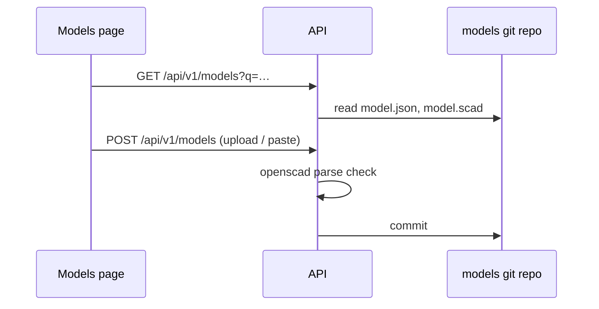

# Catalogue and models

## What it does

The Models page lists the bundled templates and your own. Add a model by uploading a
`.scad` file, pasting source or importing from a URL; duplicate one (a fork that can take
its upstream's later changes); edit its name, description, tags, README and pictures;
delete it (the source stays in git). User guide: [Catalogue](../user-guide.md#catalogue),
[Writing a model](../user-guide.md#writing-a-model),
[Deleting a model](../user-guide.md#deleting-a-model).

## How it works

Templates are folders in a git repository on the API's data volume. Bundled models
(`models/`) are copied into the image and mirrored under `_builtin/` as one commit at
every start; each catalogue write is one commit. The API process alone reads and writes
the repository. Longer writes (duplicate, mesh-model creation) run as `library`
operations ([workflows.md](../architecture/workflows.md#operations-one-shape-for-writes)).

## Code

- Page: `frontend/src/pages/CataloguePage.tsx` (Paste source, Import from URL, Add model at
  `:192-201`).
- Routes: `backend/scadbuddy/api/models.py` (search and filters from `:313`, duplicate at
  `:1395`), `backend/scadbuddy/api/model_files.py`, `backend/scadbuddy/api/media.py`,
  `backend/scadbuddy/api/readme_images.py`, `backend/scadbuddy/api/upstream.py:82`
  (upstream status, merge, dismiss, detach).
- Catalogue and history: `backend/scadbuddy/library/catalogue.py` (`duplicate` at `:1262`,
  built-in sync at `:2940-2956`), `backend/scadbuddy/library/history.py:1-13`,
  `backend/scadbuddy/library/upstream.py:1-11` (three-way merge with `git merge-file`).
- Bundled models: `models/<slug>/` with `model.scad`, `model.json`, `README.md`,
  `thumbnail.png` and `verify.sh` ([`models/CLAUDE.md`](../../models/CLAUDE.md)).

## Data

- The models git repository under `SCADBUDDY_DATA_DIR`; a model's metadata is its
  `model.json` (`backend/scadbuddy/core/paths.py:11`).
- Tables: `template_media`, `model_previews`, `models_repo_head`
  ([data.md](../architecture/data.md#ownership-by-domain)).
- Blob keys: `src-<slug>-<revision>` snapshots for render workers, `asset-<id>` uploads.

## Tests

- Backend: `backend/tests/test_history.py`, `backend/tests/api/test_duplicate.py`,
  `backend/tests/api/test_upstream.py`.
- e2e: `frontend/e2e/catalogue-cards.spec.ts`, `catalogue-filters.spec.ts`,
  `catalogue-list.spec.ts`, `import-dialog.spec.ts`, `paste-source.spec.ts`,
  `model-details.spec.ts`, `duplicate-template.spec.ts`, `upstream-update.spec.ts`,
  `template-gallery.spec.ts`, `media-manager.spec.ts`.
- Bundled models: each `verify.sh`, run by the `models` CI job.

## Limits and known issues

- A duplicate always tracks its upstream; a clone without that link is
  [#3187](https://github.com/eh-homelab/ScadBuddy/issues/3187).
- The Models page's search folds case and accents in process; there is no database index
  (`backend/scadbuddy/api/models.py:313-367`).
