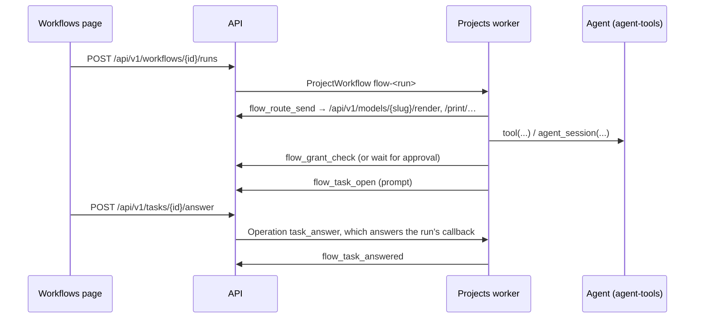

# Flows (workflows)

## What it does

A flow is a short script that chains ScadBuddy's actions: render, save an output, queue a
print, arrange, call a tool, or ask the assistant. Flows are registered and edited under
Workflows, started by hand, on a schedule or on an event (for example an order change),
and pause for a person's approval where a grant does not cover an outward step. A flow can
also ask a person a question, as free text or as a form with typed fields
([Questions to a person](#questions-to-a-person)).

## How it works

A run is `ProjectWorkflow` on the `projects` queue, id `flow-<run_id>`. Its host
functions call the API's own routes through an activity, and `tool(...)` and
`agent_session(...)` go to the agent's queue. Triggers are Temporal Schedules or bus
events that start `FlowTriggerFire`. See
[workflows.md "Flows"](../architecture/workflows.md#flows) and the
[flow grants and git spec](../superpowers/specs/2026-10-11-flow-grants-and-git-design.md).

## Questions to a person

A script asks with a host function (`backend/scadbuddy/workflows/flow_tools.py`):

| | `wait_for_human(question, timeout_s=None, people_only=False)` | `prompt(title, schema, context=None, place=None, ui=None, timeout_s=None, people_only=False)` |
|---|---|---|
| The question | a text | a title and a form |
| The answer | `{answer}`, a text | a dict by field name |
| Row in `tasks` | none | one, opened before the call waits |
| Answer route | `POST /api/v1/workflow-runs/{run_id}/answer` | `POST /api/v1/tasks/{task_id}/answer` |
| Operation kind | `flow_answer`; an agent's: `flow_agent_answer` | `task_answer`; an agent's: `flow_agent_answer` |
| Harness callback | `human_answer_open` (`human_answer` in a replay of an older call) | `task_answer` |

The text route refuses a prompt's call with 409 `flow-answer-is-a-task`
(`backend/scadbuddy/api/flows.py` `ANSWER_IS_A_TASK`).

**No default limit.** Both wait with no limit unless `timeout_s` sets one (`_wait_s`). The
floor is 10 seconds (`MIN_WAIT_S`): less raises `ValueError`, and a literal that is too
short is refused when the script is checked (`backend/scadbuddy/flows/typecheck.py`
`_literal_ranges`). When a `timeout_s` is up the script gets `TimeoutError`. The ceiling is ten
years (`OPEN_WAIT`): a longer `timeout_s` is ten years. The callbacks declare the same ten
years to the harness, which ends a call with no `timeout_s` then. The script does not get
`TimeoutError` for that. It gets the harness's `CallbackToolError`, which a script sees as a
plain `Exception`, and the prompt's task is `cancelled`.

**Old runs keep their timer.** A `wait_for_human` that a run called before this change
replays with the old callback, its default of an hour and its range of 10 to 86400 seconds
(`WAIT_OPEN_PATCH`, a patch id per call). The next call of the same run has no default
limit.

**The schema.** A prompt's `schema` is the subset of a flow's `inputs.json`
(`backend/scadbuddy/core/input_schema.py` `schema_problems`,
`backend/scadbuddy/tasks/schema.py` `prompt_schema_problems`). A string, or an array's string
items, may also have a `format`: `email`, `date` or `date-time` (`FORMATS`). A `date-time`
is RFC 3339 with an offset, and a leap second is refused. An `email` has one `@`, a local
part before it and a domain with a dot after it, no empty part between dots in the domain,
no whitespace, no control character, none of `,;<>()[]\"` and at most 254 characters. A
letter need not be ASCII. A `default` must fit its field, its `format` included. The inputs of a flow and of a
pipeline refuse `format`.

**Sizes.** `backend/scadbuddy/tasks/models.py` `TaskOpen` checks them. The title has 1 to
500 characters. The context has at most 16 KiB of JSON (`MAX_JSON_BYTES`), `ui` at most 200
characters, and `place` 1 to 100 characters with no control character. The schema has the
limits of an inputs schema. What Postgres cannot store is refused
(`backend/scadbuddy/core/json_values.py` `unstorable`). An answer has at most 16 KiB of
JSON (413).

**What the script gets.** The answer, as the schema types it
(`backend/scadbuddy/flows/inputs.py` `filled`). A field left out is its default. With no
default, a boolean is `False` and any other field is `None`. A field in `required` must be
in the answer, also when it has a default. `prompt` raises `ValueError` for a schema,
title, context, place, `ui` or `timeout_s` it does not take, and for an answer that fits
the schema and not the field's type (a huge number). It raises `RouteRefusedError` when the
run takes no task, because it ended or is gone.

**Who answers.** A person, always (`backend/scadbuddy/core/authorship.py` `by_a_person`). The
person's setting `flow_answerers` (#7471) may also let in, on the agent's service credential:

| Value | Who |
|---|---|
| `starter` | the session that started the run |
| `sessions` | any session that a browser user owns |
| `token:<id>` | that MCP token, and the sessions it owns |

Empty, the default, is people only. Only a person changes it (403 `person_only`). A session
answers only while it is not archived, is its author's, holds `write`, and is not a flow's
(`ai_sessions.background_tools`, `turn_flow`). A token answers only while it is not revoked
or expired and holds `write`. A call from a flow run never answers. A question that the
script asked with `people_only=True`, or that parked before #7471, is for people only. Any
other caller gets 403 `flow-answer-not-allowed`, whose detail names the setting or says that
the question is for people only (`backend/scadbuddy/flows/answerers.py`,
`backend/scadbuddy/api/flows.py` `answerer` and `admit`). The route reads the setting; the
operation's check asks again about the question and the session or token, so a Reset that
parks a people-only question in between is refused. A repeat of a request gets its first
answer. Both routes are `api` routes, so `enforce` lets the agent's credential reach them.

The assistant answers with the tool `answer_flow_question` (tier `outward`, so a person
approves each answer unless they lower it). The decision row names the answerer
(`responder`: `browser`, `session:<id>` or `token:<id>`) and what admitted it
(`admitted_by`: `setting`). A task's `answered_by` is that text for an agent. The run's page
names the assistant and links its session. A person's answer keeps the Update id and the
operation key it had before. A person may take over an agent's answer that never reached the
run; an agent only its own. A run grant cannot admit answerers yet (`GrantSpec.answers` is
refused), a child run's grant never has them, and a trigger's grant may not hold them.

The forms on the page are user-only (`USER_ONLY`): the assistant cannot press or fill them,
and cannot read the text typed in them
([browser-bridge.md](../ai/browser-bridge.md#data-agent-user-only)).

**The answer's way.** The route checks the answer against the task's schema
(`backend/scadbuddy/tasks/validate.py` `validate_answer`). A problem names a field and
never quotes a value (422 `invalid-answer`). The answer goes to the `task_answer` operation
sealed under the run's payload key (`backend/scadbuddy/flows/operations.py` `seal_answer`).
So no operation record and no Temporal history holds it in the clear. The operation's result
names the task, and `GET /api/v1/tasks/{task_id}` has the answer.

**Two answers.** The run's `workflow_run_decisions` row picks the winner
(`FlowStore.record_decision`), and the other answer is refused with a 409. The exception
is a row whose answer never reached the run and that nothing may still send: a later answer
takes it over (`backend/scadbuddy/flows/operations.py` `take_over`, #7575). The task's row is
marked after the run has the answer. So for a moment an answered task can read `open`, and
so can the `state` of a 409 `not-open`. The operation's mark is best effort. The run's own
mark (`flow_task_answered`, `final`) is of the answer that the script gets. It replaces
another answer on the row and leaves an expired task as it is.

**A task's life** (`backend/scadbuddy/tasks/store.py` `TaskStore`):

| State | When |
|---|---|
| `open` | the prompt asked, and the run waits or soon will |
| `answered` | an answer reached the run |
| `expired` | the prompt's time was up (`flow_task_close`) |
| `cancelled` | the run ended, the call ended with no answer, or a Reset went back to before the prompt |

- **Reset.** A Reset through ScadBuddy makes the tasks match the run
  (`TaskStore.match_waiting_in`). A task that the run waits for again opens again, with no
  answer. An open task of a call that the run no longer has is cancelled. Any other task
  stays as it is. When the point is between the prompt's open and its wait, the task is
  cancelled, and opens again as the call waits (`TaskStore.reopen_in`): it keeps its first
  `expires_at`, and the prompt's timer starts anew.
- **Executions.** Each write by the run names the execution that makes it
  (`backend/scadbuddy/workflows/flow_activities.py` `FlowTaskActivities`). An execution that
  a Reset replaced opens, marks and closes nothing. The run's own mark or close from an
  execution that the row of an open run does not know yet is refused (503 `run-behind`) and
  tried again. From one that the row of an ended run does not know, the write changes
  nothing and returns the task as it stands, so it is not tried again.
- **Retries.** The task activities (`flow_task_open`,
  `flow_task_answered`, `flow_task_close`) are tried without limit. Only `flow_task_open` has final
  refusals: a task that is refused (422), a run that has ended and a run that is gone.
- **Forget.** Forgetting a run deletes its tasks (`ON DELETE CASCADE`).

**Reads.** `GET /api/v1/tasks` lists tasks by `state` and `place`, without their answers or
who gave them (`TaskQuestion`). `GET /api/v1/tasks/{task_id}` reads one with both
(`backend/scadbuddy/api/tasks.py`). A run's page gets
the question, without its answer, in its pending entry (`PendingEntry.task`). A task that
opens or moves to another state publishes `task.changed` on the realtime topics `tasks`,
`task:<id>` and, with a place, `tasks:<place>` (`backend/scadbuddy/api/realtime.py`
`topics_of`). No page lists tasks by place, and nothing reads `ui`.

## Decisions on an outward call

A person approves or denies a waiting call with `POST /api/v1/workflow-runs/{run_id}/decide`,
operation kind `flow_decide` (`backend/scadbuddy/flows/operations.py`). The decision is
written to the call's `workflow_run_decisions` row, and then sent to the run.

**The row is what counts.** The Update that the run gets says only yes or no. A print, an
arrange and a tool of ScadBuddy's agent read the row before they act (`flow_decision` in
`backend/scadbuddy/workflows/flow_grants.py`). The agent reads it too before it runs one of
its tools or a plugin's. The call does not run when the row is not an approval, or when there
is no row (#7588). It runs the input that the row approves: the call as it was parked, or the
narrowed input, which must match the row's hash. A run that made an approved call before
#2482 reads the row from its next call on, by a marker of the call's own.

So a call stops, and its step fails with `NoApprovalError`, when its approval reached the run
but its row is gone or is not an approval. A narrowed input that does not match the row's hash
fails with `NarrowedInputError`.
That happens when the row was undone because Temporal said that the Update never arrived and
it then arrived, when a grant's approval was withdrawn and its Update then arrived, or when a
Reset falls between the decision and the call. In the last case the person was told
"approved" for the execution that the Reset replaced.

**Two decisions.** The first one on the row wins, and another one is refused with a 409. The
exception is a person's row whose decision never reached the run and that nothing may still
send, while the call still waits: a later decision of a person takes it over (`take_over`,
#7588). Two approvals are two decisions when they approve another input or were shown
another printer or draft. An approval of a call that names no printer or draft takes no
`bound_hash` (422 `flow-call-not-bound`). The row of a grant or of the starter session is never
taken over (#7675), and a grant's use is never given back (`RuleUse` in
`backend/scadbuddy/flows/grants.py`).

**A late Update.** When a replaced denial reaches the run first, the call is denied and the
denial is on the row again. When a replaced approval reaches the run first, the row does not
change: the call does what the new decision says.

## Code

- UI: `frontend/src/pages/WorkflowsPage.tsx`, `FlowPage.tsx`, `WorkflowRunPage.tsx`,
  `frontend/src/components/flows/FlowEditor.tsx:106`. A question:
  `frontend/src/components/flows/PendingCard.tsx`, `TaskCard.tsx` (a prompt's card),
  `SchemaForm.tsx` (the form, which Start run also uses), `inputsForm.tsx` and
  `frontend/src/lib/flowInputs.ts`.
- Routes: `backend/scadbuddy/api/flows.py` (`register_flow`, `start_flow_run`),
  `backend/scadbuddy/api/flow_triggers.py:65`, `backend/scadbuddy/api/flow_script.py:18`,
  `backend/scadbuddy/api/tasks.py`. The projects worker's task routes:
  `backend/scadbuddy/api/crud_tasks.py`, client `backend/scadbuddy/crud/tasks.py`
  `RemoteTasks`.
- Runs: `backend/scadbuddy/flows/launch.py:54`, `backend/scadbuddy/workflows/project.py:126`,
  `flow_tools.py` (`FLOW_TOOLS`, `SCRIPT_TOOLS`), `flow_activities.py`, `flow_routes.py:192`,
  `flow_grants.py`.
- Tasks: `backend/scadbuddy/tasks/` (`models.py`, `schema.py`, `validate.py`, `store.py`,
  `component.py`).
- What a flow's author reads of the host functions: the description of the agent's
  `register_flow` tool (`agent/src/tools/flows.ts`).
- Definitions in git under `data/flows` (`backend/scadbuddy/flows/repository.py`).
- Triggers: `backend/scadbuddy/flow_triggers/fire.py:113`, `events.py:170`,
  `backend/scadbuddy/workflows/flow_triggers.py:55`.
- Agent tools: `agent/src/tools/flows.ts`, `flowTriggers.ts`.

## Data

- Tables: `workflow_definitions`, `workflow_runs`, `workflow_run_decisions`,
  `workflow_flow_states`, `flow_grants`, `flow_grant_uses`, `flow_triggers`,
  `flow_trigger_fires`, `flow_trigger_grants`, `tasks` (`20261124T0449Z_tasks`);
  `ai_flow_blobs` for a run's images; flow payloads sealed per subject (`ai_payload_keys`).
- Only the API has SQL on these tables. The projects worker writes a task through its CRUD
  area `tasks`. A `tasks` row holds the question and the answer as plain `jsonb`.

## Tests

- Backend: `backend/tests/flows/`, `backend/tests/test_flow_store.py`,
  `test_flow_trigger_*.py`, `backend/tests/api/test_flows.py`, `test_flow_grants.py`,
  `test_projects_worker_nodb.py`. Two decisions on one call:
  `backend/tests/flows/test_decision_take_over.py`. Prompts and tasks: `backend/tests/flows/test_prompt.py`,
  `backend/tests/tasks/`, `backend/tests/api/test_tasks.py`, `test_flow_prompt.py`,
  `backend/tests/crud/test_crud_tasks.py`, and the histories that
  `backend/tests/flows/test_project_replay.py` replays.
- Frontend: `frontend/src/components/flows/PendingCard.test.tsx`, `SchemaForm.test.tsx`,
  `frontend/src/lib/flowInputs.test.ts`.
- e2e: `frontend/e2e/workflows.spec.ts`.

## Limits and known issues

- Grant checks do not follow the inherited chain
  ([#5685](https://github.com/eh-homelab/ScadBuddy/issues/5685)).
- Some rare Resets can leave a task row behind its run: one made by hand in Temporal, and one
  through ScadBuddy whose commit was lost and which was then tried again
  ([#7413](https://github.com/eh-homelab/ScadBuddy/issues/7413)).
- `wait_for_human` opens no task yet.
