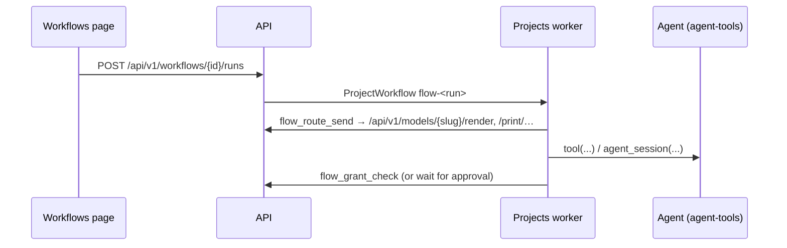

# Flows (workflows)

## What it does

A flow is a short script that chains ScadBuddy's actions: render, save an output, queue a
print, arrange, call a tool, or ask the assistant. Flows are registered and edited under
Workflows, started by hand, on a schedule or on an event (for example an order change),
and pause for a person's approval where a grant does not cover an outward step.

## How it works

A run is `ProjectWorkflow` on the `projects` queue, id `flow-<run_id>`. Its host
functions call the API's own routes through an activity, and `tool(...)` and
`agent_session(...)` go to the agent's queue. Triggers are Temporal Schedules or bus
events that start `FlowTriggerFire`. See
[workflows.md "Flows"](../architecture/workflows.md#flows) and the
[flow grants and git spec](../superpowers/specs/2026-10-11-flow-grants-and-git-design.md).

## Code

- UI: `frontend/src/pages/WorkflowsPage.tsx`, `FlowPage.tsx`, `WorkflowRunPage.tsx`,
  `frontend/src/components/flows/FlowEditor.tsx:106`.
- Routes: `backend/scadbuddy/api/flows.py:123` (register `:454`, run `:715`),
  `backend/scadbuddy/api/flow_triggers.py:63`, `backend/scadbuddy/api/flow_script.py:18`.
- Runs: `backend/scadbuddy/flows/launch.py:54`, `backend/scadbuddy/workflows/project.py:126`,
  `flow_tools.py:1373-1391`, `flow_routes.py:192`, `flow_grants.py`.
- Definitions in git under `data/flows` (`backend/scadbuddy/flows/repository.py`).
- Triggers: `backend/scadbuddy/flow_triggers/fire.py:113`, `events.py:170`,
  `backend/scadbuddy/workflows/flow_triggers.py:55`.
- Agent tools: `agent/src/tools/flows.ts`, `flowTriggers.ts`.

## Data

- Tables: `workflow_definitions`, `workflow_runs`, `workflow_run_decisions`,
  `workflow_flow_states`, `flow_grants`, `flow_grant_uses`, `flow_triggers`,
  `flow_trigger_fires`, `flow_trigger_grants`; `ai_flow_blobs` for a run's images; flow
  payloads sealed per subject (`ai_payload_keys`).

## Tests

- Backend: `backend/tests/flows/`, `backend/tests/test_flow_store.py`,
  `test_flow_trigger_*.py`, `backend/tests/api/test_flows.py`, `test_flow_grants.py`,
  `test_projects_worker_nodb.py`.
- e2e: `frontend/e2e/workflows.spec.ts`.

## Limits and known issues

- A run whose outward step failed ends succeeded
  ([#6123](https://github.com/eh-homelab/ScadBuddy/issues/6123)).
- A keyed tool call whose heartbeat was lost is not retried with one key
  ([#6345](https://github.com/eh-homelab/ScadBuddy/issues/6345)); grant checks do not
  follow the inherited chain ([#5685](https://github.com/eh-homelab/ScadBuddy/issues/5685)).
