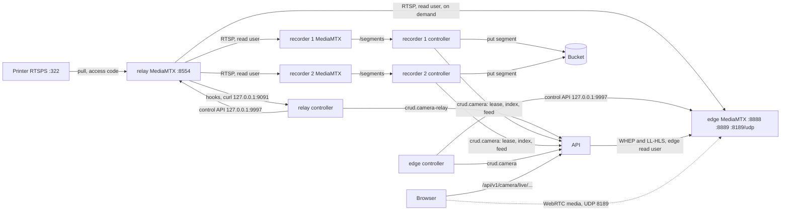

# Printer cameras

## What it does

ScadBuddy records the camera of each printer that qualifies, all the time, as fMP4 segments
of about 4 s in the blob store, with an index in Postgres. Phase 1 of
[#7334](https://github.com/eh-homelab/ScadBuddy/issues/7334) ([#7328](https://github.com/eh-homelab/ScadBuddy/issues/7328))
records and indexes only. Phase 3
([#7330](https://github.com/eh-homelab/ScadBuddy/issues/7330)) adds the live view (see "Live
view" below). Per-print video, timelapses and retention are phases 2, 4 and 5 (spec
[§9](../superpowers/specs/2026-11-23-printer-camera-recording-design.md#9-phases-each-one-issue-under-one-new-epic)).

A printer qualifies when all three are true (`camera/store.py` `CameraStore.sources`):

- its LAN link has a sealed access code;
- its last LAN report's `ipcam.rtsp_url` starts with `rtsps://`;
- its toggle `printers.camera_recording` is on. The default is on. The API's
  `PATCH /api/v1/printers/{id}` sets it (`printers/models.py` `PrinterPatch`). Phase 1
  has no UI for it.

## How it works

Three processes do the work. Each runs beside its own MediaMTX in one pod. The design is in
the spec
[§6.1](../superpowers/specs/2026-11-23-printer-camera-recording-design.md#61-parts); the
plan is `docs/superpowers/plans/2026-11-23-printer-camera-recording.md`.

- **The relay** (`python -m scadbuddy.camera.relay`, `camera/relay.py`) is the only part
  that holds access codes. It reads the qualifying printers from
  `/api/v1/internal/crud/camera-relay/printers`, the only routes that return a code
  (`api/crud_camera_relay.py`). It gives MediaMTX one RTSPS pull per printer through the
  control API, never through a file. The path name is the printer id. MediaMTX's
  `runOnAvailable` and `runOnUnavailable` hooks call the relay's hook server, and the relay
  reports the feed state (`pulling`, `retrying`) to the API.
- **The recorders** (`python -m scadbuddy.camera.recorder`, `camera/recorder.py`) run as two
  pods. Each MediaMTX reads every recorded printer from the relay with the read user and
  writes fMP4 segments under `/segments`. MediaMTX's `runOnRecordSegmentComplete` hook calls
  the controller. For each printer, the recorder that holds the lease (`camera_leases`,
  20 s, renewed every 5 s) is the leader. The leader puts each segment in the bucket, oldest
  first, then indexes it (`POST …/crud/camera/printers/{id}/segments`). The standby keeps the
  segments that the index has not reached yet, so a handover leaves no gap. The object key is
  `<prefix>/camera/<printer_id>/<yyyy>/<mm>/<dd>/<HHMMSS.ffffff>.mp4`, by the segment's UTC
  start (`camera/uploads.py`). The API refuses an index call that names a key outside
  `camera/<printer_id>/` (422 `foreign_object_key`, `store.py` `in_camera_folder`).
- **A stalled leader (#7407).** The lease renewal runs in a task of its own, so a leader whose
  uploads or indexes are stuck still renews. When a leader has indexed no segment in 6
  renewals in a row (`STALLED_LEAD_TICKS`, 30 s) while its MediaMTX says the path is ready
  (`ready` in `GET /v3/paths/list`), it releases the lease and acquires none for 10 s
  (`START_HOLDOFF`), so the standby takes over. A path that is not ready (the printer is off)
  is no stall. 30 s is past the longest a healthy leader goes without an index while video
  arrives: a lost hook's file waits `ADOPT_AGE` (12 s), then an upload pass (5 s) and at most
  `INDEX_EVERY` (8 s) of puts. `/v3/paths/list` is read at most once per half tick: the
  stall checks in that time share the read, including one still in flight. Each release adds one to `scadbuddy_camera_stall_releases_total`.
  When both recorders cannot index (the bucket is down, or the API answers the lease route but fails the index route), they hand the lease back
  and forth every 25 to 30 s (a leader releases at its sixth stalled tick, and the other
  recorder takes the lease at its next tick), and that counter shows it (#7998). If the API
  does not answer at all, no lease moves: the leader stops leading after `LEASE_SECONDS`,
  no recorder takes over, and the counter stays flat.
- **The edge** (`python -m scadbuddy.camera.edge`, `camera/edge.py`) is the live view's
  server. Its controller puts one on-demand path per recorded printer in its MediaMTX
  (`source` is the relay's RTSP URL with the relay read user, `sourceOnDemand: true`,
  `sourceOnDemandCloseAfter: 10s`), and never puts an unchanged path again, so a resync cuts no
  viewer. Its MediaMTX serves WebRTC (WHEP) on 8889, LL-HLS on 8888 and WebRTC media on UDP
  8189, behind the edge read user. The edge holds no access code and no bucket key. It sets
  `scadbuddy_camera_viewers`.
- **Changes.** The controllers follow a filtered change stream
  (`GET …/crud/camera[-relay]/changes`, `camera/follow.py`). On `resync` they read the full
  list again; they never act on a stale row.
- **The two containers of a pod.** Each pod runs its image twice: MediaMTX
  (`mediamtx /etc/mediamtx/mediamtx.yml`) and the controller (the image's default command).
  This keeps one process per container. The controller reaches MediaMTX's control API on
  `127.0.0.1:9997`, and MediaMTX's hooks run `curl` against the controller's hook server on
  `127.0.0.1:9091` (`camera/process.py` `HOOK_PORT`), so both containers must share the pod's
  network. The recorder's two containers also share `/segments`, an `emptyDir`.
- **Health.** Each controller answers `/healthz` and `/metrics` on port 9090
  (`camera/process.py` `serve_health`, `healthy`). `/healthz` answers 503 when:
  - MediaMTX's control API does not answer within 3 s (`CHECK_BUDGET`);
  - MediaMTX's runtime list (`GET /v3/paths/list`) lacks a path the controller has put
    (`Relay.wanted`, `Recorder.wanted`). This is how a restart of MediaMTX's container alone,
    which loses every path, is repaired: the probe restarts the controller, and the
    controller puts every path again at its start;
  - the change follower has stopped;
  - (recorder) its clock is more than 2 s off the API's (see "Clock" below).

  Before the follower starts (the controller waits for the CRUD service, or reads its first
  list), the follower does not count: it answers 200 when MediaMTX answers and holds the
  paths (and, in the recorder, the clock is within 2 s), because a restart cannot bring the
  API back. A liveness probe on `/healthz`
  restarts the controller's container only; MediaMTX's container needs its own probe
  (README ["Printer cameras (#7328)"](../../README.md#printer-cameras-7328)).
- **Readiness and rolling updates.** Each controller also answers `/readyz` on 9090
  (`serve_health`'s `ready` check). It answers 503 until the change follower runs, a full
  reconcile has put the API's paths in MediaMTX (`Relay.ready`, `Recorder.ready`), and
  `/healthz` would answer 200. The recorder is ready only when every printer it recorded at
  its first full reconcile has delivered a segment since the process started, or has
  delivered none for 120 s (`STALL_SECONDS`): a printer that is off sends no video to any
  recorder, so it must not stop a rollout. A printer added later does not count, so adding a
  printer does not take a running recorder out of ready. The relay does not wait for its
  pulls, so a printer that is off does not take the relay out of its Service.

  This is what makes a rolling update of the recorders gapless. The Deployment rolls one pod
  at a time (`maxSurge: 0`, `maxUnavailable: 1`). With a liveness probe only, Kubernetes
  counts a new pod available at once and stops the other pod, which may be the leader, before
  the new pod holds any video. With the readiness probe, the old pod stops only after the new
  one records every printer that sends video, and `minReadySeconds: 30` adds 30 s more. In that
  time an old leader whose upload lag is under 30 s indexes past the new pod's first segment.
  So when the new pod takes the lease, its buffer holds the segment that contains the index's
  end (spec D14), even when the old leader cannot flush at SIGTERM. The probe numbers are in the
  README.
- **Deleted printers.** The lease and feed routes answer 404 `printer_not_found` for a printer
  that was deleted (their rows need the printer's row). The feed senders stop on a 4xx (a 429
  is retried with back-off, and a state wanted while the refused post was on its way is still
  posted), and a recorder that gets a 404 on a lease call leads that printer no more. A
  recorder that stops
  leading drops the feed state it has not posted yet (`FeedSender.forget`), so it does not
  overwrite the new leader's report.
- **Clock (spec
  [§6.9](../superpowers/specs/2026-11-23-printer-camera-recording-design.md#69-operation)).**
  Segment times come from the recorders' clocks; print times come from the API's. The
  recorder compares its clock with the `Date` header of the API's answers. The API's CRUD
  listener is uvicorn (`crud/listener.py`, `date_header` left at its default `True`), which
  writes `Date` in whole seconds and refreshes it once a second ([uvicorn 0.53.0 `server.py` `on_tick`](https://github.com/encode/uvicorn/blob/0.53.0/uvicorn/server.py#L251-L256)). So the API's time at
  an answer lies in [Date, Date + 2 s), and the recorder takes Date + 1 s against the middle of
  its own send and receive (`Recorder._sample`): ±1 s plus the call's latency. It decides on
  the smallest offset of its last three samples, so one slow answer does not count. At start,
  after the CRUD service answers, it takes three samples; more than 2 s off refuses the
  start: the recorder logs the offset and exits 2 (`Recorder.check_clock`). After that, each
  lease call adds a sample. While the offset is more than 2 s, `/healthz` answers 503 and every
  feed report carries an `error` that names it (`Recorder._note_clock`,
  `FeedSender.set_error`).

## Live view

The camera dialog (`NowPrinting.tsx`) shows a live player when `GET /api/v1/printers/now` marks
the printer `camera_live`. That is true when the printer is recorded and the API has all four
settings `SCADBUDDY_CAMERA_EDGE_WHEP_URL`, `SCADBUDDY_CAMERA_EDGE_HLS_URL`,
`SCADBUDDY_CAMERA_EDGE_READ_USER` and `SCADBUDDY_CAMERA_EDGE_READ_PASS` (spec
[§6.7](../superpowers/specs/2026-11-23-printer-camera-recording-design.md#67-live-view)).
Otherwise the dialog keeps the MJPEG view.

- **The proxy** (`api/camera.py`). The browser calls only the API's origin. The API forwards
  to the edge with HTTP Basic auth of the edge read user on every call, and forwards no
  browser header (no cookie, no `Authorization`). Routes:
  - `POST /api/v1/camera/live/{printer_id}/whep` (an SDP offer, `application/sdp`, 64 KiB at
    most), and `PATCH`/`DELETE …/whep/{session}`. The edge's `Location` is rewritten to the
    API's path; any other `Location` is dropped.
  - `GET …/hls/{name}` (LL-HLS). It passes the query keys `_HLS_msn`, `_HLS_part`,
    `_HLS_skip`, `session` and `cookieCheck`, and no others. The name is
    `[A-Za-z0-9_-]{1,128}.(m3u8|mp4|m4s)`. A 302 to a path of the same printer is rewritten into
    the proxy; any other redirect is a 502.
  - `GET /api/v1/printers/{id}/camera` (the feed states and `live`) and
    `POST …/camera/reconnect` (202; the relay replaces that printer's path, `camera.reconnect`
    event, `Relay.restart`). After the 202 the dialog starts its player again only when the
    relay next reports `pulling` (a report newer than the one it read before), or after 20 s
    (`NowPrinting.tsx` `CameraFeeds`). A player that started at once would attach to the old
    pull while the relay removes it.
- **Problem types.** `camera-edge-unset` (503: the route's own URL, or the user or password, is unset; `camera_live` is then false), `camera-edge-unreachable`
  (502), `camera-edge-refused` (502: the edge refused the read user, or sent a redirect that
  the proxy does not pass), `camera-live-session-ended` (404: MediaMTX dropped the HLS session;
  the player starts again), `camera-not-recorded` (409 on reconnect; 404 on the live routes).
- **The player** (`LivePlayer.tsx`). It tries WebRTC first. It falls back to LL-HLS (hls.js,
  loaded on demand) after 6 s without a connected ICE state, after 6 s of ICE `disconnected`, or
  at once when the offer is refused or ICE fails. After 10 s of HLS with no frame it shows
  "Camera unavailable" with "Try again". A fatal HLS error before the first frame is retried
  after 1 s inside that wait. Close and a change of printer end the WHEP session and destroy
  hls.js. A WHEP answer that comes after the fallback is ended at once.
- **An HLS session** (MediaMTX v1.21.4, measured 2026-11-25, edge e2e and curl). A request for
  `index.m3u8` with no query gets a 302 to `index.m3u8?cookieCheck=1` and a cookie. The proxy
  forwards no cookie, so the next answer names the session in the query key `session`
  (`video1_stream.m3u8?session=<uuid>`, each segment and part too). A request without the
  session gets 401 "session not found". Once made, the session id works without credentials at
  MediaMTX, so it acts as a bearer key. The browser gets it in the playlists, through the
  proxy, and sends it back in the query. The edge admits a request that names it without the
  read password, so only the NetworkPolicy (the API's pods only on 8888) keeps it from being
  used outside the proxy.
- **Lifetime of a pull** (same date and method). With `hlsMuxerCloseAfter: 10s` the muxer is
  gone 10 s after the last HLS request, the session stays a reader until about 40 s, and the
  relay lost the edge's reader 48.5 s after the last request (69.2 s with the default 60 s).
  So a viewer who closes the dialog costs the relay about 50 s of one RTSP client.
- **Metrics.** `scadbuddy_camera_viewers{printer}` counts MediaMTX readers of the printer's
  edge path: one per WebRTC session, one for the whole HLS muxer. It is not a count of people.
  The "Live viewers" panel in the "Cameras" row shows it.

### MediaMTX facts (v1.21.4)

The release is pinned by version and sha256 in the Dockerfile's `mediamtx` stage. The
facts the code relies on, with how each was measured, are in the spec
[§2](../superpowers/specs/2026-11-23-printer-camera-recording-design.md#2-measured-and-known-facts).
The official image `bluenviron/mediamtx:1.21.4` has one layer and the entrypoint
`/mediamtx`, and has no `sh` and no `curl` (measured 2026-11-24 with `docker image inspect`
and `docker run --entrypoint sh`/`curl`, which both fail with "executable file not found").
The hooks need `curl`, so the camera images take the release binary on
`python:3.12-slim-bookworm` with `curl` from apt.

## Code

- Processes: `backend/scadbuddy/camera/relay.py`, `recorder.py`, `edge.py`, shared `process.py` (hook
  server, `/healthz`, `/readyz`, `main_with`), `follow.py`, `feed.py`, `mediamtx.py` (control API
  client), `uploads.py` (bucket), `mp4.py` (init section parse), `settings.py`
  (`RelaySettings`, `RecorderSettings`, `EdgeSettings`).
- API side: `backend/scadbuddy/camera/store.py` (`CameraStore`), `models.py`,
  `backend/scadbuddy/api/crud_camera.py`, `api/crud_camera_relay.py`; the callers in
  `auth/exchange.py` `SERVICE_ACCOUNTS` (`scadbuddy-camera`, `scadbuddy-camera-relay`,
  `scadbuddy-camera-edge`); the browser's routes `backend/scadbuddy/api/camera.py` and
  `api/streaming.py` (`ClosingStreamingResponse`).
- Frontend: `frontend/src/components/prints/LivePlayer.tsx`, `hlsLoader.ts`, `NowPrinting.tsx`
  (`LiveCameraView`, `CameraFeeds`), `src/mocks/features/camera.ts`.
- Agent: `agent/src/tools/print.ts` `get_printer_camera_state` (`read`) and
  `reconnect_printer_camera` (`write`: it restarts ScadBuddy's own pull and sends nothing to the
  printer, so it needs no approval). The live routes are `NOT_A_TOOL` entries in
  `agent/src/tools/coverage.ts`; an agent reads a frame with `get_printer_camera`.
- MediaMTX configs: `deploy/camera/mediamtx-relay.yml`, `mediamtx-recorder.yml`,
  `mediamtx-edge.yml`.
- Images: Dockerfile stages `mediamtx`, `camera-deps`, `camera`, `camera-relay`,
  `camera-recorder`, `camera-edge`; published by `build-image.yml` job `camera`, checked by `ci.yml` job
  `camera-image`.

## Data

- Tables: `camera_segments`, `camera_leases`, `camera_feeds`, and the column
  `printers.camera_recording` (`backend/scadbuddy/migrations/20261124T0059Z_camera_recording.sql`).
- Events: `camera.feed` (a feed state changed, `core/events.py` `CameraFeedEvent`) and
  `camera.reconnect` (the browser's Reconnect, `CameraReconnectEvent`; the relay's follower
  replaces that printer's path, `api/crud_camera.py` `CAMERA_KINDS`). The browser also gets
  `camera.feed` on the topic `printer:<id>` (`api/realtime.py`).
- Blobs: one object per segment, under `<prefix>/camera/` in the camera bucket. Only the
  recorder pods hold its keys.
- Metrics. The relay (`camera/relay.py`): `scadbuddy_camera_relay_pulling` (1 while the
  pull is ready, 0 while MediaMTX tries it) and `scadbuddy_camera_relay_reconnects_total`
  (each time the pull is ready again after it was not; a replaced path counts too). The
  recorders (`camera/recorder.py`): `scadbuddy_camera_segments_indexed_total`,
  `scadbuddy_camera_upload_lag_seconds`, `scadbuddy_camera_backlog_bytes`,
  `scadbuddy_camera_leader`, `scadbuddy_camera_last_segment_age_seconds` and
  `scadbuddy_camera_stall_releases_total`. All are per printer. The edge (`camera/edge.py`
  `ViewersCollector`) sets `scadbuddy_camera_viewers`, read from MediaMTX's path list at
  each scrape. The "Cameras" row of `deploy/grafana/scadbuddy-printing.json` shows them
  all but the stall releases.

## Tests

- Backend: `backend/tests/camera/` (relay, recorder, follower, uploads, mp4, store,
  settings, `/healthz` and `/readyz` in `test_process.py`), `backend/tests/api/test_crud_camera.py`,
  `test_crud_camera_changes.py`.
- Real MediaMTX: `backend/tests/camera/test_e2e_mediamtx.py`. ffmpeg publishes a stream, and
  real MediaMTX processes on the `deploy/camera/` configs run the relay and two recorders with
  their `curl` hooks; the test kills the leader and checks that the index has no gap. The
  Dockerfile's `test` stage has ffmpeg and MediaMTX, so it fails there instead of skipping.
  The same file has the edge test: with no viewer the relay path has 0 readers; HLS through the
  edge answers 200; the relay then shows 1 reader, gone 60 s after the last request at most;
  HLS and WHEP answer 401 without the edge read password; no log holds a password.
- API proxy: `backend/tests/api/test_camera_live.py` (a mock edge, and one walk through the proxy
  to a real MediaMTX edge: `index.m3u8`, its redirect, the variant, the init and a segment, and one
  blocking reload), `test_camera_routes.py`.
- Player: `frontend/src/components/prints/LivePlayer.test.tsx` (a fake `RTCPeerConnection` and hls.js),
  `NowPrinting.test.tsx`, and Playwright `frontend/e2e/camera-live.spec.ts` (the fallback to HLS
  through msw, the 302, the feed list, Reconnect, and no reads after Close).
- Images: `ci.yml` job `camera-image` (MediaMTX's version, `curl`, `TZ=UTC`, the refusals,
  MediaMTX on each config, the relay's read user from `MTX_AUTHINTERNALUSERS_0_*`, and the
  edge's: HLS and WHEP answer 401 without or with a wrong password, and 404 with the right one).

## Limits and known issues

- Phase 0's stream measurements (codec, frame rate, bitrate, keyframe interval, audio, how
  many RTSP clients the H2C accepts) are not made yet (spec §2).
- Liveness does not see a dead task inside a healthy controller: a printer's renewal or
  upload task, a relay feed sender, or the hook server. Each loop logs and goes on after an
  error, so only a bug ends one.
- After MediaMTX's container restarts alone, recording stops until the controller's probe
  fails enough times to restart it (3 failures, 10 s apart, in the README's probe numbers).
- No retention: nothing is deleted until phase 5.
- A relay restart is a gap of about 10 to 30 s in every printer's recording (the spec's
  estimate, §6.9). So the relay's image is not rolled with ScadBuddy's releases: its pin
  moves by hand, in a reviewed clusters PR, only when the relay's code or MediaMTX changes
  (spec §6.1). `deploy.reusable.yml` moves the recorders' and the edge's pins with each build
  (#7997), and never the relay's.
- Deployment lives in eh-homelab/clusters; the issue that asks for it is drafted with the
  phase 1 PR. The edge's manifests (the Deployment, two secrets, NetworkPolicies, the UDP
  port) are not made yet.
- WebRTC media (UDP 8189) from browsers to the edge is not measured. The player falls back
  to LL-HLS after 6 s, which needs no UDP.
- hls.js through the real proxy's 302 is proven only against mocks (msw in Playwright). The
  proxy and a real MediaMTX are tested together with an HTTP client (TestClient, which follows
  the 302), not with a browser.
- The Go front (`tools/go/core`, not deployed) forwards camera routes to Python. A blocking HLS
  request takes about 20 s there: the Python proxy waits up to 20 s for a blocking playlist, so
  the front's forward must allow that.
- A WHEP session that the browser's 6 s timer ends while the edge still creates it is ended by
  the player when the answer comes. If the page closes first, MediaMTX's own timeout ends it.
- A later ICE `disconnected` is covered by a 6 s timer; a `disconnected` that clears keeps
  WebRTC.
- The proxy has no cap on live viewers per printer (the MJPEG route has 4). Each HLS request
  runs one query of the recorded printers, and LL-HLS asks for a part many times a second.
