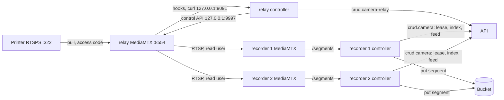

# Printer cameras

## What it does

ScadBuddy records the camera of each printer that qualifies, all the time, as fMP4 segments
of about 4 s in the blob store, with an index in Postgres. Phase 1 of
[#7334](https://github.com/eh-homelab/ScadBuddy/issues/7334) ([#7328](https://github.com/eh-homelab/ScadBuddy/issues/7328))
records and indexes only. Per-print video, live view, timelapses and retention are phases
2 to 5 (spec
[§9](../superpowers/specs/2026-11-23-printer-camera-recording-design.md#9-phases-each-one-issue-under-one-new-epic)).

A printer qualifies when all three are true (`camera/store.py` `CameraStore.sources`):

- its LAN link has a sealed access code;
- its last LAN report's `ipcam.rtsp_url` starts with `rtsps://`;
- its toggle `printers.camera_recording` is on. The default is on. The API's
  `PATCH /api/v1/printers/{id}` sets it (`printers/models.py` `PrinterPatch`). Phase 1
  has no UI for it.

## How it works

Two processes do the work. Each runs beside its own MediaMTX in one pod. The design is in
the spec
[§6.1](../superpowers/specs/2026-11-23-printer-camera-recording-design.md#61-parts); the
plan is `docs/superpowers/plans/2026-11-23-printer-camera-recording.md`.

- **The relay** (`python -m scadbuddy.camera.relay`, `camera/relay.py`) is the only part
  that holds access codes. It reads the qualifying printers from
  `/api/v1/internal/crud/camera-relay/printers`, the only routes that return a code
  (`api/crud_camera_relay.py`). It gives MediaMTX one RTSPS pull per printer through the
  control API, never through a file. The path name is the printer id. MediaMTX's
  `runOnAvailable` and `runOnUnavailable` hooks call the relay's hook server, and the relay
  reports the feed state (`pulling`, `retrying`) to the API.
- **The recorders** (`python -m scadbuddy.camera.recorder`, `camera/recorder.py`) run as two
  pods. Each MediaMTX reads every recorded printer from the relay with the read user and
  writes fMP4 segments under `/segments`. MediaMTX's `runOnRecordSegmentComplete` hook calls
  the controller. For each printer, the recorder that holds the lease (`camera_leases`,
  20 s, renewed every 5 s) is the leader. The leader puts each segment in the bucket, oldest
  first, then indexes it (`POST …/crud/camera/printers/{id}/segments`). The standby keeps the
  segments that the index has not reached yet, so a handover leaves no gap. The object key is
  `<prefix>/camera/<printer_id>/<yyyy>/<mm>/<dd>/<HHMMSS.ffffff>.mp4`, by the segment's UTC
  start (`camera/uploads.py`).
- **Changes.** Both controllers follow a filtered change stream
  (`GET …/crud/camera[-relay]/changes`, `camera/follow.py`). On `resync` they read the full
  list again; they never act on a stale row.
- **The two containers of a pod.** Each pod runs its image twice: MediaMTX
  (`mediamtx /etc/mediamtx/mediamtx.yml`) and the controller (the image's default command).
  This keeps one process per container. The controller reaches MediaMTX's control API on
  `127.0.0.1:9997`, and MediaMTX's hooks run `curl` against the controller's hook server on
  `127.0.0.1:9091` (`camera/process.py` `HOOK_PORT`), so both containers must share the pod's
  network. The recorder's two containers also share `/segments`, an `emptyDir`.
- **Health.** Each controller answers `/healthz` and `/metrics` on port 9090
  (`camera/process.py` `serve_health`, `healthy`). `/healthz` answers 503 when:
  - MediaMTX's control API does not answer within 3 s (`CHECK_BUDGET`);
  - MediaMTX's runtime list (`GET /v3/paths/list`) lacks a path the controller has put
    (`Relay.wanted`, `Recorder.wanted`). This is how a restart of MediaMTX's container alone,
    which loses every path, is repaired: the probe restarts the controller, and the
    controller puts every path again at its start;
  - the change follower has stopped;
  - (recorder) its clock is more than 2 s off the API's (see "Clock" below).

  Before the follower starts (the controller waits for the CRUD service, or reads its first
  list), the follower does not count: it answers 200 when MediaMTX answers and holds the
  paths (and, in the recorder, the clock is within 2 s), because a restart cannot bring the
  API back. A liveness probe on `/healthz`
  restarts the controller's container only; MediaMTX's container needs its own probe
  (README ["Printer cameras (#7328)"](../../README.md#printer-cameras-7328)).
- **Clock (spec
  [§6.9](../superpowers/specs/2026-11-23-printer-camera-recording-design.md#69-operation)).**
  Segment times come from the recorders' clocks; print times come from the API's. The
  recorder compares its clock with the `Date` header of the API's answers. The API's CRUD
  listener is uvicorn (`crud/listener.py`, `date_header` left at its default `True`), which
  writes `Date` in whole seconds and refreshes it once a second ([uvicorn 0.53.0 `server.py` `on_tick`](https://github.com/encode/uvicorn/blob/0.53.0/uvicorn/server.py#L251-L256)). So the API's time at
  an answer lies in [Date, Date + 2 s), and the recorder takes Date + 1 s against the middle of
  its own send and receive (`Recorder._sample`): ±1 s plus the call's latency. It decides on
  the smallest offset of its last three samples, so one slow answer does not count. At start,
  after the CRUD service answers, it takes three samples; more than 2 s off refuses the
  start: the recorder logs the offset and exits 2 (`Recorder.check_clock`). After that, each
  lease call adds a sample. While the offset is more than 2 s, `/healthz` answers 503 and every
  feed report carries an `error` that names it (`Recorder._note_clock`,
  `FeedSender.set_error`).

### MediaMTX facts (v1.21.4)

The release is pinned by version and sha256 in the Dockerfile's `mediamtx` stage. The
facts the code relies on, with how each was measured, are in the spec
[§2](../superpowers/specs/2026-11-23-printer-camera-recording-design.md#2-measured-and-known-facts).
The official image `bluenviron/mediamtx:1.21.4` has one layer and the entrypoint
`/mediamtx`, and has no `sh` and no `curl` (measured 2026-11-24 with `docker image inspect`
and `docker run --entrypoint sh`/`curl`, which both fail with "executable file not found").
The hooks need `curl`, so the camera images take the release binary on
`python:3.12-slim-bookworm` with `curl` from apt.

## Code

- Processes: `backend/scadbuddy/camera/relay.py`, `recorder.py`, shared `process.py` (hook
  server, `/healthz`, `main_with`), `follow.py`, `feed.py`, `mediamtx.py` (control API
  client), `uploads.py` (bucket), `mp4.py` (init section parse), `settings.py`
  (`RelaySettings`, `RecorderSettings`).
- API side: `backend/scadbuddy/camera/store.py` (`CameraStore`), `models.py`,
  `backend/scadbuddy/api/crud_camera.py`, `api/crud_camera_relay.py`; the callers in
  `auth/exchange.py` `SERVICE_ACCOUNTS` (`scadbuddy-camera`, `scadbuddy-camera-relay`).
- MediaMTX configs: `deploy/camera/mediamtx-relay.yml`, `deploy/camera/mediamtx-recorder.yml`.
- Images: Dockerfile stages `mediamtx`, `camera-deps`, `camera`, `camera-relay`,
  `camera-recorder`; published by `build-image.yml` job `camera`, checked by `ci.yml` job
  `camera-image`.

## Data

- Tables: `camera_segments`, `camera_leases`, `camera_feeds`, and the column
  `printers.camera_recording` (`backend/scadbuddy/migrations/20261124T0059Z_camera_recording.sql`).
- Events: `camera.feed` (a feed state changed, `core/events.py` `CameraFeedEvent`). The
  change streams' filter also names `camera.reconnect` (`api/crud_camera.py` `CAMERA_KINDS`),
  which nothing sends before phase 3.
- Blobs: one object per segment, under `<prefix>/camera/` in the camera bucket. Only the
  recorder pods hold its keys.
- Metrics. The relay (`camera/relay.py`): `scadbuddy_camera_relay_pulling` (1 while the
  pull is ready, 0 while MediaMTX tries it) and `scadbuddy_camera_relay_reconnects_total`
  (each time the pull is ready again after it was not; a replaced path counts too). The
  recorders (`camera/recorder.py`): `scadbuddy_camera_segments_indexed_total`,
  `scadbuddy_camera_upload_lag_seconds`, `scadbuddy_camera_backlog_bytes`,
  `scadbuddy_camera_leader` and `scadbuddy_camera_last_segment_age_seconds`. All are per
  printer. The "Cameras" row of `deploy/grafana/scadbuddy-printing.json` shows them.

## Tests

- Backend: `backend/tests/camera/` (relay, recorder, follower, uploads, mp4, store,
  settings, `/healthz` in `test_process.py`), `backend/tests/api/test_crud_camera.py`,
  `test_crud_camera_changes.py`.
- Real MediaMTX: `backend/tests/camera/test_e2e_mediamtx.py`. ffmpeg publishes a stream, and
  real MediaMTX processes on the `deploy/camera/` configs run the relay and two recorders with
  their `curl` hooks; the test kills the leader and checks that the index has no gap. The
  Dockerfile's `test` stage has ffmpeg and MediaMTX, so it fails there instead of skipping.
- Images: `ci.yml` job `camera-image` (MediaMTX's version, `curl`, `TZ=UTC`, the refusals,
  MediaMTX on each config, and the relay's read user from `MTX_AUTHINTERNALUSERS_0_*`).

## Limits and known issues

- Phase 0's stream measurements (codec, frame rate, bitrate, keyframe interval, audio, how
  many RTSP clients the H2C accepts) are not made yet (spec §2).
- Liveness does not see a dead task inside a healthy controller: a printer's renewal or
  upload task, a relay feed sender, or the hook server. Each loop logs and goes on after an
  error, so only a bug ends one.
- After MediaMTX's container restarts alone, recording stops until the controller's probe
  fails enough times to restart it (3 failures, 10 s apart, in the README's probe numbers).
- No retention: nothing is deleted until phase 5.
- Deployment lives in eh-homelab/clusters; the issue that asks for it is drafted with the
  phase 1 PR.
