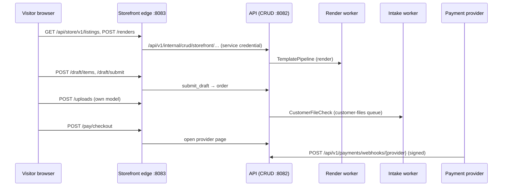

# Storefront and payments

## What it does

A public shop: published listings that a visitor can customize (colours, text, size)
with a live render and a firm price from a slice (or "priced by hand" when the shop cannot slice it), a cart, design requests, "print my model"
uploads, passwordless accounts, an order page, and payment through Stripe, PayPal or
Square. In the back office, **Sell on storefront** turns a model into a listing, and the
Storefront page edits, prepares and publishes listings. See README
["Storefront"](../../README.md#storefront-5284) and
["Payment webhooks"](../../README.md#payment-webhooks-4957).

## How it works

The storefront edge is its own process with no database, KEK or Temporal access. Every
call it makes is a `crud.storefront` route on the API's CRUD port. Payment webhooks are
served by the API, not the edge. Customer uploads are checked by the intake worker in a
sandbox before they are used. A render's price comes from slicing it through the back
office's quote path, as the `storefront_slice_price` operation on the `library` queue
(`backend/scadbuddy/orders/storefront/slice_price.py:1-4`, `backend/scadbuddy/orders/quote.py:872`);
the visitor's page asks `GET /api/store/v1/renders/{job_id}/estimate`
(`backend/scadbuddy/storefront/routes.py:196`), which answers `slice`, `pending` or `none`
(`backend/scadbuddy/orders/estimate.py:69-71`). Checkout charges that cached price as a
`storefront` quote.

## Code

- Edge: `backend/scadbuddy/storefront/__main__.py:24-48`, `app.py`, `routes.py:83`
  (visitor routes `:117-760`), `settings.py:18-26` (what it refuses).
- CRUD side: `backend/scadbuddy/api/crud_storefront.py:208`, `backend/scadbuddy/orders/storefront/`
  (`listings.py:230`, `file_listings.py`, `renders.py`, `drafts.py`, `submit.py:138`, `accounts.py`,
  `mail.py`, `turnstile.py`, `prepare.py`, `intake.py`).
- Back office: `backend/scadbuddy/api/storefront.py:51`, `frontend/src/pages/StorefrontPage.tsx`,
  `frontend/src/components/storefront/ListingEditor.tsx:927`.
- Public UI: `frontend/src/storefront/` (router `App.tsx:86-97`, client
  `api/client.ts:67`); its OpenAPI is exported by
  `backend/scadbuddy/tools/export_openapi.py` `--storefront`.
- Payments: `backend/scadbuddy/payments/` (`registry.py:13-21`, `stripe.py`, `paypal.py`,
  `square.py`, `service.py:171`); webhook route `backend/scadbuddy/api/payment_webhooks.py:58`.
- Intake: `backend/scadbuddy/intake_worker/`, `backend/scadbuddy/workflows/staged_file.py`.

## Data

- Tables: `storefront_listings`, `storefront_renders`, `storefront_visitors`,
  `storefront_accounts`, `storefront_sessions`, `storefront_mail`, `storefront_uploads`,
  `storefront_order_links`, `payment_credentials`, `payment_requests`, `payment_events`.
- Blob keys: `listing-media-<sha256>`, `customer-preview-<sha256>`,
  `customer-file-<sha256>`; a file listing's held copy `listing-file-<sha256>` and its
  plate previews `listing-preview-<sha256>` (#6710, `file_listings.py`).
- Settings: `storefront_*` (`backend/scadbuddy/core/settings.py:279-361`); provider
  credentials are sealed rows, entered in Settings.

## Tests

- Backend: `backend/tests/storefront/` (the edge), `backend/tests/orders/storefront/`,
  `backend/tests/api/test_crud_storefront_*.py`, `backend/tests/payments/`,
  `backend/tests/intake_worker/`, `backend/tests/test_prepare_listing_workflow.py`,
  `test_staged_file_workflow.py`.
- e2e: `frontend/e2e/storefront.spec.ts`, `storefront-account.spec.ts`,
  `storefront-models.spec.ts`, `storefront-sell.spec.ts`, `storefront-admin.spec.ts`.

## Limits and known issues

- Customer model imports after the check are a later phase
  (`backend/scadbuddy/workflows/staged_file.py:17`;
  [#6133](https://github.com/eh-homelab/ScadBuddy/issues/6133)).
- The first read of a done render's preview on an API replica fetches its files from the
  blob store. While that runs, the read answers 503 `preview_not_ready` after a few seconds
  (`backend/scadbuddy/orders/storefront/renders.py` `preview_ready`); the edge asks again for
  10 s, and the viewer (`frontend/src/lib/previewLoader.ts`) asks again on a 502, 503 or 504
  with a backoff, so a slow store shows as loading, not as an error
  ([#6968](https://github.com/eh-homelab/ScadBuddy/issues/6968)). The app's own viewers use
  the same loader, so there any 502, 503 or 504 (a `database_unavailable` too) shows as
  loading for about 30 s before the failure shows.
- A published listing with no price (published before #6922, or whose price run ended with
  none) gets its run from the housekeeping sweep `housekeeping_warm_listings`
  (`backend/scadbuddy/orders/storefront/prepare.py` `warm_unpriced`, #7665): once per
  version of the listing, and again only past Temporal's retention. A listing whose run
  finds no price shows none before that.
- Venmo's pay page is off (`backend/scadbuddy/payments/venmo.py:48`;
  [#4960](https://github.com/eh-homelab/ScadBuddy/issues/4960)).
- A pipeline template is listed only when it declares its inputs (`model.json`
  `pipeline.inputs`). The shop sets them through the API only, the customer never sets
  them (`backend/scadbuddy/orders/storefront/pipeline_inputs.py`). A render of several
  outputs has one price over all of them. The order page prints each output on its own, and
  the shop records the item's attempt by hand: the item's own print refuses a kit
  (`item_kit`, `backend/scadbuddy/orders/printing.py`;
  [#5701](https://github.com/eh-homelab/ScadBuddy/issues/5701)).
