# The inventory model, shown with real examples

This folder is the proof for the design
[`2026-11-25-inventory-kinds-and-handlers-design.md`](../superpowers/specs/2026-11-25-inventory-kinds-and-handlers-design.md)
(epic #6949). It shows that one base model, with handlers, holds every kind of thing the
owner named on 2026-11-25: a printer, a nozzle, a spool, a spool insert, a textured PEI
plate, RFID labels, a power drill, a label printer, its service plan, a spool of labels and
a ream of paper. It adds a warranty, an hourly service and a flat-rate service.

| File | What it holds |
|---|---|
| [`handlers.yaml`](handlers.yaml) | The steps, every handler, the defaults per class, the special types |
| [`kinds.yaml`](kinds.yaml) | The kind tree, with every phase 2 built-in kind placed in it |
| [`relations.yaml`](relations.yaml) | The relationship types and their handlers |
| [`examples.yaml`](examples.yaml) | The items, the instances you have, and the relationships between them |
| [`check.py`](check.py) | Resolves and checks all of it (below) |

Run the check from the repo root:

```bash
uvx --with pyyaml python -I docs/inventory-model/check.py
```

It resolves each item's class and handlers, checks each handler's step, class and
parameters, checks each instance and relationship, and checks that §3's table is what it
resolved. It also checks that the five relationships marked `expect: refused` are refused,
each for its stated reason. It replays `examples.yaml`'s history (a nozzle and a plate
move from one printer to another) and checks each unit's life against `expect_life`.
Output on 2026-11-25:

```text
refused as expected: contains unit:label_printer_1 -> unit:roll_5: unit:label_printer_1 holds 1 of kind:label_roll at most, and has ['unit:roll_4']
refused as expected: contains unit:label_printer_1 -> unit:roll_9: unit:label_printer_1 does not accept unit:roll_9
refused as expected: contains unit:drill_1 -> unit:nozzle_4: unit:drill_1 does not accept unit:nozzle_4
refused as expected: contains unit:h2c_1 -> unit:insert_7: unit:insert_7 is already in unit:spool_112
refused as expected: covers unit:drill_1 -> unit:h2c_1: unit:drill_1: class {'nature': 'physical', 'role': 'durable', 'counting': 'unit'} is not {'nature': 'service', 'billing': 'term'}
life as expected: nozzle_4 used 1350, 90.0%, warn True, book value 250.00
life as expected: plate_1 used 900, 90.0%, warn True, book value 400.00
life as expected: nozzle_3 used 700, 46.7%, warn False, book value 1333.33
life as expected: h2c_1 used 700, 7.0%, warn False, book value 325407.00
life as expected: h2c_2 used 750, 7.5%, warn False, book value 323657.50
ok: 33 kinds, 38 handlers, 16 items, 17 instances, 16 relationships, 8 history events, 5 lives
```

## 1. What a thing is: the class

Every kind answers a short, fixed set of questions. A child kind may answer a question its
parent left open, never change an answer. Only the answers pick default behaviour; the
names of the kinds do not.

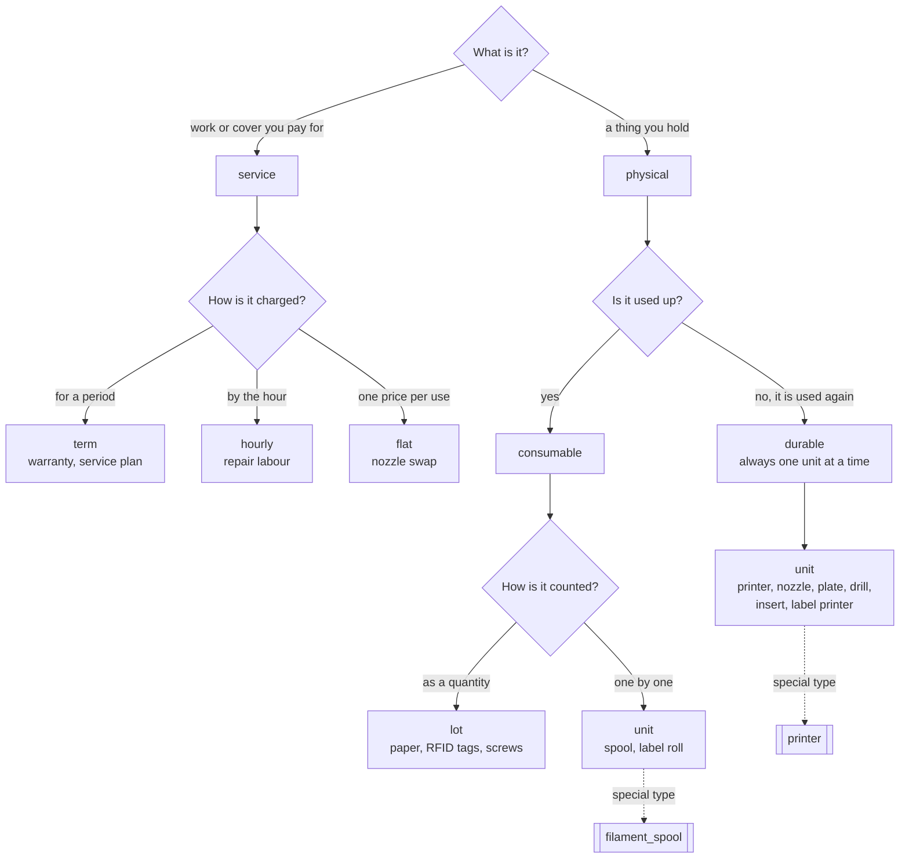

## 2. How a step finds its handler

The base flow knows ten steps: receive, consume, count, move, retire, cost, life, bill,
label and sync. It never does a step itself. It finds the handler and calls it.

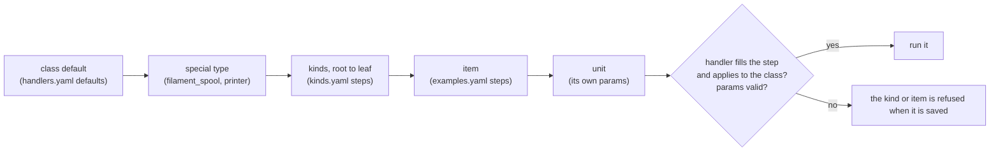

Each layer may name another handler for a step, or set only parameters for the handler
it has. A new handler drops the parameters set for the old one. `refuse` fills a step a
class does not have: an hourly service cannot be received, a nozzle cannot be counted.

## 3. Every example, resolved

`check.py` builds this table from the YAML and fails if it differs. "—" is `refuse`.

<!-- matrix:start -->
| Item | Class | receive | consume | count | move | retire | cost | life | bill | label | sync |
|---|---|---|---|---|---|---|---|---|---|---|---|
| Bambu Lab H2C | physical/durable/unit + printer | `printer.receive` | `printer.consume_run` | — | `move.place` | `retire.default` | `printer.machine_rate` | `life.hours` | — | `label.default` | `printer.bambuddy_link` |
| H2C hardened steel nozzle 0.4 mm | physical/durable/unit | `receive.units` | `consume.use` | — | `move.place` | `retire.default` | `cost.unit` | `life.hours` | — | `label.default` | `sync.none` |
| Bambu PLA Matte Charcoal 1 kg | physical/consumable/unit + filament_spool | `filament.receive` | `filament.consume_grams` | `filament.weigh` | `filament.move` | `filament.close` | `filament.cost_per_kg` | `life.none` | — | `filament.label` | `filament.bambuddy_sync` |
| Bambu PLA+ Gold 1 kg | physical/consumable/unit + filament_spool | `filament.receive` | `filament.consume_grams` | `filament.weigh` | `filament.move` | `filament.close` | `filament.cost_per_kg` | `life.none` | — | `filament.label` | `filament.bambuddy_sync` |
| Bambu reusable spool | physical/durable/unit | `receive.units` | `consume.use` | — | `move.place` | `retire.default` | `cost.unit` | `life.none` | — | `label.default` | `sync.none` |
| Textured PEI plate 350 mm | physical/durable/unit | `receive.units` | `consume.use` | — | `move.place` | `retire.default` | `cost.unit` | `life.uses` | — | `label.default` | `sync.none` |
| NTAG215 stickers, pack of 50 | physical/consumable/lot | `receive.lot` | `consume.lot_fifo` | `count.lot` | `move.place` | `retire.default` | `cost.lot_fifo` | `life.none` | — | `label.default` | `sync.none` |
| Cordless drill 18 V | physical/durable/unit | `receive.units` | `consume.use` | — | `move.place` | `retire.default` | `cost.unit` | `life.months` | — | `label.default` | `sync.none` |
| Label printer, 62 mm | physical/durable/unit | `receive.units` | `consume.use` | — | `move.place` | `retire.default` | `cost.unit` | `life.months` | — | `label.default` | `sync.none` |
| Continuous label roll 62 mm | physical/consumable/unit | `receive.units` | `consume.remaining` | `count.remaining` | `move.place` | `retire.default` | `cost.unit` | `life.none` | — | `label.default` | `sync.none` |
| Die-cut label roll 29 mm | physical/consumable/unit | `receive.units` | `consume.remaining` | `count.remaining` | `move.place` | `retire.default` | `cost.unit` | `life.none` | — | `label.default` | `sync.none` |
| Label printer service plan, 2 years | service/term | `receive.service_term` | `consume.service` | — | — | `retire.term_end` | `cost.bill` | `life.term` | `bill.term` | `label.default` | `sync.none` |
| H2C manufacturer warranty, 1 year | service/term | `receive.service_term` | `consume.service` | — | — | `retire.term_end` | `cost.bill` | `life.term` | `bill.term` | `label.default` | `sync.none` |
| Letter size paper, 20 lb | physical/consumable/lot | `receive.lot` | `consume.lot_fifo` | `count.lot` | `move.place` | `retire.default` | `cost.lot_fifo` | `life.none` | — | `label.default` | `sync.none` |
| Printer repair labour | service/hourly | — | `consume.service` | — | — | — | `cost.bill` | — | `bill.hourly` | — | `sync.none` |
| Nozzle swap, flat rate | service/flat | — | `consume.service` | — | — | — | `cost.bill` | — | `bill.flat` | — | `sync.none` |
<!-- matrix:end -->

What the table shows:

- The two spools and the ream of paper are all consumables. Only the spools have
  `filament_spool`, so only they get grams, weighing, trays, the spool label and the
  Bambuddy sync. The paper runs the defaults.
- The printer, the nozzle, the plate, the drill and the label printer are all durable. Their
  life differs only by handler and parameters: run hours of the printer itself, run hours of
  the printer the nozzle is in, prints on the plate, months for the drill (84, with 10%
  salvage) and the label printer (36). Nothing about life is in the base flow.
- The insert is durable with `life.none`: it is used again and keeps its value.
- The warranty and the plan are services with a term: they are received, they lose their
  prepaid value over the term, and they end. The hourly and the flat service have no stock:
  they are only used, and their bill handler gives the charge.

## 4. The relationships

A container field is an `accepts` rule with a `max`. `max: 1` shows as a single field on
the page (the roll in the label printer, the insert in a spool). A larger `max`, or none,
shows as a list (the two nozzles of an H2C). `contains` fills the field and checks the
rule. A person can add show-only relationship types in the UI; a type that checks or warns
comes with Go code.

```text
Label printer #1                     H2C 3DP-31B-598
  Label roll   [ 62 mm roll #4  ]      Nozzles      [ nozzle #3 ] [ + add ]   (2 at most)
  Covered by   [ service plan #1 ]     Build plate  [ PEI plate #1 ]
                                       Covered by   [ warranty #1, to 2027-06-01 ]
```

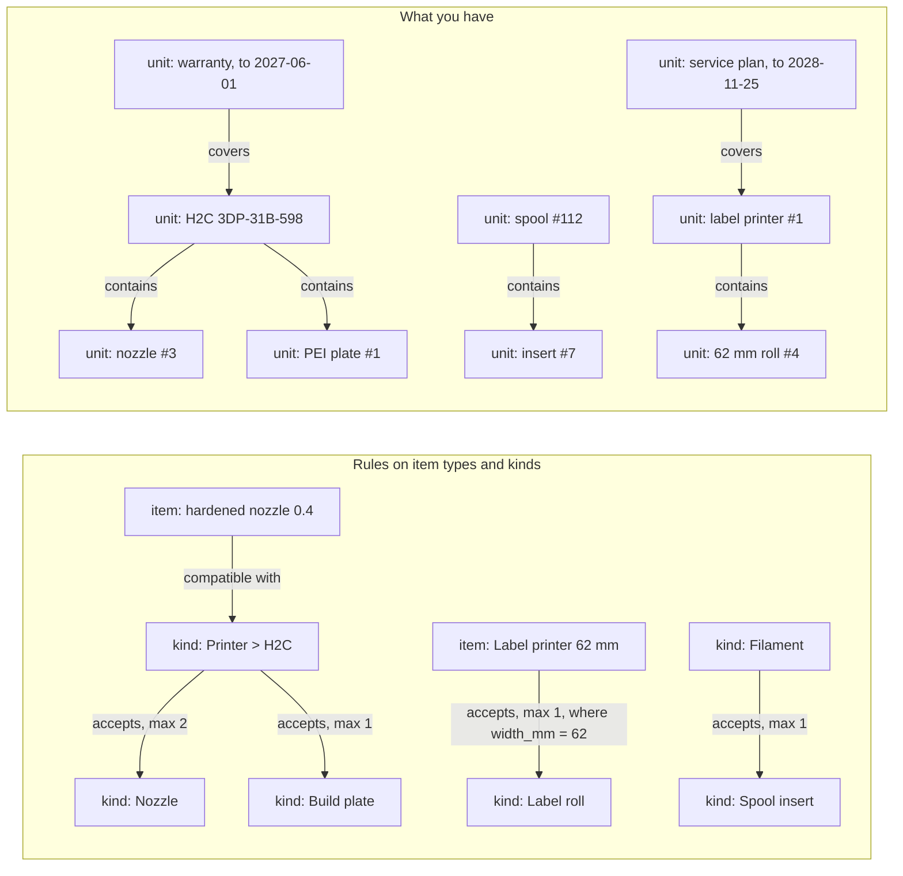

Refused by `check.py`, each for the reason the design gives:

| Relationship | Why it is refused |
|---|---|
| label printer #1 contains 62 mm roll #5 | It holds one roll (`max 1`), and roll #4 is in it |
| label printer #1 contains 29 mm roll #9 | It accepts label rolls only `where width_mm = 62` |
| drill #1 contains nozzle #4 | A drill accepts nothing |
| H2C contains insert #7 | Insert #7 is already in spool #112 (one container at a time) |
| drill #1 covers the H2C | Only a service with a term covers |

## 5. The flows

### 5.1 A mixed invoice is received

One invoice: two spools, a box of 5 reams, a pack of 50 NTAG stickers, a label printer and
its 2-year service plan. Each line goes to its own item's receive handler. Nothing is made
before the person confirms (the owner's rule of 2026-11-25).

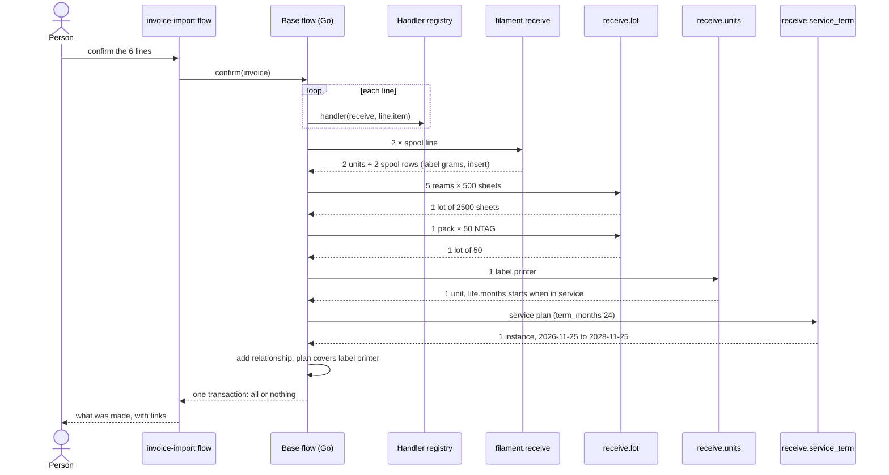

### 5.2 A print on the H2C

The printer's consume handler books the run hours, and one use on everything installed
in it. Each installed unit's own life handler reads that use in its own way. The spool's
handler books grams. Job cost takes the filament at its cost at the time of use, and the
machine rate for the hours.

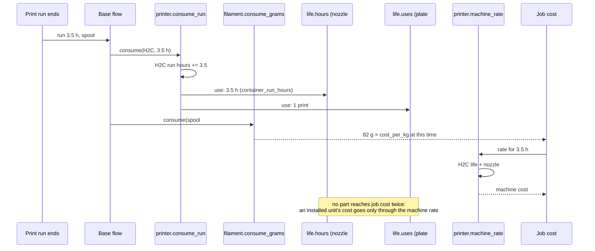

### 5.3 Fit a nozzle, and refuse a roll that does not fit

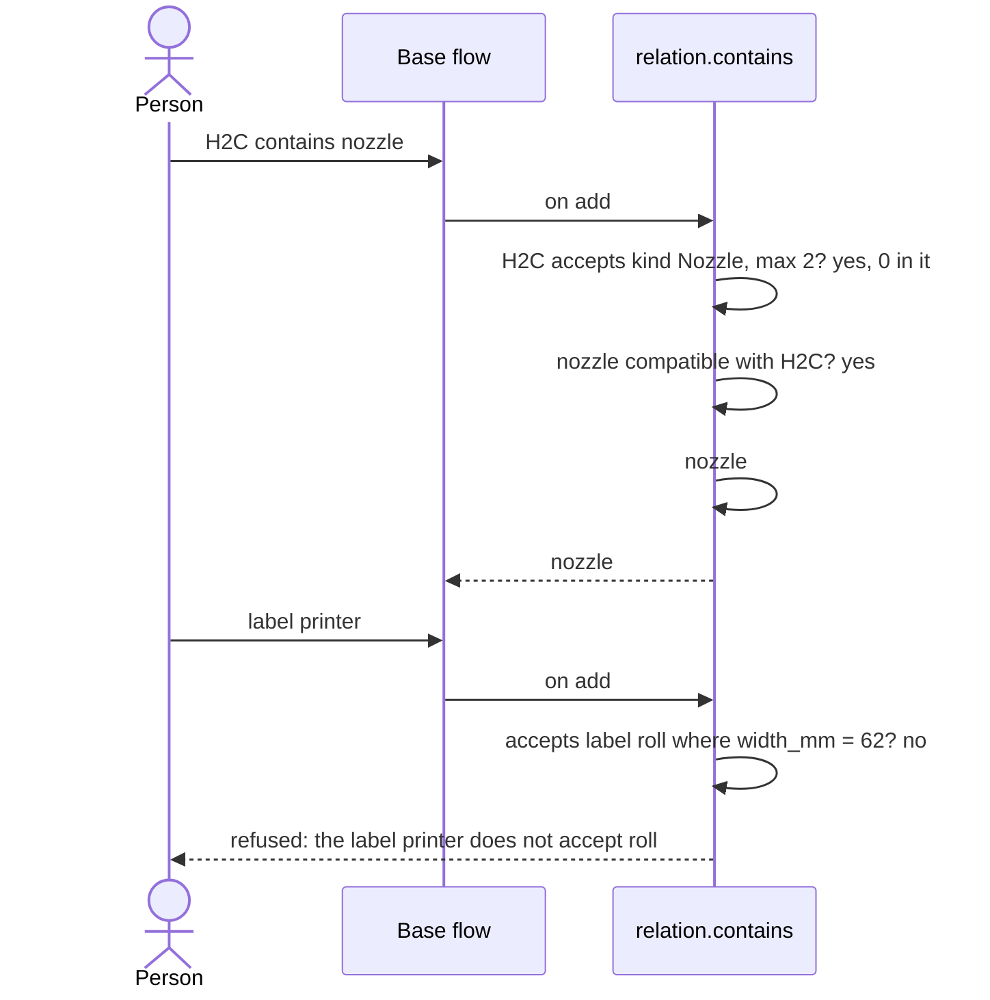

### 5.4 A term ends

A daily schedule (a Temporal workflow) asks each `covers` relationship's handler for its
signals. The handler asks the service's life handler.

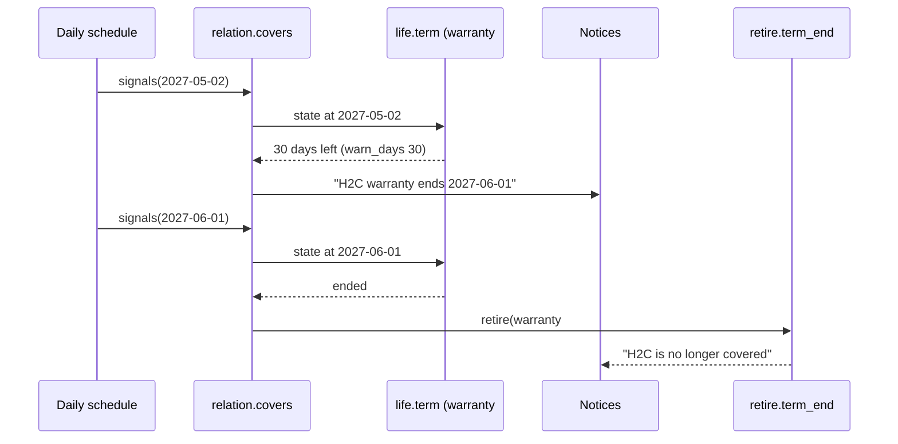

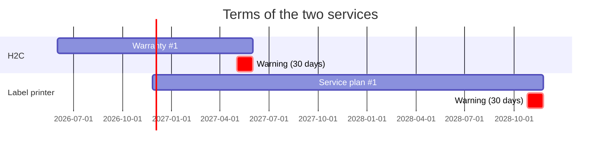

### 5.5 A spool is respooled

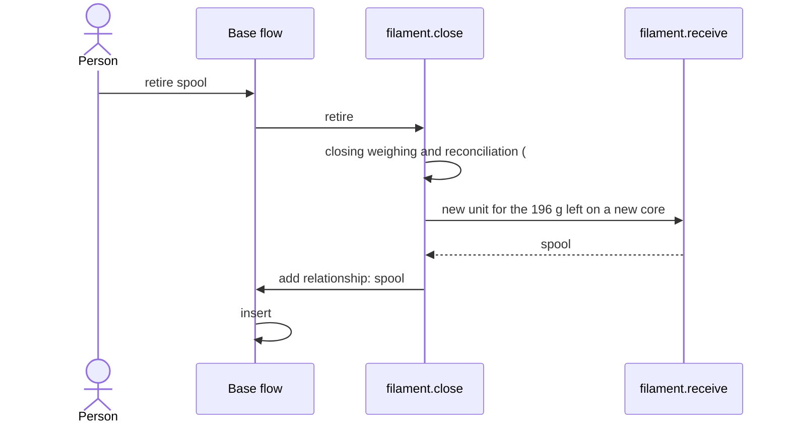

### 5.6 Services on an order

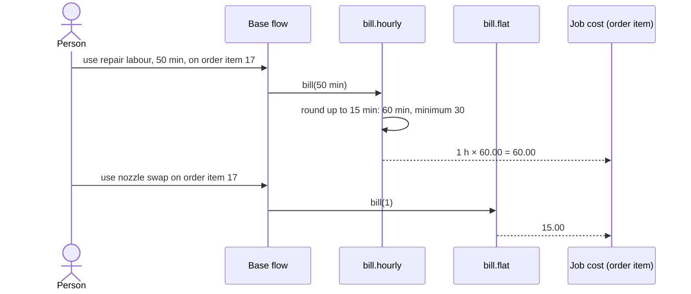

### 5.7 A nozzle and a plate move from printer A to printer B

A unit's life is never read from the printer it is in now. Every print run books a row in
`unit_uses` on the printer and, through it, on each unit it contains at that moment. A
life handler sums the unit's own rows. So a unit that moves keeps what it did in each
printer, and a printer's later runs do not count on a unit that has left it. The same
holds for any unit that is fitted in another: a nozzle (`life.hours`), a plate
(`life.uses`), a hotend, a belt.

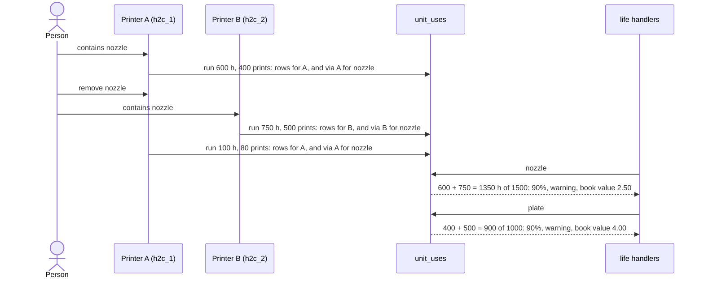

| Unit | Rows in `unit_uses` | Life handler | Used | Book value |
|---|---|---|---|---|
| Nozzle #4 | 600 h via A, 750 h via B | `life.hours`, 1500 h, through a container | 1350 h (90%, warning) | 25.00 → 2.50 |
| Plate #1 | 400 prints via A, 500 via B | `life.uses`, 1000 | 900 prints (90%, warning) | 40.00 → 4.00 |
| Nozzle #3 (stayed in A) | 600 h, 100 h via A | `life.hours`, 1500 h | 700 h (46.7%) | 25.00 → 13.33 |
| Printer A | 600 h, 100 h own | `life.hours`, 10000 h, own | 700 h (7%) | 3499.00 → 3254.07 |
| Printer B | 750 h own | `life.hours`, 10000 h, own | 750 h (7.5%) | 3499.00 → 3236.58 |

The `contains` relationship keeps its end date when a unit is removed, so the unit's page
can also list where it has been and for how long.

## 6. The life of a unit

The statuses are the base flow's. Handlers decide when a unit moves between them.

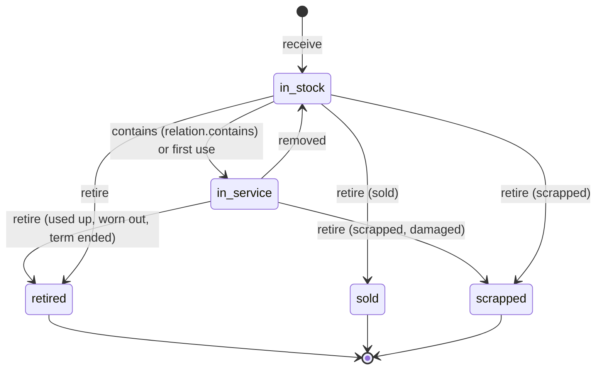

## 7. The handlers in Go

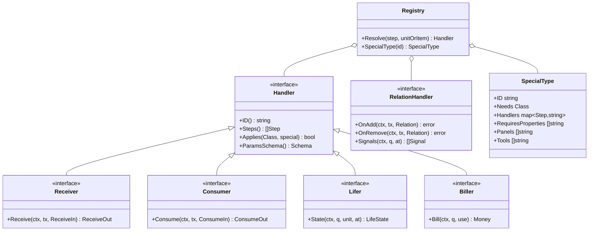

The other steps (count, move, retire, cost, label, sync) have an interface of the same
shape. The design's §6 has the package layout.
