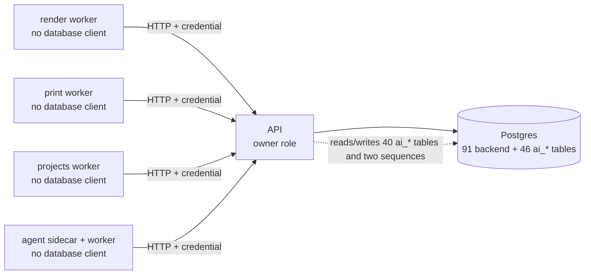
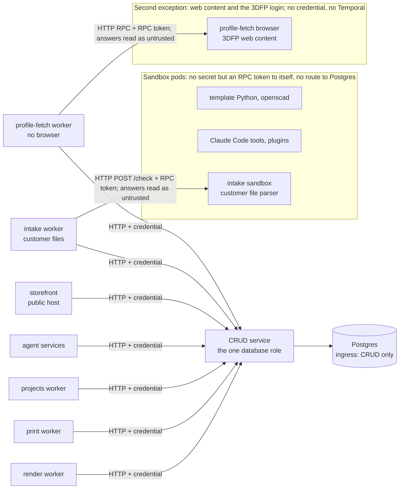

# Trust boundaries and database access

This page records who reaches ScadBuddy's database today, where untrusted code runs, and
the target that the epic [#5295](https://github.com/eh-homelab/ScadBuddy/issues/5295) sets.

## The rule

The owner decided this rule on 2026-11-05 (#5295):

- Only the CRUD service gets SQL access. The CRUD service is today's API process, once it
  runs no untrusted code.
- No untrusted code can ever reach the database.
- Every other process (the render, print and projects workers, the agent services,
  agent-durable) is an HTTP client of the CRUD service. It presents a short-lived service
  credential (the service credentials of PR #5211).
- No cross grants. No shared tables. No database role per caller as a boundary.

A role split inside one database is not a boundary. The owner of a table controls its
triggers, rules and column defaults, and a function that shadows a builtin. That code runs
with the privileges of the other role that touches the table. The review of PR #5287 (the
agent on its own role, closed) found this.

## How this was measured

Measured on 2026-11-05 (UTC):

- The manifests: `eh-homelab/clusters` `origin/main` at `3618296a`, the files
  `applications/scadbuddy/*.yaml` and `clusters/prod/scadbuddy/*`. Line numbers below are
  for that commit.
- The cluster: `kubectl --context primary -n bambuddy get networkpolicy`,
  `get ciliumnetworkpolicy`, `get ciliumclusterwidenetworkpolicy` and `get deploy`.
- The database, read only, on the CNPG primary `scadbuddy-db-1`: a count of `pg_tables`
  in `public` by name prefix and owner, and `pg_stat_activity` grouped by `usename`.
- This repository's code, at the commit that adds this page. A `file:line` is in this
  repository unless it names `clusters`.

A claim marked **not tested** is an inference from the configuration. Nobody has run it.

Measured again on 2026-11-14 (UTC), after eh-homelab/clusters#3555, #3566 and #3578, for
the render, print and projects workers' rows below: the manifests at `eh-homelab/clusters`
`main` `341bcca2` (`applications/scadbuddy/scadbuddy-render.yaml`, `scadbuddy-print.yaml`,
`scadbuddy-projects.yaml` and the three `networkpolicy-*.yaml`, read with `gh api`), and,
as the owner measured it in prod that day, the database's roles: no `scadbuddy_render`,
`scadbuddy_print` or `scadbuddy_projects` role exists, and `scadbuddy_agent` is the only
one besides the owner. The three pods set no `SCADBUDDY_DATABASE_URL` and no
`PGPASSWORD`, only the projects pod mounts the KEK, and their egress policies name no
Postgres peer.

## Who talks to the database today

Production has 91 backend tables and 46 `ai_*` tables. The role `scadbuddy` owns all 137
of them (`pg_tables`). Connected roles on 2026-11-05: `scadbuddy` (68 connections),
`scadbuddy_print` (3), `scadbuddy_projects` (3), `scadbuddy_render` (2). No session used
`scadbuddy_agent`, although CNPG creates that role (clusters
`applications/scadbuddy/cnpg-cluster.yaml:123-128`). On 2026-11-14 the three worker
roles are gone, and `scadbuddy_agent` is the only role besides the owner. Since PR #6906
the API revokes `scadbuddy_agent` at every start and logs, for each retired role that
still exists, its granted relations, owned relations and sessions
(`backend/scadbuddy/auth/revoke.py` `RETIRED_ROLES`, `retired_state`). On 2026-11-22 the
API pods on sha-3304f78 logged `scadbuddy_agent` with 0 granted relations, 0 owned relations
and 0 sessions (12:12:02Z, `kubectl logs -c scadbuddy`); eh-homelab/clusters#3965 then set it
`ensure: absent`. After that sync CNPG's `managedRolesStatus` lists it `reconciled`, and the API
pods started 13:01Z-13:05Z log no line for it, so the owner is the only login role left.

| Process | Code | Database secret (clusters manifest) | Tables it may touch | SQL into the other service's tables |
|---|---|---|---|---|
| API, 3 replicas | `backend/` | `scadbuddy-db-app`, the owner (`scadbuddy.yaml:376-379`) | all | reads and writes 40 `ai_*` tables and two sequences, as their owner on prod's one role (the agent granted them as `API_AI_GRANTS` until #6501; the agent's settings, Claude credentials, payload keys and the `ai_audit` rows of their reveals among them, which it serves the agent over CRUD routes, #5299 step 4, and the tombstones, flow images and key deletes of area `forget`, whose sweep reads `ai_session_entries`, #5299 step 6, and its small stores: the activity kinds, the browser's approved origins, the session tabs, tab owners and tab images, the pairings, the MCP tokens, the Web Push records and the notification channels, the tool access and listings, the upstream MCP sessions, the remote plugins and their sign-ins and the plugin packages, #5299 step 5, and the workspace files of area `workspace`, `ai_session_files` and `ai_session_file_bytes` with their `blob_refs` holds and `workspace.file` events, sealed and opened with its KEK, and a session's images, the staged attachments and the saved HTTP bodies of areas `session-blobs`, `attachments` and `http-bodies`, `ai_session_blobs`, `ai_session_tool_images`, `ai_attachments` and `ai_session_http_bodies`, #5299 step 7, and the background tasks, their events, a Workflow's journal and child chats, and `ai_operations`, #5299 step 8, and a session's row in `ai_sessions` as the session manager reads and writes it (a failed fork discarded with its `ai_session_entries` rows and its key) and `ai_session_resources`, areas `sessions` and `session-resources`, #5299 step 9, and a session's transcript in `ai_session_entries`, sealed and opened with its KEK under the session's data key and read through the fork chain, area `transcripts`, and its event log in `ai_session_events`, area `session-events`, #5299 step 9 part b, and the order items a session revised in `ai_session_order_costs`, its report under a lease row, area `session-order-costs`, #5299 step 9 part c), and its own `agent_leases` (#5299 D3) |
| render worker, 2 replicas | `backend/` | none since eh-homelab/clusters removed it (measured 2026-11-14); the worker has no database client either (#5298) | 0: it has no grant list (the store settings, the job rows, their events and activity rows, their blob refs, the piece geometry, the blob index, the uploads' `assets` rows and the library leases, pin holds and install slots go through CRUD routes, and it waits for the API's CRUD areas, not its migrations, #5298), and at every start the API revokes every grant it made the role `scadbuddy_render` (the migrations ledger, the `render_settings` view, `render_jobs`, `events`, `activity`, `blob_refs`, `piece_geometry`, `store_blobs`, `store_folders`, `assets`, `library_leases`, `library_pin_holds`, `library_install_slots` and the schema) and drops its row policy where the role still exists (`backend/scadbuddy/auth/revoke.py` `revoke_retired`, #5298 Task 22); prod dropped the role (2026-11-14). Through the blob-index routes it writes only a render job's own `piece` keys, never a meta key of the slicer's output mark (`SLICED_OUTPUT_META`, #6179), an output only while its job runs, and a ref only after the API hashed its object (#6233), and reads only those, the library pieces Arrange lays out, snapshots, fonts and uploads (`api/crud_render.py` `RENDER_KEY`, #5298 final review) | none |
| print worker, 1 replica | `backend/` | none since eh-homelab/clusters#3578 removed it (measured 2026-11-14); the worker holds no pool either (#5298) | 0: it has no grant list (the settings, its print runs, their outcomes, its operations, its events, its Bambuddy uploads, their slices, its slice starts, the print dialog's background slices, the projects' printers, the projects without their folder yet, the destinations' touches, the copy lease, its print links, its sends, its outputs' last prints, the printer registry, its LAN reports, the printers' access codes, the rack hotends' usage, the SB spools in a native run's trays and what its LAN starts use of them (area `filament`, #6262), ScadBuddy's own filament presets (area `own-presets`), a native slice's start and a LAN print's read URL of its sliced file go through CRUD routes, so a printer merge runs on the API alone; it waits for its CRUD areas, not the migrations, and does not LISTEN; it exchanges its proof only (`exchange_source`, no view fallback), holds no KEK, and refuses to start without a proof, #5298 Task 33), and at every start the API revokes every grant it made the role `scadbuddy_print` (the 34 tables, the sequence `native_slices_id_seq`, its credential view and the schema) and drops its row policies where the role still exists (`backend/scadbuddy/auth/revoke.py` `revoke_retired`, #5298 Task 35); prod dropped the role (2026-11-14) | none |
| projects worker, 1 replica | `backend/` | none since eh-homelab/clusters removed it (measured 2026-11-14); the worker has no database client either (#5298) | 0: it has no grant list (flow runs, decisions, grants, operations, tasks and payload keys go through CRUD routes, and it has no event bus, #5298), and at every start the API revokes every grant it made the role `scadbuddy_projects` and drops its row policies where the role still exists (`backend/scadbuddy/auth/revoke.py` `revoke_retired`); prod dropped the role (2026-11-14) | 0: the agent revoked every `ai_*` grant it made that role at every start until #6501; prod dropped the role |
| agent sidecar (in the API pod) | `agent/` | none since eh-homelab/clusters#3965 (measured 2026-11-22: the `agent` containers set no `SCADBUDDY_DATABASE_URL`); the agent would ignore one with a warning (#5299 step 12, `agent/src/config.ts` `IGNORED_VARS`) | 0: it has no SQL client (#5299 step 12; `agent/test/retiredTables.test.ts` fails on a Postgres driver in `agent/src`) | none: every store is its `Crud…` client over `/api/v1/internal/crud/agent/*` with the `agent` service credential (the areas in `agent/src/api/crudAreas.ts` and `backend/scadbuddy/api/crud_areas.py` `CRUD_AREAS["agent"]`): its settings, Claude credentials and payload keys (step 4), forget (step 6), small and plugin stores (step 5), workspace files and blobs (step 7), background tasks and operations (step 8), sessions, transcripts, event logs, turns, edits and order costs (step 9), the gate (step 10), the /mcp relay (step 11), the approvals' input-hash key and the fetch grants (area `keys`, step 12), and its reads of flow runs, their decisions and grants (area `flows`, D7). Its six NOTIFY channels come over one server-sent event stream, `GET …/crud/agent/changes` (D4), and it reads `events` only as that stream's replay. It needs a service-credential proof to start and reads no credential view. The API applies its migrations (D6), and revokes everything the role `scadbuddy_agent` held (among it `events`, `workflow_runs`, `workflow_run_decisions`, `flow_grants`, `flow_grant_uses` and `blob_refs`) at every start where it exists (`auth/revoke.py` `RETIRED_ROLES`, PR #6906); prod dropped the role (2026-11-22) |
| agent worker, 3 replicas | `agent/` | none since eh-homelab/clusters#3965, as the sidecar | 0, as the sidecar | none, as the sidecar |
| agent-durable, 0 replicas | `agent-durable/` | none (`scadbuddy-agent-durable.yaml`: "No database URL and no KEK") | 0 | none: it runs no worker |
| slicer worker, 1 replica | `workers/rust/` | none (`scadbuddy-slicer.yaml`) | 0 | none: transfer URLs only |
| `bambuddy-fs` | `tools/go/` | none | 0 | none: the public API only |
| fleet chat server (not deployed) | `tools/go/fleet/` | none | 0 | none: core's `…/crud/fleet/` routes with the `crud.fleet` credential, exchanged for its ServiceAccount token and renewed in process |

The grant lists are today's state. They describe the per-caller roles of PR #5210, which
#5295 supersedes. The agent grants nothing since #6501; on separate roles the API's role must own the `ai_*` tables.

## Where untrusted code runs

Untrusted code is code that a template author, a plugin, a remote server or the model
controls.

| Untrusted code | Where it runs | Its guard | Can it reach SQL? |
|---|---|---|---|
| A template's `pipeline/` Python | the render worker pod, a child of the worker, same uid 10001 (`scadbuddy-render.yaml:121`) | an environment allowlist (`backend/scadbuddy/workflows/template_process.py:107`), its own process group (`:138`), a kill on timeout (`:149`, `:51`). No seccomp or Landlock rule; only the pod's egress policy (`networkpolicy-render.yaml`) limits its network. | No. The render pod holds no database secret and no KEK, and its egress policy names no Postgres peer (`networkpolicy-render.yaml`; measured 2026-11-14). What a process with the worker's uid can still reach (it can usually read `/proc/<ppid>/environ` and the worker's memory) is the worker's 15-minute `crud.render` credential and the S3 keys, never a Bambuddy key: the settings route answers none (`api/crud_render.py` `withheld`, #5298 final review, #7882). With the credential it can call only the render CRUD routes, and through the blob index it can write only a render job's own pieces (`RENDER_KEY`), touch only those, the library objects and snapshots, and forget a library object only when the API cannot read it either. It writes an output only while that output's job runs (`_open_jobs_only`). A ref must name the object its kind and SHA-256 give, and the API reads and hashes its object unless a row the API verified names it (`_verified`, `store_blobs.verified_at`, #6233). Every render job still writes into one key space, so it can still overwrite another template's pieces, or the outputs of a job that runs at the same time, with true bytes of its own (Known gaps 8). With the S3 keys it can overwrite or delete any object in the bucket. #5296 moves template Python out of the worker's pod. |
| OpenSCAD source | the render worker pod; the API pod (the editor's parse check, the schema export, preset writes) | a Landlock filesystem ruleset (`backend/scadbuddy/render/confinement.py:3-17`, `render/sandbox.py`). No network rule. | Low. The language has no socket call. In the API pod it runs with the uid of a process that holds the owner secret; the render pod holds none. |
| `openscad-lsp` | the API pod (`backend/scadbuddy/library/lsp.py`) | seccomp: no socket except `AF_UNIX` (`backend/scadbuddy/editor/nonet.py:3-6`) | No TCP. It shares a uid with the API, which holds the owner secret. |
| Claude Code and its tools | the agent worker pods, a child of the agent | tiers in `canUseTool` and a `PreToolUse` hook; file tools confined to the session directory, except that `Read` and `Grep` may also reach the session's own `tool-results` directory in the Claude Code config dir (#5542) (`agent/src/harness/confine.ts`); Bash and PowerShell `off` in the pod (`agent/src/access/nativeBuiltins.ts`); where the deployment sets `SCADBUDDY_SANDBOX_*`, the session's own Bash and PowerShell run in a sandbox pod of its own with no secret (#5864, `docs/ai/security.md`); the model credential behind a loopback gateway (`agent/src/gateway/server.ts`) | Only with Bash on: the pod holds no owner database URL and no KEK since eh-homelab/clusters#3965 (#5299 step 12), but holds the `agent` credential's proof and the Temporal client. |
| A plugin package approved with `allow_refused` | the agent worker pods | the approval of its pin only. It can switch Bash on, at `outward` (`agent/src/access/nativeBuiltins.ts` `nativeBuiltinTools`), in the pod; where a sandbox is set up (#5864), the Bash it gets runs in the session's sandbox pod instead. | No database secret or KEK: eh-homelab/clusters#3965 removed both from the agent's pods (#5299 step 12). It can still read the `agent` service credential and use the Temporal client (#5299 D10). |
| Flow scripts (Monty) | the projects worker (`backend/scadbuddy/workflows/project.py`) | the interpreter; host functions only; outward calls need an approval | No. |
| Workflow scripts (QuickJS) | the agent (`agent/src/background/workflowRunner.ts`) | the interpreter; each `agent()` call is a child chat | No. |
| Template UI modules | the browser | a shadow root; `default-src 'none'; sandbox` on the served files (`backend/scadbuddy/api/template_ui.py:45-49`) | No. |
| 3dfilamentprofiles.com pages (JavaScript in Chromium) | the profile-fetch browser pod (`scadbuddy-profile-fetch-browser`, #6625, #6780), a headed Chromium that is a child of the browser service | Chromium's own sandbox (the code never passes `--no-sandbox`), an environment allowlist for the browser (`backend/scadbuddy/profile_fetch/site.py` `browser_env`), the pod's network policy (egress DNS and public 443 only, plan Decision 14; ingress from the worker's pods only). The pod holds the 3DFP login and the RPC token, and no CRUD credential, no proof and no Temporal or API address (`backend/scadbuddy/profile_fetch/browser.py`); it is no Temporal worker, and its policy has no rule to Temporal or the API (#6780). It runs a Localhost seccomp profile and a confining AppArmor profile of its own (#6779, "Browser and parser pod profiles" below), not `Unconfined`. | No: the pod holds no database secret and no CRUD credential, and reaches neither Temporal nor the API. The worker reads its answers as untrusted (`profile_fetch/remote.py`). |
| Remote MCP servers, `http_request` targets | outside the cluster, reached through the agent | the loopback forwarder; results wrapped as untrusted data | No. |
| Fleet chat messages (text other Claude Code sessions wrote) | not run: stored by core and relayed by the fleet chat server (`tools/go/fleet`), which holds `crud.fleet`, to the sessions that read their inbox | `fleet_inbox` and the inbox resource start with a line that says the text is untrusted data written by other agents (`tools/go/fleetchat`); its credential reaches only the `fleet` area. The server has no auth of its own: anything on the LAN may call it (the owner's decision of 2026-11-26), and a NetworkPolicy that admits only ScadBuddy's pods and the LAN's Gateway is to guard it, not deployed yet | No: the text is data, and the server has no SQL client. |

## Zones

| Zone | Entered by | Guard | Gap |
|---|---|---|---|
| The API on 8080 (`/api/v1/*`) | the gateway and Pomerium routes, and pods named in the API's ingress policy (clusters `networkpolicy-agent.yaml`) | `AuthGate` resolves the caller and refuses nothing itself (`backend/scadbuddy/auth/gate.py:4`); `auth/check.py` refuses only in `enforce` | The deployment sets no `SCADBUDDY_AUTH_MODE` (`scadbuddy.yaml`; checked live), so it runs the default `off` (`backend/scadbuddy/core/settings.py:248`). Anyone who reaches the API is the anonymous browser principal. |
| `/api/v1/internal/*` (outputs, library, blobs, workspace-blobs) | any pod that the API's ingress policy admits | each group takes only a service credential of its scope, in `enforce` only (README "The print worker (#1060)"); the blob routes also need a transfer token (`backend/scadbuddy/api/internal_blobs.py:5-6`) | In `off`, internal by path only. `POST /uploads` writes (`backend/scadbuddy/api/internal_workspace.py:16-18`, `:90-92`). #5297. |
| The agent's `/mcp`, `/mcp/workspace/` and the plugin feed's three reads (`/api/v1/ai/plugin-feeds/{feed}/marketplace.json`, `…/plugins/{name}/versions/{version}/{file}`, `…/plugins/{name}/archives/{file}`) on 8081 | the internet: the public URL serves exactly these with no sign-in at the ingress (eh-homelab/clusters#4017, merged 2026-11-25; the feed narrowed to its three reads by eh-homelab/clusters#4368), and the LAN gateway | the bearer check in `authenticate()` (`agent/src/auth/authenticate.ts`): an `sbmcp_` token, or an OIDC access token while OIDC is on. The feed's Settings routes under the same prefix (`GET …/{feed}`, `PUT`/`DELETE …/{feed}/packages/{name}`) take no token: they are guarded only by the Origin/Host allowlist (next row), so they must stay behind the front door | In `disabled` mode `/mcp` and the feed reads serve every caller as `anonymous`, up to `mcp_anonymous_cap` (`agent/src/auth/authenticate.ts`); `/mcp/workspace/` refuses that mode (`agent/src/mcp/uploads.ts`). Measured 2026-11-25: prod is in `bearer` mode; with no token `/mcp` answers 401 and the feed's `marketplace.json` 401. Before #4368, the whole prefix was public, and `GET …/plugin-feeds/default` answered 200 with no credential. |
| The agent on 8081 (settings, approvals, sockets) | the same front doors | an Origin and Host allowlist, which a TCP peer can forge (`agent/src/routes/guard.ts:48-49`) | The browser principal approves any outward call (`agent/src/approvals/service.ts:719`). #5297. |
| Postgres `scadbuddy-db` on 5432 | any pod in the cluster | passwords; no pod with an egress policy admits Postgres: the render, print and projects pods' policies name no Postgres peer (measured 2026-11-14), and the agent worker's and agent-durable's lost theirs with their database secrets (eh-homelab/clusters#3965, `networkpolicy-agent-durable.yaml`) | No NetworkPolicy selects the CNPG pods (checked live). Any pod can try to log in. eh-homelab/clusters#3182. |
| Temporal frontend on 7233 | pods named in its ingress policy (clusters `networkpolicy-temporal-v2-frontend.yaml`) | that policy; payloads of `session-*` and `flow-*` workflows sealed per subject | No mTLS (clusters `temporal-cluster-v2.yaml:237`). A pod in the list is a full client. |
| S3 (DO Spaces) | the API and the render worker, with the store's S3 keys (the render worker gets them from the API's CRUD route); the slicer, through presigned URLs | the slicer holds no store secret; the keys reach no other pod | The keys open the whole bucket: template Python in the render pod can reach them (see "Where untrusted code runs") and overwrite or delete any object, every service's. #5296. |

## What each pod holds

From the clusters manifests at `3618296a`; replicas and policies checked live. The render,
print and projects rows are from `341bcca2` (2026-11-14, see "How this was measured").

| Pod | KEK | Database secret | Bambuddy key | Egress policy | Read-only root |
|---|---|---|---|---|---|
| API and agent sidecar, 3 | the API: yes (`scadbuddy.yaml`). The agent container: no, since eh-homelab/clusters#3965 (#5299 step 12): the API seals and opens every agent secret and answers each plaintext or derived key to the `agent` credential from a route for that purpose, audited (#5299 step 4, #5342, area `keys`) | owner, in the API container only (measured 2026-11-22) | yes (`scadbuddy.yaml:342-351`) | none | API no (`:515`), agent yes (`:746`) |
| agent worker, 3 | no, since eh-homelab/clusters#3965 | none | no | public 443 and 80, the gateway VIP, Temporal, the API (`networkpolicy-agent-worker.yaml`; Postgres removed in #3965) | yes |
| render, 2 | no (the worker reads none, #5298) | none, and no role `scadbuddy_render` | no: no Bambuddy key either, since #7882 the API's CRUD route answers none (#5298 final review) | an allowlist with no Postgres peer (`networkpolicy-render.yaml`) | no |
| print, 1 | no: the API opens a printer's access code and a virtual printer's sealed one, says whether it can open them (the LAN path's gate, `bambuddy/print_run.py` `_registry_path`), and mints a LAN print's read URL of a native slice's file (#5298 Task 33) | none, and no role `scadbuddy_print` | yes (`scadbuddy-print.yaml`) | an allowlist with no Postgres peer (`networkpolicy-print.yaml`) | no |
| projects, 1 | yes (`SCADBUDDY_SECRET_KEY_FILE`, `scadbuddy-projects.yaml:150`), for its flows' sealed payloads | none, and no role `scadbuddy_projects` | no | an allowlist with no Postgres peer (`networkpolicy-projects.yaml`) | no |
| agent-durable, 0 | no | none | no | no Postgres rule (`networkpolicy-agent-durable.yaml`) | yes |
| slicer, 1 | no | none | no | public 443, Temporal, the API, OTLP (`networkpolicy-slicer.yaml`) | yes |

Every ScadBuddy pod runs as uid 10001, non-root, with `allowPrivilegeEscalation: false`
and all capabilities dropped. The intake sandbox and the profile-fetch browser pod run Localhost
seccomp and AppArmor profiles of their own (next section). Both proxy
settings trust the whole pod CIDR: `SCADBUDDY_TRUSTED_PROXIES` and
`SCADBUDDY_AGENT_TRUSTED_PROXIES` are `10.42.0.0/16` (`scadbuddy.yaml:340-341`, `:593-594`).

## Browser and parser pod profiles

Two pods run untrusted input inside user namespaces: the intake sandbox (a customer's file,
#6133) and the profile-fetch browser pod (3dfilamentprofiles.com pages in Chromium, #6625;
the browser moved out of the worker's pod in #6780, and the worker runs the runtime's
default profile).
Both ran seccomp `Unconfined` with an AppArmor profile that was `unconfined` plus `userns,`
until #6779. Now each runs a Localhost seccomp profile and a confining AppArmor profile of
its own, from `deploy/security/`:

| Pod | Seccomp file | Added to the runtime's default | AppArmor profile |
|---|---|---|---|
| `scadbuddy-intake-sandbox` | `seccomp/intake-sandbox.json` | `unshare` with exactly `CLONE_NEWUSER\|CLONE_NEWNET\|CLONE_NEWNS\|CLONE_NEWPID`; `mount` | `scadbuddy-intake-sandbox`: the default plus `userns,` and the launcher's six mounts in place of `deny mount,` |
| `scadbuddy-profile-fetch-browser` | `seccomp/profile-fetch.json` | `clone` whose namespace flags are exactly `CLONE_NEWUSER`, exactly `CLONE_NEWUSER\|CLONE_NEWPID\|CLONE_NEWNET`, or exactly `CLONE_NEWPID`; `unshare` with exactly `CLONE_NEWUSER`; `chroot` | `scadbuddy-profile-fetch`: the default plus `userns,` (it keeps `deny mount,`) |

The runtime's default is what the kubelet's `RuntimeDefault` gives a pod that drops every
capability on the nodes, which run containerd 2.2.7-k3s1 (node status, read with kubectl
on 2026-11-20). Its seccomp profile is containerd v2.2.7's `DefaultProfile` with no
capabilities ([contrib/seccomp/seccomp_default.go](https://github.com/containerd/containerd/blob/v2.2.7/contrib/seccomp/seccomp_default.go));
k3s-io/containerd v2.2.7-k3s1 has the same file (same git blob). The JSON was generated by
calling that function from a Go program and printing its result. Its AppArmor profile is
containerd's `cri-containerd.apparmor.d` template
([contrib/apparmor/template.go](https://github.com/containerd/containerd/blob/v2.2.7/contrib/apparmor/template.go)),
which the two profiles copy on ABI 4.0, the first ABI with a `userns` rule
([AppArmor wiki](https://gitlab.com/apparmor/apparmor/-/wikis/unprivileged_userns_restriction)).
The nodes run `kernel.apparmor_restrict_unprivileged_userns=1` (clusters
`apparmor/scadbuddy-intake-sandbox`, read in a prod pod on 2026-11-15), which stays on.
eh-homelab/clusters `applications/scadbuddy/apparmor-loader.yaml` installs both kinds on
every node, and its copies are these files, byte for byte (the same sha256).

How it was measured: a temporary workflow on a GitHub-hosted `ubuntu-24.04` runner (kernel
7.0.0-1014-aws, AppArmor parser 4.0.1, Docker 28.0.4 with containerd 2.4.2 and runc 1.5.3;
the nodes run kernel 6.8 and AppArmor 4.0), run
[44816447042](https://github.com/eh-homelab/ScadBuddy/actions/runs/44816447042) on
2026-11-20. It ran the deployed images (`scadbuddy-profile-fetch:sha-ab0f85c` and
`scadbuddy:sha-ab0f85c`, by digest) as the pods run them: their uid, a read-only root, no
capabilities, no new privileges, the restriction sysctl at 1, each profile loaded with
`docker run --security-opt seccomp=<file> --security-opt apparmor=<name>`. Chromium was
launched as `profile_fetch/site.py` launches it (headed under Xvfb, `chromium_sandbox=True`,
the allowlisted environment) and opened `chrome://sandbox`; the intake sandbox was started
as its Deployment starts it and sent one STL check. What it showed:

- The runtime's default seccomp profile, with either AppArmor profile: Chromium's launch
  fails with "No usable sandbox!", and the intake sandbox exits 3 ("unshare(CLONE_NEWUSER |
  CLONE_NEWNET | CLONE_NEWNS | CLONE_NEWPID): Operation not permitted").
- The pod's own seccomp file and AppArmor profile: Chromium reports "You are adequately
  sandboxed." (Layer 1 Namespace, PID and network namespaces, Seccomp-BPF with TSYNC) and
  runs a page's script; the intake sandbox serves and answers the check with 200, its
  verdict's `isolation` null.
- Each addition is needed: with any one rule of the table taken out, Chromium does not start
  ("No usable sandbox!" without `clone` `CLONE_NEWUSER` or `unshare`, "Zygote could not
  fork" without `clone` `CLONE_NEWPID`, "Failed to receive hello message from zygote"
  without `chroot`, the browser closed without the three-flag `clone`), and the intake
  sandbox exits 3 without `unshare` or `mount`. With the default's discovery run (the default
  with `SCMP_ACT_LOG`), Chromium also called `io_uring_setup` and `io_uring_enter` (the
  Playwright driver) and the intake parser called `mbind`; both work when these are refused,
  so neither is added.
- The intake sandbox's AppArmor mounts are needed: under the profile-fetch profile, which
  keeps `deny mount,`, it exits 3 ("mount(MS_REC | MS_PRIVATE): Permission denied").
- Calls outside the profiles are refused. In each image, under its pod's profiles,
  `keyctl` and `userfaultfd(UFFD_USER_MODE_ONLY)` answer `EPERM` (both `ok` under the old
  pods' settings), `clone3` answers `ENOSYS`, and an `unshare` with flags other than the
  allowed ones answers `EPERM`. Under the profile-fetch AppArmor profile alone (seccomp
  unconfined) a `mount` of a tmpfs in a new user and mount namespace answers `EACCES`; under
  the old profile it succeeded.
- Two informational results: Chromium starts under the pod's seccomp file with containerd's
  own default AppArmor profile too, since that profile's ABI 3.0 does not mediate user
  namespaces, and fails ("No usable sandbox!") under AppArmor `unconfined`, which the
  restriction sysctl moves into `unprivileged_userns`. The pods name their own ABI 4.0
  profiles, so the `userns` grant is explicit.

What stays unverified: the runner is not a node. Its kernel (7.0) and Docker differ from the
nodes' kernel 6.8 and the kubelet with containerd 2.2.7; containerd reads a Localhost file
into the OCI seccomp struct (`contrib/seccomp/seccomp.go` `WithProfile`) as Docker does, but
no pod has run these profiles yet. The intake sandbox's profiles were measured with its
check of one small STL file, not every format.

CI keeps it measured. ci.yml's `profile-fetch-image` job runs the driver tests
(`tests/profile_fetch/test_site.py`, Chromium with its sandbox on) under
`seccomp/profile-fetch.json` and the AppArmor profile `scadbuddy-profile-fetch`, and
`backend-pytest` shard 1 runs the intake confinement tests under
`seccomp/intake-sandbox.json` and then the sandbox and one check under both its profiles,
each with the restriction sysctl at 1. A change under `deploy/security/` selects both
lanes. Change a profile here first, then copy it to eh-homelab/clusters with its sha256
(the loader's lists; that repo's policy check fails a build where they differ).

## Known gaps

1. One process is given a Postgres secret, the owner's: the API (the table above). The agent
   sidecar and the agent worker hold neither it nor the KEK since eh-homelab/clusters#3965
   (#5299 step 12), and agent-durable holds neither. The render, print
   and projects workers hold none, and their roles are gone (#5298; measured 2026-11-14,
   after eh-homelab/clusters#3555, #3566 and #3578). Of the workers, only the projects
   worker mounts the KEK, until #5342. The API still revokes `scadbuddy_render`,
   `scadbuddy_print` and `scadbuddy_projects` at every start where they exist; the agent
   revokes nothing since #6501.
2. The agent runs no SQL (#5299 step 12): its data and its reads of the backend's tables go
   through CRUD routes. Its old role is dropped (eh-homelab/clusters#3965), and the API
   would revoke it at a start where it exists again (PR #6906).
3. Template Python shares a pod and a uid with the render worker, so it can reach the
   worker's `crud.render` credential and the S3 keys (not tested); the CRUD route
   answers it no Bambuddy key (#7882). With the S3 keys it can overwrite or delete any object in the bucket. The
   pod holds no database secret, and its egress policy names no Postgres peer. #5296.
4. An `allow_refused` plugin package can read the `agent` credential and the Temporal client
   in the agent's pods (#5299 D10); they hold no owner URL or KEK since eh-homelab/clusters#3965.
5. The API runs in `off`, so `/api/v1/internal/*` and the agent's 8081 routes are open to
   any pod that reaches them.
6. Postgres has no ingress policy. The API pod has no egress policy.
7. agent-durable runs no worker, and mounts no owner URL and no KEK.
8. All render jobs share one key space in the blob index, and every render worker uses
   one credential, so the API cannot tell which job sends a write. #6233 narrowed what
   that credential writes (`api/crud_render.py`). A put, swap or mark of an
   `output-<job>-<n>` key is refused unless that job is pending or running
   (`_open_jobs_only`), so a settled job's outputs, which a person saves and prints,
   are not rewritten. A put or swap of a ref is refused unless the ref names the object
   its bytes are stored as (on S3 `object_key(prefix, kind, sha256)`, on the local
   backend `kind/sha256`; on Bambuddy, whose ids the bytes do not name, a file that no
   row of another kind names), checked before any read, so a render key cannot be
   pointed at another service's object and read as a piece. Then the API reads the
   object from its own store and checks the ref's SHA-256 and size, unless a row the API
   verified (`store_blobs.verified_at`, set only by `_verified`, cleared when a write
   points the row at another object) names it. So the API checks a ref's bytes when it
   first reads its object, and a row from before #6233 is read once on its next reuse.
   After that check the S3 keys (gap 3) can still rewrite the object, and a verified row
   is not read again until a write points it at another object. On Bambuddy a library file that no row names at all (one a person put
   there) is not covered by that check. What is left: a piece's key is computable from
   its template, revision and parameters (`workflows/models.py` `piece_key`; an `act-`
   key likewise, `template_out_key`), not from its bytes, so a render credential can
   still point another template's piece, or an output of a job that runs at the same
   time, at true bytes of its own. A delete or stale delete of a render key is not bound
   to its job: the worker forgets a row whose object it cannot read, and a delete
   stores no bytes (with the S3 keys, gap 3, it can delete any object anyway). #5296
   removes the main way template code reaches the credential.

## The target and the order of work

The CRUD service is the only process with a database secret, and nothing untrusted runs in
its pod. Every other process calls it over HTTP with a short-lived service credential.
Untrusted code runs in a pod that holds no secret and has no route to Postgres. There are
two exceptions. The first is a token that authorizes calls to that sandbox and nothing else
(the intake sandbox's RPC token, #6133), so a leak reaches nothing beyond the sandbox. The
second is the profile-fetch browser pod (#6625, #6780): it runs untrusted web content (the
pages of 3dfilamentprofiles.com, in a Chromium that its own sandbox confines) and holds the
3DFP login, which its browser types, and an RPC token that authorizes calls to it and
nothing else. It holds no CRUD credential and reaches neither Temporal nor the API, so a
renderer exploit reaches the 3DFP account and the browser service, not Temporal, the CRUD
routes or Postgres. The profile-fetch worker, a Temporal worker with one `profile-fetch`
CRUD credential, runs no browser: it sends each step to the browser pod and reads every
answer as untrusted.

Today (each line into Postgres is a connection; the dotted one crosses into the other
service's tables; the render, print and projects workers call the API over HTTP, #5298, and
the agent services too, #5299 step 12):

The target:

What changes:

| Process | Today | Target |
|---|---|---|
| render worker | no database client, so no table over SQL; the store settings, the job rows, their events and activity rows, their blob refs, the piece geometry, the blob index, the uploads' `assets` rows and the library leases, pin holds and install slots through CRUD routes, and only on a remote store (#5298). At every start the API revokes every grant it made its old role `scadbuddy_render` (#5298 Task 22). Its service credential is exchanged only (spec 2026-11-05 §11 D8); template Python and openscad in the same pod | render jobs, blob refs and assets through CRUD routes; template Python and openscad in a sandbox pod with no secret |
| print worker | no grant list and no pool, so no table over SQL; the settings (the Bambuddy key among them), its print runs, their outcomes, its operations, its events, its Bambuddy uploads, their slices, its slice starts, the print dialog's background slices, the projects' printers, the projects without their folder yet, the destinations' touches, the copy lease, its print links, its sends, its outputs' last prints, the printer registry, its LAN reports, the printers' access codes (opened by the API, which answers them to `crud.print` only), the rack hotends' usage, the SB spools in a native run's trays and what its LAN starts use of them (area `filament`, #6262), ScadBuddy's own filament presets (area `own-presets`), a native slice's start and a LAN print's read URL of its sliced file (minted by the API only for a key the content index holds live as a slicer's output, kind `slice` with the mark the slice's record step gives its `sliced_3mf`, under the content-addressed key of its bytes, `slice-<sha256>` (`store/content_models.py` `content_index_key`, #6179), and only a sliced file of a run in use: the run's `print_run` hold in `blob_refs` names it, or a completed slice row of the run's subject does while the run's result marks it a LAN run with prints still to start (`bambuddy/runs.py` `PrintRunStore.transferable`, #6122, #6586); never the print dialog's or a quote's slice of a subject with no such run, the slicer's inputs or another kind) through CRUD routes, and no LISTEN (#5298). ScadBuddy strips print-host credential keys (`printhost_apikey`, `printhost_password`, `printhost_user` and every key naming an API key, password, secret or token, at any depth) whenever it parses a preset, and never stores, forwards or writes them into a slicer file (`core/credentials.py` `strip_credentials`, applied in `bambuddy/models.py` `LocalPresetDetail`). No copy of Bambuddy's local presets is kept any more (#7244). One window remains: preset files that older builds put in the content store keep the keys until the content sweep collects them. The print worker, which holds the Bambuddy key, can still read Bambuddy's local presets, including any such keys, in the bytes Bambuddy sends. What protects them is the Bambuddy key's scope. Its pod holds no database secret and no KEK (eh-homelab/clusters#3578, measured 2026-11-14). It exchanges its proof only (`exchange_source`, no view fallback), ignores the URL with a warning, holds no KEK, and refuses to start without a proof (#5298 Task 33). At every start the API revokes every grant it made its old role `scadbuddy_print` (#5298 Task 35). Its service credential is exchanged only: the API mints it no sealed one and revokes any left (`ServiceCredentialStore.revoke_retired_legacy`) | print runs, outcomes, slices and printer state through CRUD routes (it already reads outputs through `/api/v1/internal/outputs`) |
| projects worker | no database client, so no table over SQL; flow runs, decisions, grants, operations, tasks and payload keys (sealed) through CRUD routes, and no event bus (#5298). At every start the API revokes every grant it made its old role `scadbuddy_projects` (#5298 Task 11); the agent revoked its own until #6501. Its service credential is exchanged only: the API mints it no sealed one and revokes any left (`ServiceCredentialStore.revoke_retired_legacy`). It holds `flow.host` and `crud.projects`, not `api`: in `enforce` it reaches only the 13 public routes its flow host functions, grant checks and `flow_decide`'s printer read call (`backend/scadbuddy/auth/routes.py` `FLOW_HOST_ENDPOINTS`) | flow runs, decisions, grants, tasks and payload keys through CRUD routes |
| agent services | no SQL client and no KEK (#5299 step 12): every store, the input-hash key and the fetch grants through CRUD routes, its NOTIFY channels over the API's change stream, its schema applied by the API (D6); no database secret or KEK in its manifests since eh-homelab/clusters#3965 | Claude Code and plugins in a sandbox pod |
| agent-durable | no database secret or KEK, 0 replicas | as today |
| storefront (#4962, not built yet) | none | no database, Temporal, store or KEK secret; listings, drafts, renders and estimates through `/api/v1/internal/crud/storefront/*`, which scope every draft to the visitor id they are sent (storefront spec §5.1, amended 2026-11-07) |
| intake worker (#6133) | none: it refuses to start with a database secret or the KEK (`backend/scadbuddy/intake_worker/settings.py`), and holds no store credential | as today: it reads a customer's file only through a URL the CRUD service presigns (of the claim's frozen copy, a key of its own claim attempt, `If-Match` its ETag and its SHA-256 compared where the store gave one), parses it only in a child run by the intake sandbox, a Deployment of its own (`scadbuddy-intake-sandbox`: no ServiceAccount token, proof or database secret, its own `emptyDir`, no network namespace or volume shared with the worker, ingress from the worker's pods only and no egress; the worker hands each file over `POST /check` with the RPC token, `Authorization: Bearer`, from the Secret `scadbuddy-intake-sandbox-rpc` mounted in those two pods only, the one secret the sandbox holds because it authorizes calls to the sandbox and nothing else; 401 before any body byte is read; head and body within 60 s; a box directory per check; through a launcher that gives the parser its own network, mount and PID namespaces with no `/proc`, no capabilities, no new privileges and a seccomp filter, and that fails closed: the sandbox refuses to start where any step is refused; one check per pod at a time, so no other customer's file is there to reach), reads the answer as untrusted (status, echoed id, each length within its cap, the verdict validated, the preview's PNG header checked), and posts the verdict through `/api/v1/internal/crud/intake/*` (spec 2026-11-13 §7) |
| profile-fetch worker and browser service (#6625, #6780) | none: both refuse to start with a database secret or the KEK, the worker also with the 3DFP login, the browser service also with a proof, a Temporal or API address, a mounted ServiceAccount token or a `DEBUG` that turns on a Playwright channel (`backend/scadbuddy/profile_fetch/settings.py`, `browser.py`); neither imports Postgres code, the browser service imports no Temporal or CRUD client, and the worker imports no browser driver (#6815) (`backend/tests/profile_fetch/test_worker.py`, `test_browser.py`); neither holds a store credential or a Bambuddy key | as today: the browser service drives a headed Chromium on 3dfilamentprofiles.com, so every page it loads is untrusted web content, in a pod that holds the 3DFP login and the RPC token only and whose policy admits the worker's pods only and allows DNS and public TCP 443 only, with no rule to Temporal or the API (#6780; clusters `check-scadbuddy-intake-sandbox-policy.sh` keeps it so). The worker, which holds one `profile-fetch` CRUD credential and polls Temporal, runs no browser: it sends each step over the RPC (`backend/scadbuddy/profile_fetch/remote.py`; the token in `Authorization`, the exported file's bytes as the answer's body, capped, a failure as a kind the worker knows, its text the worker's own). That credential reaches the area `runs` of `/api/v1/internal/crud/profile-fetch/*`, and only runs the API opened (a file is checked for size, sha256, a JSON preset with a name and no printer or print settings, its G-code keys are dropped, and its key must be one of the run's targets; the API imports it into Bambuddy, the worker never does). Chromium's own sandbox stays on (never `--no-sandbox`); the browser pod runs the Localhost seccomp and AppArmor profiles that sandbox needs and no more (#6779, "Browser and parser pod profiles" below); both pods run non-root, with no privilege escalation, no capabilities and a read-only root; the browser pod's egress is DNS and public TCP 443 only, with the private ranges excepted, and the worker's is DNS, the API, Temporal and the browser service (plan 2026-11-18-profile-fetch-worker.md Decisions 6, 14; the pod specs are in eh-homelab/clusters). The browser service reads the 3DFP login from its secret and types it into the site's login form in the browser, so the browser page holds it for the login; Chromium gets an allowlisted environment with no login and no token path, and no log or error text carries the login. The browser's profile keeps the site's cookies, not the login: the browser service turns off Chromium's autofill, form saving, password manager and credentials service before each launch and sets autocomplete off on the login's fields. `backend/tests/profile_fetch/test_site.py` `test_the_profile_keeps_no_login_after_a_login` measures it: after a login to the local replica site in headed Chromium and the browser closed, no file under the profile directory holds the email or the password (UTF-8, UTF-16-LE or URL-encoded); without those changes the email was in `Default/Web Data`, `Default/Login Data` and `Default/Sessions`. The test does not check the profile while the browser runs (R-F12) |
| camera relay (printer camera recording, spec 2026-11-23 §6.8) | none: no database secret or KEK, no bucket camera keys. It holds the printers' access codes in memory only (never on disk or in a log), which the API answers to `crud.camera-relay` only, and gives them to MediaMTX through its control API, not a config file. Its credential is `crud.camera-relay` | as today: MediaMTX pulls each printer's RTSPS feed and copies H.264 with no re-encode; it runs no untrusted code. The RTSP port needs a read credential and a network policy that admits only the recorders and the live edge; the control and metrics ports listen on localhost only. It is the only part that reaches the printers' LAN |
| camera recorders (printer camera recording, spec 2026-11-23 §6.8) | none: no database secret or KEK, and no access codes. They hold the bucket camera keys. Their credential is `crud.camera` | as today: a recorder reads only the relay's RTSP port, writes segments to its bucket and the index through CRUD routes; it runs no untrusted code |
| camera live edge (live view, #7330, spec 2026-11-23 §6.7 and §6.8) | none: no database secret or KEK (`EdgeSettings.check_environment` refuses them, exit 2), no access codes and no bucket keys. It holds `crud.camera` (the recorders' whole scope, by the §6.8 table), the relay read secret (RTSP read of the relay's paths) and the edge read secret (`MTX_AUTHINTERNALUSERS_0_*`), and runs no untrusted code. Its credential is exchanged for the ServiceAccount `scadbuddy-camera-edge` | as today. WHEP (8889) and LL-HLS (8888) answer a request that names no HLS session id only with the edge read user's password, which only the API holds (it adds Basic auth in `api/camera.py`; measured 2026-11-25, MediaMTX v1.21.4: 401 without credentials and with a wrong password). The edge's NetworkPolicy must admit the API's pods only to those two ports (required in eh-homelab/clusters; not applied yet), so that a session id does not work from another pod. An HLS session id acts as a bearer key once made: MediaMTX admits a request that names it without credentials (same date). The browser gets it in the playlists, which the proxy passes through unchanged, and sends it back in the query. So the read password does not guard a request that names a session id; only the NetworkPolicy (the API's pods only on 8888) keeps it from being used outside the proxy. The browser also gets the WHEP session id in the rewritten `Location`; whether MediaMTX admits a `PATCH` or `DELETE` that names it without credentials is not measured, so the NetworkPolicy is the guard there too. WebRTC media (UDP 8189) is open to browsers and carries no secret of ours. The control and metrics ports listen on localhost only |
| API | reads and writes 40 `ai_*` tables and two sequences; applies the agent's migrations (#5299 D6); runs the LSP and openscad | the CRUD service: the only database role, every route authenticated, nothing untrusted in its pod |
| Postgres | no ingress policy | an ingress policy that admits the CRUD service only |

The agent reads no credential view since #5299 step 12: like every caller with no database
secret, it gets its credential as
[the service-credentials spec](../superpowers/specs/2026-11-05-service-credentials-without-db-design.md)
(#5325) decides: a projected ServiceAccount token, checked by TokenReview and exchanged at
the CRUD service for a 15-minute credential, scoped per caller and denied by default.

Do the steps in this order. Split the APIs out first. Lock down the network last, so its
policies admit only the CRUD service.

1. #5298 (done; the secrets and roles were gone from prod on 2026-11-14): give each
   worker's SQL a CRUD route, one area per PR. Then remove that worker's database secret,
   role and grant list. Every new route needs a service credential from its first PR.
2. #5299 (done; the agent's secret, KEK and role were gone from prod on 2026-11-22, after
   eh-homelab/clusters#3965): move the agent's data behind CRUD routes, then remove the
   agent's database secret and KEK mount.
3. #5297: require a service credential on the remaining `/api/v1/internal/*` routes in
   every mode, then on the agent's 8081 routes (part 2). Prod never runs `enforce` (the
   owner's decision of 2026-11-17).
4. #5296: move template `pipeline/` Python and openscad out of every pod with a database
   secret.
5. eh-homelab/clusters#3182: a Postgres ingress policy for the CRUD service only, egress
   policies on every pod.
