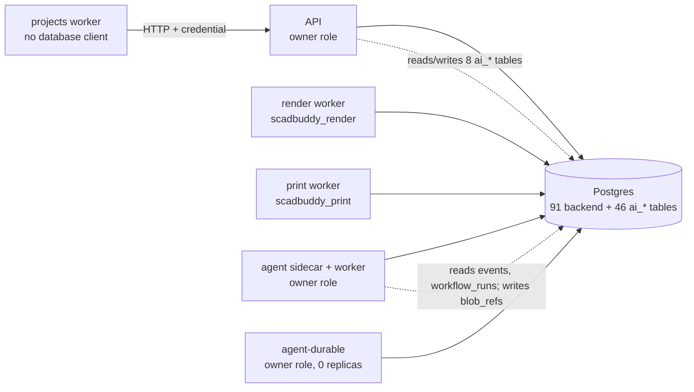
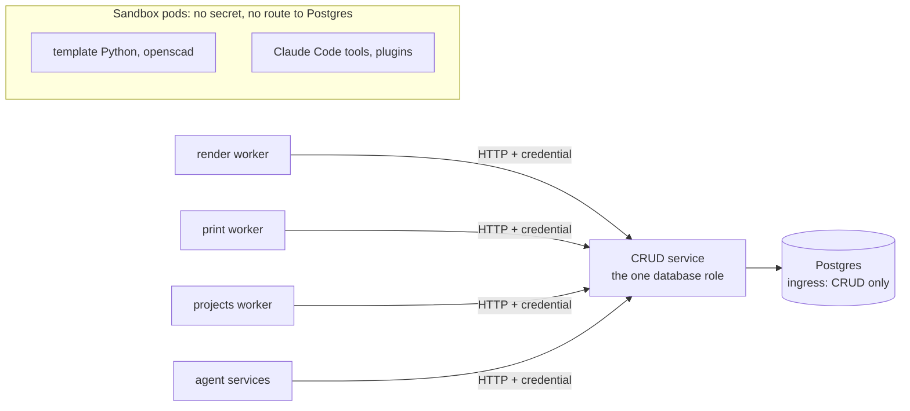

# Trust boundaries and database access

This page records who reaches ScadBuddy's database today, where untrusted code runs, and
the target that the epic [#5295](https://github.com/eh-homelab/ScadBuddy/issues/5295) sets.

## The rule

The owner decided this rule on 2026-11-05 (#5295):

- Only the CRUD service gets SQL access. The CRUD service is today's API process, once it
  runs no untrusted code.
- No untrusted code can ever reach the database.
- Every other process (the render, print and projects workers, the agent services,
  agent-durable) is an HTTP client of the CRUD service. It presents a short-lived service
  credential (the service credentials of PR #5211).
- No cross grants. No shared tables. No database role per caller as a boundary.

A role split inside one database is not a boundary. The owner of a table controls its
triggers, rules and column defaults, and a function that shadows a builtin. That code runs
with the privileges of the other role that touches the table. The review of PR #5287 (the
agent on its own role, closed) found this.

## How this was measured

Measured on 2026-11-05 (UTC):

- The manifests: `eh-homelab/clusters` `origin/main` at `3618296a`, the files
  `applications/scadbuddy/*.yaml` and `clusters/prod/scadbuddy/*`. Line numbers below are
  for that commit.
- The cluster: `kubectl --context primary -n bambuddy get networkpolicy`,
  `get ciliumnetworkpolicy`, `get ciliumclusterwidenetworkpolicy` and `get deploy`.
- The database, read only, on the CNPG primary `scadbuddy-db-1`: a count of `pg_tables`
  in `public` by name prefix and owner, and `pg_stat_activity` grouped by `usename`.
- This repository's code, at the commit that adds this page. A `file:line` is in this
  repository unless it names `clusters`.

A claim marked **not tested** is an inference from the configuration. Nobody has run it.

## Who talks to the database today

Production has 91 backend tables and 46 `ai_*` tables. The role `scadbuddy` owns all 137
of them (`pg_tables`). Connected roles on 2026-11-05: `scadbuddy` (68 connections),
`scadbuddy_print` (3), `scadbuddy_projects` (3), `scadbuddy_render` (2). No session used
`scadbuddy_agent`, although CNPG creates that role (clusters
`applications/scadbuddy/cnpg-cluster.yaml:123-128`).

| Process | Code | Database secret (clusters manifest) | Tables it may touch | SQL into the other service's tables |
|---|---|---|---|---|
| API, 3 replicas | `backend/` | `scadbuddy-db-app`, the owner (`scadbuddy.yaml:376-379`) | all | reads and writes 8 `ai_*` tables (`agent/src/db/grants.ts:23-33` `API_AI_GRANTS`) |
| render worker, 2 replicas | `backend/` | `scadbuddy-render-db` as `PGPASSWORD` (`scadbuddy-render.yaml:163-168`) | 4 in its list (`backend/scadbuddy/render/worker_role.py:34` `RENDER_GRANTS`; the store settings, the job rows, their events and activity rows, their blob refs, the piece geometry, the blob index, the Bambuddy store's folders and the uploads' `assets` rows go through CRUD routes, #5298), but an existing role still holds the `render_settings` view, `render_jobs`, `events`, `activity`, `blob_refs`, `piece_geometry`, `store_blobs`, `store_folders` and `assets` it held before, until the revoke in #5298 Task 22: 13 | none |
| print worker, 1 replica | `backend/` | `scadbuddy-print-db` (`scadbuddy-print.yaml:140-145`) | 34 (`backend/scadbuddy/auth/caller_grants.py:43` `PRINT_GRANTS`) | none |
| projects worker, 1 replica | `backend/` | `scadbuddy-projects-db` (`scadbuddy-projects.yaml:132-137`), still set; the worker has no database client and ignores it (#5298) | 0 in its list (`caller_grants.py:105` `PROJECTS_GRANTS`; flow runs, decisions, grants, operations and payload keys go through CRUD routes, and it has no event bus, #5298), but an existing role still holds the 7 flow relations and `settings`, `model_print_choices`, `printer_bed_types`, `printers`, `events` and `operations`, which it held before, until the revoke in #5298 Task 11: 14 | 0 `ai_*` tables in its list (`agent/src/db/grants.ts:16` `PROJECTS_AI_GRANTS`; its payload keys come sealed through a CRUD route, #5298), but an existing role still holds `ai_payload_keys`, `ai_forgotten_subjects`, `ai_sessions`, `ai_mcp_tokens` and `ai_settings` until that revoke: 5 |
| agent sidecar (in the API pod) | `agent/` | `scadbuddy-db-app`, the owner (`scadbuddy.yaml:549-552`) | all | 6 backend tables (`caller_grants.py:110-117` `AGENT_GRANTS`): it reads `events`, `workflow_runs`, `workflow_run_decisions` and `flow_grant_uses`, reads and updates `flow_grants`, and a trigger reads, inserts and deletes `blob_refs` |
| agent worker, 3 replicas | `agent/` | `scadbuddy-db-app`, the owner (`scadbuddy-agent-worker.yaml:102-105`) | all | as the sidecar |
| agent-durable, 0 replicas | `agent-durable/` | `scadbuddy-db-app`, the owner (`scadbuddy-agent-durable.yaml:87-90`) | all | none it runs today: it runs no worker |
| slicer worker, 1 replica | `workers/rust/` | none (`scadbuddy-slicer.yaml`) | 0 | none: transfer URLs only |
| `bambuddy-fs` | `tools/go/` | none | 0 | none: the public API only |

The grant lists are today's state. They describe the per-caller roles of PR #5210, which
#5295 supersedes. On one shared role the agent grants nothing (`agent/src/db/grants.ts:8-9`).

## Where untrusted code runs

Untrusted code is code that a template author, a plugin, a remote server or the model
controls.

| Untrusted code | Where it runs | Its guard | Can it reach SQL? |
|---|---|---|---|
| A template's `pipeline/` Python | the render worker pod, a child of the worker, same uid 10001 (`scadbuddy-render.yaml:121`) | an environment allowlist (`backend/scadbuddy/workflows/template_process.py:107`), its own process group (`:138`), a kill on timeout (`:149`, `:51`). No seccomp, Landlock or network rule. | **Likely; not tested.** The worker's environment holds `PGPASSWORD` (`scadbuddy-render.yaml:165-168`). A process with the same uid can usually read `/proc/<ppid>/environ`. No NetworkPolicy selects the render pod. #5296 tests and fixes this. |
| OpenSCAD source | the render worker pod; the API pod (the editor's parse check, the schema export, preset writes) | a Landlock filesystem ruleset (`backend/scadbuddy/render/confinement.py:3-17`, `render/sandbox.py`). No network rule. | Low. The language has no socket call. It runs with the uid of a process that holds a database secret. |
| `openscad-lsp` | the API pod (`backend/scadbuddy/library/lsp.py`) | seccomp: no socket except `AF_UNIX` (`backend/scadbuddy/editor/nonet.py:3-6`) | No TCP. It shares a uid with the API, which holds the owner secret. |
| Claude Code and its tools | the agent worker pods, a child of the agent | tiers in `canUseTool` and a `PreToolUse` hook; file tools confined to the session directory, except that `Read` and `Grep` may also reach the session's own `tool-results` directory in the Claude Code config dir (#5542) (`agent/src/harness/confine.ts`); Bash and PowerShell `off` (`agent/src/access/nativeBuiltins.ts:9-15`); the model credential behind a loopback gateway (`agent/src/gateway/server.ts`) | Only with Bash on. The agent's environment holds the owner database URL and the KEK path (`scadbuddy-agent-worker.yaml:102-121`). |
| A plugin package approved with `allow_refused` | the agent worker pods | the approval of its pin only. It can switch Bash on, at `outward` (`agent/src/access/nativeBuiltins.ts:14-15`). | **Yes.** It can read `SCADBUDDY_DATABASE_URL` from `/proc/<agent pid>/environ` and read the KEK file (`docs/ai/security.md:685-690`). |
| Flow scripts (Monty) | the projects worker (`backend/scadbuddy/workflows/project.py`) | the interpreter; host functions only; outward calls need an approval | No. |
| Workflow scripts (QuickJS) | the agent (`agent/src/background/workflowRunner.ts`) | the interpreter; each `agent()` call is a child chat | No. |
| Template UI modules | the browser | a shadow root; `default-src 'none'; sandbox` on the served files (`backend/scadbuddy/api/template_ui.py:45-49`) | No. |
| Remote MCP servers, `http_request` targets | outside the cluster, reached through the agent | the loopback forwarder; results wrapped as untrusted data | No. |

## Zones

| Zone | Entered by | Guard | Gap |
|---|---|---|---|
| The API on 8080 (`/api/v1/*`) | the gateway and Pomerium routes, and pods named in the API's ingress policy (clusters `networkpolicy-agent.yaml`) | `AuthGate` resolves the caller and refuses nothing itself (`backend/scadbuddy/auth/gate.py:4`); `auth/check.py` refuses only in `enforce` | The deployment sets no `SCADBUDDY_AUTH_MODE` (`scadbuddy.yaml`; checked live), so it runs the default `off` (`backend/scadbuddy/core/settings.py:248`). Anyone who reaches the API is the anonymous browser principal. |
| `/api/v1/internal/*` (outputs, library, blobs, workspace-blobs) | any pod that the API's ingress policy admits | each group takes only a service credential of its scope, in `enforce` only (README "The print worker (#1060)"); the blob routes also need a transfer token (`backend/scadbuddy/api/internal_blobs.py:5-6`) | In `off`, internal by path only. `POST /uploads` writes (`backend/scadbuddy/api/internal_workspace.py:16-18`, `:90-92`). #5297. |
| The agent on 8081 (settings, approvals, sockets) | the same front doors | an Origin and Host allowlist, which a TCP peer can forge (`agent/src/routes/guard.ts:48-49`) | The browser principal approves any outward call (`agent/src/approvals/service.ts:719`). #5297. |
| Postgres `scadbuddy-db` on 5432 | any pod in the cluster | passwords; egress policies on the print, projects, agent worker and agent-durable pods | No NetworkPolicy selects the CNPG pods (checked live). Any pod can try to log in. eh-homelab/clusters#3182. |
| Temporal frontend on 7233 | pods named in its ingress policy (clusters `networkpolicy-temporal-v2-frontend.yaml`) | that policy; payloads of `session-*` and `flow-*` workflows sealed per subject | No mTLS (clusters `temporal-cluster-v2.yaml:237`). A pod in the list is a full client. |
| S3 (DO Spaces) | the slicer, through presigned URLs | the slicer holds no store secret | None found. |

## What each pod holds

From the clusters manifests at `3618296a`; replicas and policies checked live.

| Pod | KEK | Database secret | Bambuddy key | Egress policy | Read-only root |
|---|---|---|---|---|---|
| API and agent sidecar, 3 | yes (`scadbuddy.yaml:440-452`, `:605-640`) | owner, in both containers | yes (`scadbuddy.yaml:342-351`) | none | API no (`:515`), agent yes (`:746`) |
| agent worker, 3 | yes | owner | no | public 443 and 80, the gateway VIP, Postgres, Temporal, the API (`networkpolicy-agent-worker.yaml`) | yes |
| render, 2 | yes (`scadbuddy-render.yaml:223-229`) | `scadbuddy_render` | no | **none** | no |
| print, 1 | yes | `scadbuddy_print` | yes (`scadbuddy-print.yaml:166-172`) | an allowlist (`networkpolicy-print.yaml`) | no |
| projects, 1 | yes | `scadbuddy_projects`, unused: the worker has no database client (#5298) | no | an allowlist (`networkpolicy-projects.yaml`) | no |
| agent-durable, 0 | yes | owner | no | Postgres and public 443 (`networkpolicy-agent-durable.yaml`) | yes |
| slicer, 1 | no | none | no | public 443, Temporal, the API, OTLP (`networkpolicy-slicer.yaml`) | yes |

Every ScadBuddy pod runs as uid 10001, non-root, with `allowPrivilegeEscalation: false`
and all capabilities dropped. No ScadBuddy manifest sets a `seccompProfile`. Both proxy
settings trust the whole pod CIDR: `SCADBUDDY_TRUSTED_PROXIES` and
`SCADBUDDY_AGENT_TRUSTED_PROXIES` are `10.42.0.0/16` (`scadbuddy.yaml:340-341`, `:593-594`).

## Known gaps

1. Seven processes in six Deployments hold a Postgres secret (the table above). Four of
   the processes (the API, the agent sidecar, the agent worker, agent-durable) use the owner.
   The projects worker ignores its secret: it has no database client (#5298).
2. The agent and the API run SQL on each other's tables, through cross grants.
3. Template Python shares a pod and a uid with a database secret and has no network rule
   (not tested).
4. An `allow_refused` plugin package can read the owner URL and the KEK.
5. The API runs in `off`, so `/api/v1/internal/*` and the agent's 8081 routes are open to
   any pod that reaches them.
6. Postgres has no ingress policy. The render and API pods have no egress policy.
7. agent-durable runs no worker but still mounts the owner URL and the KEK.

## The target and the order of work

The CRUD service is the only process with a database secret, and nothing untrusted runs in
its pod. Every other process calls it over HTTP with a short-lived service credential.
Untrusted code runs in a pod that holds no secret and has no route to Postgres.

Today (each line into Postgres is a connection; the dotted ones cross into the other
service's tables; the projects worker calls the API over HTTP, #5298):

The target:

What changes:

| Process | Today | Target |
|---|---|---|
| render worker | 4 tables over SQL in its list; the store settings, the job rows, their events and activity rows, their blob refs, the piece geometry, the blob index, the Bambuddy store's folders (which the API finds in Bambuddy itself) and the uploads' `assets` rows through CRUD routes (#5298). An existing role keeps the `render_settings` view, `render_jobs`, `events`, `activity`, `blob_refs`, `piece_geometry`, `store_blobs`, `store_folders` and `assets` until the revoke in #5298 Task 22; template Python and openscad in the same pod | render jobs, blob refs and assets through CRUD routes; template Python and openscad in a sandbox pod with no secret |
| print worker | 34 tables over SQL | print runs, outcomes, slices and printer state through CRUD routes (it already reads outputs through `/api/v1/internal/outputs`) |
| projects worker | no database client, so no table over SQL; flow runs, decisions, grants, operations and payload keys (sealed) through CRUD routes, and no event bus (#5298). An existing role keeps the 7 flow relations, `settings`, `model_print_choices`, `printer_bed_types`, `printers`, `events`, `operations` and `ai_payload_keys`, `ai_forgotten_subjects`, `ai_sessions`, `ai_mcp_tokens`, `ai_settings` until the revoke in #5298 Task 11. Its service credential holds `flow.host` and `crud.projects`, not `api`: in `enforce` it reaches only the 11 public routes its flow host functions, grant checks and `flow_decide`'s printer read call (`backend/scadbuddy/auth/routes.py` `FLOW_HOST_ENDPOINTS`) | flow runs, decisions, grants and payload keys through CRUD routes |
| agent services | the owner role; 46 `ai_*` tables and 6 backend tables | sessions, transcripts, approvals and credentials through CRUD routes; Claude Code and plugins in a sandbox pod; no database secret |
| agent-durable | the owner role, 0 replicas | no database secret |
| API | reads and writes 8 `ai_*` tables; runs the LSP and openscad | the CRUD service: the only database role, every route authenticated, nothing untrusted in its pod |
| Postgres | no ingress policy | an ingress policy that admits the CRUD service only |

Each caller reads its service credential from a database view of its own today
(`backend/scadbuddy/auth/service_credentials.py`). With no database secret, it gets one as
[the service-credentials spec](../superpowers/specs/2026-11-05-service-credentials-without-db-design.md)
(#5325) decides: a projected ServiceAccount token, checked by TokenReview and exchanged at
the CRUD service for a 15-minute credential, scoped per caller and denied by default.

Do the steps in this order. Split the APIs out first. Lock down the network last, so its
policies admit only the CRUD service.

1. #5298: give each worker's SQL a CRUD route, one area per PR. Then remove that worker's
   database secret, role and grant list. Every new route needs a service credential from
   its first PR.
2. #5299: move the agent's data behind CRUD routes. Then remove the agent's database
   secret.
3. #5297: require a service credential on the remaining `/api/v1/internal/*` routes, and
   move the API and the agent to `enforce`.
4. #5296: move template `pipeline/` Python and openscad out of every pod with a database
   secret.
5. eh-homelab/clusters#3182: a Postgres ingress policy for the CRUD service only, egress
   policies on every pod, and no owner secret or KEK in agent-durable.
