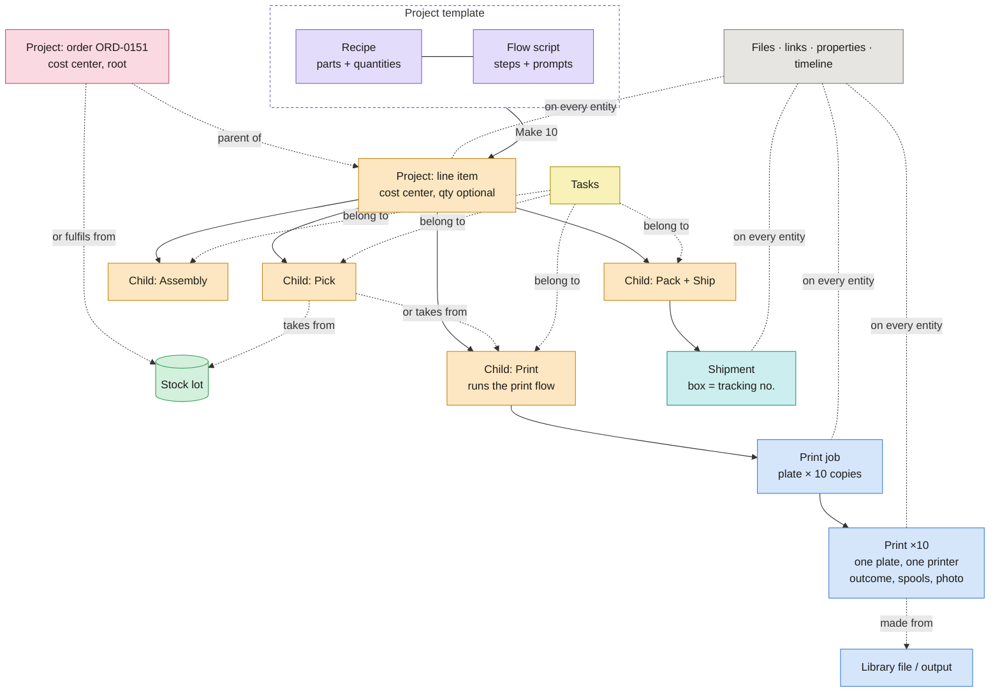
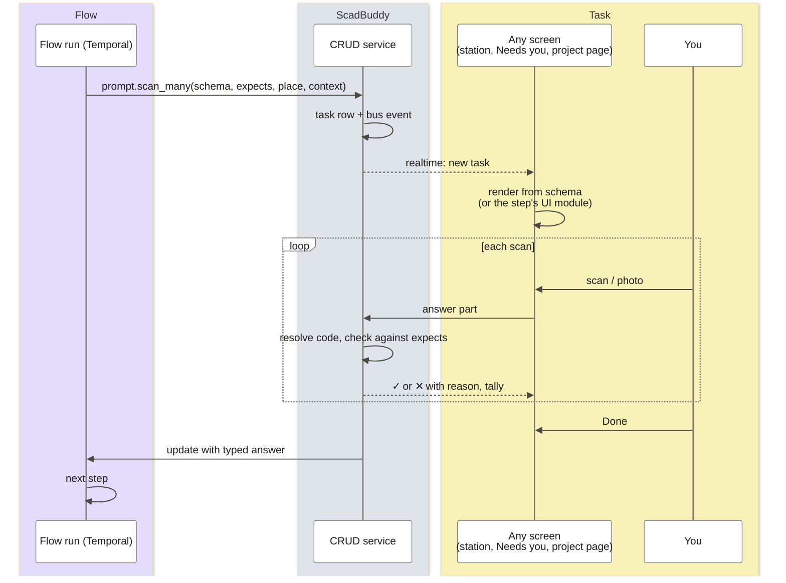
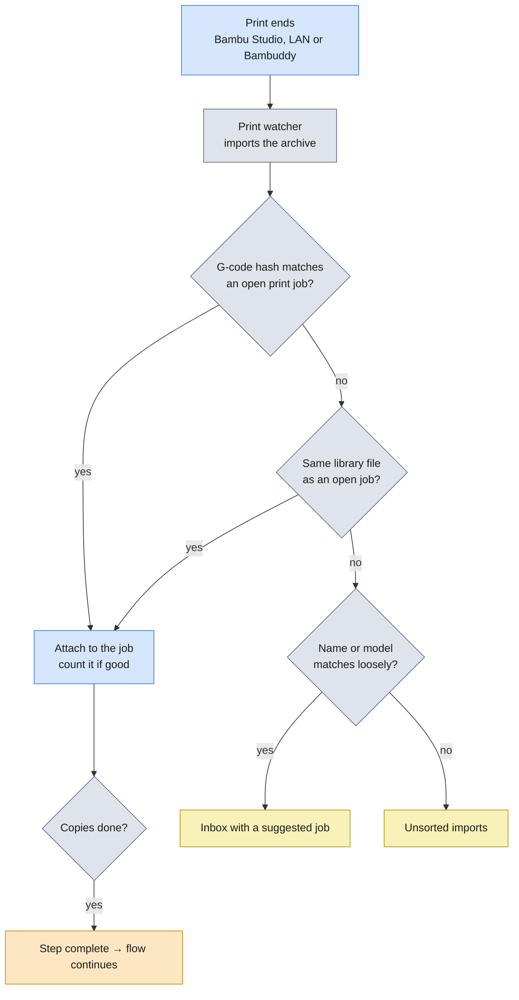
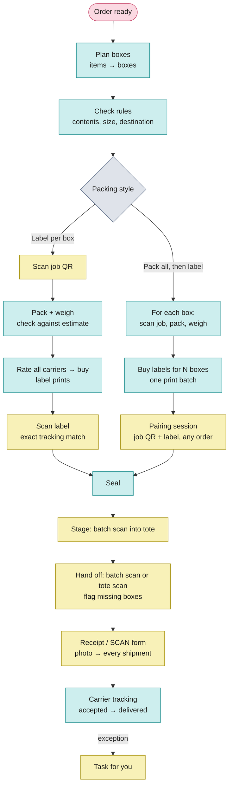

# Shop floor flows: projects, tasks and shipping (design)

Status: approved by the owner on 2026-11-24. Brainstormed with the owner on 2026-11-23/24.
The diagrams are below, in the sections they illustrate. Epics: #7361 (tasks and capture),
#7362 (projects), #7363 (shipping); the library file picker is #7340, which holds its
mockups. #7339 was closed into #7362.

**Colour key for the diagrams:** purple = template (recipe, flow); amber = project and steps; blue = printing (jobs, prints, files); green = inventory; rose = orders; teal = shipping; yellow = tasks (a person scans, photographs or confirms); slate = system (watcher, checks); grey = files, links, properties.

## 1. Intent

ScadBuddy runs the shop: it renders, slices and prints, keeps the filament and (epic #6949)
every other thing in stock, and takes orders. What happens between a good print and a parcel
at the carrier is not in it. Test prints have no place to go. A print started from Bambu
Studio is linked to a model or a file at best, never to the job it was for. Picking a part
from a shelf, assembling, packing, labelling and handing parcels to the carrier happen with
no record, no check and no cost.

The owner wants that work to be **workflows**, and the screens a person uses to be **made from
those workflows**. A flow declares its steps and what each step asks a person for. ScadBuddy
draws the screens from that, as it draws the customizer form from a SCAD file's parameters,
and a module can replace a screen, as a template UI replaces the generated form.

Why (owner, 2026-11-23/24): every test print needs a place to go; "make 10 keychains" is one
print job of 10 plates, a pick of 10 rings from a shelf, an assembly, packing, a label and a
handoff to the carrier, and each step has to be checked (the right label on the right box,
no parcel left behind) and costed; and none of this should need the assistant.

## 2. Goals

- G1. **Projects are a tree of cost centers** (owner, 2026-11-24). An order is a project; each
  line item is a child project; under it, the work (print, pick, assembly, pack, ship, or
  anything a template names) is child projects in turn. A project with no order is a root of
  its own (test prints, shop use, make to stock). Quantity is optional on every node (owner,
  2026-11-24): a made-to-count node has a target, a yield and scrap; an open-ended one has none.
- G2. **Costs book where they happen and roll up.** Filament, machine time, labour, parts,
  packaging and the label book to the node that used them; a node's cost is its own plus its
  children's. An order's real cost is its root's total, which job cost (spec 2026-11-05) shows.
- G2a. **A print node runs the whole print flow** for its line item's work: print job →
  plates → prints (one plate on one printer, with its outcome, spools, grams and photo).
- G3. **A print finds its job by itself,** wherever it was started (Bambu Studio, the LAN
  path, Bambuddy), from what each open print job expects.
- G4. **Flows are the source of truth.** A project template is a recipe (#7070) plus a flow
  script. Steps are flow calls. The project page is the flow's step graph with live state.
- G5. **Typed prompts outside the assistant.** A flow asks a person for an answer of a declared
  shape (an email address, a scan, a photo, a weight, a library file). The answer is checked
  on the server against that shape and returned to the flow typed. No assistant takes part
  unless the flow asks for one (owner, 2026-11-24).
- G6. **Screens generated from prompts** (owner picked approach 1, 2026-11-24): a widget per
  schema type, format and hint; context blocks the flow chooses; a UI module may replace a
  step's screen.
- G7. **Rapid capture.** Batch scanning and photos with no tap between items, photos routed
  by the code in the frame, containers (one scan moves everything inside), every input
  device feeding one session.
- G8. **Entities everywhere.** Projects, steps, jobs, prints, shipments, outputs, library
  files and models are entity kinds with files, links and properties (#6950, #7026), typed
  relations between any two, and a timeline.
- G9. **Shipping as a flow.** Plan boxes, check carrier rules, rate across carriers, buy and
  print labels from the measured or estimated weight, verify the label on the box by scan,
  stage, hand off in a batch, keep the receipt, follow carrier tracking.
- G10. **Carriers direct:** UPS, FedEx and USPS through their own APIs with the shop's own
  accounts (owner, 2026-11-24), and Pirate Ship (§6.7.6).
- G11. **One library file picker** (#7340) that every prompt and dialog that picks a file uses.

## 3. Non-goals

- International shipping and customs in the first phases (designer's call, §8; US-only
  until a later phase).
- A general BPMN engine or a drag-and-drop flow builder. Flows stay scripts (#1057).
- Payroll or time clocks. Labour is recorded as minutes on a step, as job cost does
  (`orders/models.py` `TimeKind`).
- Replacing Bambuddy's queue UI. Bambuddy stays a sync target (owner, 2026-11-23).

## 4. Anti-goals

- A step kind, widget or carrier rule hard-coded where data would do. Rules and step
  templates are rows or flow code, never an allowlist in the app (the inventory spec's
  anti-goal, #6949).
- A prompt that only the assistant can answer, or a flow that needs the assistant to move.
- A screen that trusts its own validation. The server checks every answer against the
  prompt's schema, custom modules included.
- A second record of the same fact: a shipment's tracking number, a print's archive, a
  pick's stock move each live in one place, and the others refer to it.
- Base64 bytes in JSON. Photos, labels and receipts are blobs plus `{name, mediaType}`
  (#2479).
- Hardware reached through Bambuddy. The scale and the NFC reader are ScadBuddy's own (#7273).

## 5. Constraints

- **Database access (#5295).** Only the CRUD service holds SQL. Flow runs (`projects` queue),
  the carrier calls and any capture worker are HTTP clients with a service credential. New
  cross-service data goes through CRUD routes that require one from their first PR.
- **Flows today** (`docs/features/flows.md`): a run is `ProjectWorkflow` on the `projects`
  queue, AUTO_UPGRADE, replaying `tests/fixtures/project_workflow_histories/`, so new host
  functions go behind `workflow.patched`. A run can already wait for a person with
  `wait_for_human(question)` (`workflows/flow_tools.py`), which takes free text on the run's
  page. It is an agent-harness callback (`run_callback`, `human_answer`) bounded by
  `MAX_WAIT_S` (one day), not a Temporal update; `prompt()` (§6.3) is a new mechanism. Flow inputs already have a JSON Schema (`inputs.json`, #2483) drawn as a form by
  `frontend/src/lib/flowInputs.ts` `inputFields` and checked by `inputs_model`.
- **Template UIs** load a module into a shadow root with a `Host` API
  (`frontend/src/template-ui/types.ts`). They are not sandboxed; a step module has the same
  trust as a template's code (§9).
- **Entities** (#6950): `entities/registry.py` `KINDS` today covers orders, order items and
  their fulfilments and revisions, spools, spool types, suppliers, invoices, locations,
  printers, parts and customers. Attachments and links hang off any kind. Properties are
  #7026. Codes `L-` and `S-` resolve through `GET /codes/{code}` (#6955, `codes/resolve.py`
  `PREFIXES`).
- **Inventory** (#6949, spec `2026-11-21-inventory-and-purchasing-design.md`): items, lots,
  units and moves (#7067), recipes and production runs (#7070, §6.8 there), selling from
  stock (#7071).
- **Orders** (`orders/models.py` `Shipment`): a shipment has `carrier`, `service`, `tracking`,
  `shipped_at`, an address snapshot, `cost_minor` and items. ScadBuddy buys no labels today.
- **Print watcher** (#4699): imports prints ScadBuddy did not start, by archive, slicer
  project, library hash, and (LAN-only printers) the printer's own file, with an inbox for
  the rest.
- Every print, quote or ship option is a remembered choice with a toggle (#6219).
- Agent-authored docs cite sources; every measured fact says how it was measured (#259).
- Carrier facts in §6.7 were read on 2026-11-24 from the sources in §12. Each one is
  re-checked against the carrier's own documentation before its adapter is built.

## 6. Design

### 6.1 Records

New tables, all owned by the CRUD service:

- **`projects`**, one tree: `id`, `parent_id` (nullable: a root), `kind` (free text: `order`,
  `order_item`, `print`, `pick`, `assembly`, `pack`, `ship`, or a template's own), `title`,
  `key` (the flow's name for a child, unique under its parent), `template_id` (nullable),
  `order_id` / `order_item_id` (set on the order and line-item nodes, one each), `target_qty`
  (nullable: open-ended), `good_qty`, `scrap_qty`, `status` (`planned`, `running`, `waiting`,
  `done`, `cancelled`), `flow_run_id` (nullable: the run that drives this node and its
  children), `labour_minutes`, `position`, `created_by`, timestamps. Entity kind `project`,
  code prefix `P-`. There is no separate steps table: a step is a child node.
- **Cost centers.** Every cost source names the node it books to: a print's spool use and
  machine time (through its print job's node), time entries and cost entries (job cost spec
  §4.3, §4.4; a new nullable `project_id` on each), stock moves (#7067, `entity_id` = the
  node), a label's cost (its shipment's ship node). `GET /projects/{id}/cost` sums the node's
  own and its subtree's, by source, with each line traceable as job cost's are today. Today's
  order and item costs keep their meaning: an order item's real cost is its node's subtree, and
  job cost reads it from there once B2 lands (an entry with no node books to its item's node).
- **Orders create the tree.** Accepting an order creates the order node and one node per
  line item. The item's work makes the children: the item's project template (§6.2) when its
  model, file or listing has one, else a default of one `print` node (and a `ship` node when
  the order ships). Bambuddy's per-order and per-item projects (`order_projects`) become the
  mirror of these nodes (§6.10).
- **`print_jobs`**: what was asked. `id`, `project_id` (the print node it serves; nullable:
  a job may stand alone),
  `source` (library file, output, or model plus params), `plate`, `copies`, `expects`
  (jsonb: G-code hash per plate, library file id, model slug and params hash, allowed
  printers), `done_copies`, `status`. A ScadBuddy print run (#1052) that queues the job
  records `print_job_id`. Entity kind `print_job`, code prefix `J-`.
  `copies` counts **plate prints**. Each plate states `parts_per_plate` (from the recipe, or
  1); a good plate adds `parts_per_plate` good parts to its print node, and a plate a person marks
  partly good adds the count they enter (§6.6). Project and step quantities count parts.
- **`prints`**: one plate on one printer. `id`, `print_job_id` (nullable until matched),
  `archive_id` (Bambuddy) or `lan_import_id` or the run's plate start, `printer_id`,
  `outcome` (`good`, `failed`, `unknown`), `started_at`, `ended_at`. Spool use stays in the
  filament ledger; the print refers to it. Entity kind `print`. The watcher's records
  (`print_auto_imports`, `print_lan_imports`) and `print_links` keep their jobs; a print row
  points at them (anti-goal: one record per fact).
- **`tasks`**: §6.3.
- **`entity_relations`**: §6.5.

How the records link:

**Production runs (#7070).** The inventory spec's production run becomes a project whose
template makes stock: a recipe, a target quantity and a "receive into lot" step at the end.
The run's cost roll-up (§6.8 there) runs on the project. Designer's call, flagged for the
owner and the #6949 epic's session (§8).

### 6.2 Flows as project templates

A **project template** is a recipe (#7070) plus a flow version. "Make 10" creates the
project row and starts the flow run with the project as its subject.

New host functions (behind `workflow.patched`):

- `step(key, title, kind=…, expected_qty=…)`: an async context manager. It creates or
  resumes the child node `key` under the run's node, marks it running, and on exit marks it
  done with the quantities the body reported. Steps nest to any depth; a nested `step()`
  makes a grandchild. `step(..., flow=…)` starts the child's own run (a print node runs the
  built-in print flow, §6.2a) and waits for it.
- `print_job(source, plate=…, copies=…, printers=…)`: creates the job with its `expects`,
  queues it through the existing print route (or leaves it for a person to start in Bambu
  Studio), and waits until `done_copies == copies`. A failed print does not count.
- `prompt(…)`, `prompt.scan_many(…)` and friends: §6.3, §6.4.
- `pick(item, qty, from_=…)`: a pick task (§6.3) whose answer writes the stock moves
  (#7067).
- `relate(a, rel, b)`: §6.5.

A project run (10 keychains):

```mermaid
flowchart LR
    start([Order item or 'Make 10']) --> print[Print job<br/>10 copies]
    print -->|each good print| count{10 good?}
    count -->|no: failed print| print
    count -->|yes| pick[Pick 10 rings<br/>scan location L-12]
    pick --> asm[Assemble<br/>confirm qty, photo]
    asm --> pack[Pack<br/>wrap, box]
    pack --> ship[[Shipping flow]]
    ship --> done([Order item shipped<br/>cost rolled up])
    classDef tpl fill:#e4dcfb,stroke:#7a5cd6,color:#1d1c1a
    classDef work fill:#fde7c2,stroke:#c98410,color:#1d1c1a
    classDef print fill:#d5e6fb,stroke:#3a7bd5,color:#1d1c1a
    classDef stock fill:#d3f0dc,stroke:#2f9a56,color:#1d1c1a
    classDef order fill:#fbd9e2,stroke:#c8486b,color:#1d1c1a
    classDef ship fill:#cdeeee,stroke:#1f8f8f,color:#1d1c1a
    classDef task fill:#f8f1b8,stroke:#a8930f,color:#1d1c1a
    classDef data fill:#e6e5e1,stroke:#7c7a74,color:#1d1c1a
    classDef sys fill:#dfe3ea,stroke:#5a6b85,color:#1d1c1a
    class start,done order
    class print print
    class count sys
    class pick stock
    class asm,pack work
    class ship ship
```

**6.2a The print flow.** A `print` node runs a built-in flow: create the print job from the
line item's work (its output, file or model and params, plates, copies), queue it through the
existing print route or leave it for Bambu Studio, wait for the matched prints (§6.6), retry
failed plates as the template says, and finish with the node's good and scrap counts. Every
print, test prints included, books to the node, so test cost lands on the item that needed it.

**The step graph before a run.** `flows/typecheck.py` already checks a script at
registration. It also extracts the literal `step(...)` calls in order, so a template's page
shows its steps before anything runs. A step whose key is computed shows as "dynamic".

### 6.3 Tasks: typed prompts and the screens drawn from them

**The task row** (`tasks`): `id`, `run_id`, `project_id` (the node it belongs to), `title`,
`schema` (JSON Schema of the answer), `context` (a list of blocks, below), `ui` (nullable
module path), `place` (a station name, nullable), `assignee` (nullable principal, A2),
`expires_at`, `state` (`open`, `answered`, `cancelled`, `expired`), `answer` (jsonb),
`answered_by`, `progress` (jsonb, for batch tasks, A3). Entity kind `task`. A1's table leaves out
`project_id`, `assignee` and `progress`: each comes with the phase that reads it, `project_id`
with epic B (#7362) and its foreign key.

**The life of a prompt:**

1. The flow calls `prompt(title, schema=…, context=…, place=…, ui=…, timeout_s=…)`. The
   host function posts the task through a CRUD route and waits on a temporal-agent-harness
   callback whose call id is the task id; the answer arrives as the harness's own Update
   (`provide_callback_result`), the path `wait_for_human` answers take today. Unlike
   `wait_for_human` (a harness callback capped at one day), a prompt
   has no cap: with no `timeout_s` it waits until answered or cancelled. With one, the task
   becomes `expired` and `prompt()` raises `TimeoutError`, which the script may catch.
2. The CRUD service stores the row and publishes `task.changed` on the bus. The realtime
   topic `tasks` (and `tasks:<place>`) carries it to open screens.
3. A screen draws the form from the schema (below) and shows the context blocks.
4. On submit the CRUD service validates the answer against the stored schema (JSON Schema,
   draft 2020-12, with `format` checks on). A failure is a 422 naming the field, and the task
   stays open. A pass sends the update to the run, and the task is marked answered once the
   update landed, so a task is never answered without its run. One decision row per call
   picks the winner of two answers. A failure's message never quotes the rejected value.
5. The run marks its task with the answer it received, and `prompt()` returns the answer as a
   dict with its defaults filled in and typed by a model built from the schema, as flow inputs
   are (no pattern runs in the workflow), so the script reads `answer["email"]`.

The same, as a sequence:

**Widgets.** The renderer extends `inputFields`:

| Schema | Widget |
|---|---|
| `string` | text input; `format: email`, `date`, `date-time` pick the input type and the phone keyboard (only formats the server checks; `uri` waits for a check) |
| `string` + `enum` | segmented buttons up to 5 options, a select past 5 |
| `boolean` | switch |
| `number` / `integer` + bounds | stepper or number field |
| `array` of scalars | one item per line, as flow inputs today |
| `x-sb-widget: scan` (+ `expects`) | scan field: camera, USB scanner keystrokes, NFC (§6.4) |
| `x-sb-widget: photo` / `file` | camera capture or upload; stored as an entity attachment, the answer is its pointer |
| `x-sb-widget: entity` (+ `kind`) | the entity picker; for `library_file` the #7340 picker |
| `x-sb-widget: weight` | live scale reading (#7273) with "Use 640 g", or typed grams |
| `x-sb-widget: confirm` | one large button; the answer is `true` |

An unknown `x-sb-widget` falls back to the plain type's widget and logs it.

**Context blocks** (`context`): `{entity: "order:<id>"}` (the entity's card), `{text: …}`
(Markdown), `{image: <blob pointer>}`, `{table: {columns, rows}}`, `{checklist: [...]}`,
`{expect: {weight_g, tolerance_g}}`. The flow chooses them; the screen draws them above the
form.

**Custom screens.** `ui="module.js"` names a module in the flow's own files (served like
`/models/{slug}/ui/{path}`, here under the flow version). It mounts into a shadow root with a
**task host**: `task.get()` (title, schema, context, progress), `task.save(partial)`
(progress), `task.submit(answer)` (goes through the same server check), `scan()`,
`photo()`, `resolve(code)`, `attach(file)`, `link(url)`. A module that fails to load falls
back to the generated form with a banner, as template UIs do.

**Who answers.** A station screen is an ordinary signed-in session behind the front door, as
every ScadBuddy page is; there is no device credential. `answered_by` is the signed-in
person (designer's call, secure by default: no shared login to audit around).

**Where tasks show:**

- **Needs you** (`lib/needsYou.ts`): an open task is a parked call in the run's
  `waiting_on`, which already reaches the bell, the toast, the page notification and the push
  through the agent's pending-input list (#6399); A1 adds no new source.
- **Station view** `/station/<place>`: open tasks for that place, oldest first, large touch
  targets, the scan field always focused. A station is a `filament_locations` row with a
  station flag (designer's call: the location tree is the shop's places, #6949).
- **Project page**: the step graph, each step's tasks and their answers.
- **Scan-to-answer**: `/x/<code>` (#6955) looks for open tasks whose `expects` match the
  code. Exactly one: offer to answer it. Several: list them. None: open the entity.

**The assistant** may list and answer tasks through tools (`task_list`, `task_answer`) when
a grant allows. No task waits for it.

### 6.4 Capture: batch scans and photos

**Batch tasks.** `prompt.scan_many(title, expects=…, count=…, place=…)` is a task whose
answer is a list. While it is open:

- each scan is posted as it happens (`POST /tasks/{id}/parts`) and checked at once: the code
  resolves, matches `expects`, and is not a duplicate. The answer is ✓ or ✕ with a reason;
  the screen beeps and vibrates differently for each.
- progress is stored on the row after every part, so a reload or another device resumes the
  tally.
- the task completes when `count` is reached, or when the person ends it short with a
  reason (stored).
- "undo last" removes the last accepted part.

**Photos route by the code in the frame.** A photo uploaded to a capture session is decoded
on the server for QR and barcodes. A code that resolves attaches the photo to that entity.
No code: the photo goes to the last entity scanned in the session. Shooting never waits for
the upload: the browser queues photos (IndexedDB) and uploads them in the background,
retrying until stored (designer's call).

**Capture mode** (`/capture`): a session with no task. Each code opens or advances what it
names (scanning a box at the counter answers that box's open handoff task); anything the
server cannot place goes to a capture inbox, as Unsorted imports does for prints.

**Containers.** A location can hold boxes and parts. A scan into a container (scan the
tote's `L-` code, then the boxes) records each box as inside it. Scanning the container in a
later task acts on everything inside, after showing the list for a confirm.

**Input devices**, all feeding the same session:

- phone or laptop camera: the browser's `BarcodeDetector` where present, a WebAssembly
  decoder (zxing-cpp) otherwise. Both are to be measured on the shop's devices, and
  MaxiCode (UPS) is expected to need the WebAssembly decoder (§6.7.3).
- USB or Bluetooth scanner: keystrokes ending in Enter, taken by a scan field or a station
  page in scan mode.
- NFC and RFID: the shop's reader (#7273), and Web NFC where the browser has it.
- a phone paired to a desk screen: scans on the phone, the tally on the big screen; the
  pairing reuses the agent bridge's pairing pattern (designer's call).

### 6.5 Entities, expanded

- **New kinds:** `project`, `step`, `print_job`, `print`, `task`, `shipment`, `output`,
  `library_file`, `model`, and the inventory epic's `item`, `lot`, `unit`. Each gets files,
  links and properties.
- **Typed relations** (`entity_relations`): `(from_entity, rel, to_entity, created_by,
  created_at, data jsonb)`, with `rel` a row of `relation_kinds` (`fulfils`, `uses`,
  `produced_by`, `test_of`, `shipped_in`, `contains`, `made_from`, …; people add more).
  An order item fulfilled by a project is `project fulfils order_item`. Existing one-off
  link tables (`print_links`, `library_file_associations`, order fulfilments) keep working;
  each one is mapped into relations by a view first, and moved only when a later issue
  decides to (designer's call: no migration of working tables in this epic).
- **Timeline:** every entity gets `GET /entities/{kind}:{ref}/timeline`, merged from its
  relations, tasks, attachments, stock moves and print events.
- **Codes:** prefixes `P-` (project), `J-` (print job), `B-` (box, a shipment's own code until
  it has a tracking number), `T-` (task). A carrier tracking number resolves to its shipment
  (§6.7.3).

### 6.6 A print finds its job

When the print watcher (#4699) or a LAN start records a print, it runs the matcher:

1. **Hash:** the print's G-code hash (the archive's `content_hash`, or the LAN file's) equals
   a plate hash in an open job's `expects` → attach.
2. **File:** the print's library file is an open job's source → attach.
3. **Loose:** the job name or model matches an open job → inbox row with that job suggested.
4. Otherwise → Unsorted imports, as today.

As a diagram:

**Good or failed.** The printer's finish state (the LAN report, or Bambuddy's archive status)
sets the outcome first: finished is `good`, failed or cancelled is `failed`. A template may add
an inspect prompt after each plate (`prompt.confirm` with a part count), whose answer
replaces the outcome and the good-part count. An attached print counts toward `done_copies`
only when its outcome is `good`. Several open
jobs matching one print: the oldest one with copies still needed wins, and the others are
listed on the print for a person to move it.

### 6.7 Shipping

#### 6.7.1 The flow

Two packing variants, both real (owner, 2026-11-24):

- **Label per box:** scan the job QR → pack and weigh → rate and buy (label prints) → scan
  the label (exact tracking match) → seal.
- **Pack all, then label:** for each box scan the job, pack, weigh (a shipment waiting for a
  label) → buy labels for N boxes in one print batch → a pairing session: scan a box's job QR
  and a label in any order; the session matches by tracking number → seal.

**Several orders at once.** A packing session keeps a short list of open jobs. A label closes
the job it matches (by tracking number when ScadBuddy bought it; by destination ZIP for a
label bought elsewhere), not the newest one. A label that fits two open jobs asks which. A
second label for one job asks "box 2 of ORD-…?", counting toward the item's expected boxes.

**Stage and hand off** use batch tasks (§6.4): scan the tote, then the boxes; at the counter
scan the tote (everything inside, after a confirm) or sweep the labels. The expected list is
every box staged for that carrier, so a missing box and a wrong-carrier box both show before
the person leaves. The receipt photo, or the SCAN form, attaches to every shipment in the
handoff.

**A box is a shipment.** One `Shipment` row (`orders/models.py`) is one box with one tracking
number; an order already has many shipments, each listing its items and quantities. "Box 2 of
ORD-…" is a second shipment for that order item. A shipment's `B-` code is its own until
it has a tracking number. C5 adds the fields a box needs (box item, weight, dimensions,
label blob, state `packed`/`staged`/`handed_over`/`accepted`/`delivered`, container) to
`order_shipments`; no new boxes table.

#### 6.7.2 Weight

- **Estimate:** printed parts (slice grams, or the prints' booked spool use) + component
  items' weight (property `weight_g`, #7026) + packaging items (box and wrap are consumable
  items with `weight_g`; a box also has `length_mm`, `width_mm`, `height_mm` for dimensional
  weight).
- **Measure:** the closed box on a scale (#7273, or a USB shipping scale through the same
  session; WebHID support for the shop's scale is to be measured).
- **Check:** a measured weight outside the estimate's tolerance (a remembered setting,
  default 15 %) warns before the label is bought: "expected 640 g, got 410 g".

#### 6.7.3 Labels and tracking numbers

What a carrier label carries, to be confirmed on real labels before the decoder work:

- UPS: a Code 128 tracking number (`1Z` + 16 characters) and a MaxiCode with the destination
  postal code.
- FedEx: a barcode holding the tracking number, and a PDF417 with ship-to details.
- USPS: an IMpb barcode, `420` + destination ZIP + the tracking number.

A label ScadBuddy bought is matched by its tracking number exactly. A label bought elsewhere
(Pirate Ship by spreadsheet, §6.7.6) is matched by its tracking number after the import, or
by destination ZIP and "not on another shipment" before it.

#### 6.7.4 Carrier rules as data

Carrier APIs check weight, size and destination. They cannot see what is in the box: a
service such as USPS Media Mail is limited to certain contents, and wrong use is caught as
postage due later, not refused at purchase. So ScadBuddy applies its own rules first.

`shipping_rules` rows: `carrier`, `service` (nullable: all), `kind` (`content`, `limit`,
`destination`, `restricted`, `requirement`, `policy`), a predicate (jsonb over the box's
contents' properties, the box's weight and dimensions, and the destination), an effect
(`exclude` with a reason, `require` a signature or insurance, `surcharge` note), `source_url`
and `reviewed_on`. A rule past its review interval (a remembered setting, default 12 months)
shows as needing review. Seeds ship with each adapter, every row with its source.

Content comes from item properties: `media_mail_eligible`, `contains_battery`,
`contains_magnets`, `hs_code`, `declared_value`. A printed part takes its recipe's
properties. The rate screen lists every excluded service with its rule's reason.

Storefront shipping options (`shipping_option_id`) become policies: "Standard = the cheapest
eligible service that arrives within 5 days".

#### 6.7.5 Carrier adapters

One interface, one adapter per carrier, run in a worker with a CRUD credential:

- `rate(shipment) → quotes`, `buy(quote) → label` (blob: PDF and, where offered, ZPL for a
  thermal printer; tracking number; cost), `void(label)`, `track(tracking)` or the
  carrier's webhook, `manifest(batch) → form` (USPS SCAN form; the UPS and FedEx
  equivalents are to be read).
- Credentials are sealed secrets in the CRUD service (as `git_remote_token`), opened for the
  shipping worker's credential only.
- The order's reference goes in the label's reference field where the carrier has one.
- A bought label's cost becomes the shipment's `cost_minor`, which job cost reads.

Per carrier (read 2026-11-24, §12):

- **UPS:** OAuth 2.0 client credentials; Rating, Shipping and Tracking APIs; the shop's
  account number on the app gives its negotiated rates.
- **FedEx:** OAuth (one-hour token); the Ship API needs label certification by FedEx's Bar
  Code Analysis Group before production (about 3 business days, per project).
- **USPS:** the new USPS APIs (`/labels/v3/label`); Web Tools were retired on 2026-01-25.
  Labels need a CRID, a MID, enrolment in USPS Ship and an Enterprise Payment Account or a
  permit.

#### 6.7.6 Pirate Ship

Pirate Ship has no public API (its help center says so). Phase S1 supports it by spreadsheet:
ScadBuddy exports the batch (addresses, weights, dimensions, references) in Pirate Ship's
import format, the person buys the labels there, and imports Pirate Ship's export so each
shipment gets its tracking number. Using its private GraphQL is left to the owner (§7).

### 6.8 The library file picker

#7340 and its issues (#7335–#7338) are the picker. This spec uses it as the `entity` widget
for `library_file`, and adds a `project` scope to it once projects exist.

### 6.9 Run lifetime and versions

- A project's run lives as long as the project: weeks if needed. It continues-as-new after a
  bounded history (the builder picks the bound), carrying the node id; child nodes are keyed
  by `(parent_id, key)`, so the new run resumes each child where its row stands.
- Runs stay AUTO_UPGRADE on the `projects` queue, as today. A change to `step()`,
  `print_job()` or `prompt()` commands goes behind `workflow.patched`.
- A flow edited mid-project: the running project stays on the version it started with until a
  person moves it ("Move to version N" on the project page), which starts a new run on that
  version and resumes by step key. A step key the new version lacks is left as it stands.

### 6.10 Names

"Project" already names three things: Bambuddy print projects (`order_projects`,
`folderless_projects`, `project_print_targets`, the agent's `create_print_project`), the
`projects` task queue, and `ProjectWorkflow`. ScadBuddy projects replace Bambuddy print
projects as the record; Bambuddy gets a one-way mirror (owner, 2026-11-23: Bambuddy is a sync
target only). The UI and the API say "project"; the old Bambuddy-facing tables and tools keep
their names until the mirror replaces them.

## 7. Approaches considered

**How screens are made** (owner picked 1, 2026-11-24):

1. *Generated from the prompt's schema, a module overrides.* One renderer covers most steps;
   a new step needs no frontend release; custom modules for the odd case. Needs a careful
   schema design. **Picked.**
2. *Every step a custom module.* Full freedom, but every flow needs UI code and the screens
   drift apart.
3. *A fixed set of built-in step kinds.* Fastest, but a new kind of step waits for a release.

**Where a project lives:**

1. *A project is a record plus a flow run* (this spec). The record survives a flow version
   change and is what relations and costs point at.
2. *A project is only a flow run.* Simpler, but a run's history is not a queryable record,
   and an open-ended project may outlive any one run.

**Pirate Ship:** spreadsheet round trip (supported, slower) or its private GraphQL (automatic,
can break at any time, may breach its terms). Spreadsheet first; the other is the owner's
call.

## 8. Decisions made by the designer (owner to check)

- D0. (Owner, 2026-11-24.) Projects are a tree of cost centers: order → line item → work;
  a print node runs the whole print flow. Every accepted order gets its tree.
- D1. Production runs (#7070) become projects with a make-to-stock template (§6.1). Needs the
  #6949 session's agreement before #7070's plan.
- D2. Shipping is US-only until a later phase; customs is its own phase.
- D3. A station is a location row with a flag.
- D4. Existing link tables are mapped into relations by a view; none is migrated in this epic.
- D5. Photos queue in the browser and upload in the background.
- D6. Phone pairing reuses the agent bridge's pairing pattern.
- D7. The weight tolerance defaults to 15 % and a rule's review interval to 12 months, both
  remembered settings.
- D8. Several open jobs matching one print: the oldest with copies still needed wins.
- D9. A project's run continues-as-new and resumes by step key; a mid-project flow edit moves
  a project only when a person says so (§6.9).
- D10. `copies` counts plate prints; quantities count parts through `parts_per_plate` (§6.1).
- D11. The finish state sets a print's outcome; an optional inspect prompt overrides it (§6.6).
- D11a. No wait is capped by default (owner, 2026-11-24). `prompt()` waits until answered
  or cancelled unless the script passes `timeout_s`. `wait_for_human` becomes a text
  `prompt()` in A2, with the station view that needs its task row; A1 keeps its answer route
  and lifts its limits: its default changes from one hour (`DEFAULT_WAIT_S`) to no limit, and the
  one-day ceiling (`MAX_WAIT_S`) goes, so an explicit `timeout_s` is the only cap. The change
  goes behind `workflow.patched`; runs already waiting keep their timer (A1).
- D12. Stations use signed-in sessions, never a device credential (§6.3).
- D13. A box is a shipment; C5 extends `order_shipments` (§6.7.1).
- D14. Epics B and C do not wait for the inventory epic: until #7067, #7070 and #7026 land, a
  template is a flow only, `pick()` records its answer without a stock move, and weights are
  typed or measured. Each piece switches on when its prerequisite merges (§10).

## 9. Security

- Task answers are validated on the server against the stored schema; a module's `submit`
  takes the same path.
- Step UI modules are flow files: they run in a shadow root with the page's privileges, the
  trust template UIs have today. Only people who may edit flows can add one.
- Carrier credentials are sealed with the KEK and released only to the shipping worker's
  credential, `no-store`, never logged.
- Photos and labels are blobs; their names and media types are checked from their bytes, as
  session blobs are.

## 10. Phases (each an issue under an epic; epics in this order)

**Epic A: tasks and capture**
- A1. `tasks` table, CRUD routes, `prompt()` host function, Temporal update, Needs you;
  `wait_for_human` with no default cap (D11a).
- A2. Widget renderer (extends `inputFields`), context blocks, station view, scan-to-answer,
  `wait_for_human` moved onto `prompt()`.
- A3. Batch tasks, capture mode, photo routing, the browser upload queue, containers.
- A4. Input devices: camera decoders, USB scanner mode, NFC, phone pairing.
- A5. Custom task modules (task host).

**Epic B: projects and steps** (#7339 moves here)
- B1. Entity kinds and typed relations, timeline, new code prefixes.
- B2. The `projects` tree, cost centers (`project_id` on cost sources, the subtree cost read,
  job cost reading it), `print_jobs`, `prints`; `step()` and `print_job()`; orders create
  their tree at acceptance.
- B3. The print matcher (§6.6) in the watcher and the LAN start.
- B4. Project templates (recipe + flow), the step graph at registration, the project page.
- B5. Production runs as projects (D1), with #6949.

**Epic C: shipping**
- C1. Packaging items, weight estimate, scale reading, the weight check.
- C2. Carrier adapter interface; UPS adapter (rate, buy, void, track).
- C3. USPS adapter with SCAN form; FedEx adapter (after its label certification).
- C4. Rules as data with seeds and sources; storefront options as policies.
- C5. Both packing flows as built-in flows, staging, handoff, receipt.
- C6. Pirate Ship spreadsheet export and import.
- C7. Customs and international (later).

Epic #7340 (picker) runs alongside A and B.

Dependencies on #6949 (D14): B4's recipe half waits for #7070; `pick()` stock moves wait for
#7067; C1's estimate and C4's content rules read item properties from #7026. Each phase ships
first without them.

The owner has UPS, FedEx and USPS accounts (2026-11-24). FedEx label certification (about 3
business days) and any USPS Ship enrolment are lead times outside the code: start them when C2
starts.

## 11. Left to the builder

- Table and column names beyond those above, indexes, and the realtime topic names.
- How the step graph extractor handles loops and branches in a script.
- The capture inbox's screen.
- The exact JSON Schema dialect checks (`format` assertions on) and their library.
- Which WebAssembly decoder build to ship, once measured.
- Label print path to a thermal printer (browser print of a PDF first; ZPL direct later).

## 12. Sources

- Pirate Ship: [Does Pirate Ship have an API?](https://support.pirateship.com/en/articles/2309246-does-pirate-ship-have-an-api)
- USPS: [Web Tools APIs retired January 25, 2026](https://www.usps.com/business/web-tools-apis), [Label API migration guide](https://www.usps.com/business/web-tools-apis/web-tools-label-api-migration-guide.pdf), [USPS API access](https://www.usps.com/business/api-access.htm)
- FedEx: [API certification](https://developer.fedex.com/api/en-ca/certification.html), [project certification](https://developer.fedex.com/api/en-us/project/certification.html)
- UPS: [OAuth developer guide](https://developer.ups.com/oauth-developer-guide?loc=en_US)
- Barcode contents of carrier labels (§6.7.3) are from the designer's knowledge and are to be
  measured on real labels before C2.
