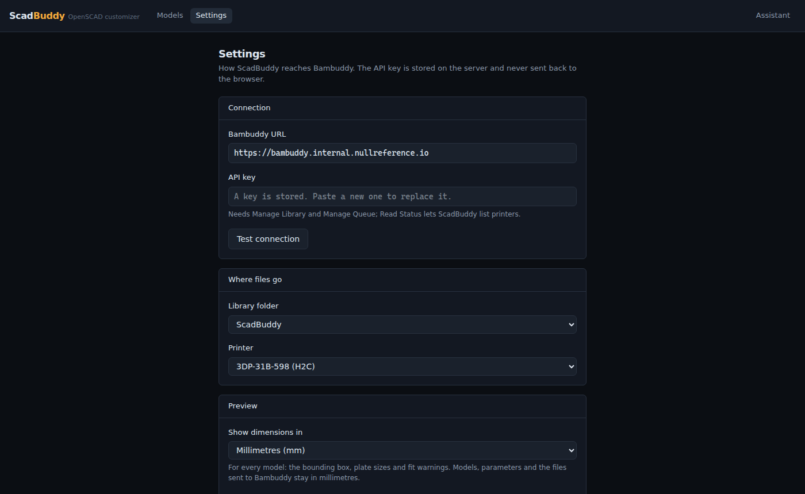
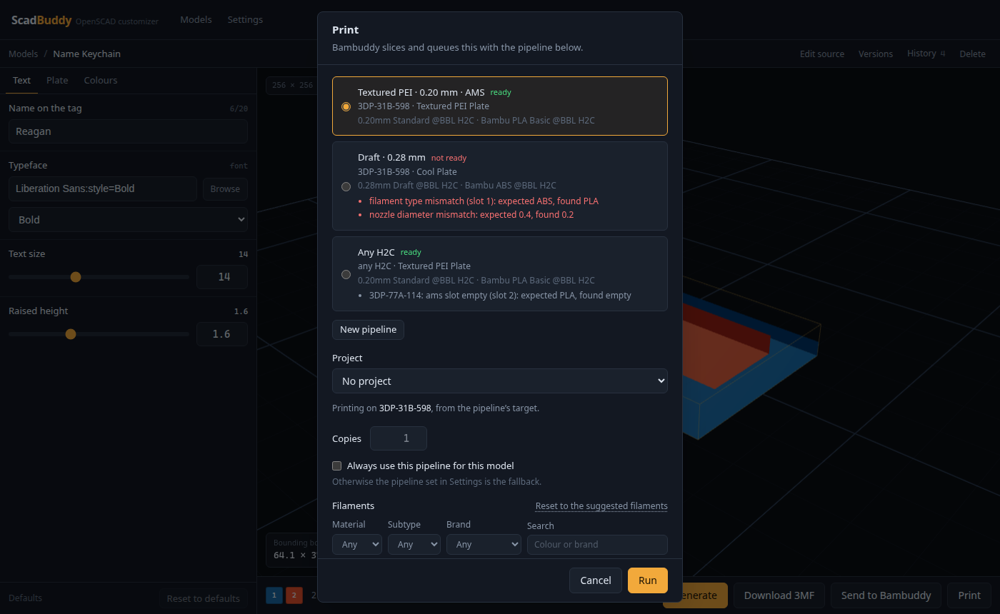
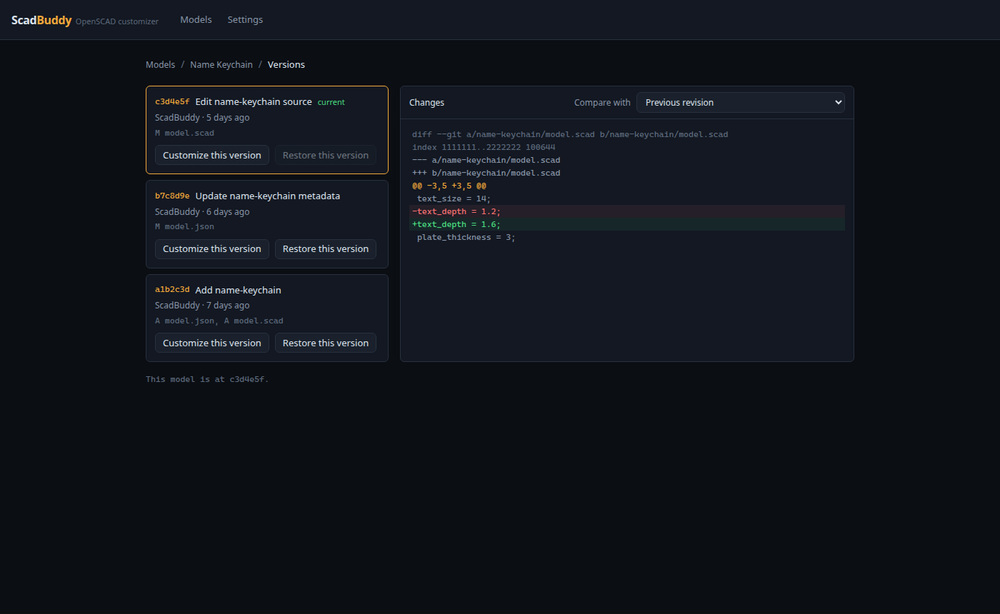

# ScadBuddy user guide

Covers writing models for ScadBuddy, the multi-colour rules, connecting it to
Bambuddy, the day-to-day features, and the AI assistant. For installing it, see the
[README](../README.md).

- [Writing a model](#writing-a-model)
- [Multi-colour output](#multi-colour-output)
- [Connecting Bambuddy](#connecting-bambuddy)
- [Using ScadBuddy](#using-scadbuddy)
- [Assistant](#assistant)

## Writing a model

ScadBuddy reads a `.scad` file the same way the
[MakerWorld Parametric Model Maker](https://makerworld.com/makerlab/parametricModelMaker)
does. A model written for MakerWorld works here without changes. The parameters
come from OpenSCAD's own customizer export (`openscad -o model.param`), so the
standard [OpenSCAD customizer](https://en.wikibooks.org/wiki/OpenSCAD_User_Manual/Customizer)
syntax applies. ScadBuddy adds the two MakerWorld annotations on top.

```scad
/* [Text] */                       // a group: one tab in the parameter panel

// Word to put on the keychain     // the comment line above a variable is its caption
name = "Reagan"; // 20             // string limited to 20 characters

// Typeface
font = "Lobster Two:style=Bold"; // font

/* [Size] */

// Letter height in mm
text_size = 20; // [8:0.5:40]      // min:step:max -> slider

style = "round"; // [round, square] // options -> dropdown

hole = true;                       // boolean -> toggle

/* [Colours] */

// Base colour (extruder 1)
base_color = "#0047BB"; // color

// Letter colour (extruder 2)
text_color = "#FF1493"; // color

/* [Hidden] */                     // never shown

$fn = 64;
```

| You write | Widget |
|---|---|
| `x = 5; // [1:0.5:10]` (min and max) | slider plus number field, with that min/max/step |
| `x = 5;` | number field (whole-number field when the value is whole) |
| `x = "a"; // [a, b, c]` or `// [1:One, 2:Two]` | dropdown; the label is shown and the value is passed to OpenSCAD |
| `x = "text"; // 20` | text field with a maximum length |
| `x = true;` | toggle |
| `x = "#RRGGBB"; // color` | colour picker; the value reaches OpenSCAD as a `"#RRGGBB"` string |
| `x = "Family:style=Bold"; // font` | font field with the installed families, plus **Browse** for Google Fonts |
| `x = ""; // file:svg,png` | drop zone for an SVG or PNG, with a preview and **Clear** (see [File parameters](#file-parameters)) |

Groups:

- `/* [Name] */` starts a group. Each group is a tab, in the order the groups first
  appear.
- Parameters under `/* [Hidden] */` are left out.
- Parameters under `/* [Global] */` get no tab of their own.

The `// color` and `// font` annotations have to be on the same line as the
assignment, after the `;`. OpenSCAD itself sees both as plain strings.

### Fonts

`text()` can only use a font that the container's fontconfig can see. The image
ships DejaVu, Noto and Lobster Two. The **Browse** button on a font parameter
searches the Google Fonts catalogue. Picking a family that isn't installed
downloads it onto the data volume, along with its licence, and it can be used in
renders straight away. No API key is needed. `SCADBUDDY_GOOGLE_FONTS_API_KEY` only
changes where the catalogue list comes from. If ScadBuddy can't reach Google Fonts,
the picker falls back to the installed families.

The Debian package `fonts-lobster` provides a family called **"Lobster Two"**, and
there is no family called "Lobster". If you ask for a family that doesn't exist,
OpenSCAD silently uses a different font, and the text comes out a different size.

OpenSCAD also leaves out, without a word, any character the font has no glyph for,
such as an emoji. A render warns when a font parameter's family lacks a character
used in the model's text parameters, and the font field says the same while you
type. ScadBuddy cannot tell which text a font draws, so it checks every string
parameter: a string that never reaches `text()`, such as a label or a file name,
can raise the warning too.

### File parameters

A parameter annotated `// file` takes a picture the viewer attaches in the
customizer, without editing the model:

```scad
// Picture to overlay
overlay_file = ""; // file:svg,png

if (overlay_file != "")
  linear_extrude(0.6) resize([30, 30]) import(overlay_file);
```

- List the kinds after the colon: `// file:svg`, `// file:png` or both. A bare
  `// file` takes both. Use an SVG with `import()` and a PNG with `surface()`.
- The value is a bare file name in the model's directory, so `import()` and
  `surface()` resolve it as they would a file shipped beside the model. A default
  such as `"sample.svg"` keeps working; `""` means no file.
- Ship sample pictures next to `model.scad` and the customizer offers them as
  thumbnails under the drop zone, so a viewer can pick one instead of uploading
  their own. Every `.svg` or `.png` directly in the model's folder is offered to
  the parameters that take its kind, except `thumbnail.png`, hidden files
  (a leading `.`), and names with spaces or characters other than letters,
  digits, `_`, `-` and `.`.
- ScadBuddy checks the upload's content, not its name. It strips scripts and
  external references from an SVG, and scales a PNG down to 256 px on its long
  side, because `surface()` gets slow with large images. Other files are refused.
- The render records the file's SHA-256 with the output's parameters, so
  re-rendering an output uses the same picture.
- An uploaded file is kept while a saved output, a preset or a render uses it. One
  that nothing uses is removed after a week (the server's
  `SCADBUDDY_ASSET_SWEEP_GRACE`). The server also caps how many uploaded files it
  keeps and their total size; **Settings → Uploaded files** shows both.
- If OpenSCAD can't open the file, the model still renders without it, and the
  render shows a warning.
- OpenSCAD itself sees an ordinary string, so the model still works in the OpenSCAD
  GUI and on MakerWorld.

### Includes

A model can `include`/`use`/`import` files from its own directory. Upload and paste
both create single-file models. Multi-file models (a model with helper files) aren't
supported yet.

## Multi-colour output

ScadBuddy outputs a Bambu-style 3MF with **one object per colour**. Each object is
assigned to an extruder, so the slicer maps colours to filaments without any
painting.

- **Each distinct `color()` value becomes one part and one filament slot.** Two
  colour parameters set to the same value produce one part, not two.
- **Extruder order.** **Colour parameters are the extruder order**: the first
  colour parameter you declare is extruder 1, the next is extruder 2, and so on,
  whatever order the geometry draws them in. In the bundled name keychain
  `base_color` is extruder 1 and `text_color` is extruder 2. A part gets the
  extruder of the first colour parameter whose value is its colour, so:
  - two colour parameters with the same value share one extruder, and the numbers
    after them close up;
  - a colour parameter that no geometry uses gets no extruder, and the ones after
    it move up;
  - colours that aren't a parameter's value (a hard-coded `color("red")`, a colour
    computed from a parameter) come after all the parameters, in the order the
    model first draws them.

  Before you send, check the numbered colour swatches in the bottom bar. They show
  which colour went to which extruder.
- **Colour everything.** When any geometry is outside a `color()` call, ScadBuddy
  can't build closed per-colour solids. The job then falls back to open parts for
  every colour and warns `uncoloured geometry present; parts are not closed`.
- Colours can be hex strings, `[r, g, b]` vectors or CSS names (`color("red")`).
- One known limitation: a `color()` nested inside a different `color()` falls back
  to open parts for that colour. The geometry is still correct.

Each output also stores the parameters that made it, so any output can be
re-opened and rendered again.

## Connecting Bambuddy

Everything ScadBuddy sends to Bambuddy goes through Bambuddy's API. The key is
stored on ScadBuddy's server and is never sent to the browser.

1. In Bambuddy, create an API key with these scopes:

   | Scope | Used for |
   |---|---|
   | **Manage Library** | uploading 3MFs, library folders, slicing, presets, and the sidebar External Link |
   | **Manage Queue** | queueing prints from the print picker |
   | **Read Status** | listing printers, spools and AMS slots for the print picker and **Test connection** |
   | **Manage Projects** | only if you use the project picker |
   | **Manage Archives** | uploading and deleting print photos, and pulling a timelapse off the printer |
   | **Manage Inventory** | only to record which spool is in a tray, when the print dialog asks and you answer yes |

2. Open **Settings** in ScadBuddy. Under **Connection**, enter the **Bambuddy URL**
   and the **API key**, then press **Test connection**.
3. Also under **Connection**, enter **ScadBuddy's own URL** (the address Bambuddy
   should link to; ScadBuddy can't work it out from behind a proxy) and press the
   section's **Save**. Then press **Add to Bambuddy sidebar**. This creates an External
   Link called "ScadBuddy" with "open in new tab" turned off, so ScadBuddy opens inside
   Bambuddy in a sandboxed frame. Pressing it again updates the existing entry instead
   of adding a second one.
4. Under **Printing defaults**, choose the **Printer**. **Send to Bambuddy** lays its
   upload out for that printer's plate, and the print picker opens on it.
5. Under **Projects & files**, choose the **Inbox folder, for sends without a
   project**, where a 3MF sent without a project goes. **Default project** is where
   the print dialog's project picker opens for a library file, and the project a send
   without one is filed under. The Customize page does not use it: it opens on the
   project remembered for the model (see [Customizing](#customizing)).

Each section has its own **Save** and **Discard changes**: save every section you
changed before leaving the page.

If the Bambuddy URL is one only ScadBuddy's server can reach (an in-cluster address,
say), list the addresses browsers use under **Bambuddy web URLs**, comma-separated.
"Open in Bambuddy" links use the first, or, when ScadBuddy is open inside one of the
others, that one.

The same values can be set on first start with `SCADBUDDY_BAMBUDDY_URL`,
`SCADBUDDY_BAMBUDDY_WEB_URLS`, `SCADBUDDY_BAMBUDDY_API_KEY` and `SCADBUDDY_PUBLIC_URL`. Once settings have been
saved from the UI, the saved values take precedence.



## Using ScadBuddy

### Catalogue

The **Models** page lists every model. Use **Add model** to upload a `.scad` file,
or **Paste source** to paste source into an editor. OpenSCAD parse-checks the
source before it's saved, and errors are marked on their line.

**Add model** also takes an optional PNG thumbnail and a README. Dropping a whole
model folder (`model.scad`, `model.json`, `thumbnail.png`, `README.md`, the layout
of `models/<slug>/`) adds it with the same name, metadata, thumbnail and README the
bundled models get.

On a model's page, **Edit details** changes its name, description, tags, thumbnail
and README. Each change is a revision in the model's history. A model with no
thumbnail of its own shows the plate image of its first generated output.

### Customizing

Changing a parameter starts a real render. The preview *is* the render (debounced),
so it shows exactly what the 3MF will contain, with the bounding box in mm. Then:

- **Generate** saves the current render as an output, with its parameters and a
  thumbnail. When the bottom bar's **Project** picker has a project selected,
  Generate also uploads the 3MF into that project's folder in Bambuddy. Deleting the
  output later never deletes that copy: it is the project's record. Choose **No
  project** to only save the output.

  **Which project the picker opens on.** Each time Generate files an output, ScadBuddy
  remembers that project for the model and the preset in use (or the model alone, with
  no preset loaded). Opening the model or loading a preset moves the picker to the
  project remembered for that preset, else to the one remembered for the model with no
  preset. With neither, it opens on **No project**: a project chosen on another model
  is never carried over, so an unrelated model is not filed into it by accident.

  **Generate asks before filing elsewhere.** When the picker is on a project other
  than the one this model and preset were last filed in, Generate asks first: "*Fish*
  was last filed in **Critters › Fish**. File this in **Critters › Snake**?" **File
  in** files it there and makes that the remembered project; **Use** files it in the
  remembered one and moves the picker there; **Cancel** saves nothing. Nothing is asked
  when nothing is remembered for the preset yet, when they match, or with **No
  project**. The picker is locked while Generate files and while the question is open.

  These are only defaults for the next filing. Which outputs and prints a project holds
  is on the project's own page in Bambuddy; ScadBuddy keeps no second list of it. Each
  remembered project is listed in **Settings → Remembered choices** as "Project" with
  its own **Forget**, and **Forget all** clears them. Deleting a model or a saved preset
  forgets its entries too.
- **Download 3MF** downloads that output. When the template declares default slicer
  settings (`print_settings` in its `model.json`, such as the name keychain's prime
  tower), the file carries them, and Bambu Studio shows them as changes to the system
  process. **Print** slices with them too.
- **Send to Bambuddy** uploads the output to the library, laid out for the printer set
  in Settings, or on the default plate without one. It doesn't slice or queue; use **Print** for that. If ScadBuddy's own URL
  is set, the library file gets an "Edit in ScadBuddy" link that opens these parameters
  again.
- **Print** opens the print picker.

The button at the top right of the preview shows it full screen, with the plate and
bounding box still on it; **Esc** or the button again puts it back. In full screen,
**Parameters** opens the parameters in a flyout over the view, so you can change them
and watch the render; the buttons along the bottom wait until you leave full screen.
Where the browser refuses full screen, as it does inside a frame that isn't allowed
it, the view fills the frame instead.

### Print picker



The print picker is spool-first: you choose the spools, the nozzle size, a quality
tier and a plate, and ScadBuddy derives every Bambu printer, process and filament
preset itself, then slices and queues through Bambuddy. There is no slicer pipeline to
pick or maintain. Pipelines still exist in Bambuddy, but ScadBuddy doesn't use them, and
**Print** is the only way it prints.

Top to bottom, the dialog is:

- **Advanced switch.** Off (Simple) by default. Advanced adds the full process list, a
  High Flow choice per side, and a filament preset override per slot. Switching back to
  Simple resets those to Standard flow, the tier's process and each spool's own preset,
  so nothing chosen in Advanced is sent unseen.
- **Printer** — shown only when more than one printer is active (today there is one).
  Otherwise ScadBuddy has already picked one: this model's remembered printer, else the
  printer set in Settings, else the first active printer — skipping a remembered or
  Settings printer that is no longer active. Presets are only resolved for the H2C, so
  printing on any other model is refused before anything is sliced.
- **Filament** — a spool-inventory picker. Loaded spools are
  marked with printer and AMS slot and listed first; an unloaded spool is still allowed,
  with a warning to load it first. Advanced adds a preset dropdown per slot, listing the
  presets Bambuddy has for the chosen nozzle size — "The spool's own preset" is always
  the first option. The slicer picks each color's extruder, and
  ScadBuddy can't steer it. So when only one nozzle is the chosen size, a multi-color
  print is refused before upload (the slicer would put a color on the other nozzle and
  the printer would pause at the first layer), and a one-color print warns you. With the
  Filament Track Switch fitted, any spool can reach either nozzle, and a loaded spool's
  badge only says where it rests ("rests on L"). Without the switch,
  each AMS feeds one side: a spool on a side whose nozzle is another size is grayed out
  with the reason (for example "L · 0.4 fitted"), and the dialog never opens on one.
  If neither nozzle is the chosen size, the print is refused before upload. A spare
  hotend of the chosen size in the H2C's rack counts for one side, since the printer
  swaps it on for the print.
- **Nozzle size** — one choice for both sides; Bambuddy can't slice mixed sizes, so
  there is no per-side size control. Sizes installed in the rack are marked
  "(installed)". A size neither mounted nozzle has, and the rack holds no spare of, is
  refused before upload (on a single-nozzle printer, a size its nozzle isn't); if the
  printer doesn't report what's mounted, picking one the rack lacks warns you to install
  it first. Advanced adds
  Standard or High Flow per side. Bambuddy has no High Flow presets yet, so a High Flow
  choice slices as Standard and the dialog says so: "Bambuddy slices this as Standard
  flow; High Flow presets aren't supported by Bambuddy yet."
- **Quality** — Fine / Standard / Draft in Simple mode. Advanced replaces that with the
  full list of Bambu processes for the chosen nozzle size.
- **Plate** — every plate type the H2C supports, preselected from the printer's last
  print, else the plate last remembered for this printer, else Textured PEI Plate.
  Choosing anything other than the last print's plate shows a reminder: "The
  *printer*'s last print used *plate*. Swap to *plate* before this starts." For an
  output with more than one plate, a separate choice of which plate (or all of them)
  to print also appears here. Choosing all plates lists every plate's colors under
  Filament, so a color only a later plate uses gets a spool too.
- **Print options** — Bambuddy's own queue-item options (manual start, waiting for
  filament, and the rest), remembered per print, per printer or per model as before.
- **Project** — file the print under a Bambuddy project. Opened from the Customize page
  it is the page's own picker. In Simple mode the step is hidden, but a "Filed under:
  *project* (change)" line names where the print goes; **change** switches to Advanced
  and puts the focus on the project picker.
- **Copies** — leave the field blank to use the remembered quantity, shown beside it.
- **Print** — slices, then queues through Bambuddy; the panel then follows the run to
  completion.

**Errors that keep the dialog open.** A combination ScadBuddy cannot turn into presets —
a filament slot with no resolvable preset, mixed nozzle sizes, no nozzle of the chosen
size, a multi-color print when only one nozzle is that size, or a spool wired to the
side whose nozzle doesn't match — comes back as an
error shown above Print and disables the button until something changes. Any other
failure (Bambuddy unreachable, a timeout) shows the same way but leaves Print enabled to
retry as it stands.

**What's remembered.** The chosen printer, the spools (only the slots moved off the
suggestion), the nozzle choice, the quality tier and process name are remembered per
model, the same way print options and copies already are. The plate type is remembered
per **printer**, not per model. Reopening the dialog restores all of it, and opens
straight into Advanced mode if the remembered choice is a named process or a High Flow
flow — either would otherwise apply unseen from Simple mode.

### Library

The **Library** page lists everything already in Bambuddy's library, by folder. By
default it shows only unsliced `.3mf` files. The **Advanced** switch, remembered per
browser, also lists STLs (printable, as one plate) and sliced `.gcode.3mf` files.

**Print** on a sliced file (#2671) queues the file itself, with no slice: the dialog
offers the plates it holds G-code for, the spools for its slots, the printer and the
print options (a held manual start among them), and shows what it was sliced for —
printer, nozzle, process and plate type — read-only, with Bambu Studio's own time and
filament estimate. A sliced file is never refused: a printer of another model, a nozzle
diameter the printer has nowhere ("Sliced for a 0.6 mm nozzle; 0.4 mm is mounted"), or a
plate the file does not hold (its first plate is queued instead) is a warning in Checks,
so you can set it right before starting the print. A sliced file cannot be arranged.
Printing a ScadBuddy copy again with the same presets queues the slice ScadBuddy already
made of it, while Bambuddy still has that file, instead of slicing it again.

**Print** on a file opens the same print picker an output uses, and the print goes
exactly as an output's does (#1752): a copy of the file is laid out for the nozzle side
and flow chosen, recolored for the spools (#476), and uploaded into the project's
folder when one is chosen (#79). The file itself is never changed. A 3MF ScadBuddy
rendered (and an STL, which is wrapped in one) is also replated for the printer
(#105); a project its author laid out in Bambu Studio keeps every plate and every
placement, and only its settings state the choices. A file nothing can be stated into
(a 3MF from another slicer) is sliced as it is, taken as Standard flow.

A folder linked to a Bambuddy project is marked "project" in the folder tree, and is
that project's file list (#2724): **Select all in folder** ticks every listed printable
file (sliced ones too, under **Advanced**) for **Print N files**. Browsing by project
(`/library?project=<id>`) opens a project's folder directly.

**Print N files** (#2672) prints every ticked printable file, sliced or not, in one
stepped dialog. Each step is the print dialog for one file, titled "File 2 of 5 — name",
with **Back**, **Skip** and **Next**, and a strip above it to jump to any file (a jump
keeps the step's choices, as Next does). The next
file opens on the last one's printer, and on its spools, nozzles, quality and options
when its slots (number, material and colour) are the same; otherwise it opens on its own.
A file whose check finds something its print would refuse is flagged (⚠) in the strip,
not held. One with only warnings, which is all a sliced file's mismatches ever are, is
marked (!) and queues. The last step is the review: each file's printer, plate, spools, time and filament,
with **Edit** (back to its step) and **Remove**. **Queue all** starts each file's own
print, exactly as Print on it would, and reports each: one refused does not stop the
rest, and a skipped file is not queued. An unsliced file's slice starts in the background
while its step is open, as in the single dialog, and its print queues that slice. The
batch and the step in view are kept by ScadBuddy (the page's `?batch=` link), so a reload
resumes it; **Cancel** forgets it. A batch with a file still being checked is kept on
Cancel, so its **Queue all** follows that file's print rather than starting it twice; the
Library page offers it again with **Resume it**.

Choices are remembered per library file, the way an output's are remembered per
model. There's no ScadBuddy progress panel or History entry for a library print —
Bambuddy's queue and archives are the record — so once it's queued, the dialog
links to Bambuddy's queue instead. The queue item is tagged with the last-used
project, the same as an output's.

### History and versions

- **History** lists every output generated for a model, with the parameters that
  differ from the defaults and any Bambuddy library and queue ids. Each output has
  **Edit** (reopen it in the customizer), **Send again** and **Delete**.
- **Versions** shows the model's revision history. Every upload, source edit,
  metadata change, restore and delete is a commit in a git repository on the data
  volume. You can diff two revisions, **Customize this version** (render an old
  revision without restoring it), or **Restore this version** (restoring adds a new
  commit and never rewrites history).
- **Edit source** opens the model's source in the editor. Saving it creates a
  new revision. The row above the editor lists the model's `.scad` files:
  `model.scad`, which every render opens, and any files beside it that it can
  `include` or `use`. Open one to edit it on its own page, where **Save file**
  and **Delete file** are each a revision too. **New file** adds one (`.scad` is
  added to the name if you leave it off). If the model changed elsewhere since
  you opened a file, saving it is refused and you can reload the file or keep
  editing and save over it.



### Deleting a model

**Delete** (top right of the customizer) removes the model and its outputs, after
you confirm. It is refused while one of its renders is still running. The source
stays in the git history. A built-in template (a bundled example, such as the
name keychain) cannot be deleted or edited; it is refreshed from the image on every
restart.

## Assistant

ScadBuddy has an AI assistant, Claude, that can customize, author and print models the
way you would, and that other Claude clients can reach over MCP. It runs in the agent
sidecar. The operator's side (deploying it, the key-encryption key, routing) is in
[Operating the agent sidecar](ai/operating.md), and what it may and may not do is in
[AI security](ai/security.md). Everything below is in **Settings → Assistant** or the
assistant panel.

### Adding the Claude credential

The assistant panel, MCP access **Tokens** and plugins show only once a credential is saved
([operating.md §4](ai/operating.md#4-setting-up-the-claude-credential),
[AI README](ai/README.md#what-the-ai-integration-is-today)).

1. Open **Settings → Assistant → Claude credentials**.
2. Choose the kind: **Anthropic API** (an `sk-ant-api03-…` key), **Claude Code OAuth
   token** (run `claude setup-token` on a machine signed in to your Claude subscription
   and paste the `sk-ant-oat01-…` token it prints), or **Gateway (base URL and token)**.
3. Press **Save**. **Test** sends one short prompt and shows "Works (…)" or the failure.

You can **Add** more than one. They are tried in the order listed (**Up** and **Down**
move them), and one that is rate limited is skipped until its limit resets. The key is
encrypted on the server and never sent back to the browser.

The same section sets **Assistant chat limits** (each new chat's budget in USD and its
turns per reply) and **Assistant images**. The assistant's HTTP request tool is the
**Make an HTTP request** row (`http_request`) of **Settings → Tools & plugins → Built-in**,
on its **HTTP requests** card: **By call (default)** runs GET and HEAD at once and waits
for your approval on anything else, and **Enabled** turns the tool off or on (see
[Tool access](#tool-access)). **AI activity** is the log of what the assistant did, under **Settings → Audits**.

### The assistant panel

Once the credential works, an **Assistant** button appears at the top right. It and
**Ctrl+`** (Ctrl on macOS too) open the panel; **Esc** closes it. The assistant sees
the page you are on, so "make the text bigger" on a model's page means that model.

- Type and press **Enter** (Shift+Enter for a new line). **Image** attaches up to four
  PNG, JPEG, GIF or WebP pictures; pasting or dropping them works too.
- Type **/** at the start of a message to list the skills the assistant loads
  (ScadBuddy's own `/scadbuddy:authoring`, `customize` and `print`, and those of enabled
  plugin packages). Keep typing to filter; **Up**/**Down** move, **Enter** or **Tab**
  puts the skill in the message, **Esc** closes the list. Nothing is sent until you send it.
- The microphone is **Voice input** (press to talk and again to stop, or hold it), and
  **Read replies aloud** speaks the answers. Inside Bambuddy's frame, voice needs
  ScadBuddy open in a tab of its own.
- **Stop** ends the running reply. Runs of tool calls fold into "N steps", with
  **Details** to see each one.
- Each chat has a budget. When it is spent the chat says so and offers **Continue in a
  new chat**, **Raise this chat's budget** or **Start a new chat**.

### Sessions, forks and the switcher

Every chat is a session kept on the server: close the panel or the browser and it is
still there
([agent-sessions.md §4.2](ai/agent-sessions.md#42-forks-and-the-session-switcher-in-the-panel-792)).

- **New chat** starts one. **Sessions (N)** lists them all, with who owns each ("you",
  or the MCP client's token name), where it came from (chat, MCP, analyzer, plugin
  hook), its status (Working, Waiting for input, Waiting for approval, Idle, Done,
  Failed, Out of budget), its spend and when it last changed. Forks are listed under
  their parent.
- On a model's page, **Only sessions that changed {model}** narrows the list to those,
  and the toolbar's **Changed by assistant (N)** opens one. **Touched** in a session's
  bar lists everything that session created, changed or deleted, each linked to its
  page ([agent-sessions.md §4.1](ai/agent-sessions.md#41-what-a-session-touched-931)).
- **Rename** and **Done** are on your own chats. Done ends a chat: it takes no more
  messages. Nothing is deleted.
- **Fork** copies the whole chat into a new one and continues there; the original stays
  as it was. **Fork from here** on a reply forks up to that reply; on one of your
  messages it forks up to the reply before it and puts your message back in the box to
  edit. A fork's bar says **Forked from …**, which opens the parent. Each fork you make
  gets a budget of its own.
- A session another agent started over MCP shows **Controlled by …**. Press **Take
  over** to send it messages yourself
  ([agent-sessions.md §2](ai/agent-sessions.md#2-who-sees-and-controls-what)).

### What needs your approval

Every tool has a tier ([security.md](ai/security.md#risk-tiers-and-the-permission-seam)):
**Reads only**, **Changes a model** (undoable through its
[history](#history-and-versions)), or **Leaves ScadBuddy** (send, print, delete, and
any settings or credential change). The first two run at once. Anything that leaves
ScadBuddy, any plugin tool not marked otherwise, and every mutating HTTP request stops
and shows **Needs your approval** in the chat, with **Approve** and **Deny**. If nobody
decides in time, it is not run. There is no "always allow".

The assistant can also stop to ask you something ("A question for you", answered with
**Send answer**), or call for your attention ("The assistant needs you: …"). The
attention card says what happens if you don't reply in time: it carries on with work
that needs no approval, it stops, or it waits. A timeout never approves anything. When
it finishes a piece of work it may leave "The assistant is done", with what ScadBuddy
recorded that turn doing; **Dismiss** clears it.

All of these count on the **Assistant** button's badge (its tooltip breaks the count
down), and the browser tab's title starts with the count, so you can leave the panel
closed and still see that something is waiting for you. While any of your chats (or a
Claude client's session) is working on a turn, a pulsing dot shows on the button too, so
it says at a glance whether the assistant is idle, working, or waiting for you. It is
read every 15 seconds and whenever you open or close the panel.

Some buttons only you can press, whatever the assistant is allowed: Print, Send,
Delete, Settings' **Save**, the approval and question cards, Fork, Take over, and every
Assistant setting. Asked to press one, the assistant is told to ask you instead
([browser-bridge.md](ai/browser-bridge.md#data-agent-user-only)).

### Connecting Claude Code or Claude Desktop

Other Claude clients reach ScadBuddy's tools at `https://<your ScadBuddy>/mcp` (plain
HTTP is refused, except on loopback). They sign in with a token from **Settings → MCP access →
Tokens** ([operating.md §4.1](ai/operating.md#41-mcp-access-tokens)),
or through your identity provider when the operator has turned on **MCP sign-in
(OIDC)** ([operating.md §6a](ai/operating.md#6a-mcp-sign-in-with-oidc)).

1. Under **Settings → MCP access → Tokens**, give the token a name ("Claude Desktop on my laptop"),
   an **Access** level (Read, Write or Outward) and an expiry, and press **Create
   token**. Copy it then: it is shown once. **Revoke** ends it. Outward actions still
   wait for a human's approval in ScadBuddy, whatever the token allows.
2. **Claude Code**, with ScadBuddy's plugin, which brings its skills and subagents as
   well as the server ([claude-plugin.md](ai/claude-plugin.md)):

   ```text
   /plugin marketplace add eh-homelab/ScadBuddy
   /plugin install scadbuddy@scadbuddy
   ```

   It asks for `scadbuddy_url` (your ScadBuddy's HTTPS address, no trailing slash) and
   `scadbuddy_token` (the token). To add the server alone, without the plugin
   ([Claude Code MCP docs](https://code.claude.com/docs/en/mcp)):

   ```bash
   claude mcp add --transport http scadbuddy https://scadbuddy.example/mcp \
     --header "Authorization: Bearer sbmcp_…"
   ```

3. **Claude Desktop.** Its custom connectors take only a URL and sign in with OAuth
   ([Anthropic help](https://support.claude.com/en/articles/11175166-getting-started-with-custom-connectors-using-remote-mcp)),
   so they work only with **OIDC sign-in** on: add `https://scadbuddy.example/mcp`
   as a custom connector. With a token instead, add the server to
   `claude_desktop_config.json`
   ([connecting local servers](https://modelcontextprotocol.io/docs/develop/connect-local-servers))
   through [`mcp-remote`](https://github.com/geelen/mcp-remote), which sends the header:

   ```json
   {
     "mcpServers": {
       "scadbuddy": {
         "command": "npx",
         "args": ["mcp-remote", "https://scadbuddy.example/mcp",
                  "--header", "Authorization: Bearer ${SCADBUDDY_TOKEN}"],
         "env": { "SCADBUDDY_TOKEN": "sbmcp_…" }
       }
     }
   }
   ```

   Neither Desktop route has been tried against a ScadBuddy yet (**unverified**).

A session an MCP client starts shows in **Sessions** like any other, and you can take
it over ([agent-sessions.md](ai/agent-sessions.md)).

### Pairing a browser tab

The panel's own chats always drive the tab you chat from. An MCP client that wants to
use your tab has to ask, and every open ScadBuddy tab then shows **Agent pairing**:
"*name* asks to use this tab". Once paired it could see the page and change it as you
can, but never press Print, Send, Delete or Save. Type the code the client gave you
into **Pairing code** in the tab it should use, and press **Allow** (or **Deny**). The
code works once, for 5 minutes. The pairing lasts until you press **Disconnect**, 8
hours pass, or the tab reloads
([browser-bridge.md](ai/browser-bridge.md#pairing-spec-85)).

### The assistant's workspace

The assistant has a workspace of its own for files: a session's files stay with it
(and are deleted with it), and a fork starts with a copy. It can save a ScadBuddy file
there (an output's 3MF, a model's file or picture, a print's photo or timelapse, a
Bambuddy library file), download one from the web into it, and read, write, edit and
delete its files, so a file it fetched does not have to pass through the conversation.
It sends a workspace file on by
name to any upload (an asset, a picture or video for the gallery, a thumbnail, a
model's source, a README), and an approval it asks for names the file and its sha256.
A file holds at most 25 MB and a session's workspace 200 MB. An MCP client working
outside any session gets a workspace of its own whose files are deleted a day after
they were last written ([operating.md §13](ai/operating.md#13-the-workspace-2329)).

**Files** in a session's bar shows that session's workspace: each file's path, size,
type, where it came from (uploaded by you, a web address, or the tool that saved it)
and when it last changed.

- **Download** saves a file; it works inside Bambuddy's frame too, through the same
  popup as the 3MF download. A PNG, JPEG, GIF or WebP also has **Preview**, shown in the
  panel. HTML and SVG files only ever download.
- **Upload**, or a file dropped on the list, puts a file in the workspace under
  `uploads/` (a name already there gets `-2`, `-3`, …) and adds
  `[workspace file uploads/<name>]` to your message, so the assistant knows to look.
  The assistant reads it with its workspace tools; no file passes through the chat.
- **Delete** asks once more, then removes the file for the assistant too.

Uploads and deletes are for your own chats that are not archived; anyone's chat can be
listed and downloaded. Settings → **Assistant workspace** sets the caps (25 MiB a file
and 200 MiB a chat by default), and they apply to uploads as to the assistant's own
files ([operating.md §13](ai/operating.md#13-the-workspace-2329)).

### A browser for the assistant

A session with no tab of yours (one started over MCP, say) can drive a browser of its
own when an admin adds Microsoft's Playwright MCP server as a plugin named
`playwright` (**Plugins** below). Its tools ask before every call until their tiers
are set ([headless-browser.md](ai/headless-browser.md)).

### Tool access

**Settings → Tools & plugins** lists every tool the assistant can use, by where it
comes from. **Built-in** has a card per source: **ScadBuddy tools**, **Your browser
tab** (with the sites the assistant's own browser may visit) and **HTTP requests**, then
**This browser's agent (WebMCP)**. **Remote MCP plugins** has a card per plugin endpoint.
A card opens from its title; folded, it shows how many tools it has and how many you
changed. A card with more than eight tools has a **Filter**.

- Each tool's row shows its name, what it does, and its name as the assistant sees it,
  with one **Access** select: **off**, **read**, **write** or **outward (asks first)**.
  The one marked **(default)** is what ScadBuddy (or, for a plugin, outward) gives it.
  A choice applies at once ("Saving…" while it is sent), from the assistant's next
  call, in classic and durable chats, flows and MCP clients alike.
- A choice below the default asks once, in one line (**Lower to …**, or **Cancel** or
  Esc to keep it). **Reset** returns a changed tool to its default.
- **Details** shows the tool's parameters and, for a plugin's tool, its annotations as
  the server's claims, which ScadBuddy does not check. **View JSON** shows the entry as
  it was listed, and **Copy** copies it.
- The printer camera is the **See a printer's camera** row (`get_printer_camera`): **off** keeps
  camera frames from the assistant and from MCP clients.
- The assistant may change these settings too, by working this page while you have it
  open. The WebMCP switch is yours only, as it lets an outside agent in.

### Plugins

**Settings → Tools & plugins → Packages** adds to what the assistant can do
([operating.md §9](ai/operating.md#9-plugin-packages-297),
[security.md](ai/security.md#plugin-packages)). ScadBuddy's own plugin is built in, with
**Enable**/**Disable**.

- **Plugin packages** (skills, agents and hooks). Give a **Git repository** or a
  **Marketplace entry** and press **Fetch and review**. Nothing loads yet: the package
  is pinned to the exact commit and content hash it fetched, and you tick that you
  reviewed them and press **Approve this pin**, then **Enable**. Anything that would
  start a process or run code inside the assistant is refused by the vetting rules and
  listed; the only way past is to approve loading the package as it is, which runs its
  code with the assistant service's own access. A newer commit is **Fetch re-pin**,
  approved the same way.
- **Remote MCP plugins**. Give a **Name**, the **MCP endpoint URL** and, if it needs
  one, an auth header, and press **Add endpoint**. It starts disabled: **Test
  connection** lists its tools as rows (see [Tool access](#tool-access)), each
  **outward (asks first)** by default. A tool whose name Claude Code changes (one with a
  `.`, say) can only be off or outward, and two tools that end up with one name are
  both off. Set each tool's access, then turn the card's **Enabled** switch on. Claude
  never sees the endpoint's address or secret.
- **Hindsight memory**. With a plugin named `hindsight` enabled, the assistant recalls
  memories against each message you send. **Recall query limit (characters)** is how
  much of the message it sends as the query: the first 800 characters by default, as
  the Claude Code Hindsight plugin does (`recallMaxQueryChars`), or all of it at 0. The
  bank has its own limit in tokens (`HINDSIGHT_API_RECALL_MAX_QUERY_TOKENS` on the
  Hindsight server, 500 by default); a query it still finds too long is retried once,
  shorter. A change applies from your next message, in classic and durable chats.
